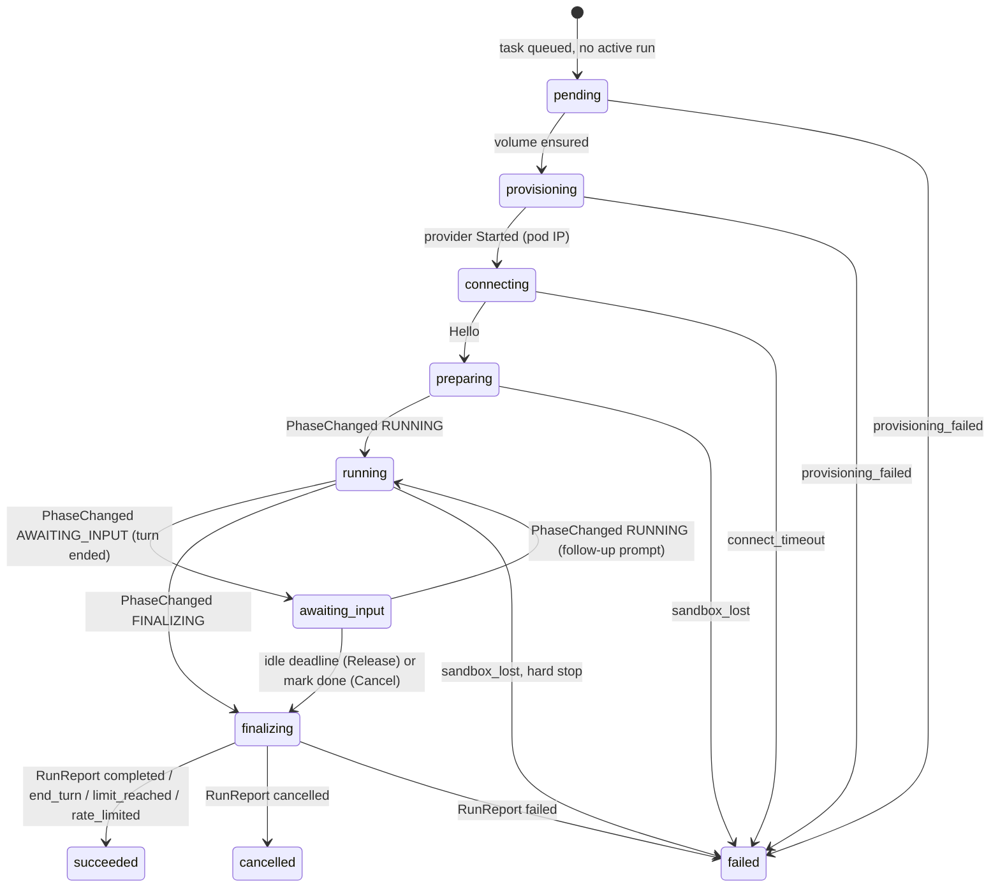

# df-agent-channel configuration and behavior reference

`dark-factory serve` starts the agent port and the run scheduler. Settings come from the instance
configuration file (`--config`, default `/etc/dark-factory/config.yaml`).

## Configuration

| Key | Required | Default | Effect |
|-----|----------|---------|--------|
| `server.agentPort` | no | `9443` | Port of the mTLS agent service, separate from `server.httpPort`. |
| `agent.tls.certFile` | yes | none | PEM server certificate (chain) of the agent port. `serve` refuses to start without `agent.tls`. The three files are checked for changes at most every 10 s; changed (rotated) material applies to new connections without a restart, material that does not parse is ignored with a warning. |
| `agent.tls.keyFile` | yes | none | PEM private key of `certFile`. |
| `agent.tls.clientCaFile` | yes | none | PEM CA bundle. Client certificates must chain to it. |
| `agent.commitIdentity.name` / `.email` | no | `Dark Factory` / `dark-factory@localhost` | Commit identity in `Assign.workspace.commit_identity`. |
| `agent.gitUsername` | no | `dark-factory` | User name sent with the project's forge token in a Git credential grant. |
| `harness.claudeCode.image` | no | `ghcr.io/prskr/dark-factory/claude-harness:0.95.0` | Harness image, mounted read-only at `/opt/harness/claude-code` in the sandbox of every run whose project has no adapter command. The tag is the adapter version. The chart renders it from `image.harness.claudeCode.*`. |
| `harness.claudeCode.adapterCommand` | no | `["/opt/harness/claude-code/bin/claude-agent-acp"]` | ACP adapter command from the harness image; a project's own adapter command replaces it (and the harness image mount). Personas have no adapter command. |
| `harness.claudeCode.env` | no | `{}` | Non-secret environment for the harness (`Assign.harness.acp.env`). |
| `harness.claudeCode.settingsJson` | no | `""` | Claude Code `settings.json` content, written by the runtime before every start. |
| `runs.maxWallClockSeconds` | no | `7200` | `Assign.budgets.max_wall_clock`. Counts from the runtime's first `Hello`, not from run creation. A value too large to represent as a date means no limit. |
| `runs.connectTimeoutSeconds` | no | `600` | Time from run creation until the runtime opens its stream; then the run fails with `connect_timeout`. |
| `runs.cancelGraceSeconds` | no | `300` | Grace after the wall-clock budget. |
| `runs.keepAliveSeconds` | no | `600` | How long a run waits for a follow-up after a normal turn end (`awaiting_input`) before the control plane sends `Release` and the run ends `end_turn`. `0` releases right after the turn. Idle time counts toward `maxWallClockSeconds`. |

The Helm chart sets `agent.tls` to the cert-manager secret mounted at `/etc/dark-factory/tls`.

The three files are checked for changes by the first connection that arrives at least 10 s after
the last check; changed material applies to new connections without a restart, and material that
does not parse is ignored (logged) until fixed. At most 256 TLS handshakes run at the same time.

## Run lifecycle

A `RunReport` is accepted in any non-terminal state. `Cancel` is sent by the replica holding the
stream at connect + `maxWallClock` + `cancelGrace` (and at the handshake if that moment has passed).
The scheduler tears the sandbox down at connect + `maxWallClock` + 2 x `cancelGrace`. Prompts and
`Cancel` are not sent once the run has ended; the prompt stays queued for the next run.

| Run outcome | Run state | Task status |
|-------------|-----------|-------------|
| `completed` | `succeeded` | `in_review` |
| `end_turn` | `succeeded` | `waiting` |
| `limit_reached` | `succeeded` | `limit_reached` |
| `rate_limited` | `succeeded` | `rate_limited` |
| `cancelled` | `cancelled` | `waiting` |
| `blocked` | `blocked` | `waiting` |
| `failed`, `provisioning_failed`, `connect_timeout`, `sandbox_lost` | `failed` | `failed` |

If prompts are still undelivered when a run ends with an outcome other than `failed`-class or
`rate_limited`, the task becomes `queued` and the next run starts with them. A task a board member
marked done (`completed`) keeps its status when its run ends, unless prompts are undelivered.

### Idle run (keep-alive)

After a normal turn end the runtime reports `AWAITING_INPUT`: the run becomes `awaiting_input`
and the task `waiting` (it stays `running` while a message is undelivered). The replica holding
the stream sends `Release` at the last persisted `TurnEnded` + `runs.keepAliveSeconds`; a replica
that takes over, or a run that reconnects after the deadline, computes the same deadline. Before it
sends `Release` (or `Cancel` for a task marked done) the control plane moves the run to
`finalizing`; no prompt is sent to a `finalizing` run, a message queued meanwhile makes the task
`queued` and the run end starts the next run. A message for an `awaiting_input` run sets the task
`running`, starts no run and is forwarded at once.

## Protocol behavior

- Identity: the client certificate must carry the URI SAN
  `spiffe://dark-factory/ns/<ns>/pod/<name>/<uid>`; `SandboxProvider::resolve_identity` maps SAN and
  peer IP to a run. Terminal runs are rejected with `UNAUTHENTICATED`.
- Handshake: `Hello` first (else `FAILED_PRECONDITION`), then `HelloAck`, `HarnessCredentials`,
  `Assign`, then the prompts: undelivered prompts that are already forwarded
  (`task_messages.forwarded_at` set) are sent again, held-back ones are claimed (marked forwarded)
  and sent only while no turn is open (no persisted `TurnStarted` without a later `TurnEnded`).
  After a persisted `TurnEnded` the held-back prompts are sent. See "Queued messages reach the
  runtime between turns" in [`contract/README.md`](../../../contract/README.md).
  `HarnessCredentials` precede `Assign` because the runtime ignores credentials that arrive later.
- Timeouts: `enforce_timeouts` ends every overdue run it can; a run that fails to end (or whose
  row cannot be read) is logged and does not stop the others.
- Ordering and delivery: messages are persisted in batches of up to 50 per transaction, duplicates
  (`seq` <= `runs.last_persisted_seq`, blobs included) are dropped, a gap closes the stream with
  `DATA_LOSS`, and the cumulative `ack` is sent after commit. Effects of the messages before a gap
  (teardown, pull request) still run. A message with an unknown body keeps its sequence number and is
  ignored.
- Tool calls and credential requests that arrive after the run ended (for example after a hard
  stop) are refused: an error result and `DeniedReason`, nothing is executed or granted.
- Pull request work after a `PushReport` or `RunReport` runs beside the stream (60 s limit each), so
  a slow forge delays neither acks, `Cancel` nor prompts. If marking the pull request ready fails,
  the completion summary is still posted.
- Shutdown (SIGTERM): the scheduler lets provisioning in flight finish (10 s); sessions stop reading,
  finish their in-flight tool calls and credential requests (up to 20 s, then they are aborted) and
  end their streams; the listeners get 30 s before they are aborted.
- A runtime failing before `Hello` is logged and answered with its gRPC status.
- Limits: 16 MiB per message (`RESOURCE_EXHAUSTED` above), HTTP/2 keepalive 30 s / 20 s, 10 s for
  the TLS handshake.
- Tool calls and credential requests run off the stream loop and are awaited (up to 60 s) when the
  stream ends. A tool call is claimed by `call_id` (`tool_calls` row) before it runs and executed at
  most once: a repeat gets the stored result, a call still running gets an error "in progress", and a
  claim without a result after 5 minutes is closed with an error and never executed. The forge is
  called without an open database transaction. Executed calls are audited as `tool_call.execute`.
- Git credentials are granted only when protocol, host and path equal the project's repository URL
  (a trailing `.git` is optional). Secret values are never logged or stored.

## Database changes

`20261019000001_task_completion_summary.sql` adds `tasks.completion_summary` (summary passed to
`complete_task`, posted on the pull request when the run completes) and `runs.connected_at` (first
`Hello`; start of the wall-clock budget).
