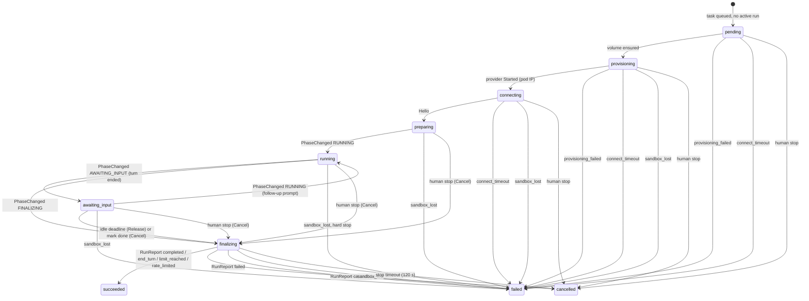

`dark-factory serve` starts the agent port and the run scheduler. Settings come from the instance
configuration file (`--config`, default `/etc/dark-factory/config.yaml`).

## Configuration

| Key | Required | Default | Effect |
|-----|----------|---------|--------|
| `server.agentPort` | no | `9443` | Port of the mTLS agent service, separate from `server.httpPort`. |
| `agent.tls.certFile` | yes | none | PEM server certificate (chain) of the agent port. `serve` refuses to start without `agent.tls`. The three files are checked for changes at most every 10 s; changed (rotated) material applies to new connections without a restart, material that does not parse is ignored with a warning. |
| `agent.tls.keyFile` | yes | none | PEM private key of `certFile`. |
| `agent.tls.clientCaFile` | yes | none | PEM CA bundle. Client certificates must chain to it. |
| `agent.commitIdentity.name` / `.email` | no | `Dark Factory` / `dark-factory@localhost` | Commit identity in `Assign.workspace.commit_identity`. |
| `agent.gitUsername` | no | `dark-factory` | User name the gateway's Git proxy sends with the project's forge token. |
| `harness.claudeCode.image` | no | `ghcr.io/prskr/dark-factory/claude-harness:0.95.0` | Harness image, mounted read-only at `/opt/harness/claude-code` in the sandbox of every run whose project has no adapter command. The tag is the adapter version. The chart renders it from `image.harness.claudeCode.*`. |
| `harness.claudeCode.adapterCommand` | no | `["/opt/harness/claude-code/bin/node", "/opt/harness/claude-code/node_modules/@agentclientprotocol/claude-agent-acp/dist/index.js"]` | ACP adapter command from the harness image; a project's own adapter command replaces it (and the harness image mount). Personas have no adapter command. |
| `harness.claudeCode.env` | no | `{}` | Non-secret environment for the harness (`Assign.harness.acp.env`). |
| `harness.claudeCode.settingsJson` | no | `""` | Claude Code `settings.json` content. A non-empty value is passed as the harness file `.claude/settings.json` (`Assign.harness.acp.files`), which the runtime writes before every start. |
| `harness.opencode.image` | no | `ghcr.io/prskr/dark-factory/opencode-harness:2.2.5` | Image of the `opencode` harness (patched OpenCode release binary and the musl runtime it needs), mounted read-only at `/opt/harness/opencode` in the sandbox of every `opencode` run whose project has no adapter command. The tag is the OpenCode version. The chart renders it from `image.harness.opencode.*`. A blank value counts as not configured: such a run fails provisioning with a message naming the harness. |
| `harness.opencode.adapterCommand` | no | `["/opt/harness/opencode/bin/opencode", "acp"]` | ACP adapter command from the harness image; a project's own adapter command replaces it (and the harness image mount). |
| `harness.opencode.env` | no | `{}` | Non-secret environment for the harness (`Assign.harness.acp.env`). The environment below wins over it. |
| `runs.maxWallClockSeconds` | no | `7200` | `Assign.budgets.max_wall_clock`. Counts from the runtime's first `Hello`, not from run creation. A value too large to represent as a date means no limit. |
| `runs.connectTimeoutSeconds` | no | `600` | Time from run creation until the runtime opens its stream; then the run fails with `connect_timeout`. |
| `runs.cancelGraceSeconds` | no | `300` | Grace after the wall-clock budget. |
| `runs.keepAliveSeconds` | no | `600` | How long a run waits for a follow-up after a normal turn end (`awaiting_input`) before the control plane sends `Release` and the run ends `end_turn`. `0` releases right after the turn. Idle time counts toward `maxWallClockSeconds`. |
| `volumes.retainAfterCloseSeconds` | no | `604800` (7 days) | The volume of a `completed` or `cancelled` task without an active run is deleted this long after its last run ended. The volume of a task whose pull request was merged is deleted at the next check, whatever this value. The check runs once per hour on the replica holding the instance Lease (not without a cluster). `0` deletes at the next check; a value too large to represent as a date means never. |
| `volumes.idleTtlSeconds` | no | `2592000` (30 days) | The volume of any task without an active run is deleted this long after its last run ended; same check and value rules as `retainAfterCloseSeconds`. The next run creates a fresh volume, clones again and restores the WIP snapshot. A board member can delete a volume at once with "Reset workspace" (`crates/df-web/README.md`). |
| `runs.maxConcurrent` | no | `4` | At least 1 (0 is rejected at startup). Runs that may be non-terminal at the same time, counted across all replicas. Further due tasks keep their status until a slot frees and then start oldest resume time first. |
| `runs.maxAutoResumes` | no | `3` | Consecutive automatic resumes after `sandbox_lost`, `connect_timeout` or `provisioning_failed` (backoff 2 min x (resumes + 1)); then the task becomes `failed`. A message or a run that ends with a `RunReport` resets the count; a capacity rejection does not count. |
| `artifacts.maxTextBytes` | no | `1048576` (1 MiB) | Largest text artifact (`write_artifact`). Between 1 and 8388608 (8 MiB, the most the runtime sends); anything else is rejected at startup. |
| `artifacts.maxImageBytes` | no | `3932160` (3.75 MiB) | Largest image artifact (PNG, JPEG, WebP, GIF), also limited to 8000 px per side (a constant). Same range as `maxTextBytes`. |
| `artifacts.maxPerTask` | no | `50` | Artifacts per task, at least 1. Replacing an artifact does not count; a write of a new name over the limit is rejected. |
| `web.showHiddenBlocks` | no | `false` | Show transcript content blocks marked `hidden` (instructions for the agent, e.g. the `set_task_title` request) in the task page and the queued message stack, muted and labeled "Instruction for the agent". Hidden blocks are always delivered to the harness. Read at startup; a change needs a restart. |
| `web.codeTheme.light` | no | `InspiredGitHub` | Theme of highlighted code blocks in agent messages in the light UI theme. One of `InspiredGitHub`, `Solarized (light)`, `Solarized (dark)`, `base16-ocean.light`, `base16-ocean.dark`, `base16-eighties.dark`, `base16-mocha.dark`. An unknown name fails startup with an error that names the option and lists the valid themes. Read at startup; a change needs a restart. |
| `web.codeTheme.dark` | no | `base16-ocean.dark` | Theme of highlighted code blocks in the dark UI theme; same names and rules as `web.codeTheme.light`. |
| `lifecycleEvents.signingKeyFile` | no | none | PEM file with the instance's Ed25519 private key (PKCS#8, as written by cert-manager or `openssl genpkey -algorithm ed25519`). Unset, lifecycle events are off: nothing is recorded or sent, and `GET /lifecycle-events/public-key` answers `404`. Set, `serve` refuses to start if the file cannot be read or holds no Ed25519 key; the public key is served at `GET /lifecycle-events/public-key` (`whpk_<base64>`, no login). Read at startup. |
| `lifecycleEvents.subscriptions[].url` | no | `[]` | Instance subscription: receives the events of every project. Must be an `http(s)` URL; any address is allowed, including cluster-internal ones. Subscriptions without `signingKeyFile` refuse the start. |
| `lifecycleEvents.subscriptions[].events` | no | `[]` (all) | Event types sent to this subscription (`volume.provisioned`, `volume.destroyed`, `sandbox.provisioning`, `sandbox.provisioned`, `sandbox.provisioning_failed`, `sandbox.destroyed`). Empty means all, including types added later. An unknown type refuses the start. |

The Helm chart sets `agent.tls` to the cert-manager secret mounted at `/etc/dark-factory/tls`.

### Harness environment and files

The control plane builds `Assign.harness.acp` per run from the persona's harness and the persona's
model. The wire API is the one of the model; the harness has no order of preference. Configured
`harness.<name>.env` entries are added first, so the values below win.

| | `claude-code` | `opencode` |
|---|---|---|
| Wire APIs the harness can use | Anthropic Messages | OpenAI Chat Completions, OpenAI Responses, Anthropic Messages |
| Base URL | `ANTHROPIC_BASE_URL` = `<gateway>/inference` | none; in the configuration document |
| Persona's model | `ANTHROPIC_MODEL` = the model ID (`ANTHROPIC_SMALL_FAST_MODEL` stays unset) | none; `model` and `small_model` in the configuration document |
| Placeholder key `df-placeholder` | `CLAUDE_CODE_OAUTH_TOKEN` (provider scheme `claude-subscription`), otherwise `ANTHROPIC_API_KEY` | none; in the configuration document |
| CA file `/run/factory/ca/ca.crt` | `NODE_EXTRA_CA_CERTS` | `NODE_EXTRA_CA_CERTS` |
| Fixed variables | `CLAUDE_CODE_DISABLE_NONESSENTIAL_TRAFFIC=1`; `CLAUDE_CODE_EXECUTABLE=/opt/harness/claude-code/bin/claude` only when the run mounts the harness image | `OPENCODE_DISABLE_MODELS_FETCH=1`, `OPENCODE_DISABLE_AUTOUPDATE=1` |
| Configuration document | none | `OPENCODE_CONFIG_CONTENT` (below) |
| System prompt file (below `HOME`) | `.claude/CLAUDE.md` | `.config/opencode/AGENTS.md` |
| Other files | `.claude/settings.json` when `harness.claudeCode.settingsJson` is not empty | none |

The file list of `Assign.harness.acp.files` holds the system prompt (when the persona has one) and
the other files of the table. The runtime writes them below `/data/home` and knows no harness
specific path.

`OPENCODE_CONFIG_CONTENT` is one JSON document per run. It ranks above OpenCode's global and
project configuration, so a repository's `opencode.json` cannot redirect the model:

| Part | Value |
|---|---|
| `provider.df` | package by the wire API of the model (`@ai-sdk/openai-compatible` for Chat Completions, `@ai-sdk/openai` for Responses, `@ai-sdk/anthropic` for Messages), `options.baseURL` `<gateway>/inference/v1`, `options.apiKey` `df-placeholder` |
| `provider.df.models` | the persona's model; `limit.context` and `limit.output` only when the model has limits |
| `model`, `small_model` | `df/<model>` |
| `enabled_providers` | `["df"]` |
| `autoupdate` | `false` |
| `policies` | denies `plugin.use`: plugins are neither installed nor loaded |
| `permission` | `question` and `websearch` denied: they are not offered to the model (questions go through the factory tool `ask_question`) |

The three files are checked for changes by the first connection that arrives at least 10 s after
the last check; changed material applies to new connections without a restart, and material that
does not parse is ignored (logged) until fixed. At most 256 TLS handshakes run at the same time.

## Run lifecycle

On startup the control plane ends every run in `connecting` or a later non-terminal state with
`sandbox_lost` if its sandbox pod no longer exists.

A `RunReport` is accepted in any non-terminal state. `Cancel` is sent by the replica holding the
stream at connect + `maxWallClock` + `cancelGrace` (and at the handshake if that moment has passed).
The scheduler tears the sandbox down at connect + `maxWallClock` + 2 x `cancelGrace`. Prompts and
`Cancel` are not sent once the run has ended; the prompt stays queued for the next run.

| Run outcome | Run state | Task status |
|-------------|-----------|-------------|
| `completed` | `succeeded` | `in_review` |
| `end_turn` | `succeeded` | `waiting` |
| `limit_reached` | `succeeded` | `limit_reached` |
| `cancelled` | `cancelled` | `waiting` (`cancelled` if a board member cancelled the task) |
| `blocked` | `blocked` | `waiting` |
| `rate_limited` | `succeeded` | `rate_limited` with a resume time (the retry time, or one hour ahead) |
| `failed` | `failed` | `failed` |
| `provisioning_failed`, `connect_timeout`, `sandbox_lost` | `failed` | `queued` with a resume time and the resume count + 1, until `runs.maxAutoResumes`, then `failed` |
| `provisioning_failed` with detail `capacity` (quota exceeded) | `failed` | `queued` in 2 minutes, resume count unchanged |

If prompts are still undelivered when a run ends with an outcome other than `failed`-class or
`rate_limited`, the task becomes `queued` and the next run starts with them. A task a board member
marked done, or whose pull request was merged (`completed`), keeps its status when its run ends,
unless prompts are undelivered.

### Task transitions and delegation

Every change of `tasks.status` goes through one function of `df-core`
(`task_transition::transition`, ADR-0055); `df_db::apply_task_event` loads the task, applies the
result and runs its effects in the caller's transaction. Besides the table above:

- A run that ends with `completed` records `tasks.first_completed_at` (once), releases the tasks
  that depend on it and wakes the parent. A task marked done records `first_done_at`, releases and
  wakes the same way; a task that ends `failed` or is cancelled wakes its parent.
- A dependent leaves `awaiting_dependencies` for `queued` when all its dependencies are satisfied
  (`completion`: `first_completed_at` or `first_done_at` is set; `done`: `first_done_at` is set).
  It leaves the status once.
- The message to the parent has the author `system` with reason `task.child_ended` and goes through
  the same rules as any message. No message is queued on a parent that is `completed`, `cancelled`
  or `failed`.
- Cross-task effects lock only the other task's row, never its run rows.

The factory tools `create_task`, `list_personas` and `send_message` are described in
[Delegate work between agents](../../using/delegation.md). `create_task` stores the title with
source `agent`; a retried call (same `call_id`) returns the stored key and creates one task.

### Human stop and cancel

A board member stops the active run (`POST /tasks/{key}/stop`) or cancels the task (`POST /tasks/{key}/cancel`, which stops the run too). Both set `runs.stop_requested_at`.

- A connected run in `preparing`, `running` or `awaiting_input` moves to `finalizing`; the session holding the stream sends `Cancel`, the runtime reports `cancelled` and the task becomes `waiting`. A run that is already `finalizing` is not marked by a stop (cancelling the task still marks it).
- A run without a connection (`pending`, `provisioning`, `connecting`) is ended `cancelled` by the scheduler on the next notification or tick and its sandbox is torn down. The task volume is kept.
- A stopped run that has not ended 120 s after the stop is torn down and ends `cancelled` with detail `stop-timeout` (volume kept).
- Task status `cancelled` is kept when the run ends. A message reopens the task (`queued`); the next run starts after the stopped run ended.
- Only messages queued after the stop requeue the task at run end; older undelivered messages leave it `waiting`. Cancelling discards the undelivered messages and closes the pending requests (`task-cancelled`).
- No pull request is opened or marked ready for a `cancelled` task; an existing one is left as it is.

### Idle run (keep-alive)

After a normal turn end the runtime reports `AWAITING_INPUT`: the run becomes `awaiting_input`
and the task `waiting` (it stays `running` while a message is undelivered). The replica holding
the stream sends `Release` at the last persisted `TurnEnded` + `runs.keepAliveSeconds`; a replica
that takes over, or a run that reconnects after the deadline, computes the same deadline. Before it
sends `Release` (or `Cancel` for a task marked done) the control plane moves the run to
`finalizing`; no prompt is sent to a `finalizing` run, a message queued meanwhile makes the task
`queued` and the run end starts the next run. A message for an `awaiting_input` run sets the task
`running`, starts no run and is forwarded at once.

## Protocol behavior

- Identity: the client certificate must carry the URI SAN
  `spiffe://dark-factory/ns/<ns>/pod/<name>/<uid>`; `SandboxProvider::resolve_identity` maps SAN and
  peer IP to a run. Terminal runs are rejected with `UNAUTHENTICATED`.
- Handshake: `Hello` first (else `FAILED_PRECONDITION`), then `HelloAck`, `Assign`, then the prompts: undelivered prompts that are already forwarded
  (`task_messages.forwarded_at` set) are sent again, held-back ones are claimed (marked forwarded)
  and sent only while no turn is open (no persisted `TurnStarted` without a later `TurnEnded`).
  After a persisted `TurnEnded` the held-back prompts are sent. See "Queued messages reach the
  runtime between turns" in [`contract/README.md`](https://github.com/prskr/dark-factory/blob/main/contract/README.md).
- `Assign` carries the harness environment: the gateway's inference endpoint (`https://<gateway
  host>:<git port>/inference`) as base URL, the placeholder key `df-placeholder` and the instance
  CA path in the harness's variables (Claude Code also gets `CLAUDE_CODE_DISABLE_NONESSENTIAL_TRAFFIC=1`), from the first wire API of the harness that the persona's
  model provider offers. No model credential is sent to a sandbox.
- Timeouts: `enforce_timeouts` ends every overdue run it can; a run that fails to end (or whose
  row cannot be read) is logged and does not stop the others.
- Ordering and delivery: messages are persisted in batches of up to 50 per transaction, duplicates
  (`seq` <= `runs.last_persisted_seq`, blobs included) are dropped, a gap closes the stream with
  `DATA_LOSS`, and the cumulative `ack` is sent after commit. Effects of the messages before a gap
  (teardown, pull request) still run. A message with an unknown body keeps its sequence number and is
  ignored.
- Tool calls and credential requests that arrive after the run ended (for example after a hard
  stop) are refused: an error result and `DeniedReason`, nothing is executed or granted.
- The session does not call the forge. A task-branch `PushReport` ahead of base (task without a
  pull request) and a `RunReport` enqueue a `pr.sync` outbox job in the batch transaction (payload:
  `task_id`, `run_id`, `open`, `ready`); a rejected non-fast-forward push sets `diverged` in the same
  transaction. A run end enqueues `open` if `WorkspaceState.task_branch_pushed`, and `ready` (the
  completion time) if the outcome is `completed`; a run that did neither, or a `cancelled` task,
  enqueues nothing. **Mark done** enqueues `ready` without `run_id`.
- The `pr.sync` handler, on every attempt: skips a missing or `cancelled` task; opens (or finds) the
  draft pull request under the per-task advisory lock `task-pr:<id>` and continues with the one
  recorded on the task; marks it ready unless a message was queued after the `ready` time (checked
  under the same lock, which `pr.mark_draft` takes too); writes `pr-ready:<n>` to the run's
  transcript once; posts `runs.completion_summary` of the job's run if non-empty. A ready-only job
  without a recorded pull request waits (retry) while an unfinished `open` job of the task exists.
  Forge and database errors retry with backoff (30 s base, 10 min cap, given up after 1 h; lease
  3 min); an invalid payload is given up. At most 8 jobs run at once, so at most 8 pooled connections
  wait for or hold the advisory lock.
- Shutdown (SIGTERM): the scheduler lets provisioning in flight finish (10 s); sessions stop reading,
  finish their in-flight tool calls and credential requests (up to 20 s, then they are aborted) and
  end their streams; the listeners get 30 s before they are aborted.
- A runtime failing before `Hello` is logged and answered with its gRPC status.
- Limits: 16 MiB per message (`RESOURCE_EXHAUSTED` above), HTTP/2 keepalive 30 s / 20 s, 10 s for
  the TLS handshake.
- Tool calls and credential requests run off the stream loop and are awaited (up to 60 s) when the
  stream ends. A tool call is claimed by `call_id` (`tool_calls` row) before it runs and executed at
  most once: a repeat gets the stored result, a call still running gets an error "in progress", and a
  claim without a result after 5 minutes is closed with an error and never executed. The forge is
  called without an open database transaction. Executed calls are audited as `tool_call.execute`.
- Git credentials are granted only when protocol, host and path equal the project's repository URL
  (a trailing `.git` is optional). Secret values are never logged or stored.

## Database changes

`20261105000004_task_dependencies.sql` adds `tasks.parent_id`, turns `tasks.created_by` into a
JSONB principal (existing users become `human`, `NULL` becomes `system` with reason `migration`),
adds `tasks.first_completed_at` and `tasks.first_done_at` (filled from the status of existing
tasks), the table `task_dependencies (task_id, depends_on_task_id, kind)`, the status
`awaiting_dependencies` and `personas.description` (at most 500 characters).

`20261019000001_task_completion_summary.sql` adds `tasks.completion_summary` (unused since
`20261105000002_run_completion_summary.sql`) and `runs.connected_at` (first `Hello`; start of the
wall-clock budget). `20261105000002_run_completion_summary.sql` adds `runs.completion_summary`
(summary passed to `complete_task` by that run, posted on the pull request when the run completes;
values of `tasks.completion_summary` are not copied).
`20261105000003_task_message_queued_at_clock.sql` makes `task_messages.queued_at` default to
`clock_timestamp()` instead of the transaction start. The insert runs after the task row lock.
The `ready` time of a run end or **Mark done** and `runs.stop_requested_at` are read from the same
clock under that lock. Their order therefore matches the lock order, and "queued after the stop"
or "queued after the completion" is exact.
