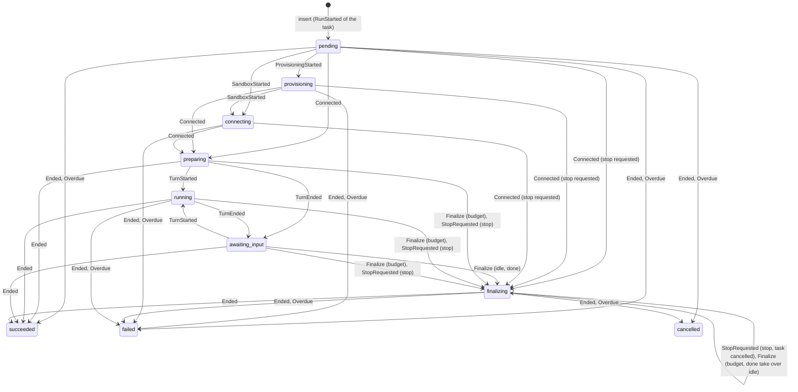

# Run state machine

Every change of `runs.state` is the result of one event passed to `run_transition` in
[`run_transition.rs`](../src/run_transition.rs) (ADR-0061). The diagram is written by hand from the
arms of that function; the test `the_state_diagram_names_every_state_event_and_finalize_reason`
checks that every `RunState`, every `RunEvent` and every `FinalizeReason` appears in it. A run is
inserted `pending` by the scheduler (`start_queued_runs`), which raises the task event
`RunStarted`; the machine starts there.

Any non-terminal state reaches `succeeded`, `failed` or `cancelled` with `Ended`; the outcome picks
the state (`RunOutcome::run_state`). The diagram draws one edge per kind of source.

## Events

| Event | Raised by | Guard | Effect |
| --- | --- | --- | --- |
| `ProvisioningStarted` | the scheduler | `pending` | `provisioning`, `provisioning_started_at`, `sandbox.provisioning` |
| `SandboxStarted` | the sandbox provider | `pending`, `provisioning` | `connecting`, `pod_ip`, `sandbox_started_at`, `sandbox.provisioned` if provisioning began |
| `Connected` | the runtime's first `Hello` | not terminal | `connected_at`; `pending`, `provisioning`, `connecting` → `preparing`, or → `finalizing` with reason `stop` when a stop was requested before; a repeated one changes nothing |
| `TurnStarted` | the runtime's `Running` phase | not `finalizing`, not terminal, not `running` | `running`; raises the task event `TurnStarted` |
| `TurnEnded` | the runtime's `AwaitingInput` phase | not `finalizing`, not terminal, not `awaiting_input` | `awaiting_input`; raises the task event `TurnEnded` |
| `Finalize(idle)` | the session's idle timer | `awaiting_input`, no undelivered message | `finalizing`, reason `idle` |
| `Finalize(budget)` | the session's budget timer | not terminal; a `finalizing` run only if its reason is `idle` | `finalizing`, reason `budget` (a run `finalizing` for `stop`, `done` or `budget` keeps its reason) |
| `Finalize(done)` | the task applier (`MarkedDone` by the board) | `awaiting_input`; a `finalizing` run only if its reason is `idle` | `finalizing`, reason `done` (a run `finalizing` for `stop`, `done` or `budget` keeps its reason) |
| `StopRequested` | a board member, the merge, `Cancelled` of the task | rejected for a terminal run; no change if already stopped, or `finalizing` with scope `ActiveOnly` | `stop_requested_at`; `preparing`, `running`, `awaiting_input` and, with scope `IncludingFinalizing`, `finalizing` get reason `stop` |
| `Ended` | the run report, a lost or failed sandbox | not terminal | the state of the outcome, outcome fields, `ended_at`, `sandbox.provisioning_failed` or `sandbox.destroyed` if provisioning began, raises the task event `RunEnded` |
| `Overdue` | the scheduler's timeout enforcement | `overdue` on the locked snapshot | `Ended`, or nothing if the run moved meanwhile |

Every event that changes a run publishes `RunChanged`. An event that changes nothing returns an
empty transition; only `StopRequested` on a terminal run is `Rejected`.

## Commands

`runs.finalize_reason` is written with `finalizing`. A session that holds the run's stream sends
the command of the reason once per stream, also after a reconnect:

| `finalize_reason` | Command |
| --- | --- |
| `idle` | `Release` |
| `budget` | `Cancel("wall-clock budget exceeded")` |
| `stop` | `Cancel("run stopped by a board member")` |
| `done` | `Cancel("task marked done")` |

## Overdue

`overdue` decides in this order; the first branch that applies ends the run:

1. a stop request on a run without a connection (`pending`, `provisioning`, `connecting`): `cancelled`, detail `stopped`;
2. a stop request older than 120 s, in any state: `cancelled`, detail `stop-timeout`;
3. no connection within `runs.connectTimeoutSeconds` of the run's creation: `failed` with outcome `connect_timeout`;
4. a connected run older than the wall-clock budget plus two grace periods: `failed`.
