# Task status machine

Every change of `tasks.status` is the result of one event passed to `transition` in
[`task_transition.rs`](../src/task_transition.rs) (ADR-0055). The diagram is written by hand from the
arms of that function; the test `the_status_diagram_names_every_status_and_event` checks that every
`TaskStatus` and every `TaskEvent` appears in it.

```mermaid
stateDiagram-v2
    [*] --> awaiting_dependencies: Created (a dependency is unsatisfied)
    [*] --> queued: Created
    awaiting_dependencies --> queued: DependencySatisfied (the last one)
    awaiting_dependencies --> awaiting_dependencies: MessageQueued (never ran)
    queued --> running: RunStarted
    rate_limited --> running: RunStarted
    queued --> waiting: MessageWithdrawn (no message left)
    running --> waiting: TurnEnded (no message waits)
    waiting --> running: TurnStarted
    running --> in_review: RunEnded (completed)
    running --> waiting: RunEnded (end_turn, cancelled)
    running --> blocked: RunEnded (blocked)
    running --> limit_reached: RunEnded (limit_reached)
    running --> rate_limited: RunEnded (rate_limited, resume time)
    running --> queued: RunEnded (infrastructure failure, resume time; or a message waits)
    running --> failed: RunEnded (failed, or no resume left)
    waiting --> queued: MessageQueued
    in_review --> queued: MessageQueued
    blocked --> queued: MessageQueued
    failed --> queued: MessageQueued
    rate_limited --> queued: MessageQueued
    limit_reached --> queued: MessageQueued
    completed --> queued: MessageQueued
    cancelled --> queued: MessageQueued
    queued --> running: MessageQueued (the run is connected)
    awaiting_dependencies --> completed: MarkedDone
    waiting --> completed: MarkedDone
    blocked --> completed: MarkedDone
    in_review --> completed: MarkedDone
    rate_limited --> completed: MarkedDone
    limit_reached --> completed: MarkedDone
    failed --> completed: MarkedDone
    cancelled --> completed: MarkedDone
    running --> completed: MarkedDone (the PR was merged)
    queued --> completed: MarkedDone (the PR was merged)
    awaiting_dependencies --> cancelled: Cancelled
    queued --> cancelled: Cancelled
    running --> cancelled: Cancelled
    waiting --> cancelled: Cancelled
    blocked --> cancelled: Cancelled
    in_review --> cancelled: Cancelled
    rate_limited --> cancelled: Cancelled
    limit_reached --> cancelled: Cancelled
    failed --> cancelled: Cancelled
```

## Events

| Event | Raised by | Effect on the status |
| --- | --- | --- |
| `Created` | `create_task` | `awaiting_dependencies` or `queued` |
| `MessageQueued` | a message of a human, an agent, the system or a webhook | `running` for a connected run, `awaiting_dependencies` for a task that never ran and still waits, else `queued` |
| `MessageWithdrawn` | a human deletes a queued message | `queued` → `waiting` when no message is left |
| `RunStarted` | the scheduler | `running` |
| `TurnStarted`, `TurnEnded` | the idle phase of the run | `waiting` ⇄ `running` |
| `RunEnded` | the end of a run | by outcome; a cancelled or done task stays so, a waiting message requeues |
| `MarkedDone` | a human, or the merge of the pull request | `completed` |
| `Cancelled` | a human; also `Cancelled { via }` for each descendant of the cancelled task (below) | `cancelled` |
| `DependencySatisfied` | an effect of the target's completion or done | `awaiting_dependencies` → `queued` with the last dependency |
| `ChildEnded` | an effect of a child's completion, done, failure or cancel | none; queues a `task.child_ended` message, which is a `MessageQueued` (also on an archived chat: it makes the chat `queued`, or `running` while its idle run is still connected; no run starts while the chat is archived) |
| `Archived` | a human archives a chat | none; rejected while the chat is `queued` or `running` or has a pending request; sets `archived_at`; the effect outside the state machine: the run waiting in `awaiting_input` gets `ReleaseIdle` and is released even if messages wait (they stay queued until the unarchive) |
| `Unarchived` | a human unarchives a chat | none, or `queued` as for `MessageQueued` when a message waits; clears `archived_at` |

A task of kind `chat` rejects `MarkedDone` and `Cancelled` (`Rejected::Chat`); `Archived` and
`Unarchived` are rejected for kind `task`.

## Effects of events on other tasks

`RunEnded` (completed), `MarkedDone` and `Cancelled` raise events on other tasks in the same
transaction, dependents first, then the parent:

| Event | `RecordFirst` | `NotifyDependents` | `NotifyParent` |
| --- | --- | --- | --- |
| `RunEnded` with outcome `completed` | `first_completed_at` | yes | completed |
| `RunEnded` ending in `failed` | | | failed |
| `MarkedDone` | `first_done_at` | yes | done |
| `Cancelled` | | | cancelled |

## Cancelling a subtree

`df_db::cancel_task` cancels a task together with its descendants that are not `completed`,
`failed` or `cancelled`, in one transaction. It locks the run rows of all of them, then their task
rows, and applies `Cancelled` top-down: `{ via: None }` for the cancelled task, `{ via: <its key> }`
for each descendant, so every task has its own `task.cancel` audit entry, with `via` in the
descendants'. A parent is `cancelled` before its children's `NotifyParent` effects run, so
`ChildEnded` ignores it: no `task.child_ended` message is queued in the subtree, and only the
parent of the cancelled task is woken. Dependents outside the subtree stay as they are.

## Notifying the parent's page

A transition that changes the status of a task with a parent also publishes `TaskChanged` for the
parent (`Notice::ParentTaskChanged`), because the Subtasks tab of the parent's details shows the
status and the progress.
