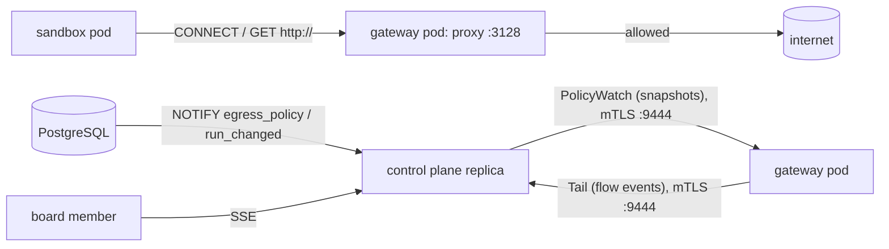
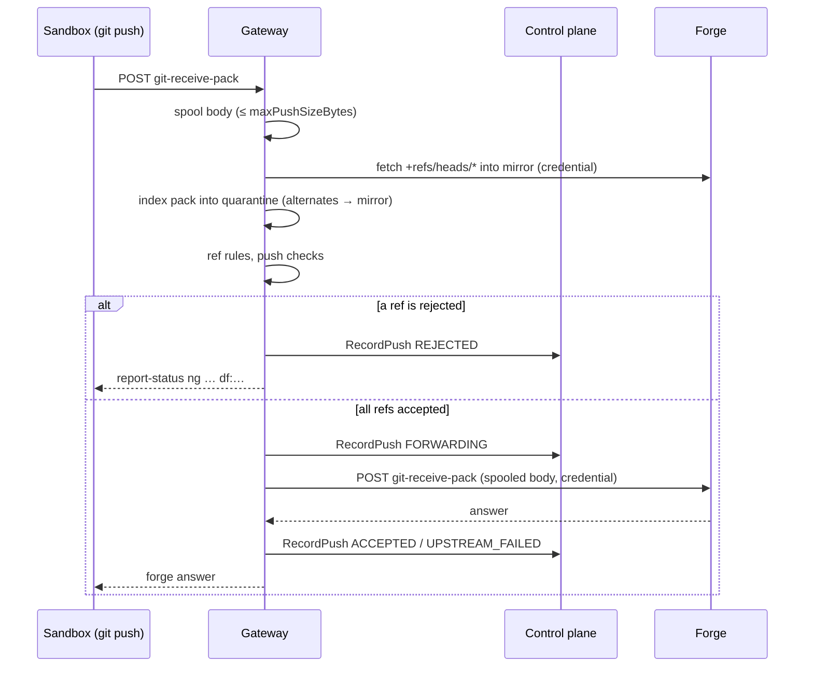

# df-gateway

The egress gateway of Dark Factory (`design/egress.md`, ADR-0029): an allowlisting HTTP(S) proxy that is the only way from sandboxes to external hosts, plus the control plane's side of its links.

`dark-factory gateway` runs it. It has no database credentials and no Kubernetes API token: everything it knows arrives from the control plane over `darkfactory.gateway.v1` ([`contract/proto/darkfactory/gateway/v1/gateway.proto`](../../contract/proto/darkfactory/gateway/v1/gateway.proto)).



## Behaviour

| Request | Decision |
|---|---|
| No snapshot received yet | `503`, reason `no-snapshot`; `/readyz` fails |
| Source IP is no active sandbox | `403`, `unknown-source` |
| `CONNECT` to an IP literal | `403`, `ip-literal` |
| Host or port not on the run's allowlist (instance + project entries, exact or `*.suffix`) | `403`, `not-allowlisted` |
| Plain `GET http://host/…` | allowed only for entries with port 80 set explicitly |
| Name resolves to a blocked range (any address of the answer) | `403`, `private-destination` |
| Name does not resolve | `502`, `resolve-failed` |
| `CONNECT` allowed, but the ClientHello has no SNI or another one than the `CONNECT` host | tunnel closed before the destination is contacted, `sni-mismatch` |
| Entry removed while a tunnel is open | tunnel closed, `removed-from-allowlist` |
| Sandbox left the registry while a tunnel is open (run ended) | tunnel closed, `unknown-source` |
| Gateway stops while a tunnel or a plain HTTP request is in flight | tunnel closed, or `503` for a request still waiting for the destination; a response that is already streaming is cut off. Event `gateway-shutdown`, recorded as allowed (in-flight requests get 2 s to record their event) |
| Connecting to the destination or the HTTP exchange fails | `502`, `upstream-failed` |
| Destination does not accept the connection and send response headers within 30 s | `502`, `upstream-timeout`; the upstream connection is closed |
| A tunnel ends with an I/O error | event with reason `tunnel-error`, bytes kept |

Each new connection is checked against the latest snapshot. Names are resolved by the gateway, IPv4 first (a cluster without IPv6 egress cannot reach the IPv6 address of a dual-stack host); the first resolved address is used and a failed connection is logged with a warning.

Blocked destination ranges: `0.0.0.0/8`, `10.0.0.0/8`, `100.64.0.0/10`, `127.0.0.0/8`, `169.254.0.0/16`, `172.16.0.0/12`, `192.168.0.0/16`, `224.0.0.0/3`, `::/128`, `::1/128`, `fc00::/7`, `fe80::/10`, `ff00::/8`, the NAT64 prefixes `64:ff9b::/96` and `64:ff9b:1::/48`, IPv4-mapped IPv6 addresses by their IPv4 part, plus `gateway.blockedCidrs`.

## Policy distribution

The control plane serves `PolicyWatch` on its internal port (`server.internalGrpcPort`, 9444). Every stream sends a full snapshot on connect and a new one, debounced by 100 ms, after each `egress_policy` or `run_changed` notification, and at the latest 60 s after its previous snapshot, so a rotated forge Secret (no notification) reaches the gateways within a minute. All control plane replicas receive the notifications, so an allowlist change reaches a gateway through whichever replica it is connected to, typically within a second. Versions come from the database sequence `egress_policy_version_seq`. A gateway keeps enforcing its last snapshot while it is disconnected and reconnects every 2 s.

Stored `http-host` entries with an invalid port are skipped with a warning, so a corrupt row narrows the policy instead of widening it.

Snapshot content: every run in a non-terminal state with a `pod_ip`, with the `http-host` entries of the instance and of the run's project, and its Git route:

- upstream: the project's repository URL; a repository that is not `https://` gets no route (warning), unless it is `http://` and `forge.allowPlainHttp` is on,
- `refs/heads/<base branch>`, `refs/heads/factory/task/<KEY>`, `refs/heads/factory/wip/<KEY>`,
- commit identity `agent.commitIdentity`,
- `credential_ref`: the id of the project's forge credential reference (empty without one).

`forge_credentials` holds each referenced credential once: user name `agent.gitUsername`, password read through the secret store on every rebuild. A credential that cannot be read is left out with a warning (never the value); its routes stay, so the Git proxy answers their requests with its own error.

## Live log

Every gateway pod keeps the last `gateway.bufferSize` flow events in memory, none older than `gateway.bufferMaxAgeSeconds` (the control plane's merged buffer applies the same age). The `opened` event of a connection that has not closed yet is kept regardless of age. Expired events are never part of a backlog and are removed from the buffer at most once a minute. An open page keeps the rows it has until it receives a new backlog (Resume, reload, or the reconnect after a token refresh). Nothing is persisted. `GatewayLog.Tail` streams the buffered events matching a filter (verdict, project, task, persona, host substring), a `backlog_end` marker, then live events; a subscriber that falls behind receives a `gap` marker.

A control plane replica opens `Tail` to every gateway pod, only while at least one viewer is connected. It finds the pods by resolving `gateway.headlessService` every 5 s, merges the buffered events of all pods by time and shares the streams between its viewers. Without `gateway.headlessService`, the egress log page reports the log as unavailable.

Phases: an allowed tunnel (after the ClientHello was forwarded) or plain HTTP exchange (when the response headers arrived) first records an `opened` event, so long-lived connections are visible while they last, and a `closed` event with bytes and duration when it ends. A denied request records one `closed` event. All events of a request carry the same `flow_id` (unique per gateway pod), so the log page shows one row per request: the open row is replaced in place when the closing event arrives, and the backlog sent on a reconnect collapses a closed flow into its closing row.

Reasons and verdicts of closing events (only denied events count for the denied-only filter and the denied-hosts summary):

| Verdict | Reasons |
|---|---|
| denied | `no-snapshot`, `unknown-source`, `ip-literal`, `not-allowlisted`, `private-destination`, `sni-mismatch`, `removed-from-allowlist` |
| allowed (the policy let it through, it failed or ended later) | `resolve-failed`, `upstream-failed`, `upstream-timeout`, `tunnel-error`, `gateway-shutdown` |

Flow event fields (time is when the event was recorded): flow id, phase, time, gateway pod, source IP, run, task, project, persona, method, host, port, SNI, verdict, reason, matched rule, bytes in/out (`bytes_out` is what the sandbox sent), duration and HTTP status (plain HTTP only).

## mTLS

Both directions use the certificate, key and CA of `agent.tls` (the chart mounts the `gateway-tls` secret in gateway pods and the `control-plane-tls` secret in control plane pods). The CA also signs sandbox certificates, so the TLS layer alone does not identify the peer. Each side additionally requires a DNS name in the peer's certificate:

- the control plane accepts `PolicyWatch` only from `gateway.identity`,
- a gateway accepts `Tail` only from `gateway.controlPlaneHost`.

Certificates are re-read for every new connection, so renewals by cert-manager need no restart.

## Configuration

Settings of the `gateway` section of the instance configuration (the chart renders them from `gateway.*` values). The gateway also reads `agent.tls` and `server.internalGrpcPort`, the control plane reads the identity and the headless Service.

| Key | Required | Default | Effect |
|---|---|---|---|
| `gateway.proxyPort` | no | `3128` | Port of the proxy for sandboxes. |
| `gateway.gitPort` | no | `8443` | Port of the Git proxy (HTTPS) for sandboxes. The run network policy allows it to the gateway pods. |
| `gateway.gitHost` | no | `<instanceName>-gateway` | Host name of the Git proxy URL. Sandboxes resolve it to the gateway `ClusterIP` through `hostAliases` and list it in `NO_PROXY`; the gateway certificate must carry the name. |
| `gateway.mirrorDir` | no | `/var/lib/dark-factory/git-mirrors` | Directory of the bare mirror repositories, one per upstream URL (directory name: hex SHA-256 of the URL). The chart mounts an `emptyDir` there. |
| `gateway.maxPushSizeBytes` | no | `268435456` | Largest push body the Git proxy accepts. |
| `forge.allowPlainHttp` | no | `false` | The Git proxy connects to `http://` upstreams without TLS (the control plane then builds routes for them too). Off, such a route gets `502` (`df: invalid forge URL`). The gateway logs a warning at startup when it is on. Sandboxes always use HTTPS to the gateway. |
| `gateway.internalGrpcPort` | no | `9444` | Port of `Tail` (mTLS). The control plane connects to it on every gateway pod. |
| `gateway.healthPort` | no | `8080` | `/healthz` (always 200) and `/readyz` (200 after the first snapshot, 503 before). |
| `gateway.controlPlaneHost` | no | `<instanceName>-control-plane` | DNS name of the control plane Service (`PolicyWatch` goes to port `server.internalGrpcPort`); its certificate must carry the name. |
| `gateway.identity` | no | `<instanceName>-gateway` | DNS name in the gateway certificate. |
| `gateway.headlessService` | no | none | DNS name of the gateway's headless Service, for the control plane's pod discovery. |
| `gateway.bufferSize` | no | `10000` | Flow events kept per pod. |
| `gateway.bufferMaxAgeSeconds` | no | `3600` | Flow events older than this are dropped (not an open connection's `opened` event). Minimum 1; a value of 0 is raised to 1 s. |
| `gateway.blockedCidrs` | no | `[]` | Pod and Service CIDRs of the cluster that the proxy refuses on top of the built-in ranges. |
| `agent.tls` | yes | none | Certificate, key and CA for both links. |

The pod name in flow events is the `HOSTNAME` environment variable (the pod name in Kubernetes).

## Limits

- Plain HTTP responses are streamed, but their byte counters stay 0; only tunnels count bytes.
- Snapshots are always complete; deltas are an additive change when many runs make them large.
- Ordering across pods: events of a pod that joins later are inserted by time into the buffer, but viewers that already read past that time see them out of order.
- The relay finds pods by DNS (no Kubernetes client); a pod becomes visible with the DNS TTL plus up to 5 s.

## Git proxy

Smart-HTTP endpoint for the task repository (`openspec/changes/iter2-git-proxy`, `design/agent-run.md` §11) on `gateway.gitPort`. URLs have the form `https://<gitHost>:<gitPort>/git/<task key>.git/info/refs?service=…` and `…/git-upload-pack` or `…/git-receive-pack`. The gateway identifies the sandbox by source IP, routes to the task's forge repository from the policy snapshot and injects the forge credential; the sandbox never sees it.

### Behaviour

| Request | Answer |
|---|---|
| Path is not `/git/<key>.git/info/refs?service=git-upload-pack\|git-receive-pack` or a `POST` to one of the two services | `404` |
| No snapshot received yet | `503`, reason `no-snapshot` |
| Source IP is no active sandbox | `403`, `unknown-source` |
| Task key is not the sandbox's own task | `403`, `other-task` (body names the own key) |
| Task has no repository route | `403`, `no-repository` |
| Route names a credential missing from the snapshot | `502`, `credential-unavailable` |
| `info/refs` or `git-upload-pack` (fetch, clone) | forwarded with the credential and the client's `Accept`, `Content-Type`, `Content-Encoding`, `Git-Protocol`, `User-Agent` headers; the forge's answer is streamed back. `info/refs` is forwarded without a request body |
| `git-upload-pack` body larger than 64 MiB | upstream request aborted, `413`, `df:fetch-too-large` |
| `git-upload-pack` body stalls for 30 s between frames | upstream request aborted, `408` |
| Forge URL invalid, or `http://` without `forge.allowPlainHttp` | `502` (`df: invalid forge URL`) |
| Forge unreachable, connect or TLS fails, no answer | `503` (`df: forge unreachable`) |
| Forge answers `401` or `403` | `502` (`df: the forge rejected the gateway's credential`), without `WWW-Authenticate`, so git does not prompt |
| Push body (`git-receive-pack`) larger than `gateway.maxPushSizeBytes` | `413`, `df:push-too-large`, recorded as `REJECTED` |
| Push body cannot be read | `400` |
| Push probe (body `0000`) | forwarded without checks or record |
| Push commands are not valid pkt-lines | `400`, `df: malformed push` |
| Mirror fetch before the checks: forge unreachable | `503`, recorded as `UPSTREAM_FAILED` |
| Mirror fetch before the checks: forge answers `401` or `403` | `502`, recorded as `UPSTREAM_FAILED` |
| Mirror fetch before the checks: forge answers another error status | `502` (`df:forge-unavailable: the forge answered the fetch with HTTP <status>`), recorded as `UPSTREAM_FAILED` |
| Mirror fetch before the checks: `http://` route without `forge.allowPlainHttp` | `502` (`df: invalid forge URL`), recorded as `UPSTREAM_FAILED` |
| Mirror fetch before the checks fails on the gateway (repository, negotiation) | `500` (`df:gateway-error`), recorded as `REJECTED` |
| Pack invalid | `400`, `df: invalid pack` |
| Spooling, quarantine or ancestry lookup fails | `500` |
| Ref neither the task branch nor the WIP branch, or a deletion of the task branch | `200` with `report-status`: `ng <ref> df:ref-not-allowed` |
| Task branch update that is not a fast-forward (WIP branch: any update allowed) | `ng <ref> df:non-fast-forward` |
| A push check rejects a ref | `ng <ref> <reason of the check>` (`df:check-failed` if the checks return a wrong count) |
| Another ref of the same push is rejected | `ng <ref> df:other-ref-rejected`; a push is accepted or rejected as a whole |
| `FORWARDING` record cannot be stored | `ng <ref> df:audit-unavailable` for every ref; nothing reaches the forge |
| All refs accepted | forwarded; the forge's answer (incl. its `report-status`) is relayed |

Rejected pushes answer `200` with a synthesized side-band `report-status`, so git prints `! [remote rejected] <ref> (df:…)` and exits with 1.

### Push



### Layout under `gateway.mirrorDir`

| Path | Content | Lifetime |
|---|---|---|
| `<hex SHA-256 of the forge URL>/` | bare mirror, `refs/heads/*` only; one fetch at a time per mirror | kept, refreshed before every push check |
| `spool/<temp>` | the request body of one push | removed when the request ends |
| `quarantine/<temp>/objects/` | the indexed pack of one push; `info/alternates` points at the mirror's objects | removed after the checks; the mirror never receives pushed objects |

The chart mounts an `emptyDir` there, so mirrors are rebuilt after a pod restart. `spool/` and `quarantine/` left by an earlier process are removed when the gateway starts.

### Push check resources

| Limit | Value | Effect |
|---|---|---|
| Concurrent quarantine and check jobs per pod | 4 | further pushes wait for a free slot (the wait counts towards the deadline) |
| Single allocation while resolving deltas | 4 × `gateway.maxPushSizeBytes` | a pack needing more is rejected as invalid (`400`) |
| Deadline for the mirror fetch, waiting, quarantining and checking one push | 10 min | `500`, `df:check-failed`; the indexing is interrupted |
| Client disconnects during the checks | — | the indexing is interrupted and the quarantine removed |

### Push records

Every push is stored with the control plane through `GatewayGit.RecordPush` on its internal port (same mTLS connector as `PolicyWatch`), keyed by a gateway-chosen `UUIDv7` `push_id`; `gateway_pod` is `HOSTNAME`.

| Record | Sent | If it cannot be stored |
|---|---|---|
| `REJECTED` | instead of forwarding; without refs if the commands could not be read (`df:malformed-push`, `df:request-timeout`, `df:unreadable-push`, `df:gateway-error` for a spool failure on the gateway, `500`) | retried for 5 s (100 ms backoff, doubling; 2 s per attempt), then logged; the client gets its rejection either way |
| `FORWARDING` | before the first byte goes to the forge | retried for 5 s, then every ref is rejected with `df:audit-unavailable` and nothing reaches the forge |
| `ACCEPTED` / `UPSTREAM_FAILED` | after the forge answered | retried for 5 s, then queued in memory (at most 1000 records, newer ones dropped with a warning beyond) and retried every 30 s; the forge's answer is relayed regardless. On shutdown the queue gets 5 s to drain; what is left is lost and covered by the control plane's stale-push scan |

Only `UNAVAILABLE`, `DEADLINE_EXCEEDED`, `RESOURCE_EXHAUSTED`, `UNKNOWN`, connect errors and attempt timeouts are retried; any other status (for example `INVALID_ARGUMENT`) fails the record at once.

The verdict after forwarding: a non-2xx answer (`503` for an unreachable forge, `502` for a rejected credential) is `UPSTREAM_FAILED`. For a 2xx answer to a client that requested `report-status`, the gateway reads the forge's report (demultiplexed from band 1 with `side-band-64k`) and records `ACCEPTED` only for `unpack ok` without any `ng` line; an `ng` (forge-side hook, branch protection, a lost lease against a stale mirror), an unpack error, a fatal band-3 message or an incomplete report is `UPSTREAM_FAILED`. To read the report, the gateway buffers the forge's answer (at most 4 MiB, within 5 min) before it relays it unchanged, so hook output reaches the client at the end; an answer that is larger, slower or breaks off becomes `502` `df:forge-unavailable` and `UPSTREAM_FAILED`. Without `report-status` (git always requests it) a 2xx answer is `ACCEPTED`.

A failed mirror fetch before the checks is also recorded as `UPSTREAM_FAILED` (reason `df:forge-unavailable`): forge unreachable → `503`, credential rejected → `502`, forge answered the fetch with another error status → `502` `df:forge-unavailable: the forge answered the fetch with HTTP <status>` (the fetch answer is not relayed, it was not the client's request). Any other mirror failure (repository, URL, negotiation) is on the gateway: `REJECTED` with `df:gateway-error` (`500`).

### Implementation choices (spikes, 2026-10-31)

gitoxide covers everything the proxy needs in pure Rust, so the gateway image stays static and needs no `git` binary.

| Need | Crate and features | Result |
|---|---|---|
| Ref commands of a push | `gix-packetline` (no features): `decode::streaming` returns the bytes consumed per line, so the pack offset follows directly | Commands, capabilities (first line, after the NUL, with a leading space) and the `push-options` section parsed from a body captured from a real `git push` |
| Synthesized `report-status` | hand-written pkt-lines (`unpack ok`, `ok`/`ng <ref> <reason>`, flush), wrapped in side-band-64k band 1 plus an outer flush | git 2.54 prints `! [remote rejected] HEAD -> main (df:ref-not-allowed …)` and exits with 1. git asks for `report-status-v2`, v1 lines are accepted. Text after the reason code is printed verbatim |
| Quarantine of a thin pack | `gix-pack` (`sha1`, `streaming-input`): `Bundle::write_to_directory` with the mirror's object database as thin-pack base lookup | A thin pack with two unresolved deltas is indexed into `<quarantine>/objects/pack`, `git verify-pack` accepts it, the mirror is unchanged |
| Ancestry across mirror and quarantine | `gix` (`sha1`, `revision`): the mirror repository with its object database swapped for the quarantine (whose `objects/info/alternates` points at the mirror), then `merge_base` | Fast-forward and non-fast-forward cases answered correctly. `Repository` is not `Send` without `parallel`: run in `spawn_blocking` |
| Mirror fetch with the forge credential | `gix` (`blocking-network-client`) plus `gix-transport` (`http-client`, no backend) with an own `Http` implementation on hyper 1, tokio-rustls and ring | `+refs/heads/*:refs/heads/*` fetched from github.com, `Authorization: Basic` sent with the first request. The reqwest and curl backends of gix were rejected: they bring reqwest 0.13 next to the workspace's 0.12, `aws-lc-sys` or libcurl |

Rules that follow from the spikes:

- The mirror fetches `+refs/heads/*:refs/heads/*` only. `refs/*` would also mirror `refs/pull/*` on GitHub (4004 refs on a small repository).
- Credential helpers are disabled for the fetch (`with_credentials` returns an error); otherwise gix runs the configured helpers or prompts after a 401.
- The fetch is blocking and runs in `spawn_blocking`, under the per-mirror lock.
- Upstream TLS uses the webpki roots, like the forge requests of the plugin host.

### Client behaviour (spike against Forgejo 13.0.5, git 2.54)

Checked through a minimal pass-through that forwards only the D3 headers and injects the credential.

- `git clone --filter=blob:none` uses protocol v2 (`Git-Protocol: version=2` on every request). Missing blobs are fetched lazily through the proxy on checkout.
- Fetch request bodies were small and sent with `Content-Length`, without `Content-Encoding`.
- A push larger than `http.postBuffer` (1 MiB) sends two POSTs: a probe whose body is only `0000` (`Content-Length: 4`), then the push with `Transfer-Encoding: chunked`. The proxy forwards the probe without a push record, and neither the spool nor the size limit relies on `Content-Length`.
- Forgejo answers pushes with side-band `report-status` (v1) and band-2 messages; the relayed answer prints normally.
- A plain-text body of a 403 or 503 is shown by git as a `remote:` line, followed by `fatal: unable to access …: The requested URL returned error: 503` and exit code 128. git does not retry a 503 by itself (not even with `http.maxRetries`), so the runtime retries it.

## Tests

```sh
cargo test -p df-gateway            # tests with PostgreSQL use testcontainers (needs a container socket)
cargo llvm-cov -p df-gateway        # line coverage
```

The proxy tests run against stub resolvers and dialers and a local TLS echo server, the policy tests against PostgreSQL and mutual TLS with a test PKI.
