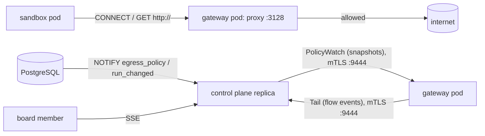

# df-gateway

The egress gateway of Dark Factory (`design/egress.md`, ADR-0029): an allowlisting HTTP(S) proxy that is the only way from sandboxes to external hosts, plus the control plane's side of its links.

`dark-factory gateway` runs it. It has no database credentials and no Kubernetes API token: everything it knows arrives from the control plane over `darkfactory.gateway.v1` ([`contract/proto/darkfactory/gateway/v1/gateway.proto`](../../contract/proto/darkfactory/gateway/v1/gateway.proto)).



## Behaviour

| Request | Decision |
|---|---|
| No snapshot received yet | `503`, reason `no-snapshot`; `/readyz` fails |
| Source IP is no active sandbox | `403`, `unknown-source` |
| `CONNECT` to an IP literal | `403`, `ip-literal` |
| Host or port not on the run's allowlist (instance + project entries, exact or `*.suffix`) | `403`, `not-allowlisted` |
| Plain `GET http://host/…` | allowed only for entries with port 80 set explicitly |
| Name resolves to a blocked range (any address of the answer) | `403`, `private-destination` |
| Name does not resolve | `502`, `resolve-failed` |
| `CONNECT` allowed, but the ClientHello has no SNI or another one than the `CONNECT` host | tunnel closed before the destination is contacted, `sni-mismatch` |
| Entry removed while a tunnel is open | tunnel closed, `removed-from-allowlist` |
| Sandbox left the registry while a tunnel is open (run ended) | tunnel closed, `unknown-source` |
| Gateway stops while a tunnel or a plain HTTP request is in flight | tunnel closed, or `503` for a request still waiting for the destination; a response that is already streaming is cut off. Event `gateway-shutdown`, recorded as allowed (in-flight requests get 2 s to record their event) |
| Connecting to the destination or the HTTP exchange fails | `502`, `upstream-failed` |
| Destination does not accept the connection and send response headers within 30 s | `502`, `upstream-timeout`; the upstream connection is closed |
| A tunnel ends with an I/O error | event with reason `tunnel-error`, bytes kept |

Each new connection is checked against the latest snapshot. Names are resolved by the gateway, IPv4 first (a cluster without IPv6 egress cannot reach the IPv6 address of a dual-stack host); the first resolved address is used and a failed connection is logged with a warning.

Blocked destination ranges: `0.0.0.0/8`, `10.0.0.0/8`, `100.64.0.0/10`, `127.0.0.0/8`, `169.254.0.0/16`, `172.16.0.0/12`, `192.168.0.0/16`, `224.0.0.0/3`, `::/128`, `::1/128`, `fc00::/7`, `fe80::/10`, `ff00::/8`, the NAT64 prefixes `64:ff9b::/96` and `64:ff9b:1::/48`, IPv4-mapped IPv6 addresses by their IPv4 part, plus `gateway.blockedCidrs`.

## Policy distribution

The control plane serves `PolicyWatch` on its internal port (`server.internalGrpcPort`, 9444). Every stream sends a full snapshot on connect and a new one, debounced by 100 ms, after each `egress_policy` or `run_changed` notification. All control plane replicas receive the notifications, so an allowlist change reaches a gateway through whichever replica it is connected to, typically within a second. Versions come from the database sequence `egress_policy_version_seq`. A gateway keeps enforcing its last snapshot while it is disconnected and reconnects every 2 s.

Stored `http-host` entries with an invalid port are skipped with a warning, so a corrupt row narrows the policy instead of widening it.

Snapshot content: every run in a non-terminal state with a `pod_ip`, with the `http-host` entries of the instance and of the run's project.

## Live log

Every gateway pod keeps the last `gateway.bufferSize` flow events in memory, none older than `gateway.bufferMaxAgeSeconds` (the control plane's merged buffer applies the same age). The `opened` event of a connection that has not closed yet is kept regardless of age. Expired events are never part of a backlog and are removed from the buffer at most once a minute. An open page keeps the rows it has until it receives a new backlog (Resume, reload, or the reconnect after a token refresh). Nothing is persisted. `GatewayLog.Tail` streams the buffered events matching a filter (verdict, project, task, persona, host substring), a `backlog_end` marker, then live events; a subscriber that falls behind receives a `gap` marker.

A control plane replica opens `Tail` to every gateway pod, only while at least one viewer is connected. It finds the pods by resolving `gateway.headlessService` every 5 s, merges the buffered events of all pods by time and shares the streams between its viewers. Without `gateway.headlessService`, the egress log page reports the log as unavailable.

Phases: an allowed tunnel (after the ClientHello was forwarded) or plain HTTP exchange (when the response headers arrived) first records an `opened` event, so long-lived connections are visible while they last, and a `closed` event with bytes and duration when it ends. A denied request records one `closed` event. All events of a request carry the same `flow_id` (unique per gateway pod), so the log page shows one row per request: the open row is replaced in place when the closing event arrives, and the backlog sent on a reconnect collapses a closed flow into its closing row.

Reasons and verdicts of closing events (only denied events count for the denied-only filter and the denied-hosts summary):

| Verdict | Reasons |
|---|---|
| denied | `no-snapshot`, `unknown-source`, `ip-literal`, `not-allowlisted`, `private-destination`, `sni-mismatch`, `removed-from-allowlist` |
| allowed (the policy let it through, it failed or ended later) | `resolve-failed`, `upstream-failed`, `upstream-timeout`, `tunnel-error`, `gateway-shutdown` |

Flow event fields (time is when the event was recorded): flow id, phase, time, gateway pod, source IP, run, task, project, persona, method, host, port, SNI, verdict, reason, matched rule, bytes in/out (`bytes_out` is what the sandbox sent), duration and HTTP status (plain HTTP only).

## mTLS

Both directions use the certificate, key and CA of `agent.tls` (the chart mounts the `gateway-tls` secret in gateway pods and the `control-plane-tls` secret in control plane pods). The CA also signs sandbox certificates, so the TLS layer alone does not identify the peer. Each side additionally requires a DNS name in the peer's certificate:

- the control plane accepts `PolicyWatch` only from `gateway.identity`,
- a gateway accepts `Tail` only from `gateway.controlPlaneHost`.

Certificates are re-read for every new connection, so renewals by cert-manager need no restart.

## Configuration

Settings of the `gateway` section of the instance configuration (the chart renders them from `gateway.*` values). The gateway also reads `agent.tls` and `server.internalGrpcPort`, the control plane reads the identity and the headless Service.

| Key | Required | Default | Effect |
|---|---|---|---|
| `gateway.proxyPort` | no | `3128` | Port of the proxy for sandboxes. |
| `gateway.internalGrpcPort` | no | `9444` | Port of `Tail` (mTLS). The control plane connects to it on every gateway pod. |
| `gateway.healthPort` | no | `8080` | `/healthz` (always 200) and `/readyz` (200 after the first snapshot, 503 before). |
| `gateway.controlPlaneHost` | no | `<instanceName>-control-plane` | DNS name of the control plane Service (`PolicyWatch` goes to port `server.internalGrpcPort`); its certificate must carry the name. |
| `gateway.identity` | no | `<instanceName>-gateway` | DNS name in the gateway certificate. |
| `gateway.headlessService` | no | none | DNS name of the gateway's headless Service, for the control plane's pod discovery. |
| `gateway.bufferSize` | no | `10000` | Flow events kept per pod. |
| `gateway.bufferMaxAgeSeconds` | no | `3600` | Flow events older than this are dropped (not an open connection's `opened` event). Minimum 1; a value of 0 is raised to 1 s. |
| `gateway.blockedCidrs` | no | `[]` | Pod and Service CIDRs of the cluster that the proxy refuses on top of the built-in ranges. |
| `agent.tls` | yes | none | Certificate, key and CA for both links. |

The pod name in flow events is the `HOSTNAME` environment variable (the pod name in Kubernetes).

## Limits

- Plain HTTP responses are streamed, but their byte counters stay 0; only tunnels count bytes.
- Snapshots are always complete; deltas are an additive change when many runs make them large.
- Ordering across pods: events of a pod that joins later are inserted by time into the buffer, but viewers that already read past that time see them out of order.
- The relay finds pods by DNS (no Kubernetes client); a pod becomes visible with the DNS TTL plus up to 5 s.

## Tests

```sh
cargo test -p df-gateway            # tests with PostgreSQL use testcontainers (needs a container socket)
cargo llvm-cov -p df-gateway        # line coverage
```

The proxy tests run against stub resolvers and dialers and a local TLS echo server, the policy tests against PostgreSQL and mutual TLS with a test PKI.
