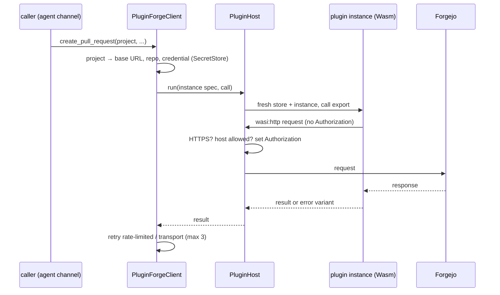

# df-plugins

Runs integration plugins (WebAssembly components implementing `darkfactory:integrations@0.1.0`, see
`contract/wit/integrations`) and exposes the Forgejo plugin as the control plane's
`df_core::ForgeClient`. Decisions: ADR-0002, ADR-0018, ADR-0028; spec: `plugin-host`.

## Pinned versions

| Component | Version | Note |
|---|---|---|
| `wasmtime`, `wasmtime-wasi`, `wasmtime-wasi-http`, `wasmtime-wasi-config` | 50.0.0 | Provides WASI `0.2.12` and `wasi:config@0.2.0-rc.1`; the `forge` component (imports at `0.2.12`) links and runs (tests `forgejo`, `sandbox`). |
| `wit-bindgen` (guest) | 0.63 | |
| `wasm-tools` (inspection only) | ≥ 1.245 | `wasm-tools component wit target/wasm32-wasip2/release/forgejo_plugin.wasm` |

`wasmtime-wasi-http` is built with `p2` and `default-send-request` only (no WASI 0.3).

## How a call runs



- One Wasmtime `Engine` (`PluginEngine`, one epoch clock thread) shared by all plugins; each plugin's compiled
  component is shared by all its calls. Every call gets a fresh `Store` and instance, so no state leaks between calls
  or projects.
- Load cost (Forgejo plugin, image build, dev cluster, 2026-10-30): `bytes=345564` (≈ 337 KiB), `compile_ms=351`,
  from the `plugin loaded` log line of a control plane pod.
- WASI is linked without capabilities: no preopened directories, environment, arguments, sockets or
  stdin/stdout. Stderr lines are logged via `tracing` (`plugin=forgejo`).
- At load time imports are checked against an allow-list of namespaces (`wasi:http`, `wasi:config`,
  `wasi:io`, `wasi:clocks`, `wasi:random`, `wasi:cli`, `darkfactory:integrations`). Anything else
  (for example `wasi:filesystem`, `wasi:sockets`) fails the load, naming the import. `wasi:cli` is
  allowed because the Rust standard library imports it; the context behind it is empty.
- Outgoing requests: HTTPS only, authority (host and port) must equal that of the project's base URL.
  The host replaces `Authorization` with `token <credential>`. Denied requests fail inside the plugin
  as `transport` before any connection is opened.
- Capabilities (`pull-requests`, `issues`) are detected from the component's exports. The host
  currently instantiates world `forge` only.

## Configuration

Reference: [`docs/configuration.md`](docs/configuration.md) (section `plugins` of the instance
configuration, per-project inputs, Forgejo token scopes).

### Retries

`rate-limited` waits `retry-after` (1 s if absent) and retries; a `retry-after` above 30 s is returned
without retrying. `transport` waits 1 s. Both are retried at most 3 times. All other errors are
returned. `add-comment` is not idempotent; a retry can rarely create a duplicate comment (accepted by
the contract).

## Development

```bash
# Tests use prebuilt plugin components (target wasm32-wasip2 from rust-toolchain.toml):
cargo build --target wasm32-wasip2 -p forgejo-plugin -p test-probe-plugin -p github-plugin
cargo test -p df-plugins
# Pull request lifecycle against a real Forgejo (variables: see tests/homelab.rs)
cargo test -p df-plugins --test homelab -- --ignored
# Pull request lifecycle against github.com (variables: see tests/github_live.rs)
cargo test -p df-plugins --test github_live -- --ignored
# Coverage
cargo llvm-cov -p df-plugins --summary-only
```

The tests do not build the components themselves: that would need the `wasm32-wasip2` target and a
nested `cargo` inside every test run (slow, and not hermetic under Bazel). They read
`FORGEJO_PLUGIN_WASM` / `GITHUB_PLUGIN_WASM` / `TEST_PROBE_WASM` (set by the Bazel targets from the `//plugins/...`
outputs) or, without them, `target/wasm32-wasip2/debug/*.wasm`, and fail with the build command if a
file is missing. The test plugin `plugins/test-probe` misbehaves on request (environment dump, endless loop, memory hog,
stderr) to test the sandbox.

If `rustc` resolves to Bazel's toolchain (`.bazel_env/bin` first on `PATH`), the `wasm32-wasip2`
build fails with `can't find crate for core`; put `~/.cargo/bin` first.
