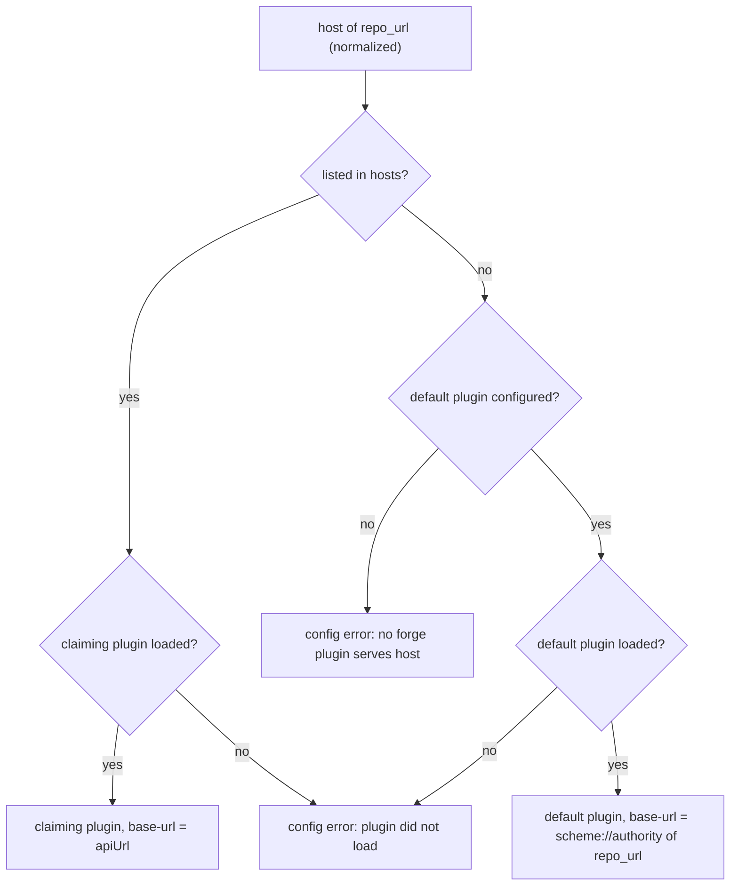

# df-plugins configuration reference

Section `plugins` of the instance configuration (`/etc/dark-factory/config.yaml`) is a map from plugin
name to its settings. The host does not know plugin-specific keys; `settings` is passed through to
the plugin as `wasi:config/store`. `hosts` and `authScheme` are host-side keys: the host enforces
them, the plugin never sees them.

```yaml
plugins:
  forgejo:
    path: /plugins/forgejo/plugin.wasm
    callTimeoutSeconds: 30
    memoryMib: 64
    settings:
      wip-prefixes: "WIP:,[WIP]"
    # no hosts: default plugin
  github:
    path: /plugins/github/plugin.wasm
    authScheme: bearer
    hosts:
      - host: github.com
        apiUrl: https://api.github.com
      - host: ghe.example.org
        apiUrl: https://ghe.example.org/api/v3
```

| Key | Required | Default | Effect |
|---|---|---|---|
| `plugins.<name>.path` | yes | none | Component file. |
| `plugins.<name>.callTimeoutSeconds` | no | `30` | Upper bound of one plugin call (retries excluded). Guest code is stopped by epoch interruption (50 ms granularity), network waits by a timeout. A timed-out call fails with `internal`; the instance is discarded. |
| `plugins.<name>.memoryMib` | no | `64` | Linear memory limit per instance. Exceeding it fails the call with `internal`. |
| `plugins.<name>.hosts` | no | `[]` | Repository hosts this plugin serves. Each entry is a string `host[:port]` or a map `{host, apiUrl}`; the map rejects unknown keys. Hosts are DNS names, IPv4 or bracketed IPv6 addresses; they are lowercased, a trailing dot and port `443` are dropped, any other port stays part of the host. A host may be claimed by one entry only. An entry without `hosts` (or with `[]`) is the default plugin; at most one is allowed. |
| `plugins.<name>.hosts[].apiUrl` | no | `https://<host>` | API base URL for this host. Must start with `https://` and have no userinfo, query or fragment; host lowercased, port `443` and a trailing `/` dropped, the path is kept (`https://ghe.example.org/api/v3`). Becomes the plugin's `base-url` and the only authority its requests may reach. Only valid in the `{host, apiUrl}` form, which rejects unknown keys. |
| `plugins.<name>.authScheme` | no | `token` | How the project's forge credential is sent: `token` → `Authorization: token <credential>`, `bearer` → `Authorization: Bearer <credential>`. The host sets the header on every request and replaces one set by the plugin. Applies to all hosts of the entry, the default plugin included. |
| `plugins.<name>.settings` | no | `{}` | String map handed to the plugin unchanged. The host adds `base-url` (the route's `apiUrl`; for the default plugin scheme and authority of the project's `repo_url`) and it wins over a configured one. Keys are documented by the plugin (Forgejo: `wip-prefixes`, see `plugins/forgejo/README.md`). |

Unknown keys fail parsing the configuration. An unknown `authScheme` value fails startup naming the
plugin and the value (see "Startup").

The Helm chart renders the section from its `plugins.*` values and mounts each plugin image
(`//deploy:plugin_forgejo_image`, one file `/plugin.wasm`) as an image volume at `/plugins/<name>`
(`deploy/helm/dark-factory/README.md`, "Plugins"). All plugins share one Wasmtime engine and epoch
clock.

## Forge routing

Each forge call is routed by the host of the project's `repo_url`, normalized like `hosts`
(lowercase, port `443` dropped). Matching is exact: `www.example.org`, `example.org` and
`example.org:3000` are three hosts. A claimed host goes to the plugin claiming it, any other host to
the default plugin. A plugin that did not load keeps its hosts: its projects get a `config` error
naming the plugin and never fall through to the default, because their credential is meant for that
forge.



With more than one plugin, give every entry `hosts`: a default plugin also receives projects of
forges nobody configured (for example `gitlab.com` sent to Forgejo) and fails with upstream 401/404.
Without a default such projects get a clear `config` error.

## Startup

1. Without a `plugins` section (or with an empty one) `serve` uses one entry `forgejo` with path
   `/plugins/forgejo/plugin.wasm` as the default plugin. As soon as `plugins` has an entry, there is
   no implicit `forgejo`.
2. `serve` builds the routing table from the configuration alone. A configuration error stops
   startup before any plugin loads (event "control plane server failed", field `error`):
   ``invalid `plugins` configuration: <cause>`` with one of
   - ``host `<host>` is claimed by plugins `<a>` and `<b>` ``
   - ``plugins `<a>`, `<b>` have no `hosts`; at most one default plugin is allowed``
   - ``plugin `<name>`: apiUrl `<url>` must use https://``
   - ``plugin `<name>`: invalid apiUrl`` (not a URL, or with userinfo, query or fragment; the value
     is not echoed)
   - ``plugin `<name>`: invalid host in `hosts[<index>]` `` (index from 0; the value is not echoed)
   - ``plugin `<name>`: unknown authScheme `<value>` (use `token` or `bearer`)``
3. It loads every entry. An entry that fails (component missing or invalid, `memoryMib` too large,
   or no `pull-requests` export: "is not a forge plugin") is logged at `error` ("forge plugin not
   loaded", fields `plugin`, `path`, `error`) and stays in the table as unavailable.
4. If no forge plugin loaded, `serve` exits with `no forge plugin loaded: <every load error>`.
5. Otherwise it logs the table at `info`: one "forge route" per claimed host (fields `host`,
   `plugin`, `available`, ordered by host), then "default forge route" (`plugin`, `available`) or
   "no default forge route".

Each successful load is logged at `info` ("plugin loaded") with the fields `plugin` (name under
`plugins`), `path`, `bytes` (component size) and `compile_ms` (load time: everything after the file
read, i.e. import validation, compilation and pre-instantiation; the shared engine is created once
before). Use it to see what the plugin costs at startup.

Plugin stderr is logged at `info` with the fields `plugin` (the name under `plugins`) and `line`;
lines longer than 4 KiB are split.

Per project (database): `repo_url` (`https://<host>/<owner>/<name>[.git]`, without userinfo, query
or fragment) selects the route and gives the repository; `base-url` comes from the route (see
`settings`). `forge_credential_id` references the Kubernetes Secret holding the token. Secrets are
read per call and not cached.

## Add a second forge

1. Make the component available to the control plane (for the chart: a plugin image mounted at
   `/plugins/<name>`).
2. Add an entry with the hosts it serves, the `apiUrl` where the API is not at `https://<host>`, and
   the `authScheme` the forge expects. Give the existing entry `hosts` as well, so neither is a
   catch-all:

   ```yaml
   plugins:
     forgejo:
       path: /plugins/forgejo/plugin.wasm
       hosts: [git.example.org]
     github:
       path: /plugins/github/plugin.wasm
       authScheme: bearer
       hosts:
         - host: github.com
           apiUrl: https://api.github.com
   ```

3. Restart `serve` and check the "forge route" events: each host with the expected `plugin` and
   `available=true`.
4. Create projects with a `repo_url` on the new host and a forge credential for that forge.

## Swap a plugin for a host

Projects store no plugin name, so moving a host needs no data change.

1. Add the new entry (or change `path` of the existing one to replace only the component).
2. Move the host from the old entry's `hosts` to the new one. Listing it in both fails startup with
   ``host `<host>` is claimed by plugins …``.

   ```yaml
   plugins:
     forgejo:
       path: /plugins/forgejo/plugin.wasm
       hosts: [git.example.org]
     forgejo-next:
       path: /plugins/forgejo-next/plugin.wasm
       hosts: [code.example.org]   # moved from `forgejo`
   ```

3. Check that the projects' credentials fit the new plugin's `authScheme`.
4. Restart `serve`; the "forge route" event for the host shows the new `plugin`. To roll back, move
   the host back.

## Troubleshoot an unroutable project

1. Read the error of the failed forge call (`plugin configuration error: …`):
   - ``no forge plugin serves host `<host>` ``: no entry claims the host and there is no default
     plugin, or the host is not valid. Compare the host with the "forge route" events (port and
     `www.` count) and add it to the right entry's `hosts`.
   - ``forge plugin `<plugin>` serving host `<host>` did not load``: find the startup event "forge
     plugin not loaded" with that `plugin`; its `path` and `error` name the cause. Fix it and restart.
   - `invalid repository URL`: `repo_url` is not `https://<host>/<owner>/<name>[.git]`, or it has
     userinfo, a query or a fragment. The URL is not echoed: it may carry credentials.
   - ``repository URL for host `<host>` is not HTTPS``: `repo_url` uses `http://`; use `https://`.
   - `the project has no forge credential`: set the project's forge credential.
2. Open the project's edit form. The hint below the repository URL names the routing result:
   - "Served by the `<integration>` integration; pull requests and issues use it."
   - "The `<integration>` integration claims this host but is not loaded: …"
   - "The default `<integration>` integration is not loaded: …"
   - "No forge integration applies: …"

   The project list shows the generic Git icon for a project no loaded integration serves (and for
   a project without a forge credential).
3. An upstream 401 or 404 instead of a `config` error usually means the project went to the default
   plugin. Check the "forge route" and "default forge route" events and add the host to the entry of
   its forge.

## Forgejo token scopes

The bot account's token needs `write:repository` (create and update pull requests, read branches)
and `write:issue` (comments on issues and pull requests). Read-only use needs `read:repository` and
`read:issue`. The account needs write access to the repository.

