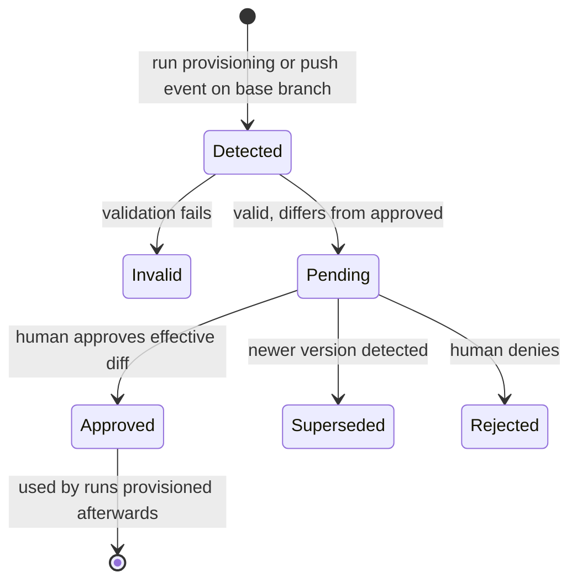

# Agent Run — Deep Dive

> Detailed design of how a single agent run executes: identity, sandbox and storage lifecycle, workspace handling, harness setup, credentials, MCP proxying and failure handling. High-level decisions live in the ADRs ([`design/adr/`](adr/README.md), mainly ADR-0005–ADR-0010, ADR-0015–ADR-0017, ADR-0019, ADR-0022–ADR-0023); wire formats in [`contract/`](../contract/README.md). Status: **design draft**.

## 1. Terminology

| Term | Meaning |
|---|---|
| **Task** | Unit of delegated work, linked to at most one issue (an issue can have many tasks). Owns a task branch, a PVC and one transcript shared by all its runs. Identified by a per-project key, e.g. `DF-42`. Tasks form a tree (optional parent, any depth); a task without an agent only groups its subtasks (ADR-0034). |
| **Run** | One execution of an agent on a task inside one sandbox. A task has 1..n runs, strictly sequential. A run ends when the agent finishes, asks a question or requests approval, hits a limit, or fails. |
| **Sandbox** | An agent-sandbox `Sandbox` (one pod) hosting exactly one run. Always cold-started; no warm pools. |
| **Runtime** | The Rust agent binary, mounted into the sandbox via an image volume. |
| **Harness image** | Image volume with the harness (adapter, Node.js, CLI) mounted at `/opt/harness/<harness>`; the project image needs no Node.js. |
| **Harness** | What drives the model: an external agent via ACP (e.g. Claude Code) or the runtime's built-in loop (full-harness mode). |
| **Workspace** | The task's Git working tree and caches on the PVC. |

## 2. Principles

1. **Git is the only durable store for code.** The PVC is a cache; losing it costs time, not work.
2. **The control plane never handles workspace content**, only metadata: repo, branches, PVC name, pushed SHAs, run records.
3. **Everything on the PVC is untrusted at run start.** The runtime regenerates whatever configuration it owns before using it.
4. **No long-lived credentials in the sandbox.** Authority is exercised through the control plane and scoped to the task the sandbox is bound to.
5. **The sandbox is the blast radius.** The harness may do anything inside it; protection focuses on what crosses the boundary.

## 3. Trust boundaries

```
┌──────────────── Sandbox pod (untrusted, Kata) ───────────────┐
│  Harness (Claude Code via ACP, or built-in loop)             │
│     │ stdio MCP            │ git CLI, package managers, ...  │
│     ▼                      ▼                                 │
│  Runtime (Rust, /opt/factory) ◄──► /data (task PVC)          │
└─────┬──────────────────────────┬──────────────────┬──────────┘
      │ gRPC bidi, mTLS          │ HTTP(S) via      │ direct: cluster
      │ (agent port)             │ HTTPS_PROXY      │ targets (e.g. RBE)
      ▼                          ▼                  ▼
 Control plane ──PolicyWatch──► Gateway ──► model provider, registries,
 (tools, credentials,           (egress proxy;      Forgejo (v1)
  authorization, WASI plugins)   later Git proxy,
      │                          inference + MCP endpoints)
      └── WASI plugins ──► Forgejo API
```

The control plane's authorization decision is always: *sandbox identity → bound run → task → agent persona → allowed repo, tools, models, budgets.* The gateway applies the same binding to network egress (pod IP → run → allowlist), see [`egress.md`](egress.md).

## 4. Identity and connection

### 4.1 mTLS identity
- The Sandbox pod spec mounts a cert-manager **csi-driver** volume (`csi.cert-manager.io`) issued by a private CA Issuer. (csi-driver cannot use SelfSigned issuers.)
- URI SAN per pod: `spiffe://dark-factory/ns/${POD_NAMESPACE}/pod/${POD_NAME}/${POD_UID}`. csi-driver substitutes these variables at mount time, so every pod gets its own certificate.
- Short duration (hours) with `renew-before`; the key never lives in a Kubernetes Secret. The runtime watches the files and uses the rotated certificate for new connections; existing streams continue.
- Sandbox pods set `automountServiceAccountToken: false`: no Kubernetes API token inside the sandbox.

### 4.2 Control plane verification
- The agent port (tonic + rustls) requires client certificates from the private CA.
- The control plane parses the URI SAN and checks it against its informer cache: the pod exists, its UID matches, it belongs to a Sandbox the factory created, and the connection's peer IP matches the pod IP. The last check makes an exfiltrated key useless from anywhere else.
- Unknown or stale identities are rejected.

### 4.3 Stream establishment
- `Hello`: runtime version, capabilities, and the previous run id found on the PVC. The control plane answers with the bound run and the last persisted sequence number; it supports the current and the previous protocol major version.
- The runtime may report what it finds on the PVC (e.g. existing repo, task key marker), but the control plane trusts only its own sandbox → run binding.
- Reconnect with exponential backoff. Unacknowledged events are buffered on disk (`/data/runtime/outbox`, bounded) and replayed after reconnect. Delivery semantics: `contract/proto/darkfactory/agent/v1/agent.proto`.

## 5. Sandbox and storage lifecycle

### 5.1 Task PVC
- One PVC per task (e.g. `task-df-42`), created by the control plane before the first run. Tasks without a repository get a small one too: uniform lifecycle, and harness session state survives between runs.
- StorageClass `factory-workspace`: Longhorn with **one replica** — it's a cache; Git holds the durable copy. Default size configurable per project.
- **ReadWriteOnce acts as a lock**: only one sandbox can mount it. The control plane additionally serializes runs per task in its state machine, so a second run waits instead of hanging on volume attach.
- Namespace `ResourceQuota` limits total storage and PVC count; per-PVC size limits stop runaway builds.

### 5.2 Layout (stable across runs)

| Path | Content | Notes |
|---|---|---|
| `/opt/factory` (image volume, read-only) | Runtime binary, empty hooks directory, read-only Git config | Trusted; never on the PVC |
| `/data/repo` | Git working tree | cwd for the harness |
| `/data/home` | `HOME` for harness and tools (`~/.claude`, …) | harness config regenerated each run |
| `/data/cache` | Build caches (Bazel output base, cargo target dir, …) | exposed via env vars |
| `/data/runtime` | Runtime-owned: outbox, run state, temp index | harness should not touch it |
| `/run/factory` (tmpfs) | Unix socket for MCP, per-run secrets | never on the PVC |

Paths and `HOME` stay identical across runs so absolute symlinks (e.g. Bazel convenience symlinks into the output base) remain valid.

### 5.3 Sandbox creation
- The control plane creates a `Sandbox` per run with: the project's image, the runtime image volume at `/opt/factory`, the image volume of the run's harness at `/opt/harness/<harness>` (unless the project sets an adapter command, ADR-0022), the csi-driver certificate volume, the task PVC at `/data`, a tmpfs at `/run/factory`, the configured runtime class (Kata in the homelab), resources, and run/persona labels for network policy selection.
- Network wiring (details in [`egress.md`](egress.md) §5): `HTTP(S)_PROXY` with the gateway's ClusterIP, `NO_PROXY` and `hostAliases` for cluster targets, the control plane endpoint as an IP — no DNS needed. A generated `NetworkPolicy` (or `CiliumNetworkPolicy`) owned by the Sandbox is created alongside.
- Entrypoint: `/opt/factory/factory-agent run`. The project image only needs git, a shell and glibc (for the Claude adapter).
- No warm pools: every run cold-starts. Throughput comes from concurrent tasks, not start-up time.
- After the run, the control plane deletes the Sandbox; the PVC stays. While a run waits for an answer to a blocking question, the sandbox stays alive for a short keep-alive window (§6.4).

### 5.4 Isolation
- Runtime class configurable per instance/project; Kata Containers in the homelab.
- Restricted pod security context (non-root, no privilege escalation, dropped capabilities, read-only root filesystem where the project image allows it).
- No nested containers or container daemons. Container-based tests run via Bazel RBE; its endpoints are part of the project's egress allowlist (§10).

### 5.5 Garbage collection
- Task closed or merged → delete the PVC after a grace period.
- Idle TTL for abandoned tasks.
- "Reset workspace" in the UI deletes the PVC; the next run re-clones.
- All of this is safe because Git holds committed work and the WIP snapshot.

## 6. Run lifecycle

States: `Pending → Provisioning → Connecting → Preparing → Running ⇄ AwaitingInput → Finalizing → Succeeded | Blocked | Failed | Cancelled`. The runtime reports each phase transition over the stream. `Blocked` means the run ended waiting for an answer or approval; the next run resumes the task.

### 6.1 Triggers and Assign
- A run starts when a task with pending work has no active run: task assignment (human or superior agent), queued messages (chat), a routine firing, completion of a task this one depends on, or a routed webhook notification (ADR-0015).
- Control plane → `Assign { run_id, task, workspace, harness, tools, budgets, continuation }`, followed by harness credentials and the queued prompts. Budgets cover wall-clock time, tokens and turns; both runtime and control plane enforce them.

### 6.2 Prepare workspace
Branch naming: task branch `factory/task/<key>`, WIP snapshot branch `factory/wip/<key>` (e.g. `factory/task/DF-42`). These must not nest: Git can't hold both `refs/heads/factory/<key>` and `refs/heads/factory/<key>/wip`. Tasks starting from existing branches (ADR-0025) are not covered here yet. `<base>` is the project's default branch, for subtasks with `subtask_base: parent-branch` the parent's task branch (ADR-0034), or for tasks with a `base_task` that task's branch (ADR-0041); the control plane resolves it and sends it as `Workspace.base_branch`, so prepare and finalize don't distinguish the cases.

```
if /data/repo/.git does not exist:
    git clone --filter=blob:none --no-checkout <repo_url> /data/repo
    write runtime-owned .git/config (§7)
    if origin has factory/task/<key> with own commits (not an ancestor of origin/<base>):
                                       git checkout -B factory/task/<key> origin/factory/task/<key>
    else:                              git checkout -B factory/task/<key> origin/<base>
    if origin has factory/wip/<key>:   restore WIP files into the worktree
                                       (git restore --source=<wip> --worktree -- .)
else:
    sanitize: rewrite .git/config (§7), regenerate harness config (§6.3)
    git fetch origin <base> factory/task/<key>
    if local has commits not on origin (failed earlier push): push them first (§6.5)
    compare local vs origin task branch:
        equal         → nothing to do
        remote ahead  → git merge --ff-only
        diverged      → don't resolve automatically; record "diverged" in run context
                        (agent instruction or human decision, per project policy)
    if the task branch has no own commits (ancestor of origin/<base>):
        git merge --ff-only origin/<base>   # follow the base (ADR-0041); on failure leave it as is
no git clean — preserving caches is the purpose of the PVC
```

Blobless clone rather than shallow: full commit graph for `log`/`blame`, cheap rebases onto an updated base, blobs fetched on demand.

### 6.3 Configure harness
Regenerated from `Assign` on every run, overwriting whatever is on the PVC:
- **ACP mode**: harness settings under `/data/home` (permissions, hooks only from the control plane), MCP servers: the runtime's `factory` server and, once available, the gateway's MCP endpoint (§9) — nothing else; environment for this run. Where the harness supports enforced/managed settings, the runtime writes those.
- **Full-harness mode**: the runtime's own loop configuration; model access via the gateway's OpenAI-compatible inference endpoint (not over the agent stream).

Trust policy for configuration found in the repository:

| Source in repo | Treatment |
|---|---|
| `AGENTS.md`, `CLAUDE.md` | Accepted as model instructions |
| Repo skills (`.agents/skills`, `.claude/skills`) | Accepted unless the project disables them |
| MCP server definitions (`.mcp.json`, …) | Not used by the runtime; can be surfaced to the control plane as a `repository-mcp-server` approval request (ADR-0038) |
| Harness hooks/settings in the repo | Whatever the harness honours runs inside the sandbox only; none of the runtime's privileged operations depend on them |
| `.dark-factory/config.toml` | Never read from the worktree. The control plane reads it from the base branch and applies only the approved version (§16) |
| Repository Git hooks (`.githooks/`, `.pre-commit-config.yaml`, …) | Only run when a commit hook command configured in Dark Factory calls them (§7.1) |

### 6.4 Execute
- **ACP mode**: spawn the adapter, `session/new` (or `session/load`, see below) with cwd `/data/repo` and the runtime's MCP server; translate `session/update` notifications into the Dark Factory transcript schema (ADR-0017) and stream them to the control plane.
- **First prompt** of a run: the trigger plus all queued messages.
- **Queued messages during a run**: delivered turn-based — the runtime sends them as the next prompt after the current turn ends. ACP has no mid-turn injection; a human who needs to interrupt uses cancel.
- **Pushes during the run**: after every turn that produced new commits, the runtime pushes the task branch and reports it; the control plane opens the draft PR on the first push that is ahead of base (ADR-0025).
- **Permission requests** (`session/request_permission`): answered by a control-plane policy — auto-approve inside the sandbox by default, escalate selected categories to a human as a `harness-permission` approval request (ADR-0038).
- **Blocking questions and approvals** (raised via factory tools to a human or another agent, ADR-0038): the run enters `AwaitingInput`, the sandbox stays alive for a short keep-alive window. An answer within the window is delivered as the next prompt in the same run; otherwise the run finalizes as `Blocked` and the answer later starts a new run.
- **Full-harness mode**: same tool registry, model calls through the inference gateway.
- **Continuity across runs**: the transcript belongs to the task. The harness's session state in `/data/home` allows `session/load` where the adapter supports it; otherwise the new session is seeded with a summary from the control plane (strategy pluggable later, F3).
- **Cancellation**: control plane sends `Cancel`; the runtime stops the harness and still finalizes.

### 6.5 Finalize
1. Stop the harness gracefully (timeout, then kill).
2. Rewrite `.git/config` again (§7).
3. Push the task branch with an explicit refspec. Fast-forward pushes are plain; rewritten history (e.g. after a rebase) is pushed with `--force-with-lease=<ref>:<expected>` only if the project's branch rewrite policy allows it (`never` / `with-lease` (default) / `always`, ADR-0033). `<expected>` is the remote SHA the runtime last fetched or pushed:
   `git push <repo_url> refs/heads/factory/task/<key>:refs/heads/factory/task/<key>`.
   If rejected because the remote moved (lease no longer matches): fetch, don't retry with force, mark the task diverged.
4. WIP snapshot without touching the agent's index or branch:
   ```
   export GIT_INDEX_FILE=/data/runtime/wip.index
   git read-tree HEAD
   git add -A                          # respects .gitignore
   tree=$(git write-tree)
   if tree differs from HEAD^{tree}:
       size cap; drop paths matching the secret-file denylist (.env*, *.pem, *.key, id_*, ...)
       commit=$(git commit-tree "$tree" -p HEAD -m "WIP snapshot, run <run_id>")
       git push --force <repo_url> "$commit:refs/heads/factory/wip/<key>"
   else:
       delete remote factory/wip/<key> if it exists
   ```
   No secret scanning happens in the sandbox; the Git proxy scans every push centrally (§11). Until it exists, WIP snapshots rely on `.gitignore` and the denylist.
5. Report to the control plane: outcome, task branch SHA, WIP SHA, push status, workspace size, harness session id. Token usage per turn (model, input/output/cache-read/cache-write tokens) is already in the transcript.
6. Flush remaining events from the outbox, close the stream, exit. The control plane deletes the Sandbox.

### 6.6 Failure modes

| Failure | Effect | Handling |
|---|---|---|
| Pod killed mid-run | No finalize | Unpushed commits and uncommitted work stay on the PVC; next run's prepare pushes them; run marked failed |
| PVC lost | Caches and unpushed work lost | Re-clone, restore from WIP branch; at most the work since the last push/finalize is lost |
| Push rejected (non-fast-forward or lease mismatch) | Remote moved, or rewrite not allowed by policy | No unconditional force push; task marked diverged; resolved at next prepare per policy |
| Forge unreachable | Push fails | Work kept on the PVC; retried at next prepare; task flagged |
| Token or time limit reached | Run stops | Finalize normally; run ends with the limit as reason; task resumable with a new run |
| Provider rate limit | Run stops | Finalize normally; distinct resumable outcome with retry time if known |
| Control plane restart | Stream drops | Runtime reconnects (any replica) and resumes from the last persisted seq; run continues |
| Push rejected by the Git proxy's secret scan (later) | Push fails | The rejection message names commit and file; the agent rewrites the commit. A rejected WIP snapshot stays on the PVC; human alerted |
| Certificate rotation / expiry | New connections need the new cert | Runtime reloads files; reconnects if the stream fails |
| PVC full | Builds fail | Quota limits damage; runtime reports; human resets workspace |

## 7. Git hardening

### 7.1 Runtime-owned `.git/config`
- **Allowlist, not denylist**: the runtime generates `.git/config` from a template derived from what a fresh clone of the same Git version writes (including the partial-clone keys `remote.origin.promisor` / `partialclonefilter`), plus its own overrides. Unknown keys, `include`/`includeIf`, `url.*.insteadOf`, filters, extra credential helpers and `core.fsmonitor` disappear.
- Also removed: `.git/config.worktree`.
- Template overrides:
  - `core.hooksPath` → the generated commit-hook directory `/run/factory/git-hooks` if commit hooks are configured, otherwise `/opt/factory/hooks-empty` (read-only image volume). The runtime's own operations always use the empty directory.
  - remote URL from `Assign` (v1: forge; future: control plane Git proxy)
  - credential helper: the runtime itself (v1 only)
  - commit identity of the agent's bot account

#### Configurable entries (instance and project scope)
- Admins can add Git config entries at instance and project scope — e.g. `rebase.autoStash`, `rebase.updateRefs`, `pull.rebase`, `merge.conflictStyle`, `rerere.enabled`, `diff.algorithm`. Multi-valued keys are allowed.
- The control plane validates and merges them and sends them in `Assign.workspace.git_config`. The runtime renders `.git/config` in this order: fresh-clone template → instance entries → project entries → runtime-owned keys (above). Later layers win; the runtime-owned keys can't be overridden.
- **Denylist** — rejected when an entry is saved, and again by the runtime when rendering:
  - anything that runs a program: `core.hooksPath`, `core.fsmonitor`, `core.sshCommand`, `core.gitProxy`, `core.askPass`, `core.editor`, `core.pager`, `pager.*`, `sequence.editor`, `filter.*`, `diff.external`, `diff.*.textconv`, `diff.*.command`, `merge.*.driver`, `gpg.*`, `alias.*` values starting with `!`;
  - anything that redirects traffic or touches credentials: `remote.*`, `url.*`, `branch.*.remote`, `branch.*.pushRemote`, `credential.*`, `http.*`, `protocol.*`;
  - configuration loading and runtime-owned areas: `include.*`, `includeIf.*`, `user.*`, `submodule.*` (project option instead), `lfs.*`, `core.worktree`, `core.bare`, `extensions.*`, `commit.gpgSign`, `tag.gpgSign` (signing is an open question).
- The full list lives in code next to the template and is reviewed on every Git upgrade. A denylist (rather than the allowlist used for what's found on the PVC) is acceptable here because entries come from people configuring the instance, not from the sandbox, and an allowlist would block the knobs this feature exists for.
- Changing Git config entries requires an admin-level permission that isn't grantable to agents by default (ADR-0011).

#### Commit hooks for the harness (instance and project scope)
- Dark Factory stores commit hook commands per hook type: `pre-commit`, `prepare-commit-msg`, `commit-msg`. Examples: `pre-commit run --hook-stage pre-commit` (pre-commit framework), `lefthook run pre-commit`, `cargo fmt --check`, or a repository script such as `./.githooks/pre-commit`. The tools must be in the project image.
- Scopes: project for project tooling (linters, formatters, fast tests); instance for generic hooks (e.g. a `prepare-commit-msg` hook adding a `Task: DF-42` trailer, or an early check against the WIP secret-file denylist). Instance commands run first, then project commands; the first failure fails the hook; each command has a timeout.
- At run start the runtime generates `/run/factory/git-hooks` (tmpfs, outside the repository, regenerated every run) with one script per configured hook type and points the harness's `core.hooksPath` at it. The runtime's own Git operations keep the empty hooks directory.
- A failing hook makes `git commit` fail with the hook's output, which the agent sees as tool output and fixes — the intended feedback loop.
- `pre-push` isn't offered: the runtime does the pushes, and its Git operations never run hooks. Slow test suites belong in CI, not in `pre-commit`.
- **Feedback, not enforcement:** an agent can bypass client-side hooks (`--no-verify`, editing hook scripts or repository config, changing `core.hooksPath` mid-run). Enforcement stays with CI and the Git proxy's push checks (§11); project instructions should tell agents not to skip hooks.

### 7.2 Runtime Git invocations
Always with:
- `-c core.hooksPath=/opt/factory/hooks-empty -c core.fsmonitor=false -c credential.helper= -c credential.helper=<runtime>` (v1)
- `-c protocol.allow=never -c protocol.https.allow=always`
- `-c submodule.recurse=false`
- `GIT_CONFIG_NOSYSTEM=1`, `GIT_CONFIG_GLOBAL=/opt/factory/gitconfig` — `HOME` is on the PVC, so `~/.gitconfig` is untrusted
- `GIT_TERMINAL_PROMPT=0`

### 7.3 Submodules and LFS
- Submodules off by default; per-project opt-in with a URL allowlist.
- LFS: if enabled for the project, the runtime adds the LFS filter itself; `git-lfs` must be in the project image.

## 8. Credentials in the sandbox

| Item | In sandbox? | Lifetime | Notes |
|---|---|---|---|
| mTLS client key | Yes (csi volume, never a Secret) | Hours, auto-rotated | Identity, not a bearer token; bound to pod UID and pod IP |
| Kubernetes SA token | No | — | `automountServiceAccountToken: false` |
| Inference provider keys | No | — | Full-harness mode uses the gateway's inference endpoint, which injects provider credentials |
| 3rd-party MCP credentials | No | — | Only the gateway talks to upstream MCP servers (the control plane only for catalog discovery) |
| Forge token | **v1: yes**, served on demand by the runtime's credential helper | Short-lived where Forgejo allows; scoped to the project repo | Removed by the Git proxy (§11) |
| Harness auth (e.g. Claude subscription) | Yes | Delivered per run over the stream, kept on tmpfs | Never in the pod spec. API-key-based harness auth could move to the gateway if the harness supports a base URL override |
| Project build/test secrets (private registries, test DBs) | Out of scope for now | — | Candidate for the same proxy pattern later |

Target state after the Git proxy: the mTLS identity and third-party harness auth are the only credentials in the sandbox. Removing tokens doesn't remove authority — the sandbox can still act through the control plane — so per-task authorization in the control plane is the real control.

## 9. Tools: factory server and gateway MCP endpoint
The harness sees two MCP servers, both configured by the runtime (ADR-0027, ADR-0032):

- **`factory`** — the factory tools, which act on Dark Factory's state (iteration 1: update the PR, comment on the issue, report progress, complete the task; later: ask a question, request an approval (ADR-0038), create a subtask, merge a subtask's PR into the task's own branch if `subtask_merge` allows it (ADR-0034), artifacts). Configured as a stdio command (`/opt/factory/factory-agent mcp`); no network listener — the subprocess connects to the parent runtime via a Unix socket on tmpfs (`/run/factory/mcp.sock`). The runtime answers `tools/list` from `Assign.tools` and forwards calls as typed tool-call messages over the agent stream; the control plane authorizes them against the task binding and executes them (database, run control, WASI plugins). Large results can be stored as artifacts and returned by reference.
- **Gateway MCP endpoint** *(later)* — third-party MCP servers (e.g. forgejo-mcp), aggregated by the gateway over Streamable HTTP. The gateway identifies the sandbox by pod IP, injects upstream credentials, exposes only the run's tool set (enabled catalog ∩ persona grants ∩ project restrictions) and offers `search_tools` / `load_server` when that set is large. No token is needed in the sandbox.

In full-harness mode the runtime's own loop uses both directly, without the stdio hop.

## 10. Network egress
Summary; full design in [`egress.md`](egress.md) and ADR-0029.
- Every run gets a generated network policy (`NetworkPolicy` by default, `CiliumNetworkPolicy` in Cilium mode), owned by its Sandbox and reconciled when allowlists or referenced Services change. No ingress.
- Egress allowed to: the control plane agent port, the gateway's proxy port, and the run's **cluster targets** (e.g. an in-cluster NativeLink scheduler for Bazel RBE) and **CIDR targets**. DNS is denied unless a target needs it.
- All HTTP(S) to the outside — the model provider, package registries, the forge in v1 — goes through the gateway's egress proxy, which enforces the run's host allowlist (instance, project, persona and task scopes). Allowlist changes reach running sandboxes within a second.
- The gateway's live egress log shows allowed and denied connections per run, with one-click allowlisting of denied hosts.

With the Git proxy, forge access moves from the generic proxy allowlist to the dedicated Git endpoint in the gateway.

**Future option — DNS server in the gateway.** Like the HTTP proxy, the gateway could also serve DNS for sandboxes (pod `dnsPolicy: None`, `dnsConfig` pointing at the gateway's ClusterIP). Details in [`egress.md`](egress.md) §12.

## 11. Future option: Git smart-HTTP proxy
Kept deliberately as a planned option. It runs in the gateway Deployment (ADR-0029), not in the control plane process; the control plane supplies the task → repository mapping over the same stream that feeds the egress allowlists.

- **Endpoint**: e.g. `https://<gateway>/git/<task-key>.git`, authenticated by the sandbox identity (pod IP lookup, or the per-pod mTLS certificate).
- **Runtime change**: only the remote URL in `Assign` changes; the credential helper disappears. Designing v1 so the runtime always uses the URL it's given makes the switch transparent.
- **Forwarding**: the gateway maps task → upstream repo and bot credential (both pushed by the control plane), forwards `info/refs`, `git-upload-pack` and `git-receive-pack`, injecting auth. Bodies are streamed, not buffered. Protocol v2 and partial-clone filters pass through.
- **Push checks (server-side hooks)**: the proxy is the only point every push passes through, so pre-receive checks belong here.
  - *Mechanism:* thin packs reference objects the push doesn't contain, so the gateway keeps a cached bare mirror per repository (rebuildable, on ephemeral or volume storage). Each push is received into a quarantine on top of the mirror, checked, and forwarded upstream only if all checks pass. Rejections go back through `report-status`, so git shows `remote rejected (reason)`. For pushes made by the runtime, the runtime feeds the rejection into the agent's next turn so it can fix the commits.
  - *Built-in checks:* ref rules (below); **secret scanning** of every pushed pack (Kingfisher or similar, live validation off) — the only secret scan, covering pushes by the runtime and by the harness alike, which a scan inside the sandbox couldn't; **commit identity** (author and committer must be the bot, so an agent can't commit as a human); **signature verification** once signing exists (§12).
  - *Configurable per project:* **protected paths** (e.g. `.forgejo/workflows/**`, `CODEOWNERS`; `.dark-factory/**` is always protected, §16) — the most important one, because CI runs with secrets and a modified workflow could leak them; size and file-type limits (large files that belong in LFS, binaries); linear history (no merge commits).
  - *Approval-gated rules* can't hold a push open (git would time out). They reject it and open a `push-check-exception` approval request (ADR-0038); once approved for the task, the next push passes.
  - *Plugin extension point:* a `push-check` WIT world executed by the gateway's Wasmtime host. The host gives read-only access to the pushed refs, commits, changed paths and blob contents; the plugin returns allow, reject with reason, or approval required. No network access, no credentials, deterministic. Built-in checks stay native; plugins cover project conventions such as commit message formats (e.g. Conventional Commits, a required `Task: DF-42` trailer).
- **Ref enforcement**: `receive-pack` ref update commands are pkt-lines in front of the packfile. The proxy parses them and allows only the task's branch (non-fast-forward updates only if the branch rewrite policy permits; `receive-pack`'s old-value check provides the lease semantics) and `refs/heads/factory/wip/<key>` (force allowed), rejecting everything else before forwarding. The branch → task mapping comes from the database (ADR-0025).
- **Benefits**: no forge token and no forge egress in the sandbox; audit log of every push; per-task ref enforcement independent of forge features.
- **Costs**: the gateway is in the clone data path (bandwidth), Git protocol details to get right, LFS handled separately.
- **Implementation candidate: [gitoxide](https://github.com/GitoxideLabs/gitoxide)** for parsing — pkt-line decoding (ref commands), pack parsing including deltified objects (quarantine), tree diffs (changed paths for protected paths) and blob reads (secret scanning). Its server-side protocol (`upload-pack`/`receive-pack` serving) is not implemented, but the proxy only parses and forwards. Status as of 2026-10: [`crate-status.md`](https://github.com/GitoxideLabs/gitoxide/blob/main/crate-status.md).
- **Not planned: a restricted `git` CLI in the sandbox.** A `git` replacement exposing only allowed commands (e.g. no `--no-verify`) wouldn't enforce anything: the real binary stays in the image for tools that need it (cargo, pre-commit, Bazel, build scripts), and the agent can write `.git` directly. Enforcement stays here, at the boundary. Nudges such as refusing `--no-verify` go into the harness settings (deny rules or hooks in `Assign.harness.acp.settings_json`).

## 12. Future option: commit signing without keys in the sandbox
- **Not in the proxy:** a signature is part of the commit object, so signing in the proxy would rewrite every pushed commit and change its ID and those of all descendants. The sandbox's branch would then diverge from the remote, and the runtime would have to reset after every push, racing the agent's next commits.
- **At commit time, via a signing service:** Git calls an external program to sign (for SSH signatures, `gpg.ssh.program`). The runtime points it at a shim in `/opt/factory` that sends the commit payload over the agent stream to a signing service in the control plane, which holds the bot's key and returns the signature. Commit IDs never change, and it works for commits made by the harness and by the runtime alike.
- **Key management is external:** the signing key is created and rotated outside Dark Factory and referenced as a Kubernetes Secret, like every other credential (ADR-0020). The control plane reads it into memory only, reloads it when the Secret changes, and shows the public key and fingerprint in the UI for registering on the bot's Forgejo account. The private key never lands in the database or its backups, and a reinstall doesn't invalidate it. The signing service sits behind a small backend interface — "key from Secret" first; external signers (Vault Transit, a KMS) can follow, since the service builds the SSH signature envelope itself and only needs the raw signature. A `dark-factory keygen` helper may print a new key for convenience; generation stays outside the running system.
- **Guards:** the service only signs payloads that parse as commits carrying the bot identity, and records every signature with the run ID in the audit log. The sandbox can request signatures but never obtain the key; revoking the key is a single action.
- The signing settings (`gpg.format`, `gpg.ssh.program`, `user.signingKey`, `commit.gpgSign`) are runtime-owned keys; user entries for them stay denied (§7.1).
- The Git proxy can then require valid bot signatures on every pushed commit (§11).
- To verify: Forgejo shows SSH-signed commits of the bot account as verified (bot's public key registered).

## 13. Future option: workspace changes view
Browse a task's repository in the dashboard, including changes the agent hasn't committed yet — current as of the last turn, not continuously.

- **Snapshot per turn:** the runtime pushes the WIP snapshot (§6.5 step 4) after every turn, not only at finalize, alongside the per-turn push of the task branch. Same denylist, same `PushReport`.
- **Isolation from the agent:** the snapshot uses its own index file, creates a commit no local branch points to (`git commit-tree`) and pushes it by hash to the URL (no remote-tracking ref appears). The agent's index, staged/unstaged state, HEAD, branches, reflog and working tree are untouched; its `git status`/`diff`/`log` look the same before and after.
  - Snapshots are taken only at tool-call boundaries: the runtime tracks the harness's tool calls from ACP `session/update` (started → completed/failed) and snapshots only while none is running, so a half-written file is never captured. A mid-turn request ("refresh now") waits for the running tool call to finish, up to a timeout; a snapshot forced by the timeout is marked as possibly incomplete in the UI. Concurrent writes are safe for Git's object store, and the separate index avoids `index.lock` conflicts.
  - Performance: start the snapshot index from a copy of the agent's index (consistent, since Git replaces it atomically) so the stat cache is reused and only changed files are hashed.
  - Unreferenced snapshot commits accumulate; Git's automatic maintenance prunes them, or the runtime runs `git gc` at finalize.
- **One read path — Git:** committed changes are base … task branch, uncommitted changes are task branch … WIP snapshot, and the file browser shows the repository at the WIP snapshot. This works whether or not a sandbox is running and survives a lost PVC.
- **Refresh now:** while a run is active, the UI can ask for an immediate snapshot. The control plane sends a small `SnapshotWorkspace` command over the agent stream; the runtime pushes a snapshot and reports it. No file contents travel over the agent protocol.
- **Reading:** first from the forge through a `repository` capability of the integrations plugin (compare refs, read a file at a ref, list a tree); once the Git proxy exists, from the gateway's cached mirror (§11), which is faster and forge-independent.
- **UI:** a "Changes" view on the task with changed files (committed / uncommitted), unified or side-by-side diffs, a file browser at the snapshot, and the snapshot's turn and time. Read-only and desktop-only: no comments or review on lines — the view links to the pull request, where review happens (ADR-0035, ADR-0036).
- **Caveats:**
  - Per-turn snapshot pushes may trigger CI on forges that run workflows for every branch. Either exclude `factory/wip/*` in workflow filters, or move snapshots to a ref namespace outside branches (e.g. `refs/factory/wip/<key>`) — to verify whether Forgejo accepts pushes to such refs.
  - Workspace content is untrusted: the UI renders files and diffs as escaped text (syntax highlighting server-side), never as HTML or SVG.

## 14. Future option: workspace lifecycle hooks
Script snippets the runtime executes at fixed points of a run, defined in Dark Factory at instance and project scope.

| Phase | When | Typical use |
|---|---|---|
| `workspace-init` | After workspace prepare, only when the workspace was freshly created (first clone, or after "reset workspace") | Install pre-commit, fetch dependencies, warm build caches |
| `run-start` | After workspace prepare on every run, before the harness starts (ACP or built-in loop) | Refresh dependencies, start helper processes |
| `run-end` | After the harness stopped, before finalize (push and WIP snapshot, §6.5) | Stop background processes, remove build junk — reflected in the snapshot |

- **Definition:** inline snippet or a reference to a script in the repository (e.g. `./scripts/df-setup.sh`). Agents can change repository scripts on their task branch, affecting later runs of that task — acceptable because of the next point.
- **Privileges:** hooks run as the harness user with exactly the harness's environment — no access to `/data/runtime`, the mTLS key or anything else only the runtime holds. A hook can't do anything the agent couldn't already do.
- **Execution:** `/bin/sh -c` in the project image, cwd `/data/repo`, the harness's proxy settings (fetches go through the egress allowlist and show up in the live log), plus `DF_TASK_KEY`, `DF_RUN_ID`, `DF_HOOK_PHASE`, `DF_BASE_BRANCH`. Timeout per hook; output and exit code are recorded as transcript events.
- **Failure policy per hook:** `fail` ends the run before the harness starts with a clear reason; `warn` continues. `run-end` hooks are always `warn` — finalize must push regardless.
- **Git hooks** are not set up through lifecycle hooks (e.g. `pre-commit install`, which writes to `.git/hooks` and is ignored because of `core.hooksPath`). Commit hooks are configured directly in Dark Factory (§7.1) and generated by the runtime every run.
- **Turn-based hooks:** in ACP mode, the harness's native hooks (e.g. Claude Code hooks) can already be configured through the harness settings the control plane sends (`Assign.harness.acp.settings_json`). Equivalent turn/tool hooks for the built-in loop are a later addition.
- The run phase `Preparing` covers `workspace-init` and `run-start`; `Finalizing` starts with `run-end`.

## 15. Future option: sidecar services
Service containers that run next to the agent in the sandbox pod — e.g. a PostgreSQL the agent develops against — defined in Dark Factory per project, so the agent never needs to provision containers itself (no nested containers, ADR-0023).

- **Mechanism:** extra containers in the `Sandbox` pod template, as Kubernetes native sidecars (init containers with `restartPolicy: Always`). They start before the agent container, a startup or readiness probe gates the start of the runtime, and they stop with the pod at the end of the run.
- **Reachability:** containers of a pod share the network namespace, so the agent reaches a sidecar at `localhost:<port>`. That traffic never leaves the pod: no allowlist entry, no network policy, no proxy. The control plane lists the configured sidecars (name, ports, purpose) in the run's instructions so the agent knows they exist.
- **Definition (project scope, humans only):** name, image, ports, env, resources, probe, data mode. Images come from the project configuration like the sandbox image (ADR-0022); agents can neither add sidecars nor change images — at most request it as a human decision (ADR-0038).
- **Data:** `ephemeral` (default, `emptyDir` — a fresh service each run) or `task` (a directory on the task PVC, `/data/sidecars/<name>`, so state survives across runs of the task and is deleted with the PVC). Schema migrations and seed data run as workspace lifecycle hooks (§14), e.g. a `run-start` hook calling the project's migration command.
- **Credentials:** sidecar services are throwaway development instances; credentials are plain values in the definition and also given to the agent's environment (e.g. `DATABASE_URL`). Real secrets don't belong in sidecars.
- **Isolation:**
  - With Kata, all containers of the pod share one VM: the isolation boundary stays the same, the VM's memory grows by the sidecars' limits.
  - The sidecar is as untrusted as the sandbox: the agent can talk to it freely, and the pod's egress policy applies to it as well. Proxy settings aren't injected into sidecars, so they have no outbound access unless their image honours an explicitly configured proxy.
  - No shared process namespace: the agent can't see sidecar processes or their environment beyond what's configured.
- **Cost:** image pulls and service start-up add to the cold start of every run (accepted, ADR-0022); `task` data mode avoids re-seeding.
- **Logs:** humans see sidecar logs in the UI (read through the Kubernetes API, desktop view); for the agent, a factory tool returning a sidecar's recent log lines — so it can debug e.g. failed queries — is a later addition.
- **Not covered:** services that need their own pod or privileged setup (e.g. a Kubernetes cluster, Docker daemon) — container-based integration tests keep running via Bazel RBE (ADR-0023); and sidecars shared between tasks, which would couple tasks' state.
- **To verify:** native sidecar support in agent-sandbox's pod template and with the Kata runtime class (native sidecars are stable since Kubernetes 1.33).

## 16. Future option: repository configuration file
Project settings maintained in the repository as `.dark-factory/config.toml`, activated only after a human approves them in Dark Factory. Decision and rejected alternatives: ADR-0039.

### 16.1 Contents
| Setting | Notes |
|---|---|
| Commit hook commands (§7.1) | Run after instance and project commands |
| Lifecycle hooks (§14) | Failure policy defaults to `warn` |
| Environment variables | Non-secret values only |
| Git config entries (§7.1) | Same denylist as entries made in the UI |
| Project image, sidecars (§15) | Each image must match the instance image allowlist |
| Egress `http-host` entries | Project scope ([`egress.md`](egress.md)); no further approval |
| Cluster targets | By name, from targets an admin defined |

Everything else stays in the UI (and the declarative import, F4): credentials, runtime class, security context, service account, node placement, resources, PVC size, budgets, branch rewrite policy, subtask settings, push checks, MCP servers and tool grants, persona settings. Everything the file triggers runs inside the sandbox as the harness user.

**Image allowlist** (instance setting): glob patterns over full image references. `*` matches within one path segment, `**` across segments.

- Applies to all project and sidecar images, from the repository and from the UI.
- Checked when an image is saved in the UI, when a repository version is validated, and again at run provisioning. A non-matching image fails provisioning with a clear reason, so a tightened allowlist takes effect on the next run.
- **Empty allowlist = implicitly open:** with no patterns configured, every image is allowed.

| Pattern | Allows |
|---|---|
| `harbor.example.com/**` | every image of the registry |
| `harbor.example.com/dev/*` | every image directly under `dev/` |
| `harbor.example.com/dev/rust:1.99` | one image and tag |

### 16.2 Format
```toml
version = 1

[image]
ref = "harbor.example.com/dev/rust:1.99"

[env]
CARGO_TARGET_DIR = "/data/cache/cargo-target"

[git.config]
"rebase.autoStash" = "true"

[commit_hooks]
pre-commit = ["lefthook run pre-commit"]

[[lifecycle_hooks]]
phase = "run-start"
run = "./scripts/df-setup.sh"
timeout = "5m"
on_failure = "warn"

[[sidecars]]
name = "postgres"
image = "harbor.example.com/library/postgres:17"
ports = [5432]
env = { POSTGRES_PASSWORD = "dev" }

[egress]
http_hosts = ["crates.io", "static.crates.io", "index.crates.io"]
cluster_targets = ["nativelink"]
```
The schema above is illustrative. Unknown fields are rejected, so a typo fails validation instead of silently dropping a hook. `dark-factory config validate <file>` runs the same validation offline (e.g. in CI).

### 16.3 Activation

- The control plane reads the file through the forge plugin at the project's base branch from the database. It never reads it from the forge's default-branch setting, a task or parent branch, or the PVC. Symlinks, LFS pointers and submodule entries are rejected, and the size is capped.
- A pending, invalid or rejected version never blocks runs: they use the last approved version (or database settings only if none was ever approved). If the forge is unreachable, the last approved version is used.
- The approval request (`project-config`, ADR-0038) belongs to the project, not a task, and shows the diff of the effective settings. The run record stores the config version a run used.
- Layering: instance → project (database) → approved repository config → task. List entries add up; for single values the later layer wins; runtime-owned Git keys can't be overridden. The project page shows the effective configuration with the source of every value.

### 16.4 Per-task selection
| `repo_config` | Effect |
|---|---|
| `approved` (default) | Last approved version |
| `ignore` | Database settings only, e.g. while the approved config breaks runs |
| `ref` | Version at a commit the human picks at task creation, resolved to a SHA and pinned; the form shows the effective diff, creating the task counts as approval for its subtree |

Resolved like the subtask settings of ADR-0034: the task's own value, else the nearest ancestor's, else `approved`. Humans set any value without an extra permission; agents creating subtasks may only set `ignore`.

Configuration from the base branch can be ahead of or behind the code on an older task branch, e.g. a hook calling a command the branch doesn't have yet. `warn` as the default failure policy and `ref` for testing cover this.

## 17. Open questions
- Divergence policy: agent rebases automatically vs human decides.
- Separate UIDs for runtime and harness to protect `/data/runtime` and `.git/config` within the sandbox.
- Keep-alive window length for `AwaitingInput` (responsiveness vs resource use).
- Forgejo token scoping and expiry options for the v1 credential helper.
- Tasks starting from existing branches (ADR-0025): prepare/finalize with a non-`factory/task/` branch.
- [gitoxide](https://github.com/GitoxideLabs/gitoxide) instead of the Git CLI for the runtime's own operations (prepare, push, WIP snapshot): no hooks or config-triggered programs by construction, typed errors. Blocked as of 2026-10 by missing push and partial-clone (promisor) support; revisit when both exist. Until then a mixed setup would put two Git implementations on one repository, and the runtime would have to read whatever format the agent's `git` writes (index versions, extensions, reftable).
