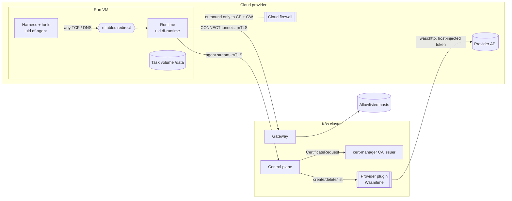
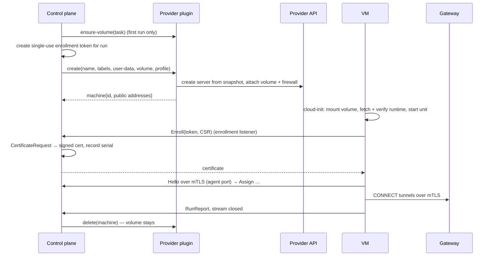
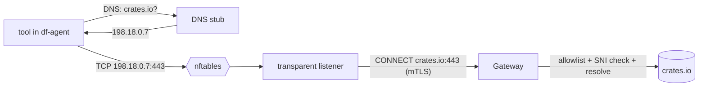

# Cloud VM Sandboxes — Concept

> Concept for running agent sandboxes on on-demand cloud VMs provisioned through a plugin, next to the Kubernetes provider. Covers sandbox profiles, identity, task volumes, egress, the plugin contract, how it fits the existing design and which guarantees change. Hetzner Cloud serves as the example provider throughout; nothing here is Hetzner-specific unless marked. Status: **idea, not planned** — input for a future design decision; it conflicts with current non-goals (§10).

## 1. Motivation and scope

- Some tasks are CPU- or memory-heavy (large non-Bazel builds, test suites, data processing) and would starve the homelab cluster or exceed what a Kata pod should get.
- Cloud providers offer large VMs by the hour, created from a prepared machine image (snapshot) through an API.
- Goal: such tasks run on a cloud VM with the same run model as a Kubernetes sandbox — cold start per run, dial-back, Git as the durable store, gateway-controlled egress — selected per project or task.

In scope:
- Ephemeral VMs, one per run, created and deleted through a provider API.
- A WASI plugin per cloud provider; everything security-relevant stays in the host.

Not in scope:
- Long-lived or shared hosts reached over SSH (rejected: a persistent host breaks the per-run blast radius, and SSH needs inbound access and an SSH key in the control plane).
- Moving the control plane or gateway out of Kubernetes. They keep running in the cluster.
- Nested containers in the VM (ADR-0023 still applies; container-based tests go through RBE).
- Warm pools of VMs (ADR-0022 still applies).

## 2. Overview



## 3. Sandbox profiles

A **sandbox profile** names where and how a run executes. Today the project's image and runtime class implicitly form the only profile; profiles make that explicit.

| Field | Kubernetes provider | Cloud VM provider |
|---|---|---|
| `provider` | `kubernetes` (built-in) | plugin reference (OCI artifact, ADR-0018) |
| Environment | project image (ADR-0022) | machine image / snapshot id |
| Size | resources (CPU, memory) | machine type (e.g. `ccx43`) |
| Isolation | runtime class (Kata) | the VM itself |
| Placement | node selectors | location / region |
| Task volume | PVC size, StorageClass | volume size (§6) |
| Outer egress fence | generated network policy | reference to an admin-created cloud firewall (§8.5) |
| Provider settings | — | opaque key/values validated by the plugin (§9) |

- Profiles are defined at instance scope by admins. Projects pick a default profile; a task may override it with any profile the project allows (e.g. "heavy"). Agents creating subtasks may only choose from the profiles the parent task can use.
- The repository configuration file (ADR-0039) may reference a profile by name, like cluster targets, but never define one.
- Machine images need an allowlist like container images (ADR-0039 §16.1): per provider plugin, a list of allowed image ids or label selectors, checked at save time and at provisioning.
- **Provider capabilities** are reported by the provider and shown with the profile: task volumes (yes/no), outer egress fence (enforced/declared/none), identity bound to source IP (yes/no). The UI marks profiles that are weaker than the Kubernetes default.

## 4. Run lifecycle



- Run states are unchanged: `Provisioning` covers server creation, boot and volume attach; `Connecting` covers enrollment and `Hello`.
- Teardown deletes the VM. The volume is detached by the deletion and stays for the next run.
- **Keep-alive while `AwaitingInput`** (agent-run §6.4) costs money per minute on a VM. The window should be configurable per profile, defaulting to shorter than for Kubernetes.
- **Orphans**: every VM and volume carries the labels `dark-factory.instance`, `dark-factory.run` / `dark-factory.task`. The control plane leader periodically lists them through the plugin and deletes VMs without an active run and volumes of deleted tasks. This replaces Kubernetes owner references; without it, leaks keep billing.

## 5. Identity and mTLS

### 5.1 Problem
ADR-0006 relies on the cert-manager csi-driver, which issues a per-pod certificate whose SAN contains the pod UID, and on the informer cache to verify pod UID and pod IP. A VM has neither a CSI mount nor a pod.

### 5.2 Enrollment
1. Before creating the VM, the control plane creates a **single-use enrollment token** bound to the run: random, short expiry (minutes), stored hashed.
2. The token, the control plane's enrollment and agent endpoints and the instance CA certificate go into the user-data. No private key does.
3. On boot the runtime generates its private key locally (never leaves the VM) and calls `Enroll(token, CSR)` on a small **enrollment listener** (server-authenticated TLS only, one RPC, rate-limited, separate port from the agent port).
4. The control plane checks token, expiry and — where the provider reported one — that the source IP is the VM's public address, marks the token spent, and submits the CSR as a cert-manager `CertificateRequest` against the existing private CA Issuer. The URI SAN is set by the control plane, not taken from the CSR: `spiffe://dark-factory/sandbox/<provider>/<sandbox-id>`.
5. It records the certificate serial with the run and returns the certificate. From here on, the runtime behaves exactly as in a pod: `DF_TLS_DIR` holds `ca.crt`, `tls.crt`, `tls.key`.

Verification on the agent port (`SandboxProvider::resolve_identity`): the SAN's sandbox id maps to an active run **and** the certificate serial matches the recorded one; additionally the peer IP matches the VM's public address if the provider reports one and the path into the cluster preserves client IPs (§13).

Certificate lifetime: the run's wall-clock budget plus keep-alive plus a margin. No rotation; a run that outlives its certificate can't reconnect (rotation over the stream with a new CSR is a later addition).

### 5.3 Why not put the key into user-data
Simpler (no enrollment listener), but:
- The plugin would see the private key, contradicting ADR-0002 ("secrets never enter plugins").
- User-data stays readable from inside the VM through the metadata service for its whole lifetime, and is stored by the provider.

With enrollment, the plugin and the metadata service only ever see a token that is spent seconds after boot. The plugin can't redeem it: its only network path is the host-mediated `wasi:http` to the provider API.

## 6. Task volumes

Cloud block volumes behave like the RWO task PVC (ADR-0009, agent-run §5.1): the provider API attaches a volume to one server at a time, so it doubles as the per-task lock, and the control plane keeps serializing runs per task as before.

- Created on the task's first run through the plugin, labelled with the task; deleted under the existing PVC rules (task closed/merged + grace period, idle TTL, "reset workspace").
- cloud-init waits for the device, creates a filesystem on first use and mounts it at `/data` before the runtime starts. Layout (agent-run §5.2) and the "untrusted at run start" rule are unchanged.
- **Placement pinning:** volumes are bound to a location (Hetzner: one location per volume). All runs of a task run where its volume is. If the machine type is unavailable there, provisioning fails with a capacity reason; the human can retry later or reset the workspace (which drops the pinning).
- A task that switches between a Kubernetes and a VM profile loses its cache: the next run clones fresh and restores the WIP branch. Correct by construction (Git is durable), only slower.
- Providers without volumes work too: every run starts with an empty `/data` (fresh clone + WIP restore; harness session state is lost, so the summary seeding of agent-run §6.4 applies).

## 7. Machine image and runtime delivery

- The machine image replaces the project image. Minimum content: git, a shell, glibc (Claude adapter), systemd, cloud-init, nftables, plus the project toolchain. Building it (Packer, Nix, …) is up to the operator.
- The runtime is **not** baked into the image (same reasoning as ADR-0022). cloud-init downloads the release matching the control plane's protocol version from a URL in the instance configuration and checks it against a sha256 the control plane put into the user-data. Fallback: serve the binary from the control plane's enrollment listener.
- Installed root-owned under `/opt/factory`, with the empty hooks directory and Git config as in the image volume.
- **Two users** (agent-run §17 open question, required here): the runtime runs as `df-runtime`, the harness and everything it starts as `df-agent`. `df-agent` can't read `/run/factory/tls`, `/data/runtime` or modify nftables, and has no `sudo`. The runtime needs to start the harness as another user: a systemd unit with `AmbientCapabilities=CAP_SETUID CAP_SETGID` limited to that, or a fixed helper. This is a runtime change.

## 8. Egress

### 8.1 Problem
In Kubernetes the gateway identifies a sandbox by pod IP (reached via ClusterIP), and a generated network policy ensures the sandbox can only reach the gateway and the control plane. A cloud VM is outside the cluster network: ClusterIPs are unreachable, source IPs may be NATed, and there's no network policy. Relying on `HTTP(S)_PROXY` alone also depends on every tool honouring it (egress.md §8, blind spot).

### 8.2 Transparent interception in the VM
Static nftables rules (part of the machine image or written by cloud-init) redirect **all** traffic of `df-agent` to the runtime:

```nft
table inet df {
  chain nat_out {
    type nat hook output priority -100;
    meta skuid "df-agent" ip daddr != 127.0.0.0/8 tcp dport 1-65535 redirect to :15001
    meta skuid "df-agent" udp dport 53 redirect to :15053
  }
  chain filter_out {
    type filter hook output priority 0;
    meta skuid "df-agent" ip daddr != 127.0.0.0/8 drop   # other UDP (incl. QUIC), ICMP, raw sockets
    meta skuid "df-agent" ip6 daddr != ::1 drop
  }
}
```

The rules never change per run, and the runtime needs no privileges for them. The runtime's own connections (`df-runtime`) are not redirected.

### 8.3 Runtime: DNS stub and transparent listener
- **DNS stub (`:15053`)**: answers every A/AAAA query with a synthetic address from a reserved range (e.g. `198.18.0.0/15`) and remembers address → name for the run. It never forwards queries anywhere, so DNS is closed as an exfiltration channel, as in Kubernetes. Names aren't filtered here: the gateway decides, so denied names show up in the live egress log with their host name.
- **Transparent listener (`:15001`)**: reads the original destination (`SO_ORIGINAL_DST`), maps a synthetic address back to its name, and opens a tunnel to the gateway: `CONNECT name:port` (or `ip:port` for literal addresses) over mTLS with the sandbox certificate. Then it copies bytes in both directions.
- `HTTP(S)_PROXY` is no longer needed in VMs; tools that ignore it work, and every connection attempt reaches the live log.



### 8.4 Gateway changes
- A new listener for tunnels from outside the cluster: mTLS with the sandbox CA; the run is identified by the certificate (SAN + serial from the `PolicyWatch` registry), not by source IP. Initially one TLS connection per tunnel (session resumption keeps the handshake cheap); multiplexing over HTTP/2 `CONNECT` later if needed.
- Allowlist checks, SNI check, own name resolution, refusal of private destinations, live log and aggregates are unchanged.
- **Non-TLS TCP** (e.g. SSH to a forge on port 22): the gateway currently requires a matching TLS SNI. A new allowlist kind (e.g. `tcp-host`: host + port, no SNI check) is needed for such destinations, usable by both providers.
- Cluster targets (`cluster-service`, e.g. NativeLink) can be served through the same tunnel: the gateway connects to the Service on the VM's behalf. That makes them reachable from VMs without exposing them, at the cost of RBE traffic flowing through the gateway.

### 8.5 Outer fence
The nftables rules only hold while the agent doesn't gain root in the VM. As a second layer, the profile references an admin-created **cloud firewall** that allows outbound traffic only to the public addresses of the control plane (enrollment + agent port) and the gateway, and no inbound traffic. The plugin attaches it on creation. Dark Factory can't verify the firewall's rules; the profile declares it, and its absence is shown as "no outer fence".

### 8.6 Comparison with the Kubernetes provider

| Aspect | Kubernetes | Cloud VM |
|---|---|---|
| Inner enforcement | NetworkPolicy (CNI, outside the sandbox) | nftables in the VM (inside the sandbox, protected by uid separation) |
| Outer enforcement | — | Cloud firewall (outside the VM) |
| Gateway identification | Source pod IP | Client certificate |
| Tools ignoring proxy vars | Dropped, not logged | Intercepted and logged |
| DNS | Denied (or cluster DNS per target) | Local synthetic answers only |
| Cluster targets | Direct | Through the gateway tunnel |

### 8.7 Alternatives considered
- **`HTTP(S)_PROXY` with credentials in the URL**: depends on tool support, puts a bearer token into the environment, and sends it in clear unless the proxy speaks TLS — which Node-based harnesses support unevenly.
- **eBPF at TC (traffic control)**: works on packets, not sockets. No process ancestry at that hook (only the socket's cgroup for local traffic), and rewriting means owning NAT state, checksums and possibly encapsulation MTU, while the gateway needs streams with host names anyway.
- **eBPF cgroup `connect4`/`connect6`**: the right eBPF hook (rewrites the destination at `connect()`, like Cilium's socket LB). Kept as an option if nftables matching proves insufficient; costs a loader (`aya`), BTF/kernel-version dependencies and privileges at runtime.
- **WireGuard into the cluster network**: restores IP-based identification and network policies, but needs routing of pod/service CIDRs into the VM and a WireGuard endpoint in the cluster; much more infrastructure.

## 9. Plugin contract

### 9.1 Split of responsibilities

| Host (control plane) | Plugin |
|---|---|
| Profiles, image allowlist, scheduling, run state | Translate requests into provider API calls |
| Enrollment tokens, CSR signing, identity verification | Report machine id, state and public addresses |
| Rendering user-data (cloud-init) | Pass user-data through unchanged |
| Provider API credential, injected into outgoing requests (ADR-0002) | Never sees the credential |
| Orphan reconciliation (decides what to delete) | `list` by labels, `delete` |
| Per-plugin host allowlist (provider API only) | — |

ADR-0030 rejected a sandbox provider as a WASI plugin because Kubernetes provisioning needs watches and identity checks. Here the host keeps both; the plugin only does request/response API calls, which fits the existing plugin model (Forgejo precedent, ADR-0028).

### 9.2 WIT sketch

```wit
package darkfactory:sandbox@0.1.0;

interface types {
  type labels = list<tuple<string, string>>;
  /// Profile settings, opaque to the host (machine type, image id, location, firewall id, ...).
  type settings = list<tuple<string, string>>;

  record machine-request {
    name: string,
    labels: labels,
    settings: settings,
    user-data: string,
    volume-id: option<string>,
  }

  enum machine-state { starting, running, stopping, gone }

  record machine {
    id: string,
    labels: labels,
    state: machine-state,
    public-addresses: list<string>,
  }

  record volume-request {
    name: string,
    labels: labels,
    settings: settings,
    size-gib: u32,
  }

  record volume {
    id: string,
    labels: labels,
    placement: string,
    attached-to: option<string>,
  }

  record capabilities {
    volumes: bool,
    outer-fence: bool,
    public-addresses: bool,
  }

  variant error {
    not-found(string),
    invalid-settings(string),
    capacity(string),
    quota(string),
    unauthorized(string),
    rate-limited(u32),
    upstream(string),
  }
}

interface machines {
  use types.{machine-request, machine, labels, error};
  create: func(req: machine-request) -> result<machine, error>;
  get: func(id: string) -> result<machine, error>;
  delete: func(id: string) -> result<_, error>;
  list: func(selector: labels) -> result<list<machine>, error>;
}

interface volumes {
  use types.{volume-request, volume, labels, error};
  create: func(req: volume-request) -> result<volume, error>;
  delete: func(id: string) -> result<_, error>;
  list: func(selector: labels) -> result<list<volume>, error>;
}

interface provider {
  use types.{settings, capabilities, error};
  capabilities: func() -> capabilities;
  /// Called when an admin saves a profile; rejects unknown or invalid settings.
  validate-settings: func(settings: settings) -> result<_, error>;
}

world machine-provider {
  import wasi:http/outgoing-handler@0.2.12;
  import wasi:config/store@0.2.0-rc.1;
  export provider;
  export machines;
}

world machine-provider-with-volumes {
  include machine-provider;
  export volumes;
}
```

- Same conventions as `darkfactory:integrations` (ADR-0028): capabilities detected from exports, `wasi:config` for plugin-level configuration, capability-free WASI context.
- Operations are idempotent by name/labels where the provider allows it (`create` after a timeout must not create a second VM; the host checks `list` before retrying).
- Calls are short request/response; waiting for boot happens in the host (polling `get`), not in the plugin.

## 10. Alignment with the existing design

| Decision | Fit | Required change |
|---|---|---|
| `product/context.md` §2 non-goals ("only Kubernetes", "no cloud-provider runtimes") | **Conflicts** | Revise the non-goal; the control plane stays Kubernetes-only, sandboxes don't |
| ADR-0030 (Kubernetes only, provider seam, no plugin provider) | Seam fits; decision conflicts | New ADR amending it: profiles, plugin-based machine providers, capability reporting; `ensure_task_volume` and network policy rendering become provider capabilities |
| ADR-0006 (dial-back, mTLS via csi-driver, pod UID + IP) | Dial-back fits unchanged | Second identity scheme: enrollment + `CertificateRequest`, SAN `sandbox/<provider>/<id>`, serial binding; generalize `df-agent-channel` identity parsing |
| ADR-0008 (provisioning vs protocol) | Fits | Provisioning = user-data instead of pod spec; still no secrets except the single-use token |
| ADR-0009 (task PVC as cache and lock) | Fits with volumes | Volume as provider capability; placement pinning |
| ADR-0010 (credentials in the sandbox) | Fits | Same set; the enrollment token is spent at boot |
| ADR-0022 (project images, runtime via image volume) | Partly | Machine image as environment; runtime download with sha256 |
| ADR-0023 (Kata, no nested containers) | Fits | VM is the isolation; rule unchanged |
| ADR-0029 / `egress.md` (gateway, pod-IP identification, generated policies) | **Tension** | Certificate-identified tunnel listener exposed outside the cluster; transparent interception in the runtime; `tcp-host` allowlist kind; outer fence by cloud firewall |
| ADR-0002 / ADR-0018 / ADR-0028 (WASI plugins) | Fits | New package `darkfactory:sandbox` |
| `deployment.md` (RBAC, network policies, exposure) | Partly | `certificaterequests` create/get/delete in the sandbox namespace; enrollment, agent and tunnel ports reachable from outside the cluster (LoadBalancer / TLS passthrough) with matching server certificate SANs; instance-namespace policies allow that ingress |
| agent-run §10, §15 (egress summary, sidecars) | Partly | Egress per provider; sidecars not available on VMs (could become systemd services later) |
| `factory-agent` runtime | Mostly fits | Transparent listener, DNS stub, enrollment client, starting the harness as another user |

## 11. Security guarantees

| Guarantee | Kubernetes | Cloud VM | Residual risk |
|---|---|---|---|
| Fresh sandbox per run | Cold-started pod | Cold-started VM from an image | Same |
| Blast radius = one run | Kata VM per pod | Dedicated VM per run | Same |
| Identity can't be replayed elsewhere | Cert bound to pod UID + pod IP | Cert bound to run + serial (+ public IP where available) | Without IP binding, a stolen key works from anywhere until it expires or the run ends |
| Key never stored outside the sandbox | csi-driver, no Secret | Generated in the VM, only CSR leaves | Same |
| Bootstrap secret | None | Single-use token in user-data | Readable by the provider and the plugin until spent; useless after boot |
| Egress only via gateway | NetworkPolicy outside the sandbox | nftables inside + cloud firewall outside | Inner layer falls with root in the VM; outer layer is admin-configured and not verified |
| No DNS exfiltration | DNS denied | Synthetic local answers | Same |
| No Kubernetes API access | No SA token | Not reachable | Same |
| Control plane exposure | Agent port reachable from the sandbox namespace only | Enrollment, agent and tunnel ports reachable from the internet | Handshake requires a client cert (agent, tunnel); enrollment needs a valid token; larger surface for DoS and TLS bugs |
| Provider trust | Own cluster | Cloud provider sees VM memory, disk and user-data | Inherent to cloud VMs; not suitable for repositories that must not leave the homelab |
| Plugin trust | — | Plugin reports addresses and attaches the firewall | Admin-installed plugins are trusted for this; they still never see credentials |

## 12. Tradeoffs

- **Cost and leaks**: VMs and volumes bill while they exist; orphan reconciliation and shorter keep-alive windows become correctness concerns, not hygiene.
- **Start-up latency**: server creation, boot, volume attach and runtime download add up to tens of seconds to minutes. Acceptable under ADR-0022's throughput-over-latency stance, but noticeable for short runs — VM profiles are for heavy tasks only.
- **Two egress mechanisms** to maintain and test (NetworkPolicy + explicit proxy in pods, interception + tunnel in VMs). Interception could later be brought to pods (init container with `NET_ADMIN`, like Istio), which would unify them, at the cost of a privileged init step.
- **Gateway in the data path for cluster targets**: RBE traffic from VMs flows through the gateway.
- **Homelab exposure**: three ports on the public address of the cluster, which the current design avoids entirely.
- **Data residency**: repository contents and caches live at the cloud provider.
- **Machine images per project**: one more artifact per project to build and allowlist.
- **Volume placement pinning** can block a task when its location lacks capacity.

## 13. Open questions and to verify

- Client IP preservation from the internet to the control plane and gateway (LoadBalancer `externalTrafficPolicy: Local`, PROXY protocol) — needed for IP binding and the enrollment IP check.
- Runtime privilege model for starting the harness as `df-agent` (ambient capabilities vs a helper) and whether `/run/factory` socket permissions keep the MCP and credential-helper paths working across users.
- `SO_ORIGINAL_DST` through a safe wrapper (`unsafe_code` is forbidden; `rustix` is already in the lock file).
- Tools that break with synthetic DNS answers (e.g. clients that pin or validate resolved addresses).
- Tunnel cost: one TLS connection per tunnelled connection vs HTTP/2 multiplexing for dependency-heavy builds.
- Certificate rotation for runs longer than the issued lifetime.
- Whether the outer fence can be verified (reading the firewall rules through the plugin) instead of only declared.
- Image allowlist semantics for machine images (ids vs labels; provider-specific).
- Hetzner specifics to verify: outbound rules of Cloud Firewalls, `volumes` and `firewalls` on server creation, metadata service path for user-data, per-server volume limits.
