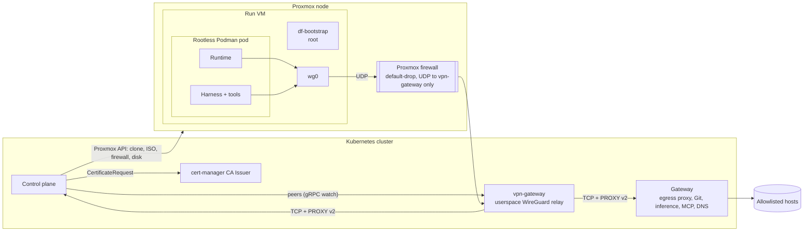
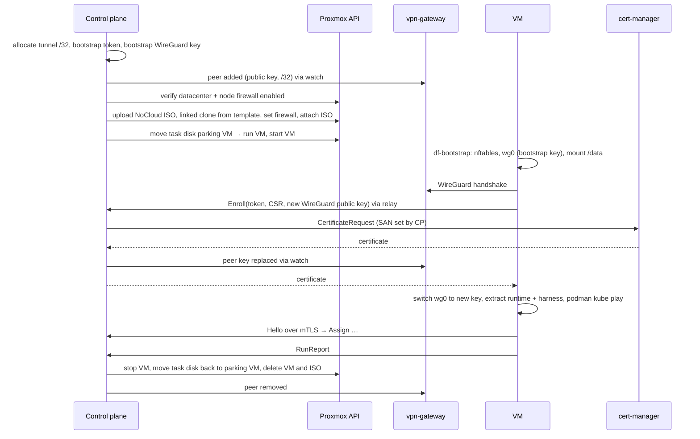

# VM Sandboxes

> Design for running agent sandboxes as full VMs next to the Kubernetes provider: Proxmox in-tree as the first provider, cloud providers (Hetzner Cloud, Scaleway, OVH, …) later as WASI plugins. VMs join the factory through a WireGuard tunnel to a userspace relay (the **vpn-gateway**) and then obey the same egress gateway, identity and mTLS rules as Kubernetes sandboxes. Decision: [ADR-0054](../docs/adr/0054-vm-sandboxes-wireguard-relay-proxmox-in-tree.md). Origin: handoff in issue #60. Status: **designed, not planned** — the prerequisites and their order are in the roadmap backlog (§16).

## 1. Motivation and scope

Kata pods hit limits for some tasks:
- **Containers:** agents that need to start containers (integration tests with Testcontainers, `docker compose` setups) can't, because Kubernetes sandboxes run no container daemons (ADR-0023).
- **Size and hardware:** CPU- or memory-heavy builds, GPUs or another CPU architecture.

VM sandboxes cover these as a **capability tier**: Kubernetes stays the default, a VM is chosen through a sandbox profile (§3).

In scope:
- One cold-started VM per run, created and deleted through a provider API, with the same run model as Kubernetes: dial-back, Git as the durable store, gateway-controlled egress, per-task workspace volume.
- Proxmox VE as an in-tree provider; a WASI plugin contract for cloud providers (§11).

Not in scope:
- Long-lived or shared hosts reached over SSH (rejected: a persistent host breaks the per-run blast radius, and SSH needs inbound access and a key in the control plane).
- Moving the control plane, the gateway or the vpn-gateway out of Kubernetes.
- Warm pools of VMs (ADR-0022 still applies).
- AWS: request signing (SigV4) does not fit the plugin model's host-injected credentials (rejected).

## 2. Overview



The VM has exactly one way out: `wg0` to the vpn-gateway. The vpn-gateway never routes packets; it accepts a fixed set of TCP services on its tunnel address and opens a new connection into the cluster for each, carrying the VM's tunnel address in a PROXY protocol v2 header.

## 3. Sandbox profiles

A **sandbox profile** names where and how a run executes. Today the project image and the runtime class implicitly form the only profile, `kubernetes`.

| Field | Kubernetes | Proxmox | Cloud plugin |
|---|---|---|---|
| `provider` | `kubernetes` (built-in) | `proxmox` (built-in, cargo feature) | plugin reference (OCI artifact, ADR-0018) |
| Environment | project image (ADR-0022) | project image, run by Podman in a VM cloned from the profile's template | same as Proxmox |
| Size | resources | CPU cores, memory | machine type |
| Isolation | runtime class (Kata) | the VM | the VM |
| Placement | node selectors | allowed Proxmox nodes | location |
| Task volume | PVC size, StorageClass | disk size, storage | volume size |
| Outer egress fence | generated network policy | firewall set and verified by the control plane (§9.4) | provider firewall |
| Capacity | namespace quota | max concurrent VMs (§9.6) | max concurrent VMs |
| Capabilities shown | — | containers, no cluster targets (§5.7) | containers, provider-specific gaps |

- Profiles are defined in the instance configuration (Helm values) for now; editing them in the admin UI (ADR-0020) is a backlog item. The default profile is `kubernetes`, so nothing changes for existing projects.
- A project chooses a default profile; a task may override it with any profile the project allows. Subtasks may only use profiles their parent may use.
- The repository configuration file (ADR-0039) may reference a profile by name, never define one.
- Capabilities (`containers`, `gpu`, `arch`, missing cluster targets) are attributes shown with the profile, not constraints a scheduler matches.
- A task that switches between profiles loses its workspace cache: the next run clones fresh and restores the WIP branch. Correct by construction (Git is durable), only slower.

## 4. Run lifecycle



- Run states are unchanged: `Provisioning` covers clone, ISO, disk move and boot; `Connecting` covers handshake, enrollment and `Hello`.
- The provider reports `Started` when the VM runs (address = the run's tunnel IP) and `Gone` when it is stopped or missing (§9.7). `SandboxEvent::Started.pod_ip` is renamed to `address`.
- Teardown removes the peer first (cuts the network within seconds), then deletes the VM. The task disk survives in the parking VM.

## 5. Network: WireGuard and the vpn-gateway

### 5.1 Tunnel
- **In the VM:** kernel WireGuard `wg0`, configured by `df-bootstrap` (root), never by the runtime. One peer, the vpn-gateway, with `AllowedIPs = 0.0.0.0/0, ::/0`, the run's tunnel /32, an explicit MTU and `PersistentKeepalive`. The VM's own UDP flow to the endpoint stays outside the tunnel (explicit route). Agent subprocesses (git, cargo, npm, sibling containers) use the tunnel as a normal interface.
- **In the vpn-gateway:** userspace WireGuard (boringtun) with a userspace TCP/IP stack (smoltcp or similar; `onetun` is prior art). One peer per run with `AllowedIPs = <tunnel /32>`, so cryptokey routing drops spoofed sources before the TCP stack sees them.

### 5.2 Relay
The vpn-gateway listens on its tunnel address (default `10.200.0.1`) for a fixed list of services, the set a Kubernetes sandbox reaches today. For each accepted connection it opens a TCP connection to the in-cluster target and sends a PROXY v2 header with the VM's tunnel IP first.

| Tunnel port | Target |
|---|---|
| agent port | control plane agent listener (dial-back) |
| enrollment port | control plane enrollment listener (§6.1) |
| proxy port | gateway egress proxy |
| Git port | gateway Git proxy |
| inference port | gateway inference endpoint (ADR-0050), once it exists |
| MCP port | gateway upstream MCP endpoint (ADR-0032), once it exists |
| 53 (UDP and TCP) | gateway DNS resolver (§5.6) |

- Everything else is dropped: no forwarding, no peer-to-peer traffic, no other ports. The list is configuration, not per run; a new gateway port means a new relay entry.
- The control-plane dial-back uses its own relay port, not `CONNECT` through the egress proxy: the binding check (§6.3) then sees the tunnel IP directly, and the proxy stays unchanged for this path.
- The pod is unprivileged: no TUN device, no `NET_ADMIN`, no IP forwarding; only the UDP port. Its egress policy allows only the gateway and control plane Services.
- Return traffic always reaches the replica that opened the connection, so there is no routing state. Start with one replica (failover = restart); two replicas later share the WireGuard private key and the peer list behind a UDP load balancer with client affinity. On replica loss, VMs re-handshake within ~10–15 s, in-flight TCP connections break and the dial-back reconnects.

### 5.3 Identification in the gateway and the control plane
- Both accept a PROXY v2 header only on connections from vpn-gateway pods (checked by source pod IP, like sandbox pods today). A connection from a vpn-gateway pod without a header is refused.
- The sandbox registry in the `PolicyWatch` snapshot is keyed by "pod IP or tunnel IP". Allowlist checks, the live egress log, inference routing and the Git proxy work unchanged for VMs.

### 5.4 Peers
- The control plane owns the desired peer set (public key, tunnel /32 per active run) and serves it to the vpn-gateway as a gRPC watch (snapshot plus updates), the same pattern as the gateway's `PolicyWatch`. No CRD.
- The vpn-gateway is a separate crate (`df-vpn-gateway`), image and Deployment, enabled in the chart with `vpnGateway.enabled` (default off).

### 5.5 Tunnel addresses and endpoint
- **CIDR:** configurable, default `10.200.0.0/16`, the vpn-gateway on `.0.1`. IPv4 only. The chart rejects overlaps with the configured pod and Service CIDRs.
- **Allocation:** one /32 per run, allocated by the control plane in PostgreSQL (unique constraint). An address is reused only 24 h after its run ended, longer than any certificate issued for it.
- **Exposure:** the chart exposes the vpn-gateway's UDP port as a Service of a configurable type and optionally a Gateway API `UDPRoute` with configurable `parentRefs`. How it becomes reachable (LoadBalancer, NetBird, a Gateway) is the operator's choice.
- **Endpoint:** VMs dial `vpnGateway.endpoint` (`host:port`). The VM has no DNS before its tunnel is up, so the control plane resolves the host at provisioning and writes the IP into the VM's WireGuard configuration and into the per-VM firewall rule (§9.4). `vpnGateway.endpointCIDRs` overrides the firewall rule's destination when the endpoint sits behind several or changing addresses. NAT on the way (NetBird, load balancers) is irrelevant: the WireGuard key is the identity.

### 5.6 DNS
- VM sandboxes require the gateway DNS resolver (`egress.md` §12); there is no interim solution. The gateway attributes queries by tunnel IP like proxy connections and answers only allowlisted and internal names (control plane, gateway), so DNS stays closed as an exfiltration channel.
- The relay converts the VM's UDP queries into DNS-over-TCP connections to the resolver, each with a PROXY v2 header, so the resolver has a single identity path (TCP plus header). PROXY v2 over UDP was rejected as rarely implemented and a second path.
- One control-plane name works in every environment: in pods it resolves to the Service, in VMs to the relay address.

### 5.7 Cluster targets
The first Proxmox version has no cluster targets (e.g. NativeLink RBE): the relay exposes only the fixed list, and the profile shows the missing capability. Later, the gateway opens connections to `cluster-service` entries on a VM's behalf through `CONNECT`, plus a non-TLS TCP allowlist kind where a target is not TLS (backlog).

## 6. Identity and certificates

### 6.1 Enrollment
1. Before the VM is created, the control plane creates a **single-use bootstrap token** (random, minutes TTL, stored hashed, bound to the run and its tunnel IP) and a **bootstrap WireGuard key pair**, and registers the public key as the run's peer.
2. Token, bootstrap WireGuard private key, CA bundle, relay endpoint and image digests go onto the per-run ISO (§9.2). No mTLS key does.
3. `df-bootstrap` brings up `wg0` with the bootstrap key, generates the mTLS private key and a **new WireGuard key pair** locally, and calls `Enroll(token, CSR, new WireGuard public key)` on the enrollment port. The enrollment listener is server-authenticated TLS only, accepts exactly this RPC and is reachable only through the relay.
4. The control plane checks token, expiry and that the PROXY header's tunnel IP is the run's, marks the token spent, submits a cert-manager `CertificateRequest` with the CSR, replaces the peer's public key with the new one, and returns the certificate.
5. `df-bootstrap` switches `wg0` to the new key and writes `tls.crt`, `tls.key`, `ca.crt` to the directory the runtime reads (`DF_TLS_DIR`), the same interface csi-driver provides in pods.

Everything on the ISO — token and bootstrap key — is worthless after enrollment.

### 6.2 Certificates
- URI SAN `spiffe://dark-factory/sandbox/<run-id>`, set by the control plane, never taken from the CSR. Kubernetes pods keep the csi-driver SAN `spiffe://dark-factory/ns/<ns>/pod/<name>/<uid>`; identity resolution dispatches by SAN shape to the provider that issued it.
- Short lifetime (e.g. 1 h). At about 2/3 of it `df-bootstrap` sends a new CSR over mTLS; renewal is refused once the run is terminal, which revokes without CRLs. The runtime reloads the files as it does for rotated csi-driver certificates.
- **Approval:** cert-manager's default approver. Only the control plane's Role may create `CertificateRequest`s, and it sets the SAN itself. cert-manager approver-policy restricting the SAN to `spiffe://dark-factory/sandbox/*` is documented as optional hardening, not a prerequisite.

### 6.3 Binding check
A connection counts as run X only when both factors agree:

| Factor | Proves | Checked by |
|---|---|---|
| WireGuard key → tunnel /32 | Packets from this /32 come from the holder of that key | vpn-gateway (cryptokey routing) |
| Tunnel IP in the PROXY header | The network identity, without trusting L3 inside the cluster | gateway, control plane |
| Client certificate SAN | The caller holds the key enrolled for run X | control plane (mTLS) |
| Binding | Tunnel IP and SAN map to the same run | control plane, on every stream |

A stolen certificate used from another tunnel fails, and so does a stolen WireGuard key without the certificate.

## 7. Inside the VM

### 7.1 `df-bootstrap`
A static musl binary from this repository (`df-bootstrap` crate), delivered on the per-run ISO and checked against a digest, run as a root systemd unit. Because it is not baked into the template, a Dark Factory release never needs a template rebuild.

1. Apply in-guest nftables: default-drop egress except `wg0` and the WireGuard UDP flow.
2. Bring up `wg0`, set the default route and the resolver (relay address).
3. Enroll (§6.1) and keep renewing.
4. Mount the task disk at `/data` (format on first use).
5. Create the unprivileged sandbox user and its subuid range.
6. Pull the project, runtime and harness images through the egress proxy, pinned by digest, signatures checked via `policy.json`. Extract runtime and harness read-only to host directories.
7. Start the run's Pod spec with `podman kube play` from a Quadlet `.kube` unit as the sandbox user.
8. Arm a maximum-lifetime power-off timer (root-owned, independent of the control plane).

### 7.2 Pod spec
The control plane renders the same Pod as for Kubernetes (plain-Pod change, `openspec/changes/k8s-plain-pod-sandboxes`). `df-proxmox` translates it mechanically:

| Kubernetes | VM |
|---|---|
| `image` volumes (runtime, harness) | read-only `hostPath` to the extracted directories (rootless `kube play` has no image volumes) |
| csi-driver certificate volume | read-only `hostPath` to the bootstrap's TLS directory |
| task PVC at `/data` | `hostPath` to the mounted task disk, `io.podman.annotations.userns=keep-id` |
| memory `emptyDir` at `/run/factory` | tmpfs |
| `securityContext.seccompProfile` | seccomp profile from `containers.conf` (`kube play` ignores the field) |

Proxy variables and DNS are set explicitly; rootless networking (pasta) egresses through the host routing table, i.e. `wg0`.

### 7.3 Agent-launched containers
- The sandbox user's rootless Podman socket is mounted into the harness container; the agent starts sibling containers instead of nesting Podman. Siblings join the pod network namespace or get the same proxy and DNS settings; bind-mount paths are identical inside and outside.
- Allowed because the VM, not the container, is the security boundary (amends ADR-0023 for VM sandboxes only).
- Any image from a registry on the run's egress allowlist may be pulled; there is no separate image allowlist for siblings. Every pull passes the egress proxy and its live log.
- The seccomp profile from `containers.conf` applies to siblings too.

### 7.4 Hardening

| Layer | Measure | First version |
|---|---|---|
| Outside the guest | Proxmox firewall, default-drop, verified (§9.4) | required |
| Outside the guest | Remote kill: peer removed, renewal refused, VM deleted | required |
| Guest | nftables default-drop except `wg0` | required |
| Guest | Root-owned maximum-lifetime power-off | required |
| Container | seccomp via `containers.conf`, also for siblings | required |
| Container | No `--privileged`, capabilities dropped, read-only root filesystem where possible | required |
| Secrets | `tls.key` mounted only into the runtime container, never the harness | required |
| Secrets | No model credentials in the VM: the gateway swaps placeholders (ADR-0050) | required (depends on ADR-0050) |
| Guest kernel | `kernel.modules_disabled=1` after boot, `unprivileged_bpf_disabled`, `kptr_restrict`, `dmesg_restrict`, lockdown | backlog |
| Process | Landlock in the runtime or harness | backlog |
| Observability | eBPF audit in the guest (e.g. Tetragon) | backlog |

User namespaces stay enabled: rootless Podman needs them.

## 8. Task volumes

> **To revisit before implementation:** the parking-VM approach below is the current plan, not final.

- Proxmox disks always belong to a VM ID, and deleting a VM deletes its disks. Each node gets one never-started, tagged **parking VM**, created by the control plane on first use, that owns all task disks between runs.
- Run start: move the task disk from the parking VM to the run's VM (`move_disk` with `target-vmid`). Teardown: stop the VM, move the disk back, delete the VM. If teardown fails halfway, the reconcile loop repeats the move before deleting.
- Proxmox can only reassign a disk between VMs on the same node, whatever the storage. A task is therefore pinned to the node holding its disk (§9.3).
- Created on a task's first run, deleted under the existing PVC rules (task closed + grace period, idle TTL, "reset workspace"). Layout (`agent-run.md` §5.2) and the "untrusted at run start" rule are unchanged.
- The disk is the per-task lock, as the RWO PVC is: it is attached to one VM at a time, and the control plane keeps serializing runs per task.

## 9. Proxmox provider

In-tree crate `df-proxmox` implementing `SandboxProvider`, behind the `proxmox` cargo feature of the `dark-factory` binary. Proxmox is the most common homelab hypervisor and fits the project's scope permanently; it is not a stepping stone to a plugin.

### 9.1 Template
- Built by the operator; the repository ships a reference build script and the minimum package list: systemd, cloud-init (NoCloud), Podman (rootless, Quadlet), WireGuard tools, nftables. Optionally pre-pulled base image layers.
- One template per profile, referenced by VM ID. Runs are linked clones (seconds); linked clones need storage that supports them (ZFS, Ceph RBD, LVM-thin, qcow2) and stay on the template's storage.

### 9.2 Bootstrap delivery
- The Proxmox API cannot upload cloud-init snippets, and the built-in cloud-init fields are readable by anyone with `VM.Audit`. The control plane therefore builds a per-run **NoCloud ISO** (user-data, meta-data, `df-bootstrap`), uploads it through the storage upload API (content type `iso`), attaches it as CD-ROM and deletes it at teardown.
- Rejected: SSH to the Proxmox nodes to place snippets (hypervisor SSH credentials in the control plane), token in `sshkeys` or `description` (a hack, readable via the API).

### 9.3 Placement
- A profile lists its allowed nodes. A task's first run goes to the allowed node with the fewest running sandbox VMs; later runs go to the node holding the task disk. If that node is full or offline, the run gets `Capacity` and is retried. "Reset workspace" drops the pinning.

### 9.4 Firewall
- Per VM, the control plane sets: firewall enabled, `policy_in` and `policy_out` `DROP`, `ipfilter`, `macfilter`, `firewall=1` on the NIC, and one outbound rule: UDP to the vpn-gateway endpoint (§5.5).
- Before every provisioning it verifies that the datacenter and node firewalls are enabled (a VM-level policy has no effect otherwise; the datacenter firewall is off by default) and fails the run with `provisioning_failed`, naming the missing setting, if not.
- The profile names a dedicated bridge or VLAN. The control plane checks that it exists; that the router behind it has no route except to the vpn-gateway endpoint is documented operator responsibility.

### 9.5 Connection and credentials
- Instance configuration: API URL, CA bundle for the (usually self-signed) API certificate — no "insecure" switch — and a reference to a Kubernetes Secret holding the API token, read through the `SecretStore`.
- The token is privilege-separated (`privsep=1`) and scoped to one resource pool, the sandbox storage, the sandbox bridge and the template VMs. Expected privileges (to verify): `VM.Clone` on templates; `VM.Allocate`, `VM.Config.*`, `VM.PowerMgmt`, `VM.Audit` on the pool; `Datastore.AllocateSpace` and ISO upload on the storage; `SDN.Use` on the bridge; `Sys.Audit` to read the datacenter and node firewall state. Never `root@pam`.

### 9.6 Capacity
- Proxmox pools enforce no CPU or memory limits. Each profile fixes CPU and memory per VM and a maximum of concurrent VMs; the control plane enforces the maximum and returns `ProviderError::Capacity` (the run is retried, the attempt doesn't count as a resume). This keeps agent builds from starving the Kubernetes nodes on the same hosts.

### 9.7 Events
- The provider polls `/cluster/resources?type=vm` (one call for all VMs, every 5 s): `Started` when a run's VM is running, `Gone` with a reason when it is stopped or missing. A VM that runs but never handshakes is covered by the connect timeout.

### 9.8 Orphan reconciliation
- VMs, task disks, parking VMs and ISOs carry tags (instance, run, task). The leader replica's hourly reconcile deletes VMs without an active run, disks of deleted tasks and ISOs without a VM. Proxmox has no server-side tag filter; the listing is filtered in the control plane.

## 10. Comparison with the Kubernetes provider

| Aspect | Kubernetes | Proxmox VM |
|---|---|---|
| Isolation | Kata VM per pod | VM per run |
| Outer egress fence | NetworkPolicy | Proxmox firewall (verified) + WireGuard-only path |
| Inner egress fence | — | nftables in the guest |
| Gateway identification | Source pod IP | Tunnel IP in PROXY header |
| mTLS identity | csi-driver, pod UID + IP | Enrollment, SAN with run id, bound to tunnel IP |
| DNS | Gateway resolver (once built) | Gateway resolver through the relay (required) |
| Containers | None (ADR-0023) | Rootless Podman siblings |
| Cluster targets | Direct | Not in the first version (§5.7) |
| Workspace volume | RWO PVC | Proxmox disk, moved between VMs |

## 11. Cloud provider plugins (later)

Cloud providers are WASI plugins, not in-tree code: one in-tree implementation per cloud does not scale. Hetzner Cloud is the first candidate. The host keeps everything security-relevant; the plugin translates request/response calls to the provider API.

| Host (control plane) | Plugin |
|---|---|
| Profiles, scheduling, run state, tunnel addresses, peers | Translate requests into provider API calls |
| Bootstrap token and key, enrollment, CSR signing, identity | Report machine id, state, addresses |
| Rendering user-data (cloud-init, same content as the Proxmox ISO) | Pass user-data through unchanged |
| Provider credential, injected into outgoing requests (ADR-0002) | Never sees the credential |
| Orphan reconciliation (decides what to delete) | `list` by labels, `delete` |

WIT sketch (`darkfactory:sandbox`, to be finalized with the Hetzner plugin):

```wit
package darkfactory:sandbox@0.1.0;

interface types {
  type labels = list<tuple<string, string>>;
  /// Profile settings, opaque to the host (machine type, image id, location, firewall id, ...).
  type settings = list<tuple<string, string>>;

  record machine-request { name: string, labels: labels, settings: settings, user-data: string, volume-id: option<string> }
  enum machine-state { starting, running, stopping, gone }
  record machine { id: string, labels: labels, state: machine-state, public-addresses: list<string> }
  record volume-request { name: string, labels: labels, settings: settings, size-gib: u32 }
  record volume { id: string, labels: labels, placement: string, attached-to: option<string> }

  variant error {
    not-found(string), invalid-settings(string), capacity(string), quota(string),
    unauthorized(string), rate-limited(u32), upstream(string),
  }
}

interface machines {
  use types.{machine-request, machine, labels, error};
  create: func(req: machine-request) -> result<machine, error>;
  get: func(id: string) -> result<machine, error>;
  delete: func(id: string) -> result<_, error>;
  list: func(selector: labels) -> result<list<machine>, error>;
}

interface volumes {
  use types.{volume-request, volume, labels, error};
  create: func(req: volume-request) -> result<volume, error>;
  delete: func(id: string) -> result<_, error>;
  list: func(selector: labels) -> result<list<volume>, error>;
}

interface provider {
  use types.{settings, error};
  /// Called when a profile is loaded; rejects unknown or invalid settings.
  validate-settings: func(settings: settings) -> result<_, error>;
}

world machine-provider {
  import wasi:http/outgoing-handler@0.2.12;
  import wasi:config/store@0.2.0-rc.1;
  export provider;
  export machines;
}

world machine-provider-with-volumes {
  include machine-provider;
  export volumes;
}
```

- Calls are short request/response; the host polls `get`/`list` for state, so no watch is needed in the plugin. Operations are idempotent by name and labels (`create` after a timeout must not create a second VM; the host checks `list` first).
- Providers whose API needs request signing (AWS SigV4) don't fit host-injected credentials and are out of scope.

Hetzner specifics, deferred to the Hetzner ADR:
- **Firewall gaps:** the metadata server, the Hetzner DNS resolver and rescue traffic always pass the Cloud Firewall, and private networks are not covered. Mitigation: guest nftables drops `169.254.169.254` and DNS except the relay; no private networks attached; the firewall is bound by label and verified per server. User-data stays readable through the metadata server, which enrollment makes harmless (§6.1).
- **Endpoint direction:** inbound UDP at home (default) or the vpn-gateway dialing the VM's public address.
- **Hairpin:** every byte goes cloud VM → home uplink → egress proxy → internet and back. Mitigations in rising complexity: pre-pulled image layers in the snapshot, pull-through caches, a second gateway in the cloud.
- **Data residency:** repository contents live at the provider; not suitable for repositories that must not leave the homelab.

## 12. Alignment with the existing design

| Decision | Change |
|---|---|
| `product/context.md` §2 ("only Kubernetes, no cloud-provider runtimes") | Control plane, gateways and vpn-gateway stay on Kubernetes; sandboxes may be VMs |
| ADR-0030 (Kubernetes only, no plugin provider) | Amended by ADR-0054: Proxmox in-tree, cloud providers as plugins, profiles |
| ADR-0023 (no nested containers) | Amended by ADR-0054: VM sandboxes may run sibling containers |
| ADR-0006 (dial-back, csi-driver identity) | Second identity scheme: enrollment, run-id SAN, tunnel IP binding |
| ADR-0022 (project images, image volumes) | Same images; image volumes become extracted `hostPath` directories in VMs |
| ADR-0029 / `egress.md` (pod-IP identification) | Registry keyed by pod or tunnel IP; PROXY v2 from vpn-gateway pods only |
| ADR-0050 (model traffic through the gateway) | Prerequisite: no model credentials in VMs |
| `deployment.md` | vpn-gateway Deployment and exposure; `certificaterequests` create/get/delete for the control plane; ingress for the relay targets from vpn-gateway pods |
| `agent-run.md` §15 (sidecars) | Sidecars would come along with the Pod spec; native sidecar support in `kube play` to verify |

## 13. Security guarantees

| Guarantee | Kubernetes | Proxmox VM | Residual risk |
|---|---|---|---|
| Fresh sandbox per run | Cold-started pod | Linked clone per run | Same |
| Blast radius = one run | Kata VM per pod | VM per run | Same |
| Egress only via the gateway | NetworkPolicy outside the sandbox | Proxmox firewall outside the VM + tunnel-only path; nftables inside | A missing bridge/router isolation (operator responsibility) exposes the LAN after a guest root escalation |
| Identity can't be replayed elsewhere | Cert bound to pod UID + IP | Cert bound to run + tunnel IP (WireGuard key) | Same |
| Key never stored outside the sandbox | csi-driver | Generated in the VM, only the CSR leaves | Same |
| Bootstrap secrets | None | Token and bootstrap WireGuard key on the ISO | Readable on Proxmox storage until enrollment; worthless after |
| No DNS exfiltration | Gateway resolver | Gateway resolver via relay | Same |
| Escape lands on | Kata VM host | Sandbox bridge/VLAN | Depends on the dedicated bridge; documented |

## 14. Tradeoffs
- **More moving parts:** vpn-gateway, enrollment, ISO handling, parking VMs and a second Pod-spec target to test.
- **Start-up latency:** clone, boot, enrollment and image pulls take tens of seconds to minutes. Acceptable under ADR-0022; VM profiles are for tasks that need them.
- **Node pinning:** a task stays on the node holding its disk; a full or offline node blocks it until reset.
- **No cluster targets** in the first version.
- **Operator duties:** template build, dedicated bridge or VLAN, datacenter firewall on, a scoped API token.

## 15. Alternatives considered
- **nftables interception in the VM plus mTLS `CONNECT` tunnels to gateway ports exposed to the internet** (previous concept): the outer fence only declared, three ports on the homelab's public address, a DNS stub with synthetic answers and a transparent listener in the runtime. Rejected for the WireGuard relay: one closed path, no public ports for Proxmox, the gateway unchanged apart from PROXY headers.
- **WireGuard L3 router into the cluster network:** needs per-/32 routing state, `NET_ADMIN` and forwarding; masquerading destroys the identity. Rejected for the userspace relay.
- **Dedicated sandbox VLAN with source-IP identity (no WireGuard) for Proxmox:** simpler, but security would rest on Proxmox and router configuration and it would be a second mechanism next to clouds. Rejected.
- **Per-project machine images with a downloaded runtime:** one more artifact per project and no sibling containers in the same Pod model. Rejected for the same OCI images under Podman.
- **Proxmox as a WASI plugin:** the provider needs ISO building, disk moves and polling with state; Proxmox is permanent scope. Rejected; plugins are for clouds.
- **`kube play` rootful, or an init container copying the runtime:** larger blast radius, or a second delivery path next to image volumes. Rejected for bootstrap extraction.
- **Control-plane dial-back through the egress proxy:** the proxy would have to forward the tunnel IP to the control plane. Rejected for a dedicated relay port.
- **Peers as a CRD:** a new CRD and RBAC for state the control plane already owns. Rejected for a gRPC watch.
- **cert-manager approver-policy as a prerequisite:** one more cluster dependency for a check the control plane already does. Kept as optional hardening.
- **SPIFFE/SPIRE with node attestors:** a second identity system next to cert-manager; SPIFFE IDs in the SAN keep a later switch cheap. Rejected for now.

## 16. Prerequisites, open questions and to verify

Order of work (roadmap backlog):
1. Gateway DNS resolver (`egress.md` §12).
2. Plain Pods instead of agent-sandbox (`openspec/changes/k8s-plain-pod-sandboxes`).
3. vpn-gateway relay spike (boringtun + userspace stack + PROXY v2 against the gateway).
4. `Enroll` and cert-manager spike; `Enroll` is added to `contract/` here.
5. Proxmox provider.
6. Cloud plugins: WIT contract, then Hetzner (own ADR).

Open:
- Task disks between runs (§8): revisit the parking-VM approach before implementation.

To verify (Proxmox facts from search results or unverified knowledge; pve.proxmox.com was not reachable during the design):
- Exact token privileges for clone, configure, firewall, ISO upload, disk move, start, delete.
- Whether a disk can be moved off a running VM or only off a stopped one.
- Linked-clone storage requirements and clones across nodes from a template on shared storage.
- Native sidecars (init containers with `restartPolicy: Always`) under `podman kube play`.
- boringtun + userspace TCP/IP stack throughput at expected agent load.
