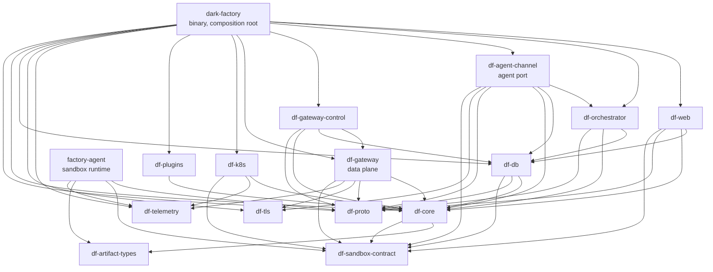

# Architecture: crates and boundaries

The workspace: which crate owns what and which crate may depend on which. Reviewers check changes against it (Standards axis). The column "Status" is `current` for what is built; a change that plans a crate marks it **target** with the change's name until it is built. A change that adds a workspace dependency edge or moves ownership updates this file in the same change.

## Dependency graph

Arrows point from a crate to its dependencies. Test-only crates (`df-test-postgres`, `df-e2e`, `fake-acp-agent`) and `tools/xtask` are left out.

## Crates

| Crate | Owns | May depend on (workspace) | Status |
|---|---|---|---|
| `dark-factory` | The binary and its subcommands; config loading; wiring of adapters (composition root) | any crate | current |
| `df-core` | Domain types and rules: IDs, task and run state machines (`task_transition`, `run_transition`), routing, webhook rules, the trait seams (`SandboxProvider`, `ForgeClient`, `SecretStore`), configuration types (`config`) | `df-artifact-types`, `df-sandbox-contract` | current |
| `df-db` | The schema, migrations and every SQL query; sole user of `sqlx` queries | `df-core`, `df-proto`, `df-sandbox-contract` | current |
| `df-proto` | Generated protobuf/gRPC wire types | none | current |
| `df-web` | Web UI and its HTTP handlers; data access through `df-db` | `df-core`, `df-db`, `df-proto`, `df-sandbox-contract` | current |
| `df-agent-channel` | The agent port: mTLS gRPC server, agent sessions (persistence, acks, prompts), the `Assign` message with the continuation summary, factory tools, run metrics | `df-orchestrator`, `df-db`, `df-core`, `df-proto`, `df-tls`, `df-sandbox-contract` | current |
| `df-orchestrator` | Control-plane orchestration: scheduler (including the creation of a base task's branch at every start of a task with a base task), run lifecycle (`finish_run`, teardown), run context loading, PR lifecycle, webhook application, volume retention | `df-db`, `df-core`, `df-proto` (transcript payloads, rule 3) | current |
| `df-gateway` | Egress data plane: proxy, git proxy, inference proxy, policy watch, log tail, the gateway link (`test-util` feature: `link::PlainConnector`); no database | `df-core`, `df-proto`, `df-tls`, `df-telemetry`, `df-sandbox-contract` | current |
| `df-gateway-control` | The control plane's side of the gateway links: policy service, git/usage/denial records, inference routes, log relay | `df-gateway` (link and flow API, peer check, wire conversions), `df-db`, `df-core`, `df-proto` | current |
| `df-k8s` | The Kubernetes adapter: sandbox provider, secret store, leader-election lease, `NetworkPolicy` reconciliation, startup RBAC checks | `df-core`, `df-telemetry`, `df-sandbox-contract` | current |
| `df-plugins` | WASM plugin host for forge plugins | `df-core` | current |
| `df-tls` | TLS and mTLS: certificate reload, mTLS listener, peer identity from client certificates, test PKI (`test-util`) | none | current |
| `df-telemetry` | Logging setup, request spans, OpenTelemetry, log capture and metric test probe (`test-util`) | none | current |
| `df-sandbox-contract` | The filesystem contract between control plane and sandbox: sandbox paths, hidden-path globs, `LandlockMode` | none | current |
| `df-artifact-types` | Artifact type definitions shared by control plane and runtime | none | current |
| `factory-agent` | The sandbox runtime: runs the harness over ACP, talks to the agent port | `df-proto`, `df-sandbox-contract`, `df-artifact-types`, `df-telemetry` | current |
| `df-harness` | Native ACP harness spike, kept as the starting point of the custom harness | none | current |
| `plugins/*` | Forge plugins (WASM) | `forge-common` only | current |
| `df-test-postgres` | PostgreSQL test containers for database tests (dev-dependency only) | none | current |
| `fake-acp-agent` | Scripted ACP agent for tests (dev-dependency only) | none | current |
| `df-e2e` | End-to-end suite and demo seed; may run SQL (rule 2) | `df-core`, `df-db`, `df-proto` | current |

## Rules

1. **Dependency direction.** A crate depends only on the crates listed for it above. This covers normal dependencies; dev-dependencies may add the test crates (`df-test-postgres`, `fake-acp-agent`) and the `test-util` features of crates already listed, and `df-telemetry` with `test-util` (log capture, metric probe) and `df-tls` with `test-util` (test PKI) in any crate. Domain (`df-core`) and wire types (`df-proto`) never depend on adapters, storage or binaries. Only `dark-factory` depends on `df-k8s`.
2. **Database access only via `df-db`.** Other crates call `df-db` functions and never run `sqlx` queries; they may pass `PgPool`/`Transaction` through. Exceptions: crate level `df-db`, `df-e2e` and `df-test-postgres`; module level `df-web/src/auth/store.rs` (`web_sessions`); test code, including `test-util` fixture modules. Enforced by clippy (`disallowed-methods`, `disallowed-macros`, `disallowed-types` in `clippy.toml`).
3. **Wire types at the edges.** `df-proto` types are used by the gRPC edges (`df-agent-channel`, `df-gateway`, `df-gateway-control`, `factory-agent`, `dark-factory`) and as the stored or rendered payload format (`df-db`, `df-web`, `df-orchestrator`) where a decision says so: transcript events as canonical protobuf JSON (ADR-0017, `transcript-storage`) and egress flow events. Domain rules take `df-core` types, not wire types.
4. **Infrastructure in infrastructure crates.** TLS, telemetry and the sandbox contract live in their own crates. A crate never depends on another domain or adapter crate only to reuse its infrastructure.
5. **The sandbox runtime stays small.** `factory-agent` depends on no control-plane crate (`df-core`, `df-db`, `df-agent-channel`, …); everything it shares with the control plane is in `df-proto`, `df-sandbox-contract` or `df-artifact-types`. It may also use the infrastructure crate `df-telemetry`.
6. **Traits where consumed.** A trait seam with several consuming crates lives in `df-core::seams`; otherwise it is declared in the crate that consumes it (AGENTS.md, "Traits over closures").
7. **Configuration.** Config types live in `df-core::config`, the binary loads them. Not a separate crate: domain modules (`routing`, `artifacts`, `lifecycle`) and the config types depend on each other.

## When this changes

- A second sandbox backend (backlog: cloud VM sandboxes) splits `df-k8s` along the `SandboxProvider` seam: provisioning per backend, secrets and the lease stay with the platform the control plane runs on.
- A new crate gets a row in the table and its edges in the graph, in the change that adds it.
