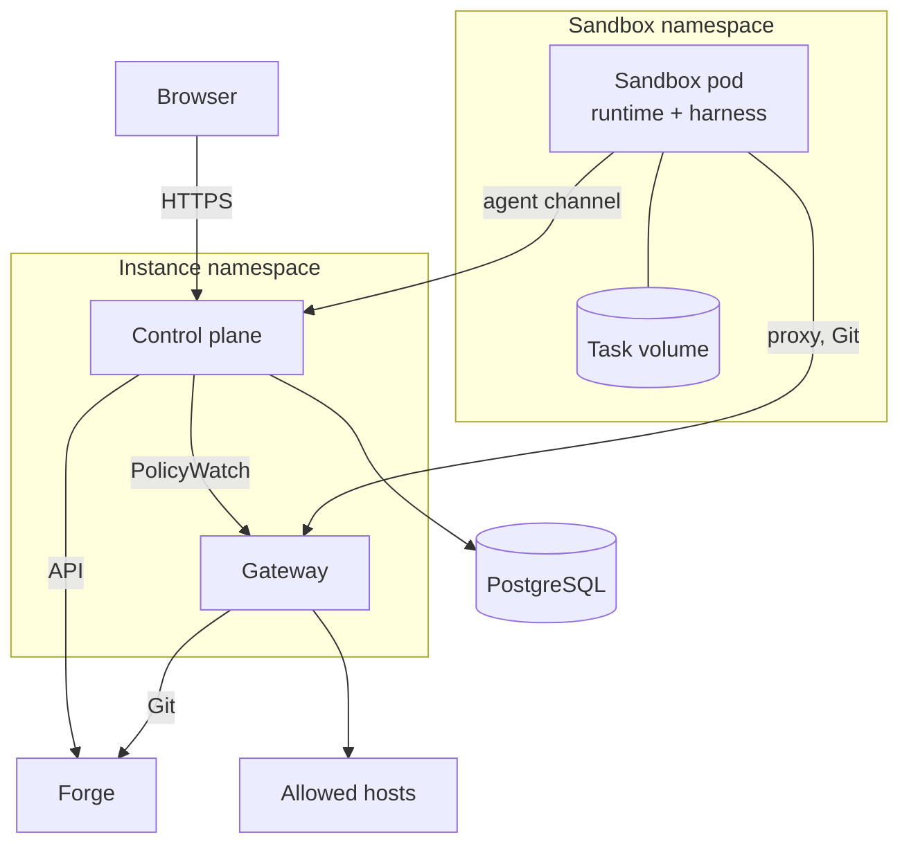

One Dark Factory instance is one Helm release: a control plane, a gateway and one PostgreSQL
database, serving one tenant. Agents run in sandbox pods, one pod per run, in a namespace of their
own. The rest of this page lists the components; [Agent runs](agent-runs.md) follows one run
through them.

## Components

| Component | Runs as | Does | Holds |
| --- | --- | --- | --- |
| Control plane | Deployment `dark-factory serve` | Web UI, task and run scheduling, the agent channel for sandboxes, forge plugins, sandbox provisioning, policy distribution to the gateway | The database connection; resolves credentials from Secret references when it uses them |
| Gateway | Deployment `dark-factory gateway` (1 by default; 2 or more for high availability) | Egress proxy for sandbox HTTP(S), Git smart-HTTP proxy with push checks, inference endpoint for model traffic, live traffic events | No database access and no Kubernetes token; policies and forge and model provider credentials arrive from the control plane and stay in memory |
| `migrate` job | Helm pre-install and pre-upgrade hook | Schema migrations, application role and grants | The owner role's password |
| Sandbox pod | Pod per run in the sandbox namespace, Kata Containers where configured | The project image with the runtime (`factory-agent`) and the harness (for example Claude Code over ACP) mounted as image volumes | The task volume at `/data`; no credential |
| PostgreSQL | External | All state: projects, personas, tasks, runs, transcripts and their binary content, requests, egress rules, audit log | |

The control plane and the gateway are the same binary in two modes. The control plane can run with
several replicas: every replica serves the UI and agent connections and can start runs (the database
prevents two runs of one task); jobs that must run once, such as the task volume cleanup, run on the
replica holding the instance lease.

The gateway runs one replica by default. For high availability set `gateway.replicas` to `2` or
more; the chart then also renders a PodDisruptionBudget (`gateway.pdb.minAvailable`, switch it off
with `gateway.pdb.enabled: false`). With a single gateway, a restart briefly interrupts the egress
of the sandboxes; they retry through the proxy.

## Connections

| From | To | Protocol | Authentication |
| --- | --- | --- | --- |
| Browser | Control plane `:8080` | HTTPS through your ingress or Gateway API route | OIDC login, server-side session |
| Sandbox | Control plane `:9443` (agent port) | gRPC, bidirectional stream | mTLS: a per-pod certificate from cert-manager's CSI driver, checked against the pod's IP and UID |
| Sandbox | Gateway `:3128` (proxy) | HTTP `CONNECT` and plain HTTP proxying | Source pod IP, looked up in the sandbox registry |
| Sandbox | Gateway `:8443` (Git) | Git smart HTTP over HTTPS (instance CA) | Source pod IP; the path names the task |
| Gateway | Control plane `:9444` (internal) | gRPC (`PolicyWatch`, push records, events) | mTLS |
| Control plane | Gateway `:9444` (internal) | gRPC `Tail` for the live traffic view | mTLS |
| Control plane | Forge API | HTTPS from a forge plugin | The project's forge credential, added by the control plane |
| Gateway | Forge Git | HTTPS | The project's forge credential, injected by the Git proxy |

Sandboxes resolve no DNS names: the proxy and control plane addresses are passed as IPs, and the
generated NetworkPolicy of each run allows only the control plane, the gateway and explicitly
allowed cluster services. Details: [Security](../security/).

## Kubernetes footprint

| Namespace | Contains | Created by |
| --- | --- | --- |
| Instance (for example `dark-factory`) | Control plane, gateway, `migrate` job, Services, Secrets with credentials, Leases | the Helm release |
| Sandbox (for example `dark-factory-sandboxes`) | Sandbox pods, task volumes (PVCs), generated per-run NetworkPolicies | the chart (`sandboxNamespace.create`) or you; never the control plane |

The control plane gets the permissions it needs in these two namespaces only: pods, PVCs,
NetworkPolicies and events (read) in the sandbox namespace; leases, Secrets (read) and EndpointSlices
in the instance namespace. The gateway and sandbox pods get no Kubernetes API token. At startup the
control plane checks its permissions and refuses to start if one is missing.

## Design records

The decisions behind this layout are recorded as ADRs in the repository, for example
[ADR-0029 (egress gateway)](https://github.com/prskr/dark-factory/blob/main/docs/adr/0029-egress-gateway-and-generated-network-policies.md),
[ADR-0030 (Kubernetes only)](https://github.com/prskr/dark-factory/blob/main/docs/adr/0030-kubernetes-only-with-sandbox-provider-seam.md)
and [ADR-0013 (single-tenant instances)](https://github.com/prskr/dark-factory/blob/main/docs/adr/0013-single-tenant-instances.md).
