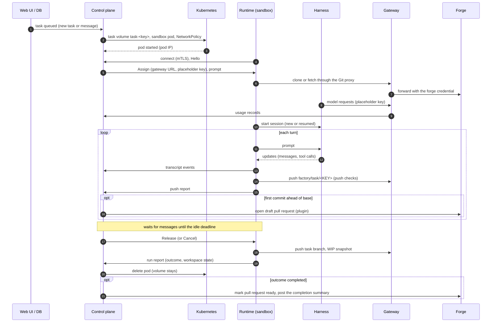

A **task** is a unit of work for one persona in one project. A **run** is one sandbox lifetime that
works on a task: it starts when the task has something to do (a new task, a message, a resume time
that passed) and ends when the agent is done, waits too long for an answer, or is stopped. A task
usually has several runs. Its code lives in Git, on the branch `factory/task/<KEY>`; the task volume
only caches the checkout between runs.

## One run

1. **Scheduling.** A task is due when it is `queued` (or `rate_limited`) and its resume time has
   passed. Up to `runs.maxConcurrent` runs (default 4) are active at a time; further due tasks wait,
   oldest first. A task never has two active runs.
2. **Provisioning.** The control plane ensures the task volume exists, creates the sandbox pod (the
   project's image with the runtime and harness mounted read-only, the configured runtime class) and a
   NetworkPolicy for the run.
3. **Connecting.** The runtime dials the control plane with its pod certificate. The control plane
   resolves the certificate to the run and sends the `Assign`: repository URL through the Git proxy,
   branches, commit identity, system prompt, harness settings, the harness environment (the gateway's
   [inference endpoint](../security/inference-endpoint.md) as base URL, a placeholder API key and the
   instance CA; no credential), budgets and the continuation of earlier runs (harness session id and
   a transcript summary).
4. **Preparing.** The runtime clones or updates the workspace through the Git proxy and writes its
   own `.git/config`; anything left on the volume is treated as untrusted.
5. **Turns.** The harness works on the prompt. Every message and tool call is streamed to the
   control plane and stored as the task's transcript. After a turn with new commits the runtime
   pushes the task branch. The first push ahead of the base branch opens a draft pull request.
6. **Waiting.** Between turns the run waits for messages. A message queued in the UI reaches the
   agent at the next turn boundary without a new run. After `runs.keepAliveSeconds` (default 600)
   without a message, the control plane releases the run.
7. **Finalizing.** The runtime stops the harness, pushes the task branch, writes a WIP snapshot of
   uncommitted files to `factory/wip/<KEY>` and reports the outcome. The control plane deletes the
   pod; the task volume stays for the next run.

## How a run ends

| Outcome | Task status afterwards |
| --- | --- |
| `completed` (the agent called `complete_task`) | `in_review`; the pull request is marked ready and gets the completion summary |
| `end_turn` (idle deadline passed) | `waiting` |
| `blocked` (a blocking question was not answered in time) | `blocked` |
| `rate_limited` (the model provider's usage limit) | `rate_limited`, with a resume time; the next run starts automatically and continues |
| `limit_reached` (a budget, or the harness's token or turn limit) | `limit_reached` |
| `sandbox_lost`, `connect_timeout`, `provisioning_failed` | `queued` again with a growing delay, up to `runs.maxAutoResumes` (default 3) times; then `failed` |
| `cancelled` (stopped by a human, or over the wall-clock budget) | `waiting`; a cancelled task stays `cancelled`, a task marked done stays `completed` |
| `failed` | `failed` |

If messages are still undelivered at the end of a run, the task becomes `queued` instead, so the next
run picks them up.

## Continuation across runs

Every run after the first gets the harness session id of the previous run and a summary of the
task's transcript: title, description, user messages, agent messages and one line per tool call,
capped in size. A harness that can resume its session (Claude Code) continues it; others start from
the summary. The workspace comes from the task branch, the WIP snapshot and the cached checkout on
the task volume.

## Task volumes

Each task has one volume (`task-<key>`), mounted at `/data`. It is a cache: committed work is in
Git, uncommitted work in the WIP snapshot. Volumes of tasks closed for 7 days, or idle for 30 days,
are deleted hourly (`volumes.retainAfterCloseSeconds`, `volumes.idleTtlSeconds`); **Reset workspace**
in a task's status menu deletes one on demand. The next run re-clones.
