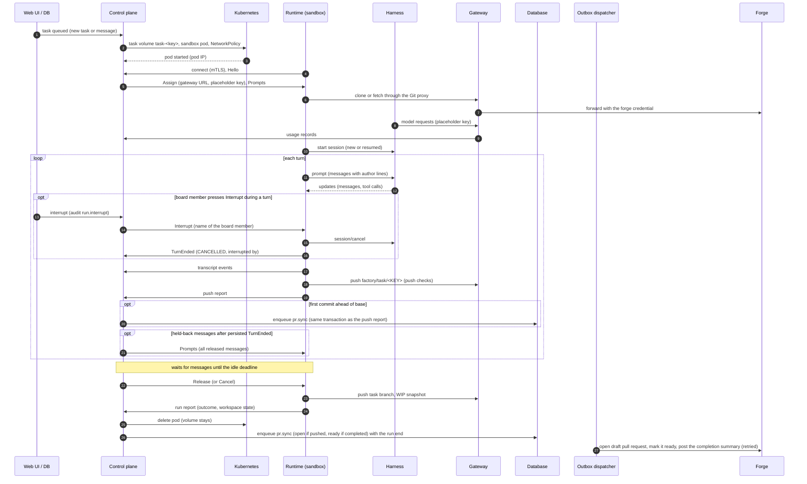

A **task** is a unit of work for one persona in one project. A **run** is one sandbox lifetime that
works on a task: it starts when the task has something to do (a new task, a message, a resume time
that passed) and ends when the agent is done, waits too long for an answer, or is stopped. A task
usually has several runs. Its code lives in Git, on the branch `factory/task/<KEY>`; the task volume
only caches the checkout between runs.

## One run



1. **Scheduling.** A task is due when it is `queued` (or `rate_limited`) and its resume time has
   passed. Up to `runs.maxConcurrent` runs (default 4) are active at a time; further due tasks wait,
   oldest first. A task never has two active runs.
2. **Provisioning.** The control plane ensures the task volume exists, creates the sandbox pod (the
   project's image with the runtime and harness mounted read-only, the configured runtime class) and a
   NetworkPolicy for the run.
3. **Connecting.** The runtime dials the control plane with its pod certificate. The control plane
   resolves the certificate to the run and sends the `Assign`: repository URL through the Git proxy,
   branches, the project's hidden paths, commit identity, system prompt (with a `Sandbox` section when paths are hidden), harness settings, the harness environment (the gateway's
   [inference endpoint](../security/inference-endpoint.md) as base URL, a placeholder API key and the
   instance CA; no credential), budgets and the continuation of earlier runs (harness session id and
   a transcript summary).
4. **Preparing.** The runtime clones or updates the workspace through the Git proxy and writes its
   own `.git/config` and sparse checkout patterns; files below [hidden
   paths](../using/hidden-paths.md) are left out or removed. Anything left on the volume is treated
   as untrusted.
5. **Turns.** The harness works on the prompt. Every message and tool call is streamed to the
   control plane and stored as the task's transcript. After a turn with new commits the runtime
   pushes the task branch. The first push ahead of the base branch enqueues the draft pull request;
   an outbox job opens it (see [Pull request actions](#pull-request-actions)). All messages waiting
   at turn start form one harness input, in queue order. Each starts with the same readable author
   name as in the UI and a colon, for example `Peter Kurfer:` or `Task assignment:`. A continuation
   summary stays first.
6. **Waiting.** Between turns the run waits for messages. A message queued in the UI reaches the
   agent at the next turn boundary without a new run. Messages released together arrive in one
   `Prompts` control message, including after reconnects, so they start one turn. After
   `runs.keepAliveSeconds` (default 600) without a message, the control plane releases the run.
   **Interrupting a turn.** A board member can end the current turn without ending the run (see
   [Interrupt](../using/tasks.md#interrupt-stop-mark-done-cancel)). Only a run in state `running`
   whose last persisted turn event is a `TurnStarted` qualifies: between the persisted `TurnEnded`
   and the `AWAITING_INPUT` report the run stays `running` while the runtime pushes, but has no turn
   to interrupt. A run is `preparing` from the runtime's first connect until the runtime reports
   the `RUNNING` phase just before its first turn, and `running` during every turn after that. The
   control plane audits `run.interrupt` and notifies all replicas through PostgreSQL with the id of
   the open turn; the replica that holds the run's stream sends `Interrupt` (name and turn id) if a
   turn is open. Nothing is stored, so an interrupt that finds no turn, or a runtime that is
   reconnecting, is lost, and the runtime ignores an interrupt whose turn id is not its current
   turn. The runtime sends the ACP notification `session/cancel`, completes open Dark Factory tool
   calls (and those started until the turn ends) with a cancelled result, and waits up to 5 seconds
   for the response to the outstanding `session/prompt`. If that response has stop reason
   `cancelled`, the turn ends with `TurnEnded` (stop reason `CANCELLED`, `interrupted_by`). Queued
   prompts start the next turn, whose input begins with "Your previous turn was interrupted by
   *name*."; otherwise the run reports `AWAITING_INPUT`. A turn that completed on its own (another
   stop reason) is not marked interrupted. If the harness fails the cancel or does not answer
   within 5 seconds, the turn ends as an error without the interrupt marker and the run fails; a
   rate-limit error as the response ends the turn and the run `RATE_LIMITED`.

   ```mermaid
   stateDiagram-v2
       running --> awaiting_input: turn ends, or Interrupt without queued messages
       awaiting_input --> running: message starts a turn
       running --> running: Interrupt with queued messages (next turn starts at once)
       running --> finalizing: Stop run, Cancel, Release
       awaiting_input --> finalizing: Stop run, Cancel, Release
   ```
7. **Finalizing.** The runtime stops the harness, pushes the task branch, writes a WIP snapshot of
   uncommitted files to `factory/wip/<KEY>` and reports the outcome. The control plane deletes the
   pod; the task volume stays for the next run.

## How a run ends

| Outcome | Task status afterwards |
| --- | --- |
| `completed` (the agent called `complete_task`) | `in_review`; the pull request is marked ready and gets the completion summary of this run (see [Pull request actions](#pull-request-actions)) |
| `end_turn` (idle deadline passed) | `waiting` |
| `blocked` (a blocking question was not answered in time) | `blocked` |
| `rate_limited` (the model provider's usage limit) | `rate_limited`, with a resume time; the next run starts automatically and continues |
| `limit_reached` (a budget, or the harness's token or turn limit) | `limit_reached` |
| `sandbox_lost`, `connect_timeout`, `provisioning_failed` | `queued` again with a growing delay, up to `runs.maxAutoResumes` (default 3) times; then `failed` |
| `cancelled` (stopped by a human, or over the wall-clock budget) | `waiting`; a cancelled task stays `cancelled`, a task marked done stays `completed` |
| `failed` | `failed` |

If messages are still undelivered at the end of a run, the task becomes `queued` instead, so the next
run picks them up.

## Agent tools

The control plane gives every run the factory tools of `contract/mcp/factory-tools.v2.json`; the
harness sees them as the MCP server `factory`. Calls are executed by the control plane, scoped to
the run's task, and at most once per `call_id`.

| Tool | Purpose |
| --- | --- |
| `update_pull_request`, `comment_on_issue`, `report_progress`, `set_task_title` | Shape the pull request, comment on the linked issue, set the status line and the title |
| `complete_task` | Ends the run after the turn; the task goes to review |
| `ask_question`, `request_approval` | [Requests](../using/requests.md) to the humans of the task |
| `read_pull_request_feedback`, `comment_on_pull_request` | Read and answer reviews |
| `create_task`, `list_personas`, `send_message` | [Delegation](../using/delegation.md): create tasks for other personas, list them, message a child. `create_task` creates tasks only in the run's project; `send_message` acts only on children of the run's task |
| `write_artifact`, `list_artifacts`, `read_artifact` | [Artifacts](../using/artifacts.md): write named text and image files on the own task, list and read those of related tasks |

## Pull request actions

The control plane never calls the forge from the agent stream. Opening the draft pull request,
marking it ready and posting the completion summary are `pr.sync` jobs of the outbox, enqueued in
the transaction that records their trigger and run by the dispatcher on the leader replica:

| Trigger | Job |
| --- | --- |
| Push of the task branch ahead of the base branch, task without a pull request | open the draft pull request |
| End of a run that pushed the task branch | open the draft pull request if it is still missing |
| End of a run with outcome `completed` | mark the pull request ready and post the summary of that run |
| **Mark done** in the UI, task with a pull request | mark the pull request ready, no summary |

Failed forge calls are retried with backoff (30 s doubling to 10 min) for one hour, also after a
control plane restart; then the job is given up with a warning (`df.outbox.jobs{kind="pr.sync",result="gave_up"}`).
Behavior to know:

- A completed run that never pushed the task branch opens no pull request. A pull request an
  earlier run opened is still marked ready.
- The summary comes from the run's own `complete_task` call (`runs.completion_summary`); a run
  without one posts none. A retry after a failed comment call may post it twice.
- Ready and summary go to the pull request recorded on the task.
- A message queued after the completion or after **Mark done** keeps the pull request a draft.
  The summary is still posted. Both times come from the database clock under the task lock, so
  they are ordered like the lock.
- A cancelled task gets no pull request action.

## Continuation across runs

Every run after the first gets the harness session id of the previous run and a summary of the
task's transcript: title, description, user messages, agent messages and one line per tool call,
capped in size. A harness that can resume its session (Claude Code) continues it; others start from
the summary. The workspace comes from the task branch, the WIP snapshot and the cached checkout on
the task volume.

## Task volumes

Each task has one volume (`task-<key>`), mounted at `/data`. It is a cache: committed work is in
Git, uncommitted work in the WIP snapshot. Volumes of tasks closed for 7 days, or idle for 30 days,
are deleted hourly (`volumes.retainAfterCloseSeconds`, `volumes.idleTtlSeconds`), the volume of a
task whose pull request was merged at the next hourly check; **Reset workspace**
in a task's status menu deletes one on demand. The next run re-clones.
