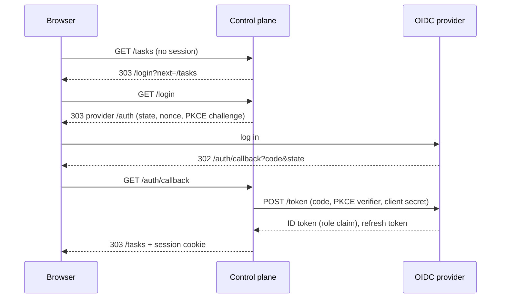

The web UI logs users in through an OIDC provider. The control plane is a confidential OIDC client
(authorization code flow with PKCE, performed server-side). Browsers only get an HTTP-only session
cookie; tokens stay on the server. Every UI page requires the role `board-member`, read from a flat
claim of the ID token. The tab "Integrations" of a project's settings page (the lifecycle event
subscriptions and the incoming webhook secret) also requires the role `admin`.

Provider guides:

- [Keycloak](keycloak.md): client role `board-member` in a `roles` claim.
- [Dex](dex.md): group `board-member` in the `groups` claim.
- [Authentik](authentik.md): group `board-member` in the `groups` claim.

## Control plane settings

The chart renders the `auth` section of `config.yaml` from the `oidc.*` values
([chart README](https://github.com/prskr/dark-factory/blob/main/deploy/helm/dark-factory/README.md#values-reference)):

| Field | Helm value | Required | Default | Effect |
| --- | --- | --- | --- | --- |
| `auth.issuerUrl` | `oidc.issuerUrl` | yes | | Issuer; `/.well-known/openid-configuration` is discovered below it on every login, callback and refresh. |
| `auth.clientId` | `oidc.clientId` | yes | `dark-factory` (chart) | OIDC client ID. |
| `auth.clientSecretFile` | `oidc.existingSecret`, `oidc.clientSecretKey` | yes | | File with the client secret (the chart mounts the Secret at `/run/secrets/oidc/client-secret`). |
| `publicUrl` (top level, not inside `auth`) | `publicUrl` | yes, with `auth` | none | Externally visible base URL of the control plane. The redirect URI is `<publicUrl>/auth/callback`, the post-logout redirect `<publicUrl>/`, and the web UI builds absolute URLs from it (the webhook URL of a project's Integrations tab). Use `https://`: the session cookie always carries `Secure` then. Plain `http://` is accepted on any host, with a startup warning on a non-loopback host, and the session cookie is sent without `Secure`. An `auth` section without `publicUrl` stops startup with an error naming `publicUrl`. |
| `auth.rolesClaim` | `oidc.rolesClaim` | no | `roles` | Top-level ID token claim with the role list. |
| `auth.extraScopes` | `oidc.extraScopes` | no | `[]` | Scopes requested in addition to `openid` and `profile`, for example `[groups, offline_access]` for Dex. |

Without an `auth` section (Helm: `publicUrl` empty) `dark-factory serve` logs a warning, serves only
`/healthz`, `/readyz` and `/assets/*`, and the UI is unavailable.

### Upgrade: `publicUrl` moved

`publicUrl` is a top-level setting now. Rename the Helm value `oidc.publicUrl` to `publicUrl` before you
upgrade: the values schema rejects `oidc.publicUrl`, so `helm upgrade` fails and the running release is
untouched until you do. In an instance configuration file, move `publicUrl` out of `auth`; the old
key `auth.publicUrl` is rejected as an unknown field.

Roles are read at every login and every token refresh; they are never stored as the source of truth.
A role removed at the provider takes effect when the access token expires and is refreshed. Live
views (task list, task detail) reconnect at that point, so they stop as well.

## Verify

1. Open `https://<public host>/`. You are redirected to the provider and, after login, to `/tasks`.
2. A user without `board-member` sees `403` with the message *Your account lacks the role
   `board-member`.*
3. A user with `board-member` but without `admin` sees no tab "Integrations" on the project's settings page,
   and requests for the project's subscriptions (`/projects/<KEY>/subscriptions`) answer `403` with
   *Your account lacks the role `admin`.*
4. **Log out** deletes the server-side session and ends the provider session (RP-initiated logout).
