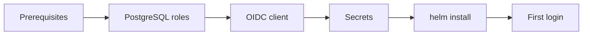

This guide installs one Dark Factory instance into a Kubernetes cluster with the Helm chart of a
release. It ends with a working login. Dark Factory is pre-MVP: pin the chart version and read the
release notes before you upgrade.



## Prerequisites

| What | Why |
| --- | --- |
| Kubernetes 1.36 or newer | The runtime and the harness reach sandboxes as image volumes (`kubeVersion` of the chart). |
| [Kata Containers](https://katacontainers.io/) with a `RuntimeClass` (this guide: `kata`) | Sandboxes run untrusted agent code and should run in a microVM. Without it they run in the cluster's default runtime. |
| cert-manager (with the CSI driver) | Issues the mTLS certificates of the control plane, the gateway and every sandbox. |
| A CNI that enforces `NetworkPolicy` (Cilium or any other) | Sandboxes may only reach the gateway; the chart ships a default-deny policy. |
| PostgreSQL 17, reachable from the cluster | The only state of an instance (the version the tests run against). |
| An OIDC provider: [Keycloak](authentication/keycloak.md) (this guide) or [Dex](authentication/dex.md) | Login to the web UI. |
| A Gateway API `Gateway` (or any other way to publish port `8080` of the control plane) with a TLS certificate | The browser needs an HTTPS URL; it is also the OIDC redirect target. |
| `helm` 3.8 or newer and access to `ghcr.io/prskr/dark-factory` | The chart is an OCI artifact. |

## 1. Create the PostgreSQL roles

Dark Factory uses two roles: an owner that runs the migrations and an application role that serves
requests (no DDL rights). The simplest setup lets the migration job manage the application role.
Then only the owner needs to exist, and it needs `CREATEROLE`:

```sql
CREATE ROLE dark_factory_owner LOGIN PASSWORD '<owner-password>' CREATEROLE;
CREATE DATABASE dark_factory OWNER dark_factory_owner;
```

Put both passwords into Secrets in the instance namespace (the application password is set on the
role by the migration job):

```bash
kubectl create namespace dark-factory
kubectl -n dark-factory create secret generic dark-factory-db-owner --from-literal=password='<owner-password>'
kubectl -n dark-factory create secret generic dark-factory-db-app   --from-literal=password='<app-password>'
```

If you provision roles declaratively and the owner must not have `CREATEROLE`, create both roles
yourself: see [Database](database.md).

## 2. Create the OIDC client

Create the confidential client `dark-factory` and the role `board-member`, and map the role into a
top-level `roles` claim of the ID token. The steps are in [Keycloak](authentication/keycloak.md)
(with Dex: [Dex](authentication/dex.md)). At the end you have a client secret; store it:

```bash
kubectl -n dark-factory create secret generic dark-factory-oidc --from-literal=client-secret='<secret from Keycloak>'
```

## 3. Write the Helm values

`values.yaml` for a cluster with Kata Containers, an external PostgreSQL and Keycloak:

```yaml
database:
  host: postgres.databases.svc
  database: dark_factory

oidc:
  issuerUrl: https://id.example.org/realms/dark-factory
  publicUrl: https://factory.example.org

sandboxNamespace:
  runtimeClassName: kata

# Publish the UI through an existing Gateway API Gateway.
httpRoute:
  enabled: true
  parentRefs:
    - name: public
      namespace: gateway-system
  hostnames:
    - factory.example.org

networkPolicy:
  ingressController:
    namespaceSelector:
      kubernetes.io/metadata.name: gateway-system
```

Everything else has a default; the [chart README](https://github.com/prskr/dark-factory/blob/main/deploy/helm/dark-factory/README.md#values-reference)
lists every key. Set `oidc.publicUrl` to the URL the browser uses: without it the web UI stays
unavailable.

## 4. Install

Pin the version. Releases are named `YYYY.M.N` (for example `2026.11.0`); the list is on the
[GitHub releases page](https://github.com/prskr/dark-factory/releases).

```bash
helm install dark-factory oci://ghcr.io/prskr/dark-factory/charts/dark-factory \
  --namespace dark-factory \
  --version 2026.11.0 \
  --values values.yaml
```

The chart runs the `migrate` job first (pre-install hook), then starts the control plane and the
gateway. Check that both are ready:

```bash
kubectl -n dark-factory get pods
kubectl -n dark-factory rollout status deploy/dark-factory-control-plane
```

The images default to the chart's `appVersion`, so the images match the chart version.

## 5. First login

1. Give your Keycloak user the client role `board-member`.
2. Open the `oidc.publicUrl`. You are redirected to Keycloak and, after the login, to the task list.
3. The profile menu (your initials) shows the version of the running instance and links to the docs
   of exactly that version.

A user without the role gets `403`; other symptoms are in the
[Keycloak troubleshooting table](authentication/keycloak.md#troubleshooting).

## Upgrade

Run `helm upgrade` with the new `--version` and the same values. The migration job runs again before
the new control plane starts. Read the release notes first.

## Next steps

- [Using Dark Factory](using/): credentials, projects and personas, then the first task.
- [Forges](integrations/forges/): connect your Forgejo or GitHub repositories.
- [Security](security/): what the sandbox can and cannot do.
- [Observability](observability/): log format and levels, metrics and traces.
