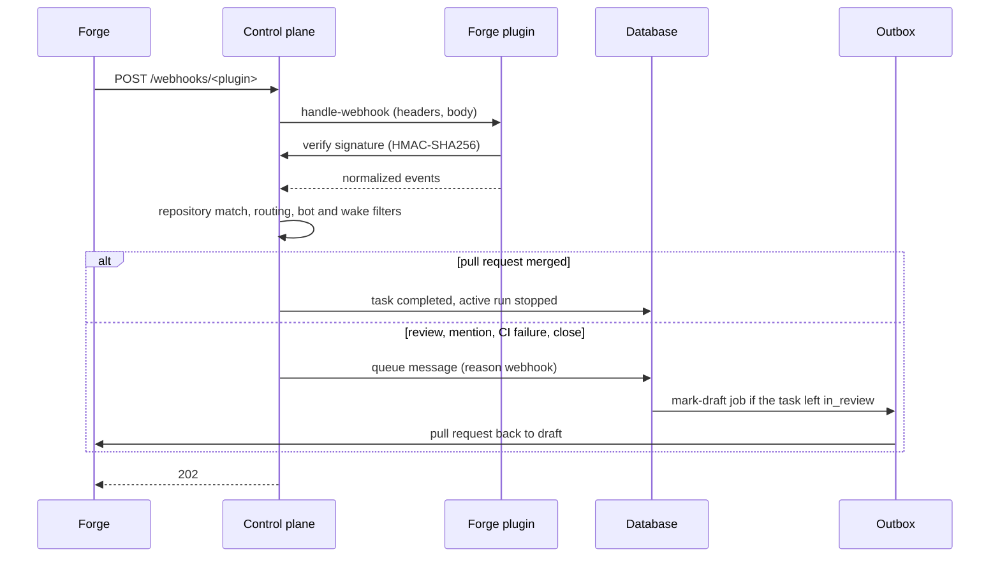

With forge webhooks, a task wakes up when someone reviews its pull request, mentions the bot
account, merges or closes the pull request, or when CI fails on its branch. Without them, the task
waits until someone writes in the web UI.

| Forge event | Effect on the task |
| --- | --- |
| Review submitted (approve, request changes, comment) | wakes the task, subject to the [wake setting](#choose-who-wakes-tasks) |
| Comment that mentions the bot account (`@factory-bot`) on the pull request or on the linked issue | wakes the task, subject to the wake setting |
| CI failed on `factory/task/<key>` | wakes the task |
| Pull request closed without merge | wakes the task |
| Pull request merged | the task becomes `completed` and its run stops; its volume is deleted at the next hourly check, whatever `volumes.retainAfterCloseSeconds` says |

Each accepted event queues one message (reason `webhook`) on its task: logins, verdicts, check
names, numbers and URLs, never review or comment text. The agent reads the feedback with
`read_pull_request_feedback`. Messages that arrive while the agent works wait for the end of its
turn, so a burst of events wakes the task once. A task in `in_review` whose pull request is still
open goes back to work and its pull request becomes a draft again; a closed pull request stays as
it is. Tasks in `completed`, `cancelled` or `failed` are not woken.



Reviews and comments written by the bot account itself are ignored. Merged, closed and CI events
apply whoever triggered them. Reviews, closes and CI runs of pull requests from a fork are ignored,
even if the fork's branch is named `factory/task/<key>`.

## Set the webhook secret

One secret per plugin signs all its deliveries (HMAC-SHA256). Every repository the plugin serves
shares it; an event only reaches projects whose repository URL matches the event's repository.

1. Create the Secret in the instance namespace:

   ```bash
   kubectl -n dark-factory create secret generic forge-webhooks \
     --from-literal=forgejo="$(openssl rand -hex 32)"
   ```

2. Reference it in the Helm values and run `helm upgrade`:

   ```yaml
   plugins:
     forgejo:
       webhookSecret:
         name: forge-webhooks
         key: forgejo
   ```

   The chart mounts the key read-only at `/var/run/dark-factory/webhooks/forgejo/secret` and sets
   `plugins.forgejo.webhookSecretFile` in the instance configuration. The control plane reads the
   file once at startup; a missing or empty file stops it
   ([Startup](configuration.md#startup)).

3. Check the endpoint. Without a valid signature it answers `401`; `404` means the plugin has no
   secret or is not loaded:

   ```bash
   curl -s -o /dev/null -w '%{http_code}\n' -X POST https://factory.example.org/webhooks/forgejo
   ```

The endpoint `POST /webhooks/<plugin>` is served on the web UI's host without login. Bodies over
1 MiB are refused with `413`. Rotating the secret means changing it in the Secret and in the forge,
then restarting the control plane (`kubectl -n dark-factory rollout restart deployment/<release>-control-plane`).

## Register the webhook in Forgejo

Register it once for all repositories of an organisation (**Organisation → Settings → Webhooks**)
or of the whole instance (**Site administration → Integrations → Webhooks → System webhooks**).
A repository webhook (**Repository → Settings → Webhooks**) works as well. Choose **Add webhook →
Forgejo**:

| Field | Value |
| --- | --- |
| Target URL | `https://factory.example.org/webhooks/forgejo` |
| HTTP method | `POST` |
| POST content type | `application/json` |
| Secret | the value from the Secret |
| Trigger on | **Custom events…** |
| Issue events | **Comments** |
| Pull request events | **Modification**, **Comments**, **Reviews** |
| Action Run events | **Failure** |
| Active | on |

Forgejo sends no webhook for commit statuses set by an external CI; only failed Forgejo Actions runs
wake a task.

Forgejo only delivers to external addresses by default. If the control plane resolves to a private
address (for example a cluster-internal name), allow it in Forgejo's `app.ini`:

```ini
[webhook]
ALLOWED_HOST_LIST = factory.example.org
```

## Register the webhook in GitHub

Register it on the organisation (**Settings → Webhooks**) or on each repository (**Settings →
Webhooks**), with the secret stored under the key of the `github` plugin
(`plugins.github.webhookSecret`):

| Field | Value |
| --- | --- |
| Payload URL | `https://factory.example.org/webhooks/github` |
| Content type | `application/json` |
| Secret | the value from the Secret |
| Events | **Let me select individual events**: **Check suites**, **Issue comments**, **Pull requests**, **Pull request reviews**, **Statuses** |
| Active | on |

GitHub sends a `ping` after saving; the control plane answers `202` and ignores it.

## Choose who wakes tasks

**Projects → edit a project → General → Wake tasks on reviews and mentions** decides whose reviews
and mentions wake the project's tasks:

| Option | Reviews and mentions from |
| --- | --- |
| Nobody | nobody; merged, closed and CI events still apply |
| Members with write access (default) | accounts with write access or more to the repository |
| Anyone | every account except the bot |

With *Members with write access*, the control plane asks the forge for the author's permission on
each review or mention. Changes are written to the audit log.

## Troubleshooting

The metric `df.webhook.requests` (Prometheus: `df_webhook_requests_total`) counts requests by
`plugin` and `outcome` ([Telemetry](../../observability/telemetry.md)). Requests for a plugin that
is not loaded are counted as `plugin="unknown"`; a loaded plugin keeps its name.

| Outcome | Cause |
| --- | --- |
| `not_found` | Wrong plugin name in the URL, the plugin did not load, it exports no webhook interface, or it has no `webhookSecret`. |
| `unauthorized` | The secret in the forge differs from the Secret, or the request carries no signature (GitHub: only `X-Hub-Signature-256` counts). |
| `invalid` | The plugin could not parse the payload: content type is not JSON, or the event header is missing. |
| `too_large` | Body over 1 MiB. |
| `error` | Storing the events or a forge lookup failed; the control plane logs a warning. Neither forge redelivers on its own: [redeliver it](#redeliver-a-failed-delivery) once the cause is fixed. |
| `accepted` but the task does not wake | See the debug log below. |

Accepted events that do not wake a task are logged at `debug`. Raise the level of these modules:

```yaml
controlPlane:
  logLevel: info,dark_factory::forge=debug,df_agent_channel::webhooks=debug,df_db::webhooks=debug
```

| Debug message | Cause |
| --- | --- |
| `webhook repository matches no project` | No project has this repository URL (compared by host, owner and name). |
| `webhook event names no factory task` | The pull request's or CI run's branch is not `factory/task/<key>`. |
| `webhook event matches no task` | No task of the project has this key or pull request, or no unfinished task is linked to the commented issue. |
| `webhook event dropped` | The author is the bot account (`reason="bot"`), or a comment does not mention the bot account (`reason="no mention"`). |
| `webhook author below the wake policy` | The wake setting is *Nobody*, or the author has no write access and the wake setting is *Members with write access*. |
| `webhook event of a finished task dropped` | The task is `completed`, `cancelled` or `failed`. |
| `webhook signature not verified` | As outcome `unauthorized`. |

### Redeliver a failed delivery

Forgejo and GitHub record a delivery answered with `5xx` as failed and do not retry it. A lost
merge event leaves the task in `in_review`; a lost review or mention does not wake it.

- **Forgejo:** the webhook's settings page → **Recent deliveries** → open the delivery →
  **Replay**.
- **GitHub:** the webhook's **Recent Deliveries** tab → open the delivery → **Redeliver**, or the
  REST endpoint `POST /repos/{owner}/{repo}/hooks/{hook_id}/deliveries/{delivery_id}/attempts`.

Redelivering is safe: a merge that was already applied does nothing, and a duplicate review adds
one more message.
