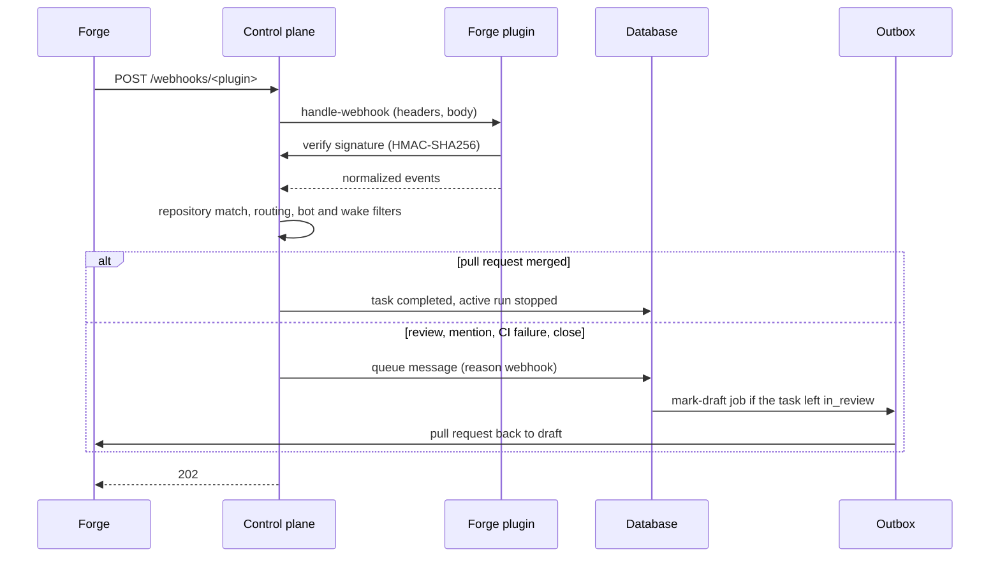

With forge webhooks, a task wakes up when someone reviews its pull request, mentions the bot
account, merges or closes the pull request, or when CI fails on its branch. Without them, the task
waits until someone writes in the web UI.

| Forge event | Effect on the task |
| --- | --- |
| Review submitted (approve, request changes, comment) | wakes the task, subject to the [wake setting](#choose-who-wakes-tasks) |
| Comment that mentions the bot account (`@factory-bot`) on the pull request or on the linked issue | wakes the task, subject to the wake setting |
| CI failed on `factory/task/<key>` | wakes the task |
| Pull request closed without merge | wakes the task |
| Pull request merged | the task becomes `completed` and its run stops; its volume is deleted at the next hourly check, whatever `volumes.retainAfterCloseSeconds` says |

Each accepted event queues one message (reason `webhook`) on its task: logins, verdicts, check
names, numbers and URLs, never review or comment text. The agent reads the feedback with
`read_pull_request_feedback`. Messages that arrive while the agent works wait for the end of its
turn, so a burst of events wakes the task once. A task in `in_review` whose pull request is still
open goes back to work and its pull request becomes a draft again; a closed pull request stays as
it is. Tasks in `completed`, `cancelled` or `failed` are not woken. The message for a review or a
mention also tells the agent to pass the `next_since` of its last read as `since`, so it reads only
what is new ([Review feedback](_index.md#review-feedback)).



Reviews and comments written by the bot account itself are ignored. Merged, closed and CI events
apply whoever triggered them. Reviews, closes and CI runs of pull requests from a fork are ignored,
even if the fork's branch is named `factory/task/<key>`.

## Set the webhook secret

One secret per plugin signs all its deliveries (HMAC-SHA256). Every repository the plugin serves
shares it; an event only reaches projects whose repository URL matches the event's repository.

By default the control plane generates the secret. On startup it creates the Secret
`<fullname>-webhook-<plugin>` in the instance namespace if it does not exist, with key `secret`
and 32 random bytes as 64 hex characters. An existing Secret is never changed. Nothing to
configure; the chart's default values do this for every plugin.

1. Read the secret and enter it in the forge ([Forgejo](#register-the-webhook-in-forgejo),
   [GitHub](#register-the-webhook-in-github)). Users with the role `admin` find the URL and the
   secret in the web UI: open **Settings → Projects**, a project of the forge, its tab
   **Integrations** and the group **Incoming webhook**. The URL is `<publicUrl>/webhooks/<plugin>`
   (the path alone when the instance has no `publicUrl`). The secret is masked: **Show secret**
   displays it, **Copy secret** copies it without displaying it. Every read of the secret is written
   to the audit log (`webhook_secret.read`, with the user, the project and the plugin, never the
   secret). The copy buttons need HTTPS or a loopback host (the browser offers the clipboard
   only there); over plain HTTP the group says "Copying needs HTTPS", and you show the secret and copy
   it by hand. The group says why when no webhook applies: no forge credential on the project, the
   plugin did not load, it exports no webhooks, or no secret is configured. Alternatively, read the
   Secret with `kubectl`:

   ```bash
   kubectl -n dark-factory get secret <fullname>-webhook-forgejo \
     -o jsonpath='{.data.secret}' | base64 -d
   ```

   `<fullname>` is `fullnameOverride` if set, else the release name, or
   `<release>-dark-factory` when the release name does not contain the chart name.

2. To manage the secret yourself, create a Secret and reference it in the Helm values:

   ```bash
   kubectl -n dark-factory create secret generic forge-webhooks \
     --from-literal=forgejo="$(openssl rand -hex 32)"
   ```

   ```yaml
   plugins:
     forgejo:
       webhookSecret:
         existingSecret: forge-webhooks
         key: forgejo   # default: secret
   ```

   The chart writes `plugins.forgejo.webhookSecret` (`name`, `key`, `generate: false`) into the
   instance configuration. A missing Secret, a missing key or an empty value stops the control plane
   at startup ([Startup](configuration.md#startup)).

3. Check the endpoint. Without a valid signature it answers `401`; `404` means the plugin has no
   `webhookSecret`, exports no webhooks or is not loaded:

   ```bash
   curl -s -o /dev/null -w '%{http_code}\n' -X POST https://factory.example.org/webhooks/forgejo
   ```

The endpoint `POST /webhooks/<plugin>` is served on the web UI's host without login. Bodies over
1 MiB are refused with `413`.

### Secret endpoint

`GET /projects/<key>/webhook-secret` returns the webhook secret of the plugin that serves the
project. The web UI calls it for **Show secret** and **Copy secret**.

| Property | Value |
| --- | --- |
| Access | role `admin` (`403` otherwise; nothing is audited) |
| Response | the secret, `Content-Type: text/plain; charset=utf-8`, `Cache-Control: no-store` |
| Audit | each successful read writes the entry `webhook_secret.read` (resource type `webhook_secret`, actor: the user with their roles; resource the plugin; details: project and plugin, never the secret). If the entry cannot be stored, the request fails with `500` and the secret is not returned. |
| `404` | the project does not exist, or it has no webhook secret to show: no forge credential, no plugin serves it, the plugin did not load, exports no webhooks or has no secret |

### Rotate the secret

The web UI shows the secret and does not rotate it.

1. Delete the generated Secret (or change the value of your own Secret).
2. Restart the control plane
   (`kubectl -n dark-factory rollout restart deployment/<fullname>-control-plane`); a deleted
   generated Secret is created again with a new value. The secret is read at startup only, there is
   no hot reload.
3. Enter the new value in the forge.

While the rollout and the forge update are in progress, old and new replicas and the forge disagree
about the value, so deliveries can get `401`. When both are done, redeliver the failed events from
the forge's delivery history.

### Generated Secrets outlive the release

The generated Secret has no owner reference, so `helm uninstall` keeps it (the forge keeps working
after a reinstall). Remove the Secrets of an instance with:

```bash
kubectl -n dark-factory delete secret \
  -l app.kubernetes.io/component=webhook-secret,app.kubernetes.io/instance=<instanceName>
```

A Secret of a removed plugin stays as well; select it additionally with `dark-factory.io/plugin=<plugin>`.

### Upgrade and rollback

- Chart values that set `plugins.<name>.webhookSecret.name` must rename it to `existingSecret`
  (keep `key`). The values schema rejects the old field, so `helm upgrade` fails until you do.
  Values that do not set `webhookSecret` switch to a generated Secret: copy its value into the forge
  after the upgrade.
- Rolling back to the previous chart mounts the referenced Secret again. If the forge already holds
  a generated value, either enter the old value in the forge again, or point the old chart at the
  generated Secret with `webhookSecret: {name: <fullname>-webhook-<plugin>, key: secret}`. Then
  redeliver the failed events from the forge.

## Register the webhook in Forgejo

Register it once for all repositories of an organisation (**Organisation → Settings → Webhooks**)
or of the whole instance (**Site administration → Integrations → Webhooks → System webhooks**).
A repository webhook (**Repository → Settings → Webhooks**) works as well. Choose **Add webhook →
Forgejo**:

| Field | Value |
| --- | --- |
| Target URL | the URL of the group **Incoming webhook**, for example `https://factory.example.org/webhooks/forgejo` |
| HTTP method | `POST` |
| POST content type | `application/json` |
| Secret | the secret of the group **Incoming webhook** (or the value from the Secret) |
| Trigger on | **Custom events…** |
| Issue events | **Comments** |
| Pull request events | **Modification**, **Comments**, **Reviews** |
| Action Run events | **Failure** |
| Active | on |

Forgejo sends no webhook for commit statuses set by an external CI; only failed Forgejo Actions runs
wake a task.

Forgejo only delivers to external addresses by default. If the control plane resolves to a private
address (for example a cluster-internal name), allow it in Forgejo's `app.ini`:

```ini
[webhook]
ALLOWED_HOST_LIST = factory.example.org
```

## Register the webhook in GitHub

Register it on the organisation (**Settings → Webhooks**) or on each repository (**Settings →
Webhooks**), with the secret stored under the key of the `github` plugin
(`plugins.github.webhookSecret`):

| Field | Value |
| --- | --- |
| Payload URL | the URL of the group **Incoming webhook**, for example `https://factory.example.org/webhooks/github` |
| Content type | `application/json` |
| Secret | the secret of the group **Incoming webhook** (or the value from the Secret) |
| Events | **Let me select individual events**: **Check suites**, **Issue comments**, **Pull requests**, **Pull request reviews**, **Statuses** |
| Active | on |

GitHub sends a `ping` after saving; the control plane answers `202` and ignores it.

## Choose who wakes tasks

**Settings → Projects →** the project's settings page **→ General → Forge events → Wake tasks on reviews and mentions** decides whose reviews
and mentions wake the project's tasks:

| Option | Reviews and mentions from |
| --- | --- |
| Nobody | nobody; merged, closed and CI events still apply |
| Members with write access (default) | accounts with write access or more to the repository |
| Anyone | every account except the bot |

With *Members with write access*, the control plane asks the forge for the author's permission on
each review or mention. Changes are written to the audit log.

On Forgejo the permission lookup needs a bot account that is repository admin. When the forge
refuses it, the author counts as not a member: the event is accepted but does not wake the task, and
the log has the plugin's warning "cannot read the repository permission of ..." (event "plugin
stderr"). Make the bot account repository admin, or choose *Anyone*
([Bot account access](configuration.md#bot-account-access)).

## Troubleshooting

The metric `df.webhook.requests` (Prometheus: `df_webhook_requests_total`) counts requests by
`plugin` and `outcome` ([Telemetry](../../observability/telemetry.md)). Requests for a plugin that
is not loaded are counted as `plugin="unknown"`; a loaded plugin keeps its name.

| Outcome | Cause |
| --- | --- |
| `not_found` | Wrong plugin name in the URL, the plugin did not load, it exports no webhook interface, or it has no `webhookSecret` (the chart always sets one; a hand-written configuration may leave it out). |
| `unauthorized` | The secret in the forge differs from the Secret, or the request carries no signature (GitHub: only `X-Hub-Signature-256` counts). |
| `invalid` | The plugin could not parse the payload: content type is not JSON, or the event header is missing. |
| `too_large` | Body over 1 MiB. |
| `error` | Storing the events or a forge lookup failed; the control plane logs a warning. Neither forge redelivers on its own: [redeliver it](#redeliver-a-failed-delivery) once the cause is fixed. |
| `accepted` but the task does not wake | See the debug log below. |

Accepted events that do not wake a task are logged at `debug`. Raise the level of these modules:

```yaml
controlPlane:
  logLevel: info,dark_factory::forge=debug,df_agent_channel::webhooks=debug,df_db::webhooks=debug
```

| Debug message | Cause |
| --- | --- |
| `webhook repository matches no project` | No project has this repository URL (compared by host, owner and name). |
| `webhook event names no factory task` | The pull request's or CI run's branch is not `factory/task/<key>`. |
| `webhook event matches no task` | No task of the project has this key or pull request, or no unfinished task is linked to the commented issue. |
| `webhook event dropped` | The author is the bot account (`reason="bot"`), or a comment does not mention the bot account (`reason="no mention"`). |
| `webhook author below the wake policy` | The wake setting is *Nobody*, or the author has no write access (or the forge refused the permission lookup, see above) and the wake setting is *Members with write access*. |
| `webhook event of a finished task dropped` | The task is `completed`, `cancelled` or `failed`. |
| `webhook signature not verified` | As outcome `unauthorized`. |

### Redeliver a failed delivery

Forgejo and GitHub record a delivery answered with `5xx` as failed and do not retry it. A lost
merge event leaves the task in `in_review`; a lost review or mention does not wake it.

- **Forgejo:** the webhook's settings page → **Recent deliveries** → open the delivery →
  **Replay**.
- **GitHub:** the webhook's **Recent Deliveries** tab → open the delivery → **Redeliver**, or the
  REST endpoint `POST /repos/{owner}/{repo}/hooks/{hook_id}/deliveries/{delivery_id}/attempts`.

Redelivering is safe: a merge that was already applied does nothing, and a duplicate review adds
one more message.
