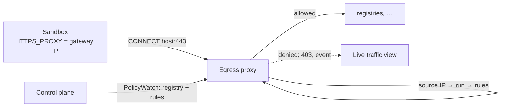

Sandboxes reach external hosts only through the gateway's HTTPS proxy. The proxy enforces the
egress rules per run and reports every connection through it to the live traffic view. Git and
model traffic use their own endpoints on the gateway and do not appear there. Sandboxes resolve no
DNS names themselves, which also closes DNS as an exfiltration channel.

## Traffic paths

| Traffic | Path | Enforced by |
| --- | --- | --- |
| Agent channel | Direct to the control plane agent port, mTLS | NetworkPolicy |
| HTTP(S) to external hosts | Egress proxy (`CONNECT` or plain HTTP forwarding) | Egress rules in the proxy; the NetworkPolicy lets the sandbox reach only the gateway |
| Git | Git proxy on the gateway | [Git proxy](git-proxy.md) |
| Model traffic | Inference endpoint on the gateway, direct (not through the egress proxy) | [Inference endpoint](inference-endpoint.md) |
| In-cluster services | Direct, as `cluster-service` rules | Generated NetworkPolicy |
| DNS | Denied | NetworkPolicy |

The pod spec sets `HTTPS_PROXY` and `HTTP_PROXY` to the gateway's ClusterIP and `NO_PROXY` plus
`hostAliases` for allowed cluster services, so no name needs DNS.

## What the proxy checks

| Check | Denial reason |
| --- | --- |
| The source pod IP belongs to a known run | `unknown-source` |
| `CONNECT host:port` matches an allow rule of the run (exact host or `*.suffix`, port, default 443) | `not-allowlisted` (403) |
| The TLS ClientHello names the same host (SNI) | `sni-mismatch` (tunnel closed) |
| None of the host's addresses is private, loopback, link-local, CGNAT or a cluster address; the proxy resolves the name itself | `private-destination` |
| The destination is a name, not an IP literal | `ip-literal` |
| Plain HTTP (`GET http://…`) only for rules with port 80 set explicitly | denied |

Until a gateway pod has received its first policy snapshot it denies everything and reports not
ready, so a rollout never lets traffic through unchecked. The proxy does not intercept TLS: it sees
the host, the port and the TLS handshake, not paths or headers.

## Rule changes reach running sandboxes

Rules live in PostgreSQL. A change is pushed through the control plane to every gateway pod
(`PolicyWatch`) and applies to the next connection, typically within a second, without restarting
the run. Removing a host closes the run's open tunnels to it. The per-run NetworkPolicies are
re-rendered when rules or the referenced Services change, and manual edits to them are overwritten.

## Live traffic

Each gateway pod keeps the latest connection events in memory (nothing is persisted per event). The
**Network traffic** page, which shows only connections through the egress proxy, merges them live from all gateway pods: a graph of sandboxes and
destinations, and a table with verdicts and reasons. A `not-allowlisted` denial raises a
`network-access` request on the task, so the agent's need shows up in the inbox. How to allow or
deny hosts: [Network access](../using/network-access.md).

## Limits

- No path or method rules: an allowed host is allowed completely.
- Tools that ignore the proxy variables cannot reach external hosts at all; their attempts are
  dropped by the NetworkPolicy and do not appear in the live view.
- The source identity relies on the CNI preserving pod IPs for in-cluster traffic.
