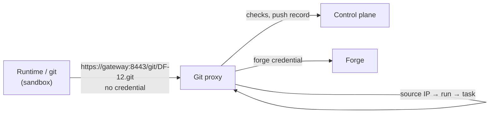

Sandboxes clone, fetch and push only through the gateway's Git smart-HTTP proxy. The proxy holds the
forge credential, restricts what a run may push, checks every pushed commit and records every push.

## Endpoint and caller

The proxy serves `https://<gateway>:8443/git/<TASK-KEY>.git` with a certificate from the instance
CA (fetch with protocol v2 and partial clone, and push). It identifies the run by the source pod IP;
an unknown source, or a path naming another task than the run's, gets `403`. Until the gateway has
its first policy snapshot it answers `503`, which the runtime retries.

## Credential injection

The proxy forwards to the project's repository URL with the project's forge credential. It drops
any `Authorization` header from the client, and never returns the credential to the client or
writes it to a log. The runtime's Git configuration has no credential helper, so nothing in the
sandbox could hold a credential either.

`http://` repositories get no route unless the instance setting `network.allowPlainHttp` is on; the
sandbox always talks HTTPS to the gateway.

## Allowed ref updates

A push is forwarded only if every ref update is:

| Ref | Allowed update |
| --- | --- |
| `refs/heads/factory/task/<KEY>` | create or fast-forward |
| `refs/heads/factory/wip/<KEY>` | create, update or delete (the WIP snapshot) |

Anything else (another branch, a tag, a force-push, another task's branch) rejects the whole push
before the forge is contacted. Git prints the reason, prefixed with `df:`.

## Push checks

Before forwarding, the proxy checks the commits a push adds (commits already on the forge are not
checked again):

| Check | Finding | Configurable per project |
| --- | --- | --- |
| Secret scan | `df:secret-scan`: rule, path, line and a masked preview; the secret itself is never stored or logged | mode `approval` (default) or `reject` |
| Commit identity | `df:identity`: author and committer must be the instance's commit identity | no, always enforced |
| Hidden paths | `df:hidden-path`: a change to a path below a hidden glob (see [Hide files from agents](../using/hidden-paths.md)); also on the WIP branch | globs (default none); always `reject`, no exception request |
| Protected paths | `df:protected-path`: a change below a protected glob; `.dark-factory/**` is always protected | globs (default CI workflow directories and `CODEOWNERS`) and mode |
| Blob size | `df:blob-too-large`: a file larger than the limit | limit (default 5 MiB) and mode |
| Linear history | `df:merge-commit` | on or off (default off) |
| Commit limit | `df:push-too-large`: more than 10,000 commits | no |
| Push size | `df:push-too-large` (HTTP 413): a push body above the maximum (default 256 MiB) | instance setting |

Pushes to the WIP branch get only the secret scan, the size limit and the hidden path check, always rejecting.

**Approval mode.** A task-branch push rejected only by approval-mode findings raises a
`push-check-exception` request in the inbox, listing the findings. Approving it creates exceptions
for exactly these findings, and the agent's next push passes them; findings in `reject` mode stay
rejected. The agent gets a message with the masked findings either way. Board members change the
modes on the project's **Push checks** tab.

## Push records

Git traffic is not part of the **Network traffic** graph or the egress log, which show only
connections through the [egress proxy](egress-gateway.md); the push records below are its trace.

Every push attempt is stored with the control plane before the client gets an answer: run, task,
ref updates with old and new SHA, verdict, reasons, bytes and duration. A push is recorded as
`forwarding` before anything reaches the forge. If the record cannot be stored within 5 seconds, the
push is rejected (`df:audit-unavailable`).

## Upstream failures

| Proxy answer | Meaning |
| --- | --- |
| `503` | The forge is unreachable or timed out, or the gateway has no snapshot yet; the runtime retries |
| `502` | The forge rejected the credential (401, 403) or answered with another error; not retried |

Reference: [Git hardening in the runtime](https://github.com/prskr/dark-factory/blob/main/design/agent-run.md#7-git-hardening).
