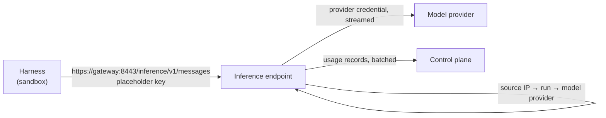

Harnesses reach their model provider only through the gateway's inference endpoint. The endpoint
holds the provider credential, so no model credential exists in a sandbox, and it measures the token
usage of every request. The same listener serves the [Git proxy](git-proxy.md).

## Endpoint and caller

The endpoint serves `https://<gateway>:8443/inference/` with a certificate of the instance CA.
The path after `/inference` is the path of the upstream API. It identifies the run by the source
pod IP and answers `403` for an unknown source (or a run without a model provider) and `503` until
the gateway has its first policy snapshot. The harness reaches it directly: the host is in the
sandbox's `NO_PROXY`, so the request does not use the egress proxy.

The harness gets the endpoint and a fixed placeholder key in its environment (Claude Code:
`ANTHROPIC_BASE_URL`, `ANTHROPIC_API_KEY` or `CLAUDE_CODE_OAUTH_TOKEN` set to `df-placeholder`,
`NODE_EXTRA_CA_CERTS`) and `CLAUDE_CODE_DISABLE_NONESSENTIAL_TRAFFIC=1`, so Claude Code sends no
telemetry or update checks past the endpoint. The placeholder is not a secret.

## Paths and status codes

| Wire API | Forwarded |
| --- | --- |
| Anthropic Messages | `POST /v1/messages`, `POST /v1/messages/count_tokens`, `GET /v1/models` |
| OpenAI Chat Completions | `POST /v1/chat/completions`, `GET /v1/models` |
| OpenAI Responses | `POST /v1/responses`, `GET /v1/models` |

Query strings are kept. `GET /v1/models` goes to the upstream of the wire API chosen for the run.

| Status | Reason |
| --- | --- |
| `403` | Unknown source, or the run has no model provider |
| `404` | Any other method or path, or a wire API the run's provider does not offer; no upstream is contacted |
| `502` | The provider credential is missing from the snapshot (an unreadable Secret), the upstream URL is unusable, or the upstream cannot be connected to (connect timeout 10 s) |
| `408` | The request body from the sandbox stalled for 60 s; nothing is the provider's fault |
| `503` | No policy snapshot yet |
| `504` | The upstream sent no response head within 10 minutes of the request starting |
| others | The upstream's status and headers (for example `429` with `retry-after`) |

Request and response bodies are streamed as they arrive, without buffering and without a limit on
the duration of a response. Unknown paths are logged at `DEBUG` with the path, so a missing one
shows up.

### Where the traffic is visible

Inference traffic does not appear in the **Network traffic** graph or the egress log: they show
only connections through the egress proxy, which is the only component that writes flow events.
The same holds for Git traffic through the [Git proxy](git-proxy.md#push-records), which is
recorded as pushes. Model requests are visible as:

- the run's token table in the task details: one usage record per request, including requests
  with unknown usage;
- the `df.gateway.inference.*` metrics and, from the stored usage records, `df.agent.tokens`
  ([Telemetry](../observability/telemetry.md)).

### Timeouts

A model may think for minutes, so the limits are generous. They are constants, not configuration.

| Limit | Value | When it is hit |
| --- | --- | --- |
| Connect (TCP and TLS) | 10 s | `502`, usage record with unknown usage |
| Response head | 10 min after sending the request started (the upload counts) | `504`, usage record with unknown usage |
| Pause in the request body from the sandbox | 60 s | The upload ends, `408`, usage record with unknown usage |
| Pause between two frames of the response | 5 min | The response ends with a stream error; the usage seen so far is recorded |

Streaming responses carry keep-alive events, so the pause limit only hits a stalled provider.

## Plain HTTP upstreams

The provider form only accepts `https` upstream URLs. A stored `http://` URL (for example from a
database edit or an older release) is forwarded only when `network.allowPlainHttp` is on, like plain
`http://` forges; otherwise the request fails with `502` and nothing is sent. The provider
credential then travels unencrypted, so use it for throwaway clusters only.

## Headers and credential

1. The client's `Authorization`, `Proxy-Authorization`, `x-api-key`, `api-key`, the provider's
   credential header, hop-by-hop headers, `Host` and `Content-Length` are dropped; all other client
   headers (for example `anthropic-beta`) pass through.
2. The provider's [extra headers](../using/model-providers.md#extra-headers), rendered for the run,
   replace client headers of the same name.
3. The credential is set last, as the provider's scheme defines. It is never returned to the client
   or written to a log.

The upstream is asked for an uncompressed answer (`Accept-Encoding: identity`) because the usage is
read from a copy of the response.

## Usage

For `/v1/messages`, `/v1/chat/completions` and `/v1/responses` the gateway reads the model and the
token counts from the final events of a stream or the `usage` object of a JSON body, without
delaying the response. Cached input tokens are reported as cache read. A response without usage is
recorded as unknown, never as zero. `count_tokens` and `/v1/models` produce no record. A request to
an unreachable provider produces a record with unknown usage and no status.

The gateway reports the records to the control plane in batches (every 2 s or at 100 records),
retries with backoff, buffers up to 10,000 records and then drops the oldest, counting them in
`df.gateway.inference.usage_dropped`. The control plane stores each request once, so a retried
report adds nothing twice. At most two seconds of records per replica are lost when a gateway
restarts.

See [Telemetry](../observability/telemetry.md#gateway) for the metrics.
