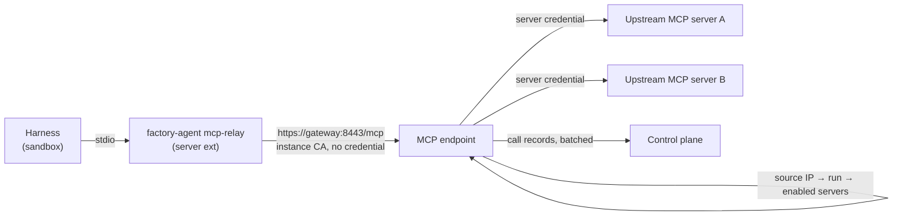

Agents reach third-party tools only through the gateway's MCP endpoint. It is one MCP server for the
whole run: it offers the tools of every [registered MCP server](../using/mcp-servers.md) the run's
project has enabled, forwards each call with the server's credential, and reports one record per
call. No upstream credential exists in a sandbox. The endpoint shares the listener of the
[Git proxy](git-proxy.md) and the [inference endpoint](inference-endpoint.md).

## Identity and the relay

The harness registers MCP servers over stdio, which every ACP harness supports. When the project has
an enabled server, the runtime registers a second stdio server `ext` next to `factory`: the command
`factory-agent mcp-relay --url https://<gateway>:8443/mcp --ca /run/factory/ca/ca.crt`. Claude Code
shows its tools as `mcp__ext__<server>__<tool>`; the name of a tool in another harness depends on
that harness.

The relay is a transport bridge, not an MCP server. It posts every JSON-RPC line it reads to the
endpoint and writes every answer as one compact line. It connects directly to the gateway (never
through the egress proxy, so the egress log shows no `CONNECT` for it), trusts only the instance CA,
sends no credential and opens no listening socket. A gateway that cannot be reached, or answers
with an HTTP error status, becomes a JSON-RPC error for that request; a notification only logs on
stderr.

The endpoint identifies the run by the source pod IP, like the inference endpoint. It answers `403`
for an unknown source and `503` until the gateway has its first policy snapshot. A sandbox of a
project without enabled servers is served with an empty tool list. The `Mcp-Session-Id` names the
run (`df-<run id>-<random>`); every gateway replica accepts it for that run's pod, a session of
another run gets `404`, and a missing one `400`. Any process in the sandbox can call the endpoint,
as with the inference endpoint: the trust boundary is the sandbox, not the harness.

## What the endpoint serves

| Request | Answer |
| --- | --- |
| `POST /mcp` `initialize` | Capabilities `tools` only, a session id. The client's capabilities are ignored; protocol versions `2025-03-26`, `2025-06-18` and `2025-11-25`. |
| `tools/list` | The tools of all enabled servers, named `<server>__<tool>`, each with `title`, `description`, `inputSchema`, `outputSchema` and `annotations` only |
| `tools/call` | The call, forwarded to the server named by the prefix |
| `ping`, `notifications/initialized`, `notifications/cancelled` | As the protocol says |
| anything else (resources, prompts, completion, logging), batches | `-32601`, `400` for batches |
| `GET` | `405`: the endpoint sends no server-initiated messages |
| `DELETE` | `204` |

A tool whose name is not made of letters, digits, `_` and `-`, or whose name as the harness sees it
(`mcp__ext__<server>__<tool>`) exceeds 64 characters, is left out and logged with server and tool
name. Later duplicates of a name are left out.

**Listing.** The servers are asked in parallel (all pages, at most 1,000 tools and 4 MiB per
server). A server that fails is retried once; if it fails again, exceeds a limit or does not answer
within 15 s (20 s for the whole list), it is left out and the others are still listed. The run view
shows a record with tool `tools/list` for every server left out. The harness usually lists once per
session, so a server missing at session start stays missing for that session; the next run lists
again. A pod reuses a run's list for 60 s; enabling, disabling or editing a server drops it.

**Calls.** The endpoint checks that the prefix names a server enabled for the run at that moment, so
disabling applies at once and enabling applies to calls at once (the harness sees a new tool when it
lists again). A call to any other server is a tool result with `isError: true` and a `rejected`
record; no upstream is contacted. A permitted call is forwarded with the name after the prefix and
the arguments unchanged, and the upstream's result is returned unchanged apart from the credential
redaction below. A JSON-RPC error of the upstream is returned as a tool result with `isError: true`.

## Credential handling

The gateway builds every upstream request itself and forwards no header of the sandbox's request.
It adds the credential the server's scheme defines:

| Scheme | Sent as |
| --- | --- |
| `bearer` | `Authorization: Bearer <value>` |
| `header` | `<name>: <prefix><value>` |
| `query` | `?<parameter>=<value>` after the URL's own parameters, URL-encoded |

The credential is read from the Kubernetes Secret behind the server's credential reference by the
control plane and sent to the gateways in the policy snapshot. It lives in the control plane and in
gateway memory only, never in a sandbox, a transcript or a log. Before anything from an upstream
goes back to the sandbox (tool lists, results, error messages), the gateway replaces the credential,
raw and URL-encoded, with `[redacted]`, so an upstream that echoes the request URL or headers cannot
put the token into the transcript. Upstream response headers are never returned.

The `query` scheme is weaker than a header outside Dark Factory's reach: the upstream, and any proxy
in front of it, may write full URLs to its access logs. On the gateway's side the query is never
logged, put into an error message or returned, and redirects are not followed, so it cannot leak to
a third host. Prefer `bearer` or `header` when the server supports them.

A server whose credential cannot be read (an unreadable Secret), or whose scheme is unset, is treated
as having none: its tools are left out, calls fail with a fixed message and no upstream is contacted.
The credential of an MCP server must not be a project's forge credential or a model provider's
credential, and the other way round: the factory's own forge token cannot be selected for an MCP
server by mistake.

## What this does not protect

This slice forwards every tool of an enabled server, unreviewed, until the tool catalog exists:

- **One credential per server per instance.** The upstream sees all projects' calls under one
  identity. Any project that enables a server reaches everything the credential reaches, and one run
  can use up the credential's rate limit for all projects.
- **Write tools bypass the factory's controls.** A tool that writes acts directly on the upstream
  system. For a forge server that means commits, merges and issues without the Git proxy's push
  checks, secret rules and task-branch rules, and without the approval of `create-issue`; in chats
  nothing asks a human either. The credential's scope is the permission: use read-only tokens, and
  never register a forge server with a write-capable token. Do not enable a server that reads private
  data together with one that writes to a public place in the same project.
- **Untrusted descriptions and results.** Tool descriptions come live from the upstream and reach
  the model unreviewed (tool poisoning); results pass unchanged (prompt injection). Register only
  servers whose operator you trust. The endpoint limits what an upstream can do beyond text: it
  never sends sampling, elicitation or roots requests to the harness (the gateway answers every such
  request of an upstream with `-32601` and drops notifications), applies size and time limits and
  serves five tool fields only.
- **Permission prompts.** The runtime approves ACP permission requests automatically, so harnesses
  run `ext` tools without asking, as all tools.

## Private network and the destination check

A server **without** "Private network" is a public server. The gateway resolves its host itself,
refuses the connection if any resolved address is private, link-local, loopback, in the built-in
reserved ranges or in `gateway.blockedCidrs` (Helm value), and connects to a checked address, so a third party who controls a public name cannot point it at an
internal service later (DNS rebinding). A server **with** "Private network" skips this check: for
servers you registered on an internal address on purpose. Use it only for names in DNS you control.
With it on, the name may also resolve to `localhost` and to the gateway's own ports. Redirects are
never followed, `http://` URLs are only used while `network.allowPlainHttp` is on, and no `http-host`
egress rule is needed for a registered server.

## Limits

| Limit | Value |
| --- | --- |
| Request body | 1 MiB (`413`) |
| Call result | 4 MiB (`result too large`) |
| Upstream tool list | 1,000 tools and 4 MiB per server |
| Connect (TCP and TLS) | 10 s |
| Upstream `tools/list` / whole list | 15 s / 20 s |
| List cache | 60 s per run and gateway pod |
| Call | 120 s (`upstream timeout`) |
| Concurrent calls | 8 per run and gateway pod (`too many concurrent calls`) |
| Idle upstream session | 10 min |

They are constants, not configuration. A call whose client disconnects is cancelled upstream
(`cancelled`); a `notifications/cancelled` does the same when it reaches the gateway pod that holds
the call. The gateway initializes each upstream session (`initialize`, then `notifications/initialized`),
declares no client capabilities, replaces an expired session once and ends sessions (`DELETE`) when
the run leaves the snapshot, the server's configuration changes or 10 minutes pass without use.

## Records and logs

The gateway reports one record per call, and one per server left out of a `tools/list`: run, server,
tool, outcome (`ok`, `tool-error`, `rejected`, `upstream-error`, `timeout`, `too-large`,
`cancelled`), start time, duration and request and response size. Arguments, results and headers are
never part of a record. The control plane stores each call once and shows the records in the run view
([MCP servers](../using/mcp-servers.md#call-records)). Reports are batched (every 2 s or at 100
records), retried with backoff and buffered up to 10,000 records; beyond that the oldest are dropped
and counted in `df.gateway.mcp.calls_dropped` ([Telemetry](../observability/telemetry.md#gateway)).
Logs name run, server, tool and outcome only, never credentials, arguments, results or tool
descriptions.
