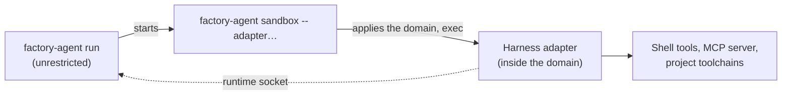

The sandbox runtime and the harness run as the same user in one container. Without further
protection, a prompt-injected harness could read the runtime's private key, rewrite the transcript
outbox, signal the runtime or change the system directories of the project image. The runtime
therefore starts every harness inside a Landlock domain, a kernel feature that restricts a process
and everything it starts without privileges. The runtime itself stays outside the domain. This holds
with `sandbox.landlock: enforce` (the default); [`disabled`](#opting-out) gives it up.

## Threat model

| The harness could otherwise | What stops it |
| --- | --- |
| Read `/run/factory/tls/tls.key` and impersonate the sandbox towards the control plane | No access to the TLS directory; the harness reads a copy of the public CA certificate only |
| Rewrite the outbox in `/data/runtime` and with it the transcript the control plane receives | No access to `/data/runtime` |
| Signal, trace or read the memory of the runtime | Landlock signal scoping, ptrace and `/proc/<pid>/mem` access across the domain are refused |
| Modify system directories (`/usr`, `/etc`, `/opt`) of the project image | Read and execute only |
| Run unrestricted after a failed setup | The wrapper exits before it starts the command; there is no best-effort mode |

Network access is not part of this: [NetworkPolicy and the egress gateway](egress-gateway.md) cover
it.

## How the harness is started



The runtime starts the adapter command of the run (the harness image's adapter or the project's own)
as `factory-agent sandbox -- <command>`. The subcommand builds the rules, applies them to itself and
replaces itself with the command, so the harness and all its descendants inherit the domain. If any
step fails, it prints the reason to stderr and exits with status 125 without running the command;
the run then ends `FAILED`.

## Ruleset

The rules follow the directory layout of the runtime (`DF_DATA_DIR`, `DF_RUN_DIR`, `DF_TLS_DIR`,
defaults below). Every other path is denied.

| Path | Access |
| --- | --- |
| Every top-level directory of `/` that is not a symlink, except those containing the data, run and TLS directories (`/data`, `/run`) | Read files, read directories, execute |
| `/data/repo` (workspace), `/data/home` (`$HOME`), `/tmp`, `/dev` | All filesystem rights of Landlock ABI 6 |
| `/run/factory/ca/` | Read files, read directories |
| Everything else, including `/data/runtime`, `/run/factory/tls` and the rest of `/run/factory` | None |

Consequences:

- A toolchain in any top-level directory (`/usr`, `/opt/go`, `/usr/local`, `/home/dev`) works without
  configuration. The rules come from the root directory listing at the start of each run, not from a
  list of system directories.
- A tool that writes outside `/data/repo`, `/data/home`, `/tmp` and `/dev` (for example `~/.npm` with a
  `HOME` other than `/data/home`, or `/var/tmp`) fails with `Permission denied`. Point such caches
  into `/data/home` or `/tmp` in the project image. The system prompt of every run names the
  writable directories.
- The non-default `DF_DATA_DIR` and `DF_RUN_DIR` move the grants with them.

### Symlinks and aliases

Landlock binds a rule to the inode its path resolves to, so the runtime treats links with care.

- **Top-level symlinks** (`/bin` to `usr/bin`, `/var/run` to `/run`) get no rule. `/bin/sh` still
  works because it resolves into `/usr`; `/var/run` grants nothing under `/run`.
- **Unreadable top-level directories** (`/lost+found`, a `0700` `/root` of the project image) that
  the sandbox user can't open for lack of permission get no rule: file permissions already deny
  them, and without a rule so does Landlock. Any other failure to open a top-level directory, and
  any failure on the writable roots or the CA directory, stops the wrapper with status 125.
- **Writable roots** (`/data/repo`, `/data/home`) must be real directories with no symlink in their
  path. Otherwise the wrapper exits with status 125 and the run ends `FAILED`. This catches a link
  left on the task volume by an earlier unrestricted run, such as `/data/home` pointing at
  `/data/runtime`. Symlinks inside the writable directories (a Bazel `bazel-bin` link into the
  cache) work, and stay confined to the granted directories.
- **The outbox directory** `/data/runtime` is written by the runtime itself, so a link there would
  redirect the runtime's writes into the writable home. When the runtime starts, before it creates
  anything below `/data` or opens the outbox, it treats `/data/runtime` like a writable root: if it
  is a symlink or has one in its path, the runtime exits and the run fails. Symlinks inside it
  (a segment replaced by a link) are removed; only the link goes, never its target.
- **Hard links** into `/data/runtime` that an unrestricted run left in the workspace or home would
  give write access to the outbox. At the same point the runtime replaces every file below
  `/data/runtime` that has more than one link with a copy.

### CA certificate

cert-manager's CSI driver rotates the TLS directory by giving `ca.crt` a new inode on every renewal,
so a rule on the file would break at the first renewal, and a rule on the directory would expose
`tls.key`. The runtime copies `ca.crt` to `/run/factory/ca/ca.crt` at startup and on every
reconnect (it reloads the TLS files then), through a temporary file and a rename. The harness reads
the copy: `NODE_EXTRA_CA_CERTS` and the workspace's `http.<proxy URL>.sslCAInfo` point at it.

## Signals, sockets and the environment

- **Scoping.** The domain scopes signals and abstract Unix sockets. The harness can't send signals
  to the runtime or to processes outside the domain, and can't connect to abstract sockets created
  outside it. Landlock also refuses `ptrace` and `/proc/<pid>/mem` access across the domain. The
  runtime can still signal its child, the harness. The pathname socket `/run/factory/runtime.sock`
  stays reachable, so the factory tools work.
- **Environment.** The harness does not get the runtime's own variables: every `DF_*` variable
  except `DF_RUNTIME_SOCK`, `DF_RUN_DIR` and `DF_LOG_FORMAT`, which the MCP server needs, is removed
  (by the wrapper, or by the runtime itself with `sandbox.landlock: disabled`). Variables of the
  project image and of the run stay, so toolchain variables like `PATH` or `JAVA_HOME` keep working.
  None of the removed variables is a secret.
- **Descriptors.** The harness inherits stdin, stdout and stderr only.
- **Privileges.** `no_new_privs` is set (the pod spec sets it as well).

## Kernel requirements

The runtime needs Landlock ABI 6: Linux 6.12 or newer with `landlock` in the kernel's LSM list. The
domain uses exactly the rights and scopes of ABI 6 on every kernel; newer kernels add no rights that
could cut off the runtime socket.

| Runtime class | The kernel that counts |
| --- | --- |
| runc (default) | The node's kernel: Linux 6.12 or newer, `landlock` in the LSM list |
| Kata Containers | The guest kernel. Landlock is enabled in the stock guest kernel since Kata 3.32.0 |

### Checking a cluster

The first command prints the kernel version and the LSM list of a node (runc). The debug pod mounts
the node's filesystem at `/host`; the LSM list is only visible if the node has securityfs mounted:

```bash
kubectl debug node/<node> -it --image=busybox -- \
  sh -c 'uname -r; cat /host/sys/kernel/security/lsm'
```

For Kata, check the guest instead: run a pod with the runtime class in the sandbox namespace and
read the same files inside it. Its `uname -r` is the guest kernel; the LSM list shows only if
securityfs is mounted in the guest (`mount -t securityfs` needs privileges the pod does not have).
The namespace enforces the Pod Security level `restricted`, so the pod sets the security context
that level requires (busybox runs as root otherwise). Replace `<sandbox namespace>`
(`sandboxNamespace.name`, default `dark-factory-sandboxes`) and `<runtime class>`
(`sandboxNamespace.runtimeClassName`):

```bash
kubectl -n <sandbox namespace> run landlock-check --rm -it --restart=Never --image=busybox \
  --overrides='{
    "spec": {
      "runtimeClassName": "<runtime class>",
      "securityContext": {
        "runAsNonRoot": true, "runAsUser": 1000, "runAsGroup": 1000,
        "seccompProfile": {"type": "RuntimeDefault"}
      },
      "containers": [{
        "name": "landlock-check",
        "image": "busybox",
        "stdin": true, "tty": true,
        "command": ["sh", "-c", "uname -r; cat /sys/kernel/security/lsm"],
        "securityContext": {
          "allowPrivilegeEscalation": false,
          "capabilities": {"drop": ["ALL"]},
          "runAsNonRoot": true, "runAsUser": 1000,
          "seccompProfile": {"type": "RuntimeDefault"}
        }
      }]
    }
  }'
```

An output that lists `landlock` and a version of 6.12 or newer means the kernel supports the
domain. A missing list proves nothing either way; the run test below does.

Before it writes the harness files, the runtime probes the kernel. If the ABI is below 6, it does not
start the harness, emits a `sandbox.landlock_unavailable` notice (`Landlock ABI 5 found, 6 required`
or `Landlock is not available in this kernel`, each followed by the opt-out hint) and ends the run
`FAILED`. A run is the quickest check of a cluster: if it starts, the kernel supports the domain.

## Opting out

Set `sandbox.landlock: disabled` in the Helm values (default `enforce`; no other value is accepted)
to run without the domain, for example on nodes whose kernel can't be upgraded:

```yaml
sandbox:
  landlock: disabled
```

The setting is instance-wide; there is no per-project switch. With `disabled`:

- the runtime starts the harness directly and logs the warning
  `Landlock disabled by instance configuration; harness runs unrestricted` at the start of every run;
- the system prompt no longer names the writable directories;
- the harness can read the TLS private key, write the outbox, signal the runtime (same user) and
  modify whatever file permissions allow. The `DF_*` variables stay hidden from it.

The control plane passes the value to every sandbox pod as `DF_LANDLOCK`
(see the [runtime reference](../reference/sandbox-runtime/configuration.md)).

## Limits

- The runtime process is unrestricted: it needs the rotated TLS key, the outbox and the workspace.
- The root filesystem of the sandbox stays writable for the runtime. Only the harness tree is
  confined.
- Landlock has no permissive mode and no network rules here. A project whose tools need other
  writable paths sees `Permission denied` from the tool, not a Dark Factory message.
