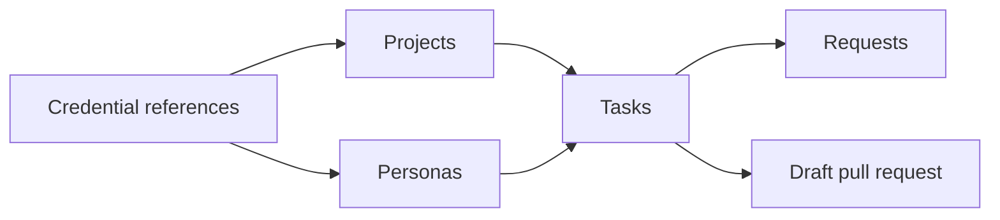

Dark Factory treats agents like employees: you give them a project and a role, assign tasks, answer
their questions and review their pull requests in your forge. Everything happens in the web UI;
creating tasks and answering questions also works on a phone.

Set up in this order:

1. [Credentials, projects and personas](setup.md): references to the forge and harness
   credentials, the repositories and the agents.
2. [Tasks](tasks.md): describe the work, follow the transcript, send messages, stop or cancel.
3. [Requests](requests.md): answer questions and decide approvals.
4. [Network access](network-access.md): allow the hosts agents need.
