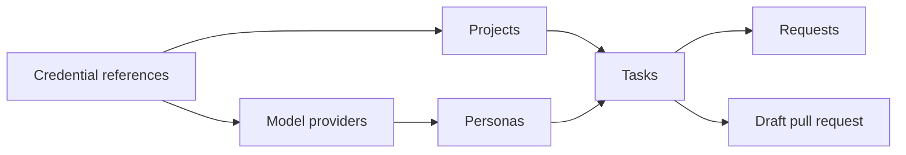

Dark Factory treats agents like employees: you give them a project and a role, assign tasks, answer
their questions and review their pull requests in your forge. Everything happens in the web UI;
creating tasks and answering questions also works on a phone.

On a desktop screen (768 px and wider), the navigation rail on the left holds Tasks, Requests,
Projects and Network traffic. The **Settings** link (gear) at its bottom opens the settings area
with a sidebar for **Personas**, **Credentials**, **Model providers** and **Egress rules**. On a
phone the settings area is not available.

Set up in this order:

1. [Credentials, projects and personas](setup.md): references to the forge and model
   credentials, the repositories and the agents.
2. [Model providers](model-providers.md): the model services agents use and their credentials.
3. [Tasks](tasks.md): describe the work, follow the transcript, send messages, stop or cancel.
4. [Requests](requests.md): answer questions and decide approvals.
5. [Network access](network-access.md): allow the hosts agents need.
