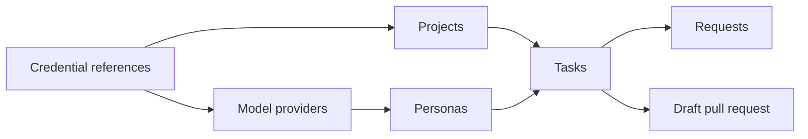

Dark Factory treats agents like employees: you give them a project and a role, assign tasks, answer
their questions and review their pull requests in your forge. Everything happens in the web UI;
creating tasks and answering questions also works on a phone.

On a desktop screen (768 px and wider), the navigation rail on the left holds Chats, Tasks,
Requests and Network traffic. On a phone the bottom bar has Chats, Tasks, Requests and Projects.
The **Settings** link (gear) at its bottom opens the projects page inside the
settings area, whose sidebar lists **Projects**, **Personas**, **Credentials**, **Model providers**,
**MCP servers** and **Egress rules**, in this order. A project is edited on its settings page at `/projects/<key>`.
On a phone the settings sidebar is not available; **Projects** is in the bottom bar.

Set up in this order:

1. [Credentials, projects and personas](setup.md): references to the forge and model
   credentials, the repositories and the agents.
2. [Model providers](model-providers.md): the model services agents use, their models and credentials.
   [OpenCode](opencode.md) shows a persona with the second harness.
3. [Tasks](tasks.md): describe the work, follow the transcript, send messages, stop or cancel.
4. [Requests](requests.md): answer questions and decide approvals.
5. [Network access](network-access.md): allow the hosts agents need.
6. [Delegation](delegation.md): agents that create tasks for other agents and wake when they end.
7. [Hidden paths](hidden-paths.md): keep files out of the agent's workspace.
8. [Existing branches](existing-branches.md): tasks on a branch that exists, attached pull requests and rebases.
9. [Build a feature in iterations](build-a-feature.md): a feature agent that merges its iterations' pull requests into its own branch.
10. [Plan work in a chat](chats.md): talk to a persona, let it hand work to tasks, archive the conversation.
11. [Verify persona commits on the forge](verify-persona-commits.md): register a persona's signing key and email on the bot account, rotate the key.
