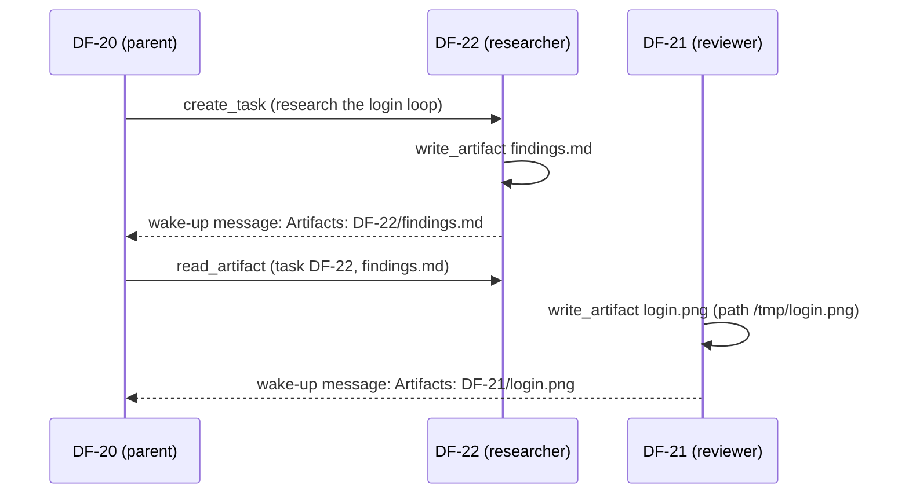

An artifact is a named text or image file that belongs to one task. The agent of a task writes it
for you and for the tasks that are related to it: a researcher's findings, a coordinator's brief,
a reviewer's screenshot. Artifacts need no branch and no pull request.

## Rules

| | |
| --- | --- |
| Name | 1 to 100 characters from `A-Z`, `a-z`, `0-9`, `.`, `_`, `-`; no leading dot; case-sensitive; unique per task |
| Content | UTF-8 text without NUL bytes, or a PNG, JPEG, WebP or GIF image. The control plane detects the type from the content, whatever the name says. SVG and everything else is rejected |
| Limits | Text: `artifacts.maxTextBytes` (1 MiB). Image: `artifacts.maxImageBytes` (3.75 MiB) and at most 8000 px per side. Per task: `artifacts.maxPerTask` (50). See the [configuration reference](../reference/agent-channel/configuration.md) |
| Replacing | Writing an existing name replaces the artifact, also with another type. There is no history and no delete. Artifacts stay as long as the task, also when its volume is deleted |

A rejected write leaves an existing artifact unchanged and tells the agent which limit it hit.

## Tools

| Tool | What it does |
| --- | --- |
| `write_artifact` | `name` and exactly one of `content` (text) or `path` (a file). Writes only to the caller's own task |
| `list_artifacts` | Name, type, MIME type, size and update time of a task's artifacts (`task`, default the caller's) |
| `read_artifact` | `name` and optional `task` and `offset`. Text comes in pages of at most 64 KiB, with a first line that names the byte range and the `offset` of the next page; an image comes as an image |

`path` is read by the runtime in the sandbox: it is absolute, lies under `/data/repo` or `/tmp`,
passes through no symlink and names a regular file of at most 8 MiB. Anything else fails the call.

An agent can read the artifacts of its own task, its ancestors, its descendants (all levels) and the
tasks it depends on (`depends_on`). Any other task, and a task that does not exist,
gives the same error "task not found or not related". What an agent reads from another task is
marked as data written by another agent; reads of other tasks are recorded in the audit log with the
target task and the artifact.

## Example: research, then decide

1. The parent creates a research task and ends its turn.
2. The researcher writes `findings.md` with `write_artifact`, then completes.
3. The parent wakes with the message `Artifacts: DF-22/findings.md`, and reads the file with
   `read_artifact`. The key in the message is the `task` argument.
4. A reviewer takes a screenshot into `/tmp` and attaches it with `write_artifact` and `path`. The
   report can show it inline: a Markdown artifact that contains `` shows the
   image if `login.png` is an image artifact of the same task. Any other image reference stays a link.

## In the task view

- **Artifacts tab**: appears in the details once the task has an artifact, with the number of
  artifacts and a card each (newest first, with the first lines of a text or the image). Without
  artifacts the details keep the title "Details".
- **Transcript**: a successful `write_artifact` shows as a row with the name and type; it opens
  the current version. A failed call stays an ordinary tool row.
- **Split view** (from 768 px): opening an artifact shows it next to the transcript, with the message
  box below the transcript. From 1280 px the details column collapses to its strip while an
  artifact is open; from 768 to 1279 px an open details slide-over closes. Closing the artifact
  restores either state. Drag the divider (or use the arrow keys on it) to change the
  split; the browser remembers it. Below 768 px an artifact opens on its own page.
- **Artifact header**: name, type, size and update time, for an image also its size in pixels; a
  Preview/Source toggle for Markdown (Source shows the highlighted text); "Open full page"; Close.
- **Rendering**: Markdown with code highlighting and Mermaid diagrams, other text highlighted by its
  extension, images as images.
- **Live**: when a `write_artifact` row arrives in the transcript, the tab and an open artifact of
  that name reload, and the first artifact brings the tab in without a reload.
- **Task list**: from 768 px a button collapses the task list to a strip to make room; the browser
  remembers the choice.
- **Artifact page**: `/tasks/<key>/artifacts/<name>` is a page of its own that you can bookmark; it
  does not update live. Images are served at `/tasks/<key>/artifacts/<name>/raw` to signed-in board
  members, with the stored content type, `nosniff` and an `ETag`.
