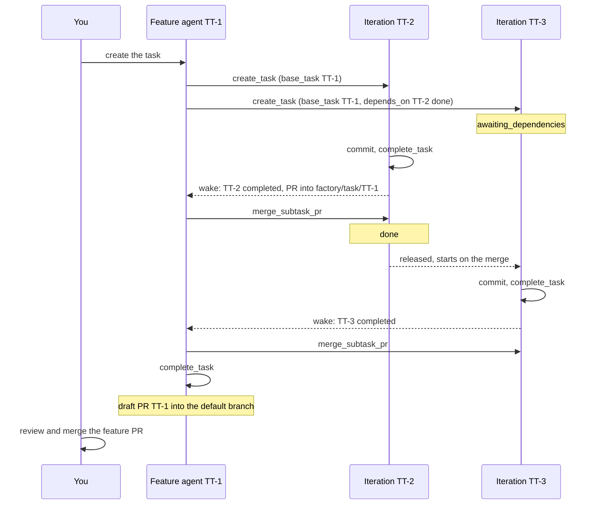

A feature that is too big for one pull request can be built in iterations: a coordinating agent owns
the feature branch, its iterations are tasks on top of it, and each iteration's pull request is
merged into the feature branch before the next one starts. The feature's own pull request into the
default branch is the one you review at the end. This guide sets that up and shows what happens. It
builds on [Delegate work between agents](delegation.md).

## Set it up

1. In the project's settings, on the **Security** tab, set **Subtask merges** to *Parent agent*
   ([Projects](setup.md#projects)). Without it, `merge_subtask_pr` refuses and you merge every
   iteration's pull request yourself; the rest of this guide works the same, with your merge as the
   signal.
2. Create the feature task for a coordinating persona (see [Delegate work](delegation.md) for the
   persona descriptions) and describe the feature and the iterations you expect.

## What the coordinator does

- **Creates the iterations on its own branch.** `create_task` with `base_task` set to its own key.
  The iteration starts from the feature branch and its pull request targets it. The coordinator's
  branch has no commits of its own at first, so the control plane creates it through the forge when
  the first iteration starts; the branch is `factory/task/<feature key>`.
- **Orders them with dependencies.** The second iteration gets `depends_on` with the first and kind
  `done`: it is released when the first iteration is done, that is when its pull request is merged.
  A `completion` dependency would start it as soon as the first agent completed, before the merge,
  on a base without the first iteration's work.
- **Ends its turn** and is woken when an iteration ends.

## What happens at the end of an iteration

1. The iteration's agent commits and completes. Its branch is pushed and its draft pull request
   into the feature branch is opened and marked ready; the task is *in review*. The coordinator is
   woken when the run ends, which can be just before the pull request exists, so the wake-up
   message may not carry its link. Until the pull request is opened and merged, the iteration
   counts as open and the coordinator cannot complete.
2. The coordinator calls `merge_subtask_pr` with the iteration's key. The control plane merges the
   pull request for the commit the iteration last pushed, with the repository's merge style. The
   iteration becomes *done*, its dependents are released, and the coordinator's own draft pull
   request into the default branch is opened if it has none.
3. The next iteration starts: its workspace is based on the feature branch, which now contains the
   merge.

The pull request of an iteration opens shortly after its run ended. If the coordinator calls
`merge_subtask_pr` before that, the error says so and the coordinator calls again.

## When something goes wrong

- **A merge conflict, a failed required check or a moved head** comes back to the coordinator as an
  error with the forge's reason. The iteration stays in review; the coordinator sends it a message
  (`send_message`) with the finding, and calls `merge_subtask_pr` again after its next completion.
- **The coordinator cannot complete** while an iteration is open: not finished, or based on the
  coordinator's branch with a pull request that is not merged. The error names the iterations and
  their pull requests. You can still **Mark done** the coordinator by hand.
- **Cancel the feature task** to stop everything: its open iterations, and theirs, are cancelled in
  one step, and runs are stopped. Pull requests stay as they are.
- **Delegation is bounded** by the [limits](delegation.md#limits) `tasks.maxDepth` and
  `tasks.maxOpenSubtasks`.

## Follow it in the UI

The feature task's **Subtasks** tab shows how many iterations are done ("1 of 2 done"), a progress
bar and a row per iteration with its status. The task list shows `1/2` next to the feature task's
key and opens to the iterations; the feature task's row carries the needs-you dot while an
iteration waits for you ([Tasks](tasks.md#subtasks-in-the-list)). An iteration's details name the feature task as **Parent** and as **Base task**.

## Review and merge the feature

When the last iteration is merged and the coordinator completes, the feature task is *in review* and
its pull request into the default branch is ready. Review it like any pull request and merge it in
your forge; with [webhooks](../integrations/forges/webhooks.md) the feature task becomes done by
itself, otherwise mark it done.
