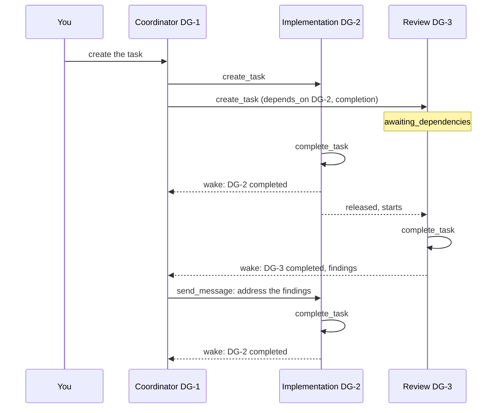

An agent can hand work to other personas: it creates tasks, lets them wait for each other and is
woken when they end. This guide shows the pattern "implementation and review". It needs no forge
webhook; webhooks add the merge of a pull request as a signal ([Forge webhooks](../integrations/forges/webhooks.md)).

## The tools

Every task of an agent gets four more [factory tools](../architecture/agent-runs.md#agent-tools):

| Tool | What it does |
| --- | --- |
| `list_personas` | Returns the name and the [description](setup.md#personas) of every persona, ordered by name. |
| `create_task` | Creates a task in the project of the caller with `persona`, `title`, `prompt`, optional `depends_on`, optional `base_task` ([below](#base-task)) and optional `branch` (an [existing branch](existing-branches.md) that matches the project's [agent branches](existing-branches.md#agent-branches); not together with `base_task`). The caller becomes the **parent**. Returns the key and the status of the new task. Fails when a [limit](#limits) is reached. |
| `send_message` | Queues a message on a child of the caller, with the same effect as your message in the task view. The caller cannot message any other task. |
| `merge_subtask_pr` | Merges the pull request of a subtask into the caller's own task branch ([below](#merge-subtask-pull-requests)). Only if the project's `subtask_merge` setting is *Parent agent*. |

Tasks created in the UI have no parent. A task created by an agent shows that agent as its creator
in the details.

## Dependencies

`depends_on` is a list of `{task, kind}`. It is set when the task is created and never changes.
All targets must be tasks of the same project.

| Kind | Satisfied when the target |
| --- | --- |
| `completion` | has completed at least once (the agent called `complete_task` and the run ended; not if it was cancelled meanwhile), or is done |
| `done` | is done: its pull request was merged, or a board member marked it done |

A satisfied dependency stays satisfied. A task with an unsatisfied dependency starts as
`awaiting_dependencies`: no run, branch, volume or sandbox. When the last dependency is satisfied it
becomes `queued` and starts like any task. Dependencies gate only the first start: a later
completion of the target does not restart a task that has run. A message queued on a waiting task
does not start it; the first run receives it with the assignment.

Marking a task done by hand satisfies `done` dependencies on it, also without webhooks. Cancelling
a waiting task discards its assignment.

## Base task

`base_task` is the key of a task of the same project that is not done, failed or cancelled. The new
task's branch starts from the base task's branch and its pull request targets that branch, so a
reviewer sees the implementation it reviews (`base_task` = the implementation) and the iterations of
a feature build on each other (`base_task` = the caller's own key). It is set at creation and never
changes. A key that is unknown, in another project or over is an error; nothing is created.

- **The base branch** of a task is the branch of its base task. Once the base task is done (merged),
  the base task's own base branch applies instead, recursively, so the task follows the default
  branch again. Without a base task it is the base of the attached pull request, or the project's
  base branch. The workspace, the Git proxy's route and the pull request use the same value.
- **The base task's branch is created** through the forge, from the base task's own base branch,
  whenever a run of the new task starts, unless it exists. If the forge refuses it, the run ends
  `failed` with `base branch: <reason>` and the task becomes `failed`; the next start (after a
  message) asks again.
- **The workspace follows it**: when a task's branch has no commits of its own, the start of each
  run moves it (locally and, if it exists there, on the remote) to the tip of the base branch. A
  task with commits of its own, and a task on an existing branch, is left as it is.
- **Artifacts**: an agent may read the artifacts of its base task ([Artifacts](artifacts.md)).

## Limits

Two instance settings bound delegation; `create_task` fails with an error naming the setting and
creates nothing ([reference](../reference/agent-channel/configuration.md)):

| Setting | Default | Counts |
| --- | --- | --- |
| `tasks.maxDepth` | `5` | The ancestors of the new task: a task with that many ancestors cannot create subtasks. |
| `tasks.maxOpenSubtasks` | `10` | The caller's open subtasks. |

A subtask is **open** until it is finished: its status is `in_review`, `completed`, `failed` or
`cancelled`, unless it is based on the caller (`base_task`) and is neither `completed` nor
`cancelled` and either has a pull request or the job that opens its pull request is still pending
(the parent is woken when the run ends, before that job ran): such an iteration is open until its
pull request is merged. Tasks you
create in the UI are not limited.

## Completing with open subtasks

`complete_task` fails while the task has open subtasks. The error lists their keys and, where they
have one, their pull request; the run does not end, and the agent can end its turn to be woken
when they end or merge the pull requests. **Mark done** in the status menu is not gated.

## Merge subtask pull requests

`merge_subtask_pr` takes the key of a subtask and merges its pull request into the caller's task
branch. It works only if all of these hold, and otherwise answers with an error that names the
condition and changes nothing:

- the project's **Subtask merges** setting is *Parent agent* ([Projects](setup.md#projects));
- the task is a subtask of the caller, and its base task is the caller;
- the subtask is `in_review` and has a pull request.

The merge is requested for the commit the subtask last pushed and uses the repository's merge style
(Forgejo: its default merge style; GitHub: merge commit if allowed, else squash, else rebase). A
forge refusal, such as a conflict, a failed required check or a head that moved, comes back as an
error with the forge's reason; the subtask stays in review. On success the subtask becomes done
(audit entry `task.done` with the calling agent, the merge time recorded as for a merge reported by
the forge), the tool returns the merged pull request's URL, the caller is woken as for any done
subtask, and the caller's own draft pull request is opened if it has none (a failure there is
retried and never fails the merge). A later merge webhook for the same pull request changes nothing. Merges into the default branch stay with humans.

If the subtask became `completed` or `cancelled` while the forge merged, the tool still returns the
merged pull request's URL and says so: the subtask "is already done" or "was cancelled meanwhile
and stays cancelled". Its status is left as it is.

## The parent wakes when a child ends

When a child completes, becomes done, fails or is cancelled, its parent gets a message in the same
moment. A parent that is done, cancelled or failed gets none; neither does a parent for a child that
waits for a human.

```text
DG-3 "Greeting review" completed.
PR: https://forge.example/acme/app/pulls/12
Artifacts: DG-3/findings.md
Still waiting on DG-3: DG-4

Summary from the agent of DG-3:
> Review done, two findings.
```

The text names the key and title of the child and how it ended (`completed`, `is done`, `failed`
with its reason, `was cancelled`), the pull request if there is one, the child's [artifacts](artifacts.md) as `<key>/<name>` (`Artifacts: none` if it has none; those of its own children are not listed), the tasks that still wait for
the child, and the child's own summary, quoted. The summary is the child's output: the parent treats
it like any untrusted text. The message is authored by the system with the reason
`task.child_ended`.

A child that completes and later has its pull request merged wakes the parent twice, once for each.
A child that is already done wakes the parent no second time when a run of it completes. A run that
ends `completed` on a cancelled child counts as nothing: no completion, no released dependents, no
message.

## Example: implementation, review and the next round



1. Describe the work to the coordinator persona. It calls `list_personas`, then `create_task` for
   the implementation and for the review with `depends_on: [{task: "DG-2", kind: "completion"}]`,
   and ends its turn. The review shows `awaiting dependencies`.
2. The implementation completes. The review is released in the same transaction and the coordinator
   is woken.
3. The review completes with findings and wakes the coordinator, which relays them with
   `send_message` to the implementation. The message reopens it.
4. The implementation completes again and wakes the coordinator; if the coordinator wants another
   review round it sends a message to the review task, which a `completion` dependency does not
   start again. Later rounds are the coordinator's job.

Without webhooks, `done` dependencies are released by marking the target done in its status menu.
With webhooks a merged pull request does it.

## In the task view

The details of a task show **Created by**, **Parent** and, for a task with a base task, **Base task**
(`DF-20 · Implement`, a link) after the branch, and a collapsible
**Dependencies** section between the properties and the runs: *Waits for* (each dependency with its
kind and whether it is satisfied) and *Needed by* (the tasks that wait for this one, with their
status). It is open while the task awaits its dependencies and updates live. The section is absent
for a task in no dependency.

A task with subtasks has a **Subtasks** tab: how many of its direct subtasks are done, a progress
bar and a row per subtask (status ring, title, key and status, and the done/total chip of a subtask
with subtasks of its own). In the task list a task with subtasks shows `done/total` next to its
status: done counts the subtasks that are in review or done, total those that are not cancelled.
Both update when a subtask changes status or is created. Cancelling a task also cancels its open
descendants ([Tasks](tasks.md#interrupt-stop-mark-done-cancel)).

There is no limit on relayed messages between a parent and its children; watch the transcript and
cancel a task that runs away. A persona is not restricted in whom it may delegate to.
