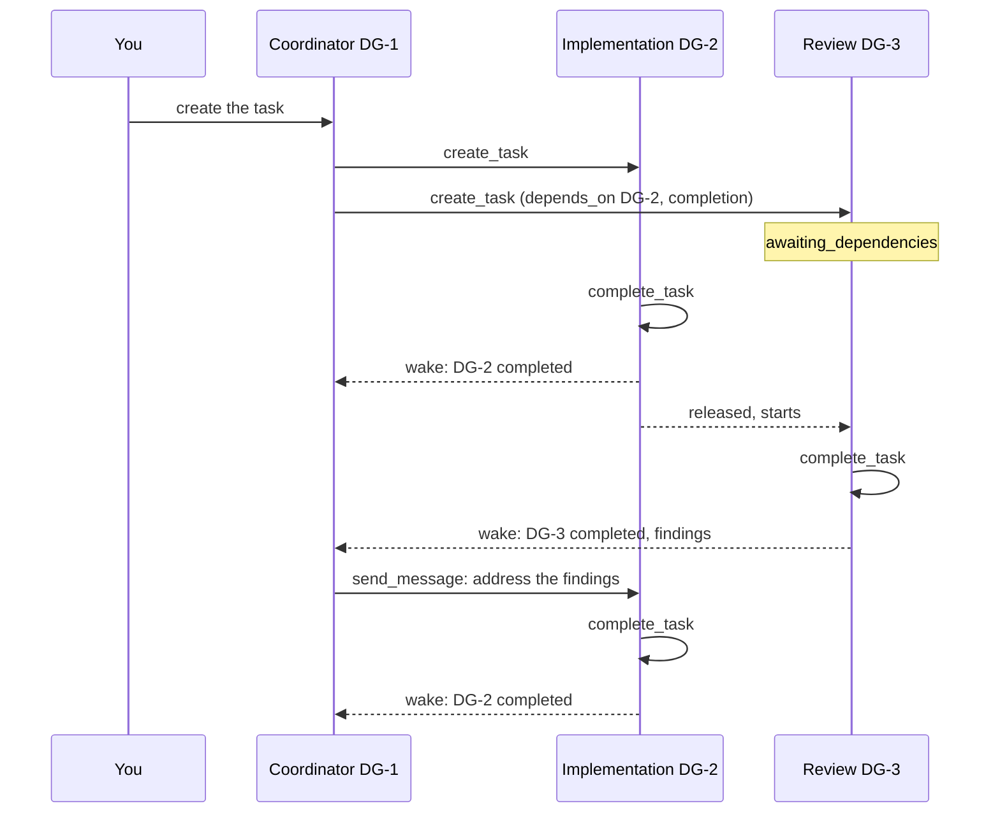

An agent can hand work to other personas: it creates tasks, lets them wait for each other and is
woken when they end. This guide shows the pattern "implementation and review". It needs no forge
webhook; webhooks add the merge of a pull request as a signal ([Forge webhooks](../integrations/forges/webhooks.md)).

## The tools

Every task of an agent gets three more [factory tools](../architecture/agent-runs.md#agent-tools):

| Tool | What it does |
| --- | --- |
| `list_personas` | Returns the name and the [description](setup.md#personas) of every persona, ordered by name. |
| `create_task` | Creates a task in the project of the caller with `persona`, `title`, `prompt` and optional `depends_on`. The caller becomes the **parent**. Returns the key and the status of the new task. |
| `send_message` | Queues a message on a child of the caller, with the same effect as your message in the task view. The caller cannot message any other task. |

Tasks created in the UI have no parent. A task created by an agent shows that agent as its creator
in the details.

## Dependencies

`depends_on` is a list of `{task, kind}`. It is set when the task is created and never changes.
All targets must be tasks of the same project.

| Kind | Satisfied when the target |
| --- | --- |
| `completion` | has completed at least once (the agent called `complete_task` and the run ended; not if it was cancelled meanwhile), or is done |
| `done` | is done: its pull request was merged, or a board member marked it done |

A satisfied dependency stays satisfied. A task with an unsatisfied dependency starts as
`awaiting_dependencies`: no run, branch, volume or sandbox. When the last dependency is satisfied it
becomes `queued` and starts like any task. Dependencies gate only the first start: a later
completion of the target does not restart a task that has run. A message queued on a waiting task
does not start it; the first run receives it with the assignment.

Marking a task done by hand satisfies `done` dependencies on it, also without webhooks. Cancelling
a waiting task discards its assignment.

## The parent wakes when a child ends

When a child completes, becomes done, fails or is cancelled, its parent gets a message in the same
moment. A parent that is done, cancelled or failed gets none; neither does a parent for a child that
waits for a human.

```text
DG-3 "Greeting review" completed.
PR: https://forge.example/acme/app/pulls/12
Artifacts: DG-3/findings.md
Still waiting on DG-3: DG-4

Summary from the agent of DG-3:
> Review done, two findings.
```

The text names the key and title of the child and how it ended (`completed`, `is done`, `failed`
with its reason, `was cancelled`), the pull request if there is one, the child's [artifacts](artifacts.md) as `<key>/<name>` (`Artifacts: none` if it has none; those of its own children are not listed), the tasks that still wait for
the child, and the child's own summary, quoted. The summary is the child's output: the parent treats
it like any untrusted text. The message is authored by the system with the reason
`task.child_ended`.

A child that completes and later has its pull request merged wakes the parent twice, once for each.
A child that is already done wakes the parent no second time when a run of it completes. A run that
ends `completed` on a cancelled child counts as nothing: no completion, no released dependents, no
message.

## Example: implementation, review and the next round



1. Describe the work to the coordinator persona. It calls `list_personas`, then `create_task` for
   the implementation and for the review with `depends_on: [{task: "DG-2", kind: "completion"}]`,
   and ends its turn. The review shows `awaiting dependencies`.
2. The implementation completes. The review is released in the same transaction and the coordinator
   is woken.
3. The review completes with findings and wakes the coordinator, which relays them with
   `send_message` to the implementation. The message reopens it.
4. The implementation completes again and wakes the coordinator; if the coordinator wants another
   review round it sends a message to the review task, which a `completion` dependency does not
   start again. Later rounds are the coordinator's job.

Without webhooks, `done` dependencies are released by marking the target done in its status menu.
With webhooks a merged pull request does it.

## In the task view

The details of a task show **Created by** and **Parent** after the branch, and a collapsible
**Dependencies** section between the properties and the runs: *Waits for* (each dependency with its
kind and whether it is satisfied) and *Needed by* (the tasks that wait for this one, with their
status). It is open while the task awaits its dependencies and updates live. The section is absent
for a task in no dependency.

## Limits

There is no limit yet on the depth of the task tree, the number of children or relayed messages;
watch the transcript and cancel a task that runs away. A persona is not restricted in whom it may
delegate to.
