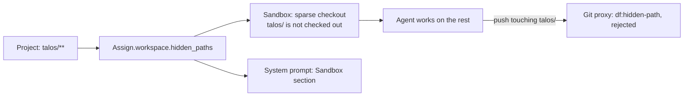

Some repositories hold files an agent should not see while it works on the rest, for example the
Talos machine configs of a homelab repository, which contain certificate material. A project can
list **hidden paths**: files matching them are left out of the agent's workspace, and no push may
change them.

## Hide a directory

Example: the repository has `talos/controlplane.yaml` and `talos/worker.yaml`; the agent should work
on everything else.

1. Open **Settings → Projects** and the project (`/projects/<key>`).
2. On the **Security** tab, enter `talos/**` in **Hidden paths**, one glob per line.
3. **Save project**.

The next run of any task of the project has no `talos/` directory. Runs that are already running
keep their workspace.

## Glob syntax

Hidden paths use the syntax of protected paths (`globset`), matched against the path relative to the
repository root:

| Glob | Hides |
| --- | --- |
| `talos/**` | everything below `talos/` |
| `CODEOWNERS` | only the file `CODEOWNERS` in the repository root |
| `configs/*` | the files directly in `configs/`; `configs/nested/visible.txt` stays |
| `**/*.secret.yaml` | such a file in any directory |

`*` does not match `/`. A glob with alternation (`{talos,secrets}/**`) is rejected on save, with the
line number in the error; list one glob per line instead. Changes are audited with the rest of the
push policy.

## What the agent sees

- **Workspace.** The runtime checks the project out with a non-cone sparse checkout that excludes
  the globs. In a fresh workspace the blobs below hidden paths are not downloaded, not even when an earlier
  run's WIP snapshot is restored; the snapshot's changes to hidden paths are not restored. The
  agent's `git status` is clean.
- **System prompt.** The persona's prompt is followed by a `Sandbox` section that lists the hidden
  globs, says they are left out on purpose and asks the agent not to restore, check out or read them
  through Git. Without hidden paths there is no such section.
- **Pushes.** A push that adds, changes, deletes or renames a hidden path is rejected with
  `df:hidden-path`, on the task branch and on the WIP branch, whatever the mode of the protected
  paths. No approval request is raised: no exception passes it. The agent gets the rejection as a
  message. A path that is both protected and hidden is only a `df:hidden-path` finding.
- **WIP snapshots.** The runtime keeps hidden paths as they are in `HEAD` in the snapshot, so a
  snapshot never fails because of them.

The runtime writes the sparse patterns again at the start and the end of every run, so edits of
`.git/info/sparse-checkout` or `core.sparseCheckout` do not last.

## Change the list later

- **Remove a glob.** The next run restores the files.
- **Add a glob** to a project whose tasks already have workspaces. When a run prepares a workspace
  that still holds files below the new glob, the runtime removes them before the harness starts: also
  files with uncommitted changes and files that Git ignores. The run gets a
  `workspace.hidden_paths_removed` notice that lists the removed paths (the first 50). Uncommitted
  changes in these files are lost. A path with a symbolic link among its parent directories is
  skipped, so the removal never leaves the repository.

## Limits

- **The content stays in the repository history.** Hiding keeps files out of the working tree. An
  agent can still read a blob with `git show HEAD:talos/controlplane.yaml`, which the Git proxy
  serves. The system prompt asks the agent not to, nothing enforces it. Secrets that are committed
  belong in the repository encrypted, for example with [SOPS](https://github.com/getsops/sops);
  hidden paths are no replacement. Refusing such fetches in the proxy is on the backlog.
- **Git 2.27 or newer** in the project image (`git sparse-checkout reapply`). Prepare fails with a
  message naming the version on older Git.
- **Instance-wide hidden paths** do not exist; every project sets its own. Hidden paths cannot come
  from the repository's `.dark-factory/config.toml`.
