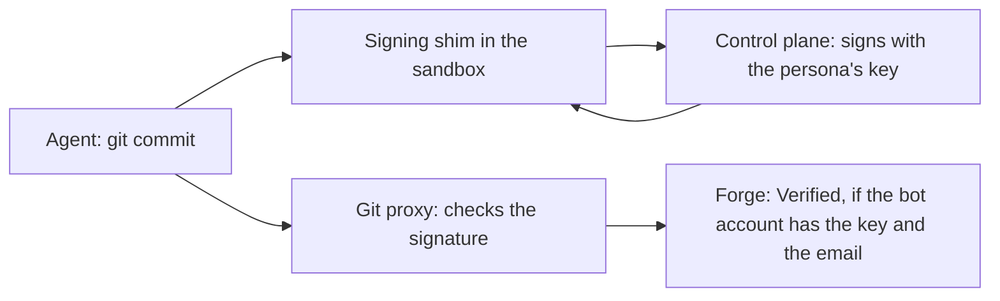

Dark Factory signs every commit an agent makes with the signing key of its persona. The signature
proves that the commit came from a run of that persona: anyone with push access can write an author
line, but only Dark Factory can sign with the key. The [Git proxy](../security/git-proxy.md) checks
the signatures itself, whatever you do on the forge. Registering the key and the commit email on
the forge's bot account only adds the "Verified" badge to the persona's commits there.

The private key is generated by Dark Factory, kept in a Kubernetes Secret and held in the control
plane's memory only. It never enters a sandbox or a gateway. A signature is made only for a commit
whose author and committer are the run's persona, and each one is written to the audit log.

## Copy the key and the email

1. Open **Settings → Personas** and edit the persona.
2. Scroll to the group **Commits**. It shows the **Commit email**, the **Public key** (OpenSSH
   format, `ssh-ed25519 AAAA…`) and its **Fingerprint** (`SHA256:…`).
3. Use the copy buttons next to the fields. They appear where the browser has a secure clipboard
   (HTTPS, or `localhost`); elsewhere select the value by hand.

A persona gets its key when you save it, or before its first run if it was created before signing
existed. A persona without a key shows "No signing key yet. Save the persona to create it."

The persona's commits carry the commit email as author and committer email
([Give a persona its identity](setup.md#give-a-persona-its-identity)). Register that email, not
another one: a forge only shows a commit as verified when its email belongs to the account that owns
the key.

## Register them on Forgejo

Do this once per persona, signed in as the bot account whose token Dark Factory uses (the project's
forge credential).

1. **Settings → SSH / GPG Keys → Add key**: paste the public key and name it after the persona.
2. **Settings → Email addresses**: add the commit email and activate it. If the forge does not
   send mail, an administrator can activate the address.

If several personas share one bot account, register every persona's key and email on it.

### Verify the key on Forgejo

Forgejo shows a commit as verified only when the SSH key is marked verified. It marks a key
verified when you hand it a signature over a token that Forgejo shows, made with the key's private
key. Dark Factory never hands out the private key, so it makes the signature for you. The persona
page offers this only when the instance loads the `forgejo` forge plugin.

1. In Forgejo, signed in as the bot account, open **Settings → SSH / GPG Keys**, choose
   **Verify** next to the key and copy the token. Note the value after `-n` in the command
   Forgejo shows: it is the domain of the Forgejo instance.
2. In Dark Factory, edit the persona and choose **Verify key on Forgejo** in the group
   **Commits**. Paste the token into **Token**, check **Forgejo domain** and choose
   **Sign token**. The domain is prefilled from the `forgejo` plugin's `hosts`: of the claimed
   hosts, the first in alphabetical order, taking the host of its `apiUrl` when it has one and
   else the claimed host itself. It is empty for a default `forgejo` plugin without `hosts`. Replace it with the value after `-n` if it differs.
3. Choose **Copy signature**, paste the signature into the field in Forgejo and choose
   **Verify**. Forgejo marks the key verified.
4. Choose **Done**.

Forgejo shows a token for 1 minute: do the steps without a break, and copy a new token if Forgejo
reports that the signature, the key or the token do not match. A wrong domain gives the same
message.

The token is signed with the Forgejo domain as namespace, never with the namespace of commits, so
the signature cannot pass as a commit signature; `git` is refused as a domain, and so is anything
that is not a host name. The audit log has the entry `persona.signing_key.forge_verify` for every
signature, with the persona, the key's fingerprint and the domain.

After a [rotation](#rotate-the-key) the new key is a new key for Forgejo: add it and verify it again.
Keep the old key, verified, so that earlier commits stay verified.

## Register them on GitHub

1. **Settings → SSH and GPG keys → New SSH key**: choose the key type **Signing key**, paste the
   public key.
2. **Settings → Emails**: add the commit email and verify it.

Both steps apply to the bot account (a machine user) that owns the project's token.

## Rotate the key

Rotate the key when it may have leaked or when your policy asks for it.

1. Edit the persona and choose **Rotate key** in the group **Commits**.
2. Read the confirmation. If runs of the persona are active, it names how many: their commits that
   are not pushed yet were signed with the old key and are rejected by the next push (`df:signature`,
   "signed by another key"). The agent is told to sign them again with `git rebase --exec 'git commit
   --amend --no-edit' <base>`, and the runtime pushes again after its next turn.
3. Confirm. The group shows the new public key and fingerprint and the note "Key rotated. Register
   the new public key on the forge's bot account." The audit log has the entry
   `persona.signing_key.rotate` with the old and the new fingerprint.
4. Register the new public key on the bot account. **Keep the old key there**, so that the commits
   signed with it stay verified. On Forgejo, [verify the new key](#verify-the-key-on-forgejo) as
   well.

For about a minute after a rotation a gateway may still check against the old key. A push signed with
the new key fails with "signed by another key" in that window and passes once the gateway has the
new snapshot.

If rotating fails (for example, the control plane may not write Secrets), the confirmation stays open
with the reason. Reload the page to see the current key before you try again.

## When commits are not verified

| Symptom | Cause |
| --- | --- |
| The forge shows "Unverified" for a persona's commits | The public key is not registered on the bot account, or the commit email is not a verified email of that account. On Forgejo the key must also be verified (see above). Compare the fingerprint on the persona page with the one the forge shows for the key. |
| Commits from before a rotation are unverified | The old key was removed from the bot account. Register it again, or accept that those commits are unverified. |
| A push is rejected with `df:signature` and "missing signature" | A commit was made without signing, for example with `git -c commit.gpgSign=false`. The runtime resets the signing configuration, and the agent signs the commits again. |
| `git commit` in a sandbox fails with "signing is unavailable" | The runtime has no connection to the control plane, or the control plane or the runtime did not answer within 10 to 12 seconds. The agent commits again. |
| `git commit` in a sandbox fails with a reason such as "author does not match the persona identity" | The control plane refused to sign: the author or committer of the commit is not the persona identity of the run, or the run has ended. The shim prints the control plane's reason; every refusal is in the audit log as `commit.sign_refused`. The agent commits again with the persona's identity. |

Signatures are not verified inside the sandbox: `git log --show-signature` and `git verify-commit`
fail there. WIP snapshots and tags are not signed.
