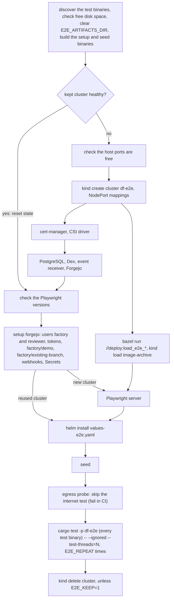

# Demo and end-to-end suite

The iteration 1 demo (`product/iterations/iteration-1.md` §2) runs in two ways:

- **Automated** with the fake ACP agent: `just e2e-local` creates a throwaway kind cluster, runs the web UI flow with Playwright and deletes the cluster. CI runs the same script on pull requests and pushes to `main` that change files outside `product/`, `design/` and `openspec/` (`.github/workflows/e2e.yaml`).
- **By hand** with Claude Code on the homelab instance (`bazel run //deploy:dev`), partly on a phone.

This page covers the automated run: commands, environment variables, seed data and what runs where.

## Quick start

```bash
bazel run //:bazel_env   # once: puts kind, helm, jq, ... on PATH (needs direnv, see docs/development.md)
just e2e-local           # about 10 min the first time, about 5 min with warm caches
```

Prerequisites on the host: `kind`, `kubectl`, `helm`, `bazel`, `cargo`, `curl`, `gh` (signed in, or `GH_TOKEN` set; it downloads the cert-manager manifest) and Docker or Podman (rootless Podman works, see below). The pinned `kind` and `helm` come from `bazel_env`.

```bash
just seed          # the end-to-end fixtures into the `just serve-local` database
just seed-demo     # realistic demo data into the same database, for screenshots
E2E_KEEP=1 just e2e-local   # keep the cluster after the run; the next run reuses it
kind delete cluster --name df-e2e
```

Rerun a changed test on a kept cluster, which takes a few minutes instead of 15 or more:

```bash
E2E_KEEP=1 E2E_TEST_ARGS="--ignored --test-threads=1 <test name>" just e2e-local   # creates the cluster
E2E_KEEP=1 E2E_TEST_ARGS="--ignored --test-threads=1 <test name>" just e2e-local   # reuses it
```

## What `just e2e-local` does



0. Before anything touches the cluster, the script lists the test binaries (see [Test discovery](#test-discovery)) and checks that the container runtime has `E2E_MIN_FREE_GIB` (default 10) GiB free in its storage directory (`docker info` / `podman info`). It stops with the free space, the threshold and the cleanup commands (`<cli> rm -fv df-test-postgres-17-alpine-r1`, `<cli> system prune`) otherwise, and leaves a kept cluster alone. For a remote `DOCKER_HOST` or Docker Desktop, whose storage is not on this host, it prints a warning and continues. It then clears `E2E_ARTIFACTS_DIR` (default `target/e2e-artifacts`, see [Diagnostics of a failed run](#diagnostics-of-a-failed-run)).
1. Creates the single-node cluster `df-e2e` (`deploy/e2e/kind.yaml`), unless it reuses a kept cluster (see [Reusing a kept cluster](#reusing-a-kept-cluster)). Just before it creates one, the script checks that the host ports of the [NodePort mappings](#host-access-nodeport) (15432, 13000, 13001, 13002) are free and stops otherwise. Meanwhile cargo compiles the `setup` and `seed` programs of `crates/df-e2e`, then the suite.
2. Builds the control plane, runtime, test project, plugin and Playwright server images with Bazel and loads them into the node: `bazel run //deploy:load_e2e_<name>` (with `--platforms=//build/platforms:linux_<arch>_musl` and `load_daemon=tar`) writes each single-platform image as a tarball, `kind load image-archive` imports it into the node. No container daemon holds the images. Nothing is pushed to a registry; `values-e2e.yaml` references the tag `e2e` with `pullPolicy: IfNotPresent`. The control plane image is a `dev-tools` build (`//crates/dark-factory:dark-factory-dev`), unlike the release image. The only downloads are the pinned upstream manifests, charts and images (cert-manager and its CSI driver, Forgejo, Dex, PostgreSQL) and the Playwright base image, which Bazel downloads into its repository cache. The Claude images are not needed.
   The Playwright server image (`//deploy:load_e2e_playwright`) is the `mcr.microsoft.com/playwright` base image plus the pinned `playwright-core` package (`deploy/images/playwright-server`), so the pod needs no npm access at runtime. Its `playwright-core` version, the base image tag in `MODULE.bazel` and the driver version of the locked `playwright-rs` must be equal; step 4 checks that.
3. Installs cert-manager and its CSI driver, PostgreSQL (`postgres:17-alpine`, no persistence), Dex (static user `admin@example.com`), the Playwright server (after the images are loaded), the lifecycle event receiver (`deploy/e2e/receiver.yaml`: stores every POST, returns them as JSON on GET), the fake Anthropic upstream (`deploy/e2e/fake-upstream.yaml`: `fake-acp-agent --serve-fake-anthropic` from the test project image; it answers `401` unless the request carries the key `e2e-model-api-key`, which only the gateway knows) and Forgejo (Helm chart, SQLite, no persistence).
4. Waits for the `setup` binary and runs `setup playwright-versions`, which stops the run unless `playwright-core` of the browser server image, the base image tag in `MODULE.bazel` and the driver of the locked `playwright-rs` agree (and prints the versions the driver install needs). Then runs `setup forgejo` (`crates/df-e2e/src/setup/`, through the Forgejo API as the admin that the script passes to the chart and to the binary), which creates the Forgejo users `factory` (the bot) and `reviewer` (collaborator with write access) if missing and a new token `e2e` for each (the script reads both from the JSON on stdout), the repositories `factory/demo` (with issue 1 and `secret/value.txt`) and `factory/existing-branch` (project `EB`, whose tests move and merge into its `main`), each with a repository webhook to `http://dark-factory-control-plane.dark-factory.svc:8080/webhooks/forgejo` (the events of [Forge webhooks](content/integrations/forges/webhooks.md), secret `e2e-webhook-secret`; `deploy/e2e/forgejo-values.yaml` allows the host in `webhook.ALLOWED_HOST_LIST`). The script then writes the bot's token to the Secret `forgejo-token` for the credential reference and, on a new cluster, the hash of `deploy/e2e/*.yaml` to the Secret `e2e-state`.
5. Creates the Secrets `fake-llm-key` for the model provider's credential reference and `forge-webhooks` (key `forgejo`, the webhook secret), and installs the chart with `deploy/values-e2e.yaml`.
6. Seeds the database and runs the ignored tests of `crates/df-e2e` (`E2E_TEST_THREADS` at a time) `E2E_REPEAT` times in a row against the same database and repositories.
7. Deletes the cluster on exit, also after a failure or `Ctrl-C`, unless `E2E_KEEP=1`.

### Reusing a kept cluster

With `E2E_KEEP=1` the cluster stays after the run. The next run reuses it when `kind get clusters` lists `df-e2e`, the Secret `e2e-state` exists in the `dark-factory` namespace, Forgejo answers its health check and `E2E_FRESH` is not `1`. Otherwise it deletes the cluster and creates it as described above. A reuse skips the cluster creation, cert-manager, PostgreSQL, Dex, the receiver, Forgejo and the Playwright server installation. It then resets the state:

1. scales the control plane to 0 and waits until its pods are gone, so it does not react to the reset;
2. deletes the pods and volumes of the sandbox namespace (task keys restart at `<KEY>-1`, so old volumes would collide);
3. drops and recreates the database `dark_factory` (`DROP DATABASE ... WITH (FORCE)` as the PostgreSQL superuser);
4. runs `setup forgejo` again: the users stay, their tokens named `e2e` are replaced (the old tokens stop working; the Secret `forgejo-token` gets the new bot token, which the control plane reads at use) and the repositories `factory/demo` and `factory/existing-branch` are deleted and created again (so no task branches or pull requests of earlier runs remain), with their issue, file, collaborator and webhook;
5. loads the images (Bazel rebuilds only what changed), runs `helm upgrade --install` (its migration Job migrates the empty database, and the control plane scales back up with the loaded image), restarts the gateway, the fake upstream and the Playwright server for the same reason (the tag `e2e` does not change, so their pods would keep the old image), seeds and runs the tests.

The script prints `Setup took N s` before the tests start. Changes to `deploy/e2e/*.yaml` (the infrastructure manifests) are not applied to a reused cluster: the script prints a hint when their hash differs from the one stored in `e2e-state`, which holds only that hash (`manifest-hash`); run once with `E2E_FRESH=1`, which also helps when a kept cluster misbehaves. A cluster kept by an earlier version of the script that stored the tokens in `e2e-state` is reused, the extra keys are ignored. A cluster kept by an older version of the script has no `e2e-state` and is recreated; so is one created before the NodePort mappings, because Forgejo does not answer on its host port.

The browser runs in the cluster (`playwright` namespace). It opens the control plane at its Service URL and is redirected to Dex through cluster DNS, so the control plane and the browser see the same issuer URL (`http://dex.dex.svc:5556/dex`). The test host only needs the WebSocket of the Playwright server.

### Host access (NodePort)

The test host reaches PostgreSQL, Forgejo, the Playwright server and the event receiver through NodePort Services. `deploy/e2e/kind.yaml` maps the node's container ports to the host, on `127.0.0.1` only:

| Service | NodePort (node) | Host port |
|---|---|---|
| PostgreSQL (`deploy/e2e/postgres.yaml`) | `30432` | `15432` |
| Forgejo (`service.http` of `deploy/e2e/forgejo-values.yaml`) | `30300` | `13000` |
| Playwright server (`deploy/e2e/playwright.yaml`) | `30301` | `13001` |
| Event receiver (`deploy/e2e/receiver.yaml`) | `30302` | `13002` |

No process on the host holds a connection to a pod: a restart of a pod (the reuse restarts the Playwright server) needs no action, the next connection reaches the new pod. kube-proxy needs a moment after a Service exists, so the script waits for Forgejo's health check on its host port before `setup forgejo` runs.

### `deploy/values-e2e.yaml`

| Setting | Value | Why |
|---|---|---|
| `image.*.tag` | `e2e`, `pullPolicy: IfNotPresent` | Images are loaded into the node. |
| `oidc.issuerUrl`, `publicUrl` | `http://dex.dex.svc:5556/dex`, `http://dark-factory-control-plane.dark-factory.svc:8080` | Plain `http://` is accepted on any host; the control plane logs a startup warning. |
| `oidc.rolesClaim`, `oidc.extraScopes` | `groups`, `[groups, offline_access]` | Dex returns the role as `groups`, as in local development. |
| `controlPlane.extraArgs` | `[--unrestricted-project-subscriptions]` | The project subscription of the lifecycle event test targets the plain-http receiver in the cluster. Only the `dev-tools` image has the flag. |
| `network.allowPlainHttp` | `true` | Forgejo in the cluster serves plain http: the control plane, the gateway's Git proxy, the inference endpoint's upstreams and the project form accept `http://` URLs (sandboxes use HTTPS to the gateway). The control plane and the gateway log a startup warning; the token travels unencrypted inside the throwaway cluster. |
| `runs.keepAliveSeconds` | `0` | A run ends with its turn, so the follow-up message starts run 2 (the `loaded` session of the script). |
| `plugins.forgejo.webhookSecret` | Secret `forge-webhooks`, key `forgejo` | Enables `POST /webhooks/forgejo` for the repository webhook. |
| `sandbox.runtimeClassName` | `''` | No Kata in kind. |
| `sandbox.landlock` | `enforce`; `just e2e-local` passes `disabled` when the node kernel has no Landlock ABI 6 | Without ABI 6 every run would fail with `sandbox.landlock_unavailable`. |
| `clusterTargets.namespaces` | `[forgejo]` | Sandboxes reach Forgejo as a cluster Service. |
| `networkPolicy.ingressController.allowAll` | `true` | The browser pod reaches the UI. |
| `sandboxNamespace.resourceQuota.pods`, `sandbox.resources` | 4 pods, requests `100m`/`128Mi`, limits `1`/`1Gi` | Memory budget, see below. |
| `sandboxNamespace.resourceQuota.persistentVolumeClaims`, `requestsStorage` | 96, `96Gi` | One 1 Gi volume per task, kept while the task is open and after a cancellation. A run of the suite creates about 30 tasks, and `E2E_REPEAT` runs it again without a reset (with 32 the second run's tasks fail provisioning with `capacity`). `local-path` does not reserve the size. |

## Environment variables

### Test suite and seed (`crates/df-e2e`)

All targets come from the environment, so the same tests run against any instance. `just e2e-local` exports them.

| Variable | Required | Effect |
|---|---|---|
| `E2E_BASE_URL` | yes (tests) | URL of the web UI as the browser reaches it. |
| `E2E_PLAYWRIGHT_WS` | yes (tests) | WebSocket of the Playwright server, e.g. `ws://127.0.0.1:13001/?browser=chromium`. |
| `E2E_DATABASE_URL` | yes (tests, seed) | Database of the instance. The seed also reads `DATABASE_URL` when this is unset. |
| `E2E_DATABASE_SCHEMA` | no | Schema of the control plane tables for the seed. Default `dark_factory`. |
| `E2E_FORGEJO_URL` | yes (tests) | Forgejo as the test host reaches it. |
| `E2E_FORGEJO_TOKEN` | yes (tests) | Token of the bot user. |
| `E2E_FORGEJO_REVIEWER_TOKEN` | yes (tests) | Token of `reviewer`, a second user with write access to the repository. |
| `E2E_USER`, `E2E_PASSWORD` | yes (tests) | Login at the identity provider. |
| `E2E_LANDLOCK` | no | `disabled` skips the `landlock` test (the cluster kernel has no Landlock ABI 6 and the release runs with `sandbox.landlock: disabled`). Anything else, or unset, runs it. |
| `E2E_RECEIVER_URL` | yes (`lifecycle_events`) | The lifecycle event receiver as the test host reaches it, e.g. `http://127.0.0.1:13002`. The control plane reaches it as `http://receiver.receiver.svc:8080/hook`. |
| `E2E_ARTIFACTS_DIR` | no | Where a failed test writes `<test name>/screenshot.png` and `console.txt`. Default `target/e2e-artifacts` of the repository. `just e2e-local` exports it. |

### `just e2e-local` (`deploy/e2e/e2e-local.sh`)

| Variable | Default | Effect |
|---|---|---|
| `E2E_KEEP` | unset | `1` keeps the cluster after the run; the next run reuses it if it is healthy ([Reusing a kept cluster](#reusing-a-kept-cluster)). |
| `E2E_FRESH` | unset | `1` deletes a kept cluster and creates a new one. Needed after changes to `deploy/e2e/*.yaml`. |
| `E2E_LIST` | unset | `1` prints the selected and the skipped test binaries and exits before the disk check and any cluster step. |
| `E2E_MIN_FREE_GIB` | `10` | Free space the container runtime's storage directory needs before the run; the script stops with the cleanup commands below it. |
| `E2E_KIND_CONFIG` | `deploy/e2e/kind.yaml` | kind configuration for the cluster. Without it, when `/.msb/tls/ca.pem` exists (CA of a TLS-intercepting proxy in the sandbox), the script mounts that file into the node (see [Sandboxes behind a TLS-intercepting proxy](#sandboxes-behind-a-tls-intercepting-proxy)). A custom configuration gets no mount. |
| `E2E_TEST_THREADS` | `2` | Tests that run in parallel per test binary, like CI. The tests are independent of each other ([Isolation](#isolation)): each finds its own tasks, branches and requests by what it created, and state-changing scenarios have fixtures of their own. The node peak stays at about 3.5 GiB (see the [resource budget](#resource-budget)). `1` runs them one at a time. |
| `E2E_TEST_ARGS` | `--ignored --test-threads=$E2E_TEST_THREADS` | Arguments after `--` of `cargo test -p df-e2e` with the discovered test binaries, e.g. a test name. Replaces the default, so keep `--test-threads`. |
| `E2E_REPEAT` | `1` | How often the `cargo test` step runs after the single reset and seed. With `2` the second run meets the database and repositories of the first, which checks that the tests repeat; the existing reuse of a kept cluster is a separate check. The log shows `Test run <n> of <m>`. |
| `E2E_ARTIFACTS_DIR` | `target/e2e-artifacts` | Cleared at the start of a run. A failed test writes its screenshot and console below it, a failed run the logs of the cluster ([Diagnostics of a failed run](#diagnostics-of-a-failed-run)). |
| `E2E_TOOLS_DIR` | `~/.cache/df-e2e` | Where the Playwright driver is kept. |
| `BAZEL` | `bazel` | Bazel command; agents use `bazel --bazelrc=.bazelrc.agents`. |
| `KIND_EXPERIMENTAL_PROVIDER`, `DOCKER_HOST` | as kind | The script selects Podman when `docker` is not installed. |

Ports on the host (NodePort mappings, `127.0.0.1` only, see [Host access](#host-access-nodeport)): `15432` (PostgreSQL), `13000` (Forgejo), `13001` (Playwright), `13002` (event receiver).

## Tests

`cargo test -p df-e2e --test <binary> ... -- --ignored` for every binary of `crates/df-e2e/tests/` (ignored by default, they need the cluster). Each test starts logged in (one login at Dex per test binary, see [Fixture and cleanup](#fixture-and-cleanup)), acts through the UI and checks what the UI does not show in Forgejo (branch, pull request, draft flag, comments, commits) and in the database (task status, runs, harness session id). Waits poll the condition with a limit named after what is awaited (5 minutes for a sandbox run, 30 s for a UI update after the state is there), never a fixed sleep. A wait for a task status stops at once, naming the status found, when the task ended in another final status.

### Fixture and cleanup

Every test runs through `df_e2e::fixture::run(name, |world| async move { ... })`. The `World` it passes holds the environment, a logged-in browser session (its own context), the database pool, the Forgejo clients of the bot and the reviewer for `factory/demo`, and a unique suffix (8 hex characters) that the test appends to every name it creates (branches, files, personas, issue titles, subscription URLs).

**Shared login.** The first test of a test binary logs in at Dex and keeps the cookies of its browser context (Playwright storage state) in the process. Every later test of the binary opens its own context with that state and lands on the board without the Dex form (`Session::start_logged_in`); tests that start together wait for that one login. A context that still lands on the Dex form (the session expired, or its row was removed from `web_sessions`) logs in again, replaces the stored state and prints `login: the stored login is no longer accepted, logging in again` to stderr (every Dex form submission prints `login: submitting the Dex login form`; both are visible with `--nocapture`). Test binaries are separate processes, so each logs in once. A test that logs out or changes the session uses its own `Session::start` and `Session::login`, as `login_shows_the_demo_project_on_the_board` does: its context is separate, and the login test always submits the Dex form.

After the body, the teardown runs every time, also after a failure or a panic (which is resumed afterwards, so `cargo test` reports it unchanged):

- It cancels each task the test created through the composer and the tasks those created (delegation children, found through `parent_id`; the query repeats after the cancelled coordinator's run ended until no new child appears), unless a task is `completed`, `cancelled` or `failed`. A chat is never cancelled (it cannot be; its runs end with their turn, `runs.keepAliveSeconds: 0`): the teardown cancels the tasks it created and waits for its runs to end. A cancellation goes through the UI in a fresh page of the context. When that fails, it falls back to the form post of the UI (`POST /tasks/{key}/cancel` with the session cookie taken after the login and the `HX-Request` header), sent through a new connection to the Playwright server, because the control plane is only reachable from inside the cluster. When both ways fail, the test fails and names the tasks that keep running.
- Every description the session submits ends in ` [<suffix>]` of the test (added in one place, `Session::create_task` and its variants), so no other test submits the same text. A creation whose task page never opened is found by project, that exact description and a creation time since the submit, and cancelled too.
- When the test failed, it writes `screenshot.png` and `console.txt` (console messages and page errors) to `$E2E_ARTIFACTS_DIR/<test name>/`. There is no Playwright trace: with the browser in the cluster, `Tracing::stop` with a path makes the browser server write the file on its own disk, and `playwright-rs` does not stream it to the test host.

The suite repeats: with `E2E_REPEAT=2` (or a second run of the script on a kept cluster, which resets first) every test passes again. A test therefore finds its data by what it created (task keys come from the UI, children through the coordinator, pull requests by head branch with `GET pulls/{base}/{head}`), never by a predicted key or a position in a shared list.

### Isolation

| Shared state | Rule |
|---|---|
| Repository `factory/demo` with `main` and issue 1 | No test commits or merges to its `main`; issue 1 belongs to the demo flow. A test that needs an issue creates its own. |
| Repository `factory/existing-branch` | Project `EB` only: its two tests move and merge into this `main`, with branches, files and commits named with the suffix. |
| Project `LC` ("Lifecycle", demo script, `factory/demo`) | Only the lifecycle event test subscribes on it, with a URL of its own, so the deliveries of other tests do not reach it. |
| Settings pages | A test that saves an edit (a model of the provider page) removes it again; created personas have a unique name. |

### Diagnostics of a failed run

`E2E_ARTIFACTS_DIR` (default `target/e2e-artifacts`) holds, after a failure:

| Path | Content |
|---|---|
| `<test name>/screenshot.png`, `console.txt` | The browser of the failed test (see [Fixture and cleanup](#fixture-and-cleanup)). |
| `cluster/<namespace>-<pod>.log` | The last 500 lines of the control plane, the gateway, every sandbox pod, Forgejo and the fake upstream, and `<pod>.previous.log` where a container restarted. Written by `just e2e-local` when the run fails. |

CI uploads the directory as the artifact `e2e-artifacts` when the job fails (`.github/workflows/e2e.yaml`).

| Test | Scenarios (`openspec/specs/task-delivery/spec.md`) |
|---|---|
| `login_shows_the_demo_project_on_the_board` | login, seeded project on the board |
| `assigned_task_gets_a_draft_pr_with_the_shaped_title_and_an_issue_comment` | DF-1 with the fake agent; tools during the first run |
| `follow_up_resumes_the_session_and_completing_marks_the_pr_ready` | line comment on the PR, follow-up message; `read_pull_request_feedback` and a reply in the review thread (`comment_on_pull_request`), `complete_task` in run 2 (the task is `in_review`, run 2 ends `completed`) |
| `rate_limited_run_shows_the_limit_and_the_next_message_continues` | rate-limited run (the UI shows "rate limited"; the retry time is checked on the run in the database) |
| `rate_limited_task_resumes_at_the_retry_time_without_a_message` | the rate-limited task of project `RT` resumes at the retry time (5 s in `rate-limit-short.yaml`) and run 2 starts without a message |
| `denied_host_is_requested_and_the_approval_lets_the_retry_through` | demo step 4 of iteration 2 (`openspec/changes/archive/2026-11-02-iter2-egress-approvals`): the proxy denies `pypi.org:443`, the control plane raises a non-blocking `network-access` request, the test approves it for the task in `/requests`, and the agent's retry in the same turn succeeds within 10 s of the approval (UI included). Needs a verified HTTPS connection from a pod to the internet: the gateway never connects to private or cluster addresses, so no in-cluster host can stand in. Behind a TLS-intercepting proxy the sandbox does not trust, `just e2e-local` skips it and logs `pods cannot fetch https://pypi.org ...: skipping <test>` (see [Sandboxes behind a TLS-intercepting proxy](#sandboxes-behind-a-tls-intercepting-proxy)) |
| `committed_secret_is_rejected_and_the_amended_commit_closes_the_request` | demo step 2 of iteration 2 (`openspec/changes/iter2-push-checks`): the Git proxy rejects the commit with a test GitHub token (`df:secret-scan`, masked `ghp_********`), the control plane raises a `push-check-exception` request and queues `push.rejected`; the agent amends its unpushed commit, the next push passes and closes the request (`push-accepted`). No push record, message or forge file holds the token |
| `protected_path_passes_after_the_exception_is_approved` | demo step 3 of iteration 2 without the agent's question: every push of the `.forgejo/workflows/ci.yml` change is rejected (`df:protected-path`) until the test approves the request in `/requests`; the commit reaches Forgejo after the next turn |
| `a_push_changing_a_hidden_path_is_rejected_and_the_agent_is_told` | demo step 6 of iteration 3 (`openspec/changes/iter3-hidden-paths`): project `HP` hides `secret/**`; the agent does not find `secret/value.txt`, commits its removal with `git rm --cached --sparse`, and the Git proxy rejects every push with `df:hidden-path` (no approval request); the agent's `push.rejected` messages name the rule and the path, and the forge keeps the file |
| `blocking_question_continues_the_run_and_an_unanswered_one_blocks_until_answered` | agent requests (`openspec/changes/archive/2026-10-28-iter2-agent-requests`, task 6.1): a blocking question answered on its request card while the run holds its turn continues in the same run; a second one left unanswered ends the run `blocked` at the idle `Release` (`keepAliveSeconds: 0`), and its answer starts run 2 |
| `the_last_tab_of_the_project_dialog_stays_in_view_on_phones` | configuration-management "Form tabs on phones": at 390 and 300 px the chosen last tab of the project dialog lies inside the tab row, and the page does not scroll sideways |
| `opening_tasks_from_the_list_keeps_the_console_clean_and_the_details_tab` | swapping between two tasks from the list logs no console error and no uncaught exception (the cleanup of the old event stream), and the details keep their open tab (`data-tab`) after the swap settled |
| `traffic_page_pauses_resizes_and_opens_details` | egress-log on the denied retries of an `NA` task: Pause aborts the stream and the rows stay while new events arrive, Resume shows them; divider Right Arrow, double-click reset, drag up to the limit, width kept across a reload; Escape closes the details panel and returns focus to the row |
| `project_subscription_receives_a_signed_sandbox_provisioned_event` | lifecycle events (`openspec/changes/archive/2026-11-04-lifecycle-events`): the admin adds a project subscription (URL with the suffix of the run) for `sandbox.provisioned` in the "Lifecycle events" tab of project `LC`, edits it, a task of `LC` starts a run, the receiver gets the event of that task on the path of the subscription (`/hook/<suffix>`), and its `webhook-signature` verifies with the public key shown in the tab; the row of the subscription then shows `HTTP 204`, and the test deletes the subscription |
| `member_review_wakes_the_task_in_review_and_its_pr_is_a_draft_again` | forge webhooks (`openspec/changes/iter3-webhooks`): a task of `WH` completes in run 1 (`in_review`, ready PR); `reviewer` requests changes through the Forgejo API, the task page shows the `webhook` message with the review within 30 s, the PR is a draft again, and run 2 reads the feedback and waits |

Run one test: `E2E_TEST_ARGS='--ignored --test-threads=1 rate_limited' just e2e-local`.

### Test discovery

`just e2e-local` runs every `crates/df-e2e/tests/*.rs` except the binaries on the `excluded_tests` list at the top of `deploy/e2e/e2e-local.sh` (`name:reason`). A new test file needs no registration. A normal run logs each skipped binary with its reason too (`skipping test binary <name>: <reason>`). `E2E_LIST=1 just e2e-local` prints what it would run and what it skips, with the reason:

| Excluded | Why |
|---|---|
| `seed` | Container-backed test of the seed program (`cargo test -p df-e2e`), not a cluster test. |
| `demo_seed` | Container-backed test of the demo profile of the seed (`cargo test -p df-e2e`), not a cluster test. |
| `unlanded_lookup` | Container-backed test of the fixture's lookup of a task whose page never opened (`cargo test -p df-e2e`), not a cluster test. |

All need a container socket (`df-test-postgres`) but no cluster; `--ignored` would skip them anyway.

## Seed data

The `seed` program has two profiles. Both are idempotent, write into the database behind `E2E_DATABASE_URL` and can share a database:

| Profile | Command | Purpose |
|---|---|---|
| End-to-end fixtures (default) | `cargo run -p df-e2e --bin seed`, `just seed` | The records the suite needs: one persona, 14 projects, no tasks. `just e2e-local` runs it against the cluster. |
| Demo | `cargo run -p df-e2e --bin seed -- --demo`, `just seed-demo` | Realistic data for screenshots and demos of `just serve-local`, see [Demo profile](#demo-profile). |

### End-to-end fixtures

`just seed` writes the data below through the `df-db` save functions. The values are constants in `crates/df-e2e/src/data.rs`; tests refer to the same names. A second run changes nothing.

| Record | Value |
|---|---|
| Credential reference | `forgejo-bot`: Secret `forgejo-token`, key `token` |
| Credential reference | `fake-llm`: Secret `fake-llm-key`, key `key` (created by `just e2e-local`) |
| Model provider | "Fake Anthropic": Anthropic Messages at `http://fake-anthropic.fake-upstream.svc:8080` (plain HTTP like Forgejo, allowed by `network.allowPlainHttp`), scheme `x-api-key`, credential `fake-llm` |
| Persona | `e2e` (harness `claude-code`, model provider "Fake Anthropic") |
| Project `DF` | "Demo Factory", repository `http://forgejo-http.forgejo.svc:3000/factory/demo`, test project image, `fake-acp-agent --script /opt/harness/scripts/demo.yaml` |
| Project `RL` | "Rate Limit", same repository, script `/opt/harness/scripts/rate-limit.yaml` |
| Project `RT` | "Rate Limit Short", same repository, script `/opt/harness/scripts/rate-limit-short.yaml` (retry time of 5 s, for the test that waits for the automatic resume) |
| Project `NA` | "Network Access", same repository, script `/opt/harness/scripts/network-access.yaml` |
| Project `SC` | "Secret Scan", same repository, script `/opt/harness/scripts/push-secret.yaml` |
| Project `PP` | "Protected Path", same repository, script `/opt/harness/scripts/push-protected.yaml` |
| Project `NS` | "No Signature", same repository, script `/opt/harness/scripts/push-unsigned.yaml` |
| Project `HP` | "Hidden Path", same repository (`secret/value.txt` on `main`, committed by `just e2e-local`), hidden path `secret/**`, script `/opt/harness/scripts/push-hidden.yaml` |
| Project `WH` | "Webhooks", same repository, script `/opt/harness/scripts/webhook.yaml` |
| Project `EB` | "Existing Branch", repository `http://forgejo-http.forgejo.svc:3000/factory/existing-branch` (its own, because its tests move and merge into `main`), script `/opt/harness/scripts/existing-branch.yaml` (tasks on existing branches: attached pull request, rebase with lease) |
| Project `LC` | "Lifecycle", same repository as `DF`, script `/opt/harness/scripts/demo.yaml`; only the lifecycle event test subscribes on it |
| Project `CH` | "Chats", same repository, script `/opt/harness/scripts/chat.yaml` |
| Project `DG` | "Delegation", same repository, script `/opt/harness/scripts/delegation.yaml` |
| Project `RS` | "Research", same repository, script `/opt/harness/scripts/research.yaml` |
| Project `TT` | "Task Tree", same repository, script `/opt/harness/scripts/task-tree.yaml`; its `subtask_merge` setting is `parent-agent` |
| Project `IN` | "Interrupt", same repository, script `/opt/harness/scripts/interrupt.yaml` |
| Project `LL` | "Landlock", same repository, script `/opt/harness/scripts/landlock.yaml` |
| Project `MC` | "MCP tools", same repository, script `/opt/harness/scripts/mcp.yaml`: calls a tool of the registered MCP server `e2e-docs` (enabled for `MC` by the test) and one of `e2e-other` (registered, not enabled) through the `ext` relay. The fake MCP server (`deploy/e2e/fake-upstream.yaml`, `fake-acp-agent --serve-fake-mcp`) answers only to the bearer token `e2e-mcp-token`, which the credential reference `fake-mcp` (Secret `fake-mcp-key`) holds and only the gateway knows |

All projects wake tasks on reviews and mentions of members (`webhook_wake` `members`).

There is no allowlist entry: sandboxes reach Forgejo through the gateway's Git proxy.

`just seed` targets the `just serve-local` database (`dark_factory` on `127.0.0.1:5432`, user and password `postgres`); set `E2E_DATABASE_URL` for another one.

### Demo profile

`just seed-demo` (the same target database as `just seed`) writes data that looks like real use, for screenshots (`docs/releasing.md`) and demos. It uses its own credential references (`demo-forge`, `demo-anthropic`, `demo-openai`) and model providers, and project keys and persona names the fixtures don't use, so it neither needs nor changes the fixtures. The code is `crates/df-e2e/src/seed/demo.rs` and its modules; the data is in `demo/data.rs` and `demo/tasks.rs`.

| Records | Value |
|---|---|
| Personas | Linus (Claude Code, engineer), Grace (Claude Code, reviewer), Ada (OpenCode, researcher) |
| Model providers | "Anthropic" (`claude-sonnet-4-5`, `claude-opus-4-1`), "OpenAI" (`gpt-5-mini`) |
| Projects | `WEB` "Storefront" (with an issue tracker URL), `PAY` "Payments API", `OPS` "Homelab infrastructure" (hidden path `talos/**`) |
| Tasks | 14, titles and texts like real work. States: `queued` (an automatic resume after a lost sandbox), `waiting` (3, one a parent), `awaiting_dependencies` (waits for the pull request of another task to be merged), `blocked` (a pending question; the seed holds one pending question of each [question kind](content/using/requests.md#question-kinds) and one answered multiple choice question with an Other answer), `rate_limited`, `in_review` (3, two with a pull request opened by the factory), `completed` (2, merged pull requests), `failed`, `cancelled` |
| Relations | `WEB-1` "Checkout redesign" with the subtasks `WEB-2` and `WEB-3`; `WEB-3` depends on `WEB-2`; `PAY-1` is attached to a pull request opened outside the factory (Renovate); `WEB-4` links the issue #187 |
| Content | per task runs with outcomes, transcript events (assignment, agent messages, tool calls, follow-up messages, the push and the pull request) and token usage per model; timestamps relative to the time of the first seeding (minutes to days ago) |
| Artifacts | `WEB-5` "Why is product search slow on mobile?": a Markdown report, a PNG chart (`crates/df-e2e/assets/demo/search-latency.png`, 640x360) and a profiler log; `WEB-2`: a test log |

The tasks are data, not live runs: the control plane of `just serve-local` has no cluster, so it cannot start a run (`serve --no-cluster`). It also reacts to some states, which the profile accounts for:

- A task with an unfinished run would be ended as `sandbox_lost` by the startup check, so no demo task has one; the agent has finished its turn in every task shown as `waiting`.
- The scheduler starts `queued` and `rate_limited` tasks whose resume time has passed, which fails without a cluster. The `queued` task and the `rate_limited` task therefore have a resume time in the future (6 hours and 4 days after the seeding).
- A later seeding moves such a resume time forward again when it has passed and no run has started since. If the scheduler started the task already, the seed prints a hint to seed a fresh database; nothing else of an existing task changes.

A task is identified by project key and title, so a second run writes nothing, not even audit entries. `crates/df-e2e/tests/demo_seed.rs` runs the profile against a migrated test database (`cargo test -p df-e2e --test demo_seed`, needs a container socket).

### Fake agent scripts

`crates/fake-acp-agent/scripts/` is part of the test project image under `/opt/harness/scripts/`:

- `demo.yaml`: run 1 first makes a `model` step (a streamed Anthropic Messages request to `$ANTHROPIC_BASE_URL/v1/messages` with `curl`, the key from `ANTHROPIC_API_KEY` or `CLAUDE_CODE_OAUTH_TOKEN` and the CA from `NODE_EXTRA_CA_CERTS`; it says the received text, or `Model call failed: <status or error>`, then a line `Model key in the sandbox: <key>` and a `Sandbox environment:` dump of every environment variable of the harness (`NAME=value`, sorted); the e2e checks that the key is the placeholder, that the dump is there and that neither the provider key nor the forge token appears in any transcript event), then plans, commits `greeting.txt`, calls `update_pull_request` and `comment_on_issue`, ends its turn; the follow-up run (loaded session) commits a test file, reads the PR feedback, replies in the first review thread, calls `complete_task` and ends. Without a line comment on the PR the reply is a tool error. An `mcp` step can `save` a value of the structured result (variable name to JSON pointer) that later steps pass as the string argument `${name}` (also in later turns, see below).
- `rate-limit.yaml`: run 1 ends with a rate limit (60 s); the next turn continues after a message. The message test sends it before the retry time and expects exactly 2 runs, so the script keeps 60 s.
- `rate-limit-short.yaml` (project `RT`): the same with a retry time of 5 s, for the test that waits for the automatic resume without a message.
- `network-access.yaml`: run 1 fetches `https://pypi.org/simple/pip/` with a `fetch` step (`curl` through the sandbox's proxy settings, retried once a second for up to 240 s) and says `Fetched <url>.` or `Could not fetch <url>: <error>`; the decision message is the next prompt of the same session. Before the fetch, a `[conversation-flow]` task asks a non-blocking question and a `[blocking-question]` task a blocking one (both of kind `text`); the held fetch keeps the turn open for the answer. The question kinds are asked the same way, by marker: `[kind-single]` a blocking single choice (PostgreSQL 16 or 17; the second turn says `Chose pg17 from the JSON block.` when the answer names `pg17`), `[kind-choices]` a multiple choice with `max_selected: 2` and a text question, and `[kind-drafts]` a text question and a multiple choice (the e2e tests of drafts, `crates/df-e2e/tests/questions.rs`). `chat.yaml` has `[chat-question]`: a chat asks a blocking single choice (`Which chart layout do you prefer?`) and, once the JSON block of the answer `split` arrives, says `The chat got the split layout.` (`crates/df-e2e/tests/chat_questions.rs`). The second turn of a `[blocking-question]` task says `Got the first answer in the same run.` and asks a second blocking question; its answer starts run 2 (loaded session), which says `Continued after the second answer.`
- `push-secret.yaml`: run 1 commits `config.py` with a GitHub token assembled by the shell step (the file holds no string a scanner matches); the turn after the `push.rejected` message (same or resumed session) replaces the token by an environment lookup and amends the commit.
- `push-protected.yaml`: run 1 commits `.forgejo/workflows/ci.yml`; later prompts have no scripted turn and end at once, so the runtime only pushes the same commit again.
- `push-unsigned.yaml` (project `NS`): run 1 commits `unsigned.txt` with `git -c commit.gpgSign=false`, which beats the runtime-owned `.git/config`; the Git proxy rejects every push with `df:signature` ("missing signature"). Later prompts have no scripted turn and end at once, so the runtime only pushes the same commit again. Every other script's commits are signed by the control plane through the shim; `setup forgejo` adds the persona's commit email to the bot account. `a_persona_commit_shows_as_verified_on_forgejo_once_the_key_is_verified` registers the persona's generated public key on the bot account, verifies it through the persona dialog "Verify key on Forgejo" (domain `forgejo-http.forgejo.svc`) and Forgejo's key settings form, and checks that Forgejo shows the pushed commit as verified (`docs/content/using/verify-persona-commits.md`).
- `push-hidden.yaml`: run 1 looks for `secret/value.txt` and says `secret/value.txt is missing` (it is not in the workspace), removes it from the index with `git rm --cached --sparse` and commits; later prompts have no scripted turn and end at once, so the runtime only pushes the same commit again.
- `webhook.yaml`: run 1 commits `welcome.txt`, calls `update_pull_request` and `complete_task`; the run after the `webhook` message (loaded session) calls `read_pull_request_feedback` and ends its turn without completing, so the task waits with a draft PR.
- `research.yaml` (project `RS`, no webhook): one script for the coordinator and the researcher, told apart by `[coordinator]` and `[research]`. The coordinator creates the researcher and saves its key; the researcher writes `findings.md` with `write_artifact` and completes; the wake-up message of the coordinator lists `<researcher key>/findings.md`, and the coordinator reads that artifact with `read_artifact`.
- `task-tree.yaml` (project `TT`, no webhook, subtask merges by the parent agent): one script for two coordinators and their children, told apart by `[tt-coord-review]`, `[tt-coord-feature]`, `[tt-impl]`, `[tt-review]`, `[tt-one]` and `[tt-two]`. The review coordinator creates an implementation and a review with the implementation as `base_task`; the implementation commits `tt-implementation.txt`, and the review says its `git log` and `ls`, which show that commit. The feature coordinator saves its own key (the structured result of `list_artifacts`), creates two iterations with itself as `base_task`, the second with a `done` dependency on the first; each iteration commits a file and completes (the second says its `git log`, which shows the merge of the first); the coordinator is woken after each completion, merges the pull request with `merge_subtask_pr` (an `mcp` step with `retry`: `attempts` and `delay_seconds` repeat the call while it answers with an error, here until the control plane has opened the pull request after the run ended) and completes after the second merge. The tests are `tests/task_tree.rs`.
- `delegation.yaml` (project `DG`, no webhook): one script for the coordinator, the implementation and the review, told apart by the markers `[coordinator]`, `[impl]`, `[review]` and `[fix]` in their prompts (`when` steps play their steps only if the prompt contains `prompt_contains`). The coordinator creates the implementation (saving its key) and a review that depends on its completion; each child completes and wakes the coordinator, which relays the review to the implementation with `send_message` for a second round.
- `chat.yaml` (project `CH`, no webhook): one script for a chat and its tasks, told apart by the markers `[chat]`, `[chat-impl]` and `[chat-review]`. The chat sets its topic (`Helm chart plan`), calls `list_issues`, asks for the issue `E2E chat issue` with `create_issue` (the test approves the request in the inbox and checks the issue on Forgejo), creates the implementation (saving its key) and a review that depends on its completion and is linked to issue 1 (`create_task` with `issue`), and tries to push from its read-only checkout (`say_shell` of `git push`, whose output with `df:read-only` is in the transcript). The implementation says `Starting the chart.` and stays open (`end: hang`) until it is interrupted; the turn after the interrupt completes it; the review completes after it. Each completion wakes the chat, which says `The implementation is in.` / `The review is in.`. The test is `tests/chats.rs`.
- `existing-branch.yaml` (project `EB`): `[attached]` appends a line with the time to `bump.txt` and commits it, so a run after an earlier merge of that file still has a change; `[rebase]` rebases the branch onto `origin/main`; `[ci]` lists the pull requests with the head prefix `renovate/e2e-ci-`, reads the CI status of the branch's head commit (the `shell_var` step runs `git rev-parse HEAD` and saves the output as `sha`, which a later call uses as `${sha}`; a failing command fails the prompt) and asks for the log of job 1.

- `interrupt.yaml` (project `IN`, no webhook): the first turn says `Starting a long task.` and stays open (`end: hang`) until the runtime sends `session/cancel`, which an interrupt does; the next turn says `Noted the interruption.` if its input has the interrupt line and `Switched to the other API.` if it has the queued message `Use the other API`.

- `landlock.yaml` (project `LL`, no webhook): the turn tries `cat /run/factory/tls/tls.key` and a write to `/opt/probe-writable/x` (a directory of the test project image owned by the sandbox user, so file permissions allow the write and only Landlock denies it), says `tls.key: EACCES` and `probe-writable: EACCES` for the denials, then asks a non-blocking question of kind `text` through the factory tool `ask_question`, which proves that the runtime socket still works inside the domain. `just e2e-local` asks the kind node for its kernel (mounting securityfs there first, which a container does not have): without Linux 6.12+ and `landlock` in `/sys/kernel/security/lsm`, it installs the release with `sandbox.landlock=disabled`, exports `E2E_LANDLOCK=disabled` and the `landlock` test skips itself with a message.

The saved values (`save`) of an `mcp` step are also kept in `.git/fake-agent-vars.json` of the working directory (inside `.git`, so `git add -A` does not commit it and no push sends it), so a later turn, also of a resumed session, passes them as `${name}`. That keeps `research.yaml` and `delegation.yaml` free of predicted task keys.

Scripts commit with the identity of the runtime-owned `.git/config`; the Git proxy rejects any other (`df:identity`).

## Running on another machine

The suite contains nothing specific to kind. Point the `E2E_*` variables at an instance that has the seed data and run (`webhooks` also needs the repository webhook and a reviewer with write access, as `just e2e-local` sets them up):

```bash
cargo test -p df-e2e --test chats --test delegation --test demo --test existing_branch --test flow --test interrupt --test landlock --test lifecycle_events --test ui --test webhooks -- --ignored --test-threads=1
```

`existing_branch` also needs the repository `factory/existing-branch` (project `EB`), `lifecycle_events` project `LC`. Set `E2E_ARTIFACTS_DIR` to collect the diagnostics of failed tests elsewhere than `target/e2e-artifacts`.

The test host needs the Playwright driver (about 130 MB). The workspace sets `PLAYWRIGHT_SKIP_DRIVER_DOWNLOAD=1` (`.cargo/config.toml`) so that `cargo build --workspace` and clippy stay offline. `just e2e-local` assembles the driver the way `playwright-rs` does (the `playwright-core` npm package next to the Node binary, versions read from the locked `playwright-rs` source), but downloads it with `curl`, which trusts the system CA store. It keeps the driver in `E2E_TOOLS_DIR` and points `PLAYWRIGHT_DRIVER_PATH` at it. On another machine run `playwright-rs install --driver-only` once, or set `PLAYWRIGHT_DRIVER_PATH` to such a directory.

## Sandboxes behind a TLS-intercepting proxy

`just e2e-local` runs inside agent sandboxes with these adaptations:

| Condition | Adaptation |
|---|---|
| `/.msb/tls/ca.pem` exists (CA of the sandbox's TLS-intercepting proxy) | Mounted to `/etc/ssl/certs/e2e-proxy-ca.pem` of the node: containerd trusts it for image pulls. |
| Always (the node's kernel may lack the iptables `statistic` match) | kube-proxy needs it for a Service with several endpoints; without it every sync fails and no ClusterIP works, cluster DNS included. The script always scales CoreDNS to one replica. The chart's default of one gateway replica needs no override. |
| Pods reach the internet, but HTTPS is intercepted and the CA is not in the sandbox image | Pods have egress (DNS, TCP and NAT work), but the certificate of `pypi.org` comes from the proxy's CA, so `curl` in a pod fails verification. Just before the tests (in `run_suite`) the script runs a probe pod from the test project image that fetches `https://pypi.org/simple/pip/`; when it fails, the script appends `--skip` for every test of `internet_tests` (today `denied_host_is_requested_and_the_approval_lets_the_retry_through`) to the test arguments, including `E2E_TEST_ARGS`, and logs the names. CI has no interception and runs all tests: when `CI` is set (GitHub Actions does), a failed probe fails the script instead of skipping. |

The host's own downloads (`gh`, `helm`, `curl`, `cargo`) use the host's CA store. Bazel's remote cache (gRPC) may not pass such a proxy; then disable it with an extra rc file: `BAZEL="bazel --bazelrc=.bazelrc.agents --bazelrc=<file>"` with `build --remote_cache=` and `build --bes_backend=`.

## Bump Playwright

The test driver (`playwright-rs`) and the server image must run the same Playwright version. It appears in three places:

1. `playwright-core` in `deploy/images/playwright-server/package.json` (and its `pnpm-lock.yaml`: `pnpm install --lockfile-only` in that directory),
2. the tag `v<version>-noble` and the digest of `playwright_base` in `MODULE.bazel`,
3. `PLAYWRIGHT_VERSION` of the locked `playwright-rs` (a `cargo update -p playwright-rs` to a release that ships the version).

Renovate groups the three in one PR ("Playwright" in `renovate.json`). A `playwright-rs` release can lag behind; `just e2e-local` stops at the start when the versions differ and prints all three.

## Rootless Podman

kind on Podman is experimental. The script sets `KIND_EXPERIMENTAL_PROVIDER=podman` when `docker` is not installed. Known limits:

- kind always mounts `/dev/mapper`; a host without it fails with `statfs /dev/mapper: no such file or directory`. Use a host that has it, or Docker.
- Podman needs a running user socket (`systemctl --user start podman.socket`).
- Each cluster stores several GB of images in a Podman volume. An interrupted run (killed script) can leave the node container and its volume behind; remove them with `kind delete cluster --name df-e2e` and `podman volume prune`. A full disk makes Podman fail with `no space left on device` or `unable to open database file`.

## Resource budget

The node targets about 3.5 GiB peak memory including Chromium. The manifests set small requests and limits (control plane 128 Mi/512 Mi, PostgreSQL 128 Mi/256 Mi, Forgejo 128 Mi/512 Mi, Dex 32 Mi/128 Mi, Playwright 512 Mi/2 Gi), sandbox pods default to 1 Gi, at most four sandbox pods exist and two tests run at a time (`E2E_TEST_THREADS=2`, the default). Measure with `podman stats df-e2e-control-plane` (or `docker stats`) while the run is going.

Measured on an 8-core, 15 GiB machine (Docker, arm64; `docker stats` every 5 s, node container):

| Run | Result |
|---|---|
| Full suite, 2 threads (default), e2e scheduling values (below), reused cluster, 3 runs in a row | 8 min 31 s (images rebuilt, setup 127 s), 7 min 27 s, 7 min 28 s; all 32 tests green each time; node peak 3.41, 3.45 and 3.47 GiB |
| Full suite, 1 thread (`E2E_TEST_THREADS=1`), default scheduling values (5 s tick), reused cluster, short rate-limit script | 13 min 11 s (`flow.rs` 9 min 42 s), node peak 3.5 GiB |
| Full suite, 1 thread, e2e scheduling values, reused cluster, short rate-limit script | 12 min 35 s (`flow.rs` 9 min 40 s), node peak 3.1 GiB |
| Setup before the tests | new cluster 114 to 131 s, reused cluster 56 to 65 s (images load about 45 s of it); more when Bazel has to rebuild images (112 to 166 s) |

Earlier runs with 2 threads (and with 1) failed about every second time with `closed connection` or `connection refused` towards the Playwright server. The cause was the runner, not the parallelism: it reached the cluster through `kubectl port-forward` processes, which a restarted pod left pointing at the old pod (and an orphaned forward kept port `13001`). The runner now uses NodePort Services with `extraPortMappings` of the kind node ([Host access](#host-access-nodeport)), which follow a restarted pod.

The e2e scheduling values (`deploy/values-e2e.yaml`: `tickMillis` 500, `resumeBackoffSeconds` 5, `forgeRetryBaseSeconds` 2) cost control plane CPU, measured idle over 60 s with `crictl stats` in the node: about 1 millicore with the defaults (tick 5 s) and about 3 millicores with a tick of 500 ms. That is negligible next to the node (up to 65 % of a core during a run). The short values save about 36 s of the full run (the two 1-thread rows above: 13 min 11 s with the default values, 12 min 35 s with the e2e values); the rate-limit resume test also waits 5 s for its retry time instead of 60 s (`rate-limit-short.yaml`), a saving that is not part of that comparison because both runs used the short script.

## Network policy

The chart's default-deny policy applies in the sandbox namespace, and kindnet enforces it. Check it once with `E2E_KEEP=1` (the namespace enforces the `restricted` Pod Security level, hence the overrides):

```bash
c() { kubectl --context kind-df-e2e -n dark-factory-sandboxes "$@"; }
c run probe --image=docker.io/library/busybox:1 --restart=Never --overrides='{"spec":{"securityContext":{"runAsNonRoot":true,"runAsUser":1000,"seccompProfile":{"type":"RuntimeDefault"}},"containers":[{"name":"probe","image":"docker.io/library/busybox:1","command":["sleep","300"],"securityContext":{"allowPrivilegeEscalation":false,"capabilities":{"drop":["ALL"]}}}]}}'
c wait --for=condition=Ready pod/probe
c exec probe -- wget -T 5 -O- http://example.com   # bad address: DNS is denied, too
```

kindnet applies a policy a few seconds after the pod starts; a connection in the first moments can still succeed. The same image in a namespace without policy (for example `dex`) reaches `example.com`.

## Manual demo with Claude Code

Run on the homelab instance (`bazel run //deploy:dev`) with the Claude project image and a subscription token, the task created and followed up on a phone and on the desktop (2026-10-31).

**Hosts Claude Code needs:** only `api.anthropic.com`. With the iteration 1 setup it was the one instance allowlist entry required for runs to work; Claude Code honours `HTTPS_PROXY`, so everything went through the egress gateway. Since the inference endpoint (iteration 3) the model traffic goes to the gateway and the entry is not needed.

### Token swap via `ANTHROPIC_BASE_URL`

Checked whether the subscription token can stay out of the sandbox: Claude Code gets a placeholder token and a base URL pointing at a proxy that swaps the bearer.

**Result: works** (Claude Code 2.1.316, headless `claude -p` with a clean `CLAUDE_CONFIG_DIR`). All requests went to the base URL (`POST /v1/messages?beta=true`); none bypassed it.

- The swap must happen before the request headers go upstream. In a streaming proxy, a hook that runs once the body streams is too late, and Anthropic answers `401 Invalid bearer token`.
- The response streams (SSE) and must not be buffered.
- Only `Authorization` changes. The `anthropic-beta` header passes through unchanged; it includes `oauth-2025-04-20` and `claude-code-20250219`.

Proxy used for the check ([mitmproxy](https://mitmproxy.org) in reverse mode):

```python
# swap_token.py
import os
from mitmproxy import http

PLACEHOLDER = "df-placeholder"
REAL = os.environ["CLAUDE_REAL_TOKEN"]

def requestheaders(flow: http.HTTPFlow) -> None:
    incoming = flow.request.headers.get("authorization", "<none>")
    swapped = incoming.strip().lower() == f"bearer {PLACEHOLDER}"
    if swapped:
        flow.request.headers["authorization"] = f"Bearer {REAL}"
    print(f"{flow.request.method} {flow.request.path} swapped={swapped}")
```

```bash
CLAUDE_REAL_TOKEN="$(tr -d '[:space:]' < ~/.claude-token)" \
  mitmdump --mode reverse:https://api.anthropic.com -p 8080 -s swap_token.py --set stream_large_bodies=1
CLAUDE_CONFIG_DIR=$(mktemp -d) ANTHROPIC_BASE_URL=http://127.0.0.1:8080 CLAUDE_CODE_OAUTH_TOKEN=df-placeholder \
  claude -p "list the files in this directory and say hi"
```

Not yet checked (iteration 3, with the inference endpoint): a long interactive session (OAuth refresh, account and update calls) and the Claude Code version of the project image.

## Iteration 1 spike results

The spikes of `product/iterations/iteration-1.md` §7, checked on the homelab cluster (Talos, Kata) on 2026-10-31:

| Spike | Result |
|---|---|
| Image volumes with Talos containerd and Kata | works |
| cert-manager CSI volumes inside Kata sandboxes | works |
| Pod passes image volumes, CSI volumes, PVCs and the runtime class through (formerly via agent-sandbox, since removed) | works |
| Claude ACP adapter: headless with `CLAUDE_CODE_OAUTH_TOKEN`, `session/load`, token usage | works; usage was reported by the adapter (since iteration 3 the gateway measures it) |
| Claude with `ANTHROPIC_BASE_URL` and a placeholder token | works, see above |
| Forgejo draft/WIP PRs via API | works |
| Bazel cross build: `ring` crypto provider, `sqlx` offline mode, migrations and assets as compile data, protoc | works; multi-arch images built daily |
| Wasmtime with WASI 0.2.12 | works |
| Claude Code honours `HTTPS_PROXY`; hosts it contacts | works; only `api.anthropic.com` |
| NetworkPolicy enforcement and pod source IPs with Kata | works |

### Open follow-ups

- Token swap: long interactive session and the image's Claude Code version (task 1.1 of `iter3-inference-gateway`; needs a real Claude Code binary and token, not done yet).
- Manual run with a Claude subscription model provider against `just serve-local` (task 6.3 of `iter3-inference-gateway`, not done yet).
- agent-sandbox was replaced by plain Pods (`k8s-plain-pod-sandboxes`).
