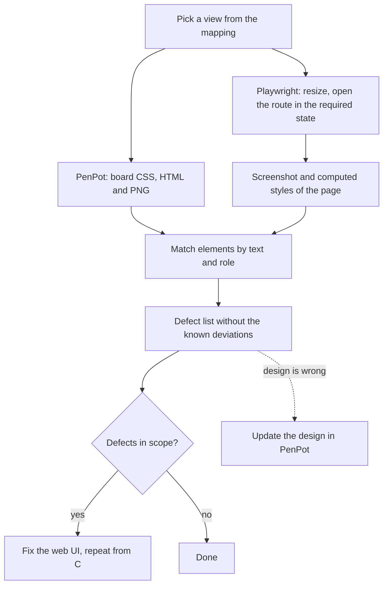

# Design workflow: PenPot and Playwright

Draft. PenPot is the master of the UI design. Agents compare the running web UI with the design through the PenPot MCP and the Playwright MCP, instead of a person comparing screens by hand.

## Setup

| Part | What it is | Notes |
|---|---|---|
| PenPot | Self-hosted, file "App Design" | Needs the PenPot tab open in a browser with the MCP plugin connected for the whole session. |
| PenPot MCP | `penpot` in the user scope | The URL carries a personal user token, so the server is not in `.mcp.json`. Add it with `claude mcp add --scope user --transport http penpot <URL with token>`. |
| Playwright MCP | `playwright-container` in `.mcp.json` (container from `compose.yml`) or `playwright` (local, pinned) | Real Chromium with viewport control (`browser_resize`). The container pins browser, libraries and MCP in one image. |
| App | `just serve-local` | `http://127.0.0.1:8080`, login `admin@example.com` / `password`, scripted traffic with `--demo-flows` ([development.md](development.md), section 6). |

### Check the setup

Run these before the first comparison of a session:

1. `/mcp` lists `penpot` and one of `playwright` (local) or `playwright-container` as connected. A server missing here is not configured in any scope.
2. PenPot: open the file in the browser, open the MCP plugin and connect it. Then run `penpot.currentFile.name` through `execute_code`; it must return `App Design` and `penpotUtils.getPages()` must list the nine pages. "Plugin tab appears to be suspended" means the tab is in the background: focus it and run `/mcp`.
3. Playwright: `browser_resize` to 1440 x 1000, open `http://127.0.0.1:8080/` and check with `browser_evaluate` that `innerWidth` is 1440. An error about a missing browser means step 2 or 3 of the Fedora setup below is open.
4. App: `curl -s -o /dev/null -w '%{http_code}' http://127.0.0.1:8080/` returns `303` while `just serve-local` runs.

### Playwright in a container

`compose.yml` has a `playwright` service (`mcr.microsoft.com/playwright/mcp`, tag = pinned `@playwright/mcp` version). It is behind the `design` profile, so `just db` does not start it.

```bash
podman compose --profile design up -d playwright
```

- The MCP listens on `http://localhost:8931/mcp`. It only accepts the host name `localhost`; `127.0.0.1` answers `403`.
- Host networking: the browser reaches the web UI and Dex on `127.0.0.1`, which the OIDC login and the cookie without `Secure` need.
- Files the browser writes (screenshots, console logs) land inside the container. Screenshots are also returned inline.
- Change the image tag and the `@playwright/mcp@<version>` pin of the local entry together.
- Sandboxes usually have no container socket and an agent must not start a daemon. There the browser has to come from the sandbox image or a sidecar of the same pod.

### Playwright on Fedora (local install)

1. Install the browser libraries (the Playwright check prints Debian package names):

   ```bash
   sudo dnf install libX11-xcb libXrandr libXcomposite libXcursor libXdamage libXi libXext \
       libXfixes libXrender gtk3 pango atk cairo cairo-gobject gdk-pixbuf2 alsa-lib dbus-libs
   ```

2. The MCP server defaults to the Google Chrome channel. Pass `--browser chromium` in the `args` of `.mcp.json`.
3. The MCP expects a specific Chromium revision, which can differ from the one of a plain `npx playwright install`. `npx @playwright/mcp@0.0.83 install-browser chrome-for-testing` downloads the matching one.
4. Reconnect with `/mcp` after every change of the MCP configuration.

## The design file

One page per section; PenPot only draws the open page, so a page of about 1,000 shapes stays fast.

| Page | Content |
|---|---|
| Components | Variant sets `Status badge`, `Rail`, `Bottom bar`, `Button`, `Task row`, `Request card` |
| Desktop | Main workspace and its variants |
| Phone | Phone boards |
| Flows (filter, new task) | Project filter, new task composer |
| Config | Projects, personas, credentials, error page |
| Empty states | One board per empty state |
| Later | Boards for features that are not built yet |
| Network | Traffic view, egress rules, their modals |
| Rejected | Boards that are not built and not planned |

Colours are tokens in the sets `light` and `dark` (theme `Mode`). Light boards bound to tokens preview in dark by switching the theme; there are no separate dark boards. Tokens are not shared with other files, so the components and tokens stay in this one file.

## Comparing a view



- `penpot.generateStyle` and `penpot.generateMarkup` return flex layout, paddings, gaps, sizes and hex colours of a board. `export_shape` returns a PNG.
- Compare by token name first (`color.status.running.bg` against `bg-status-running-bg`), then by value.
- A pixel diff of the two screenshots only finds places to look. The defect list comes from the structured comparison.
- The design is the master. If the app is right on purpose, change the design in PenPot and do not file a defect.

## Known issues

| Issue | Effect | Handling |
|---|---|---|
| The browser tab with PenPot freezes (heartbeat lost) | MCP calls time out, work in the plugin is lost | Keep the tab in the foreground. Reconnect with `/mcp`. Work in small calls. |
| One page with ~9,500 shapes | Exports time out, tab freezes | One page per section (done). Delete empty icon backgrounds (`base-background`). |
| Plugin storage and helper functions reset on reconnect | Scripts that rely on `storage` stop working | Keep each script self-contained. |
| Token bindings are lost when the page changes before PenPot applies them | Boards stay unbound | Wait on a page until the bindings are visible, then switch. |
| `setParentIndex` counts from the end of the child list | Inserted components land in the wrong place | Compute the target order, then assign `length - 1 - position`. |
| Library tokens cannot be applied in a consuming file | A separate library file does not share tokens | Keep components and tokens in one file. |
| `@playwright/mcp@latest` depends on an alpha Playwright and wants its own Chromium revision | Browser start fails with a missing revision | Pin the version, or use the container. |
| Obscura: fixed 1280 px viewport, no web fonts, no event stream, no graph lines | Comparisons were wrong | Replaced by Playwright. |

## Known deviations

The implementation deviates from the design on purpose; the OpenSpec changes record why. An agent does not report these as defects.

- Elements of the "Rejected" page are not built (request URL, query parameters, headers, response details; "Last matched" and "Matched N requests").
- The traffic page filters by persona and task, not by sandbox, and labels sandboxes with task key and run number.
- Approval cards show the summary line and the scope picker only for a registered approval type. `serve` registers none yet, so approvals render with the reason, the comment field and the buttons only. The scope radios use the browser's default style (no `accent-color`).
- Tool rows show title, kind and status. The values on the right of the board's tool rows (duration "0.1s", `+1 −1` of an edit, "2 failed · 18s") are not built; the transcript carries no timings or diff statistics per tool call.
- To be filled in during the first comparisons: segmented control style, "Rows" selector, panel titles, subtitle and button icons on the traffic page.

## Mapping views to boards

One row per view. The agent reads it to know the PenPot page and board, the route, the data it needs and the viewport.

| Board (page / name) | Route | Data | Viewport |
|---|---|---|---|
| Network / Network · live traffic | `/egress/log` | `--demo-flows` | 1440 |
| Network / Network · scrolled | `/egress/log` | `--demo-flows` | 1440 |
| Network / Network · narrow table, actions menu | `/egress/log` | `--demo-flows` | 1280 |
| Desktop / Desktop · light | `/tasks/<id>` | fixture task DF-12 (not built) | 1440 |
| Desktop / Desktop · in review | `/tasks/<id>` | manual seed (not built): task `in_review`, Status menu open | 1440 |
| Desktop / Desktop · runs collapsed | `/tasks/<id>` | manual seed (not built): task with runs | 1440 |
| Desktop / Desktop · many queued messages | `/tasks/<id>` | manual seed (not built): 7 queued messages | 1440 |
| Desktop / Desktop · many runs | `/tasks/<id>` | manual seed (not built): task with 8 runs, description of 5 lines | 1440 |
| Desktop / Desktop · blocked question | `/tasks/<id>` | manual seed (not built): task `blocked` with a pending blocking question | 1440 |
| Desktop / Requests · inbox | `/requests` | manual seed (not built): pending approval, blocking question with suggested answers, question without | 1440 |
| Phone / Phone · task list | `/tasks` | fixture tasks (not built) | 390 |
| Phone / Phone · requests | `/requests` | as Requests · inbox | 390 |
| Empty states / Empty · no requests | `/requests` | no pending requests | 1440 |

The remaining boards follow the same pattern.

## Build order

1. This document, the mapping and the deviation list.
2. Fixtures for the task views (tasks DF-12, DF-14, WEB-3 and so on, queued messages, projects, personas) and a script that starts the app with them. Without them every comparison differs in content.
3. A skill or command `design-compare <view>` that runs the loop above.
4. Pilot on the traffic view, whose data already exists, and measure how noisy the structured comparison is. Then extend it view by view.

## Open points

- The archived OpenSpec changes still cite the old design files (for example `Main.dc.html:99-111`). They are history and stay as they are. The original canvas is still online.
- Whether queued messages (cap of 3 rows, scrolling) are covered by the first fixtures.
