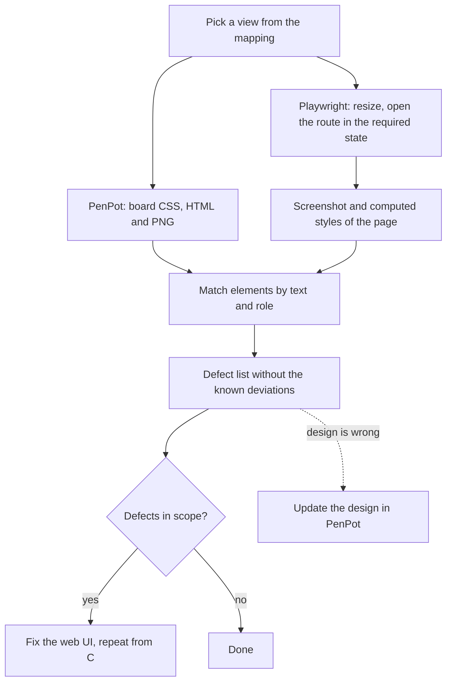

# Design workflow: PenPot and Playwright

Draft. PenPot is the master of the UI design. Agents compare the running web UI with the design through the PenPot MCP and the Playwright MCP, instead of a person comparing screens by hand.

## Setup

| Part | What it is | Notes |
|---|---|---|
| PenPot | Self-hosted, file "App Design" | Needs the PenPot tab open in a browser with the MCP plugin connected for the whole session. |
| PenPot MCP | `penpot` in the user scope | The URL carries a personal user token, so the server is not in `.mcp.json`. Add it with `claude mcp add --scope user --transport http penpot <URL with token>`. |
| Playwright MCP | `playwright-container` in `.mcp.json` (container from `compose.yml`) or `playwright` (local, pinned) | Real Chromium with viewport control (`browser_resize`). The container pins browser, libraries and MCP in one image. |
| App | `just serve-local` | `http://127.0.0.1:8080`, login `admin@example.com` / `password`, scripted traffic with `--demo-flows` ([development.md](development.md), section 6). |

### Check the setup

Run these before the first comparison of a session:

1. `/mcp` lists `penpot` and one of `playwright` (local) or `playwright-container` as connected. A server missing here is not configured in any scope.
2. PenPot: open the file in the browser, open the MCP plugin and connect it. Then run `penpot.currentFile.name` through `execute_code`; it must return `App Design` and `penpotUtils.getPages()` must list the pages of [The design file](#the-design-file). "Plugin tab appears to be suspended" means the tab is in the background: focus it and run `/mcp`.
3. Playwright: `browser_resize` to 1440 x 1000, open `http://127.0.0.1:8080/` and check with `browser_evaluate` that `innerWidth` is 1440. An error about a missing browser means step 2 or 3 of the Fedora setup below is open.
4. App: `curl -s -o /dev/null -w '%{http_code}' http://127.0.0.1:8080/` returns `303` while `just serve-local` runs.

### Playwright in a container

`compose.yml` has a `playwright` service (`mcr.microsoft.com/playwright/mcp`, tag = pinned `@playwright/mcp` version). It is behind the `design` profile, so `just db` does not start it.

```bash
podman compose --profile design up -d playwright
```

- The MCP listens on `http://localhost:8931/mcp`. It only accepts the host name `localhost`; `127.0.0.1` answers `403`.
- Host networking: the browser reaches the web UI and Dex on `127.0.0.1`, which the OIDC login and the cookie without `Secure` need.
- Files the browser writes (screenshots, console logs) land inside the container. Screenshots are also returned inline.
- Change the image tag and the `@playwright/mcp@<version>` pin of the local entry together.
- Sandboxes usually have no container socket and an agent must not start a daemon. There the browser has to come from the sandbox image or a sidecar of the same pod.

### Playwright on Fedora (local install)

1. Install the browser libraries (the Playwright check prints Debian package names):

   ```bash
   sudo dnf install libX11-xcb libXrandr libXcomposite libXcursor libXdamage libXi libXext \
       libXfixes libXrender gtk3 pango atk cairo cairo-gobject gdk-pixbuf2 alsa-lib dbus-libs
   ```

2. The MCP server defaults to the Google Chrome channel. Pass `--browser chromium` in the `args` of `.mcp.json`.
3. The MCP expects a specific Chromium revision, which can differ from the one of a plain `npx playwright install`. `npx @playwright/mcp@0.0.83 install-browser chrome-for-testing` downloads the matching one.
4. Reconnect with `/mcp` after every change of the MCP configuration.

## The design file

One page per section; PenPot only draws the open page, so a page of about 1,000 shapes stays fast.

| Page | Content |
|---|---|
| Components | Variant sets `Status badge`, `Rail`, `Bottom bar`, `Create button` (phone floating create action), `Button`, `Task row`, `Request card`, `Icon button` (properties Icon, Size, State; every icon-only control on the boards is an instance) |
| Chat | Chats, new chat with persona picker, chat artifacts, archive; desktop and phone |
| Tasks | Main task workspace and its variants (status menu, stop, cancel, reset, rename, blocked question, rate limited, user message with code and its dark preview), profile menu, Requests · deny always |
| Tasks - Queue | Queued messages: many, editing one |
| Tasks - Status | Task status `in_review` |
| Tasks - Details Sidebar | Details sidebar: collapsed, many runs, runs collapsed, awaiting dependencies, dependencies collapsed, overview with base task, description collapsed and expanded |
| Tasks - Phone | Phone boards of tasks and requests, profile menu (main component `Profile menu`) |
| Tasks - Artifacts | Artifacts of a task: details tab with cards, split view (Preview, Source, image), task list collapsed, bookmarkable artifact page; phone details sheet and artifact page |
| Tasks - Subtasks | Task tree: Subtasks tab with progress and per-subtask chips, done/total chip on task rows; board "Later · details tabs, sub-tasks" is the superseded first draft |
| Flows (filter, new task) | Project filter, new task composer |
| Request Inbox | Request inbox |
| Config - Projects | Projects: two-line list rows in the settings area, new-project modal, project settings page and its tabs (general, security, context, integrations with its states); phone |
| Config - Personas | Personas: cards, edit modal; phone edit sheet; settings area; variant set `Settings nav` (property Active; the settings sidebar on every settings board is an instance) |
| Config - Credentials | Credentials: two-line list rows, new with validation error; error page (not found) |
| Config - Model providers | Model providers: two-line list rows, new provider modal per credential scheme, provider settings page (general, models, model errors) |
| Empty states | One board per empty state |
| Network | Egress rules: table, search, new and edit modals, empty state |
| Network - Graph | Traffic view: graph, table, allow and deny flows |
| Rejected | Boards that are not built and not planned |

Colours are tokens in the sets `light` and `dark` (theme `Mode`). Light boards bound to tokens preview in dark by switching the theme; there are no separate dark boards. Tokens are not shared with other files, so the components and tokens stay in this one file.

## Comparing a view



- `penpot.generateStyle` and `penpot.generateMarkup` return flex layout, paddings, gaps, sizes and hex colours of a board. `export_shape` returns a PNG.
- Compare by token name first (`color.status.running.bg` against `bg-status-running-bg`), then by value.
- A pixel diff of the two screenshots only finds places to look. The defect list comes from the structured comparison.
- The design is the master. If the app is right on purpose, change the design in PenPot and do not file a defect.

## Known issues

PenPot issues (tab freezes, page budget, storage resets, token bindings, child order, text centring) and how to work around them: skill `penpot`, "API gotchas".

| Issue | Effect | Handling |
|---|---|---|
| `@playwright/mcp@latest` depends on an alpha Playwright and wants its own Chromium revision | Browser start fails with a missing revision | Pin the version, or use the container. |
| Obscura: fixed 1280 px viewport, no web fonts, no event stream, no graph lines | Comparisons were wrong | Replaced by Playwright. |

## Known deviations

The implementation deviates from the design on purpose; the OpenSpec changes record why. An agent does not report these as defects.

- Elements of the "Rejected" page are not built (request URL, query parameters, headers, response details; "Last matched" and "Matched N requests").
- The traffic page filters by persona and task, not by sandbox, and labels sandboxes with task key and run number.
- "Network · allow a blocked host" is superseded by "Network · allow from a row, with scope" (`iter2-egress-approvals`): the destination is read-only, the dialog has a scope, and only `not-allowlisted` rows (not IP literals) offer "Allow".
- The row action "+ Allow" is a text button like "Details" and "Rule", not the board's outlined button.
- The popover of a blocked graph node opens below the node inside the graph panel; the board places it to the right, outside the panel.
- The "Allow egress" dialog uses the shared form modal width (576 px) like the allowlist forms; the board is 480 px wide.
- After *Create rule* the traffic page shows the "Rule created" toast only; rows keep their verdict (no "Rule added" state): a row is an event that already happened.
- Approval cards show the summary line and the scope picker only for a registered approval type. `serve` registers none yet, so approvals render with the reason, the comment field and the buttons only.
- Tool rows show title, kind and status. The values on the right of the board's tool rows (duration "0.1s", `+1 −1` of an edit, "2 failed · 18s") are not built; the transcript carries no timings or diff statistics per tool call.
- The tab "Context" (board "Projects · settings page, context") is not built (`iter3-project-context`); the page has four tabs (General, Security, Egress, Integrations).
- The key panel of the "Lifecycle events" group uses the white panel surface with a border; the boards fill it grey. The primary button of the subscription editor is the accent button of the form footer; the boards draw it dark.
- After a rejected subscription (422) submitted with Enter, the focused URL input keeps its previous value, not the submitted one. This is the htmx morph behavior of every form of the dialog (the project form behaves the same); the submit button keeps the value.
- The task counts of the project list stay underlined accent links in mono; the board "Settings · projects, two-line rows (1350)" draws them as plain numbers in status tones (`ui-settings-list-rows`).
- The "Context" panel in the Overview of the Chat boards (and "Project context" link) is not built (`iter3-project-context`, undecided).
- To be filled in during the first comparisons: segmented control style, "Rows" selector, panel titles, subtitle and button icons on the traffic page.

## Mapping views to boards

One row per view. The agent reads it to know the PenPot page and board, the route, the data it needs and the viewport.

The boards of a change in progress are listed in its `openspec/changes/<name>/design-boards.md` (written by `/prepare-change`, same columns). `/complete-change` moves those rows here.

| Board (page / name) | Route | Data | Viewport |
|---|---|---|---|
| Network - Graph / Network · live traffic (interactive) | `/egress/log` | `--demo-flows` | 1440 |
| Network - Graph / Network · scrolled | `/egress/log` | `--demo-flows` | 1440 |
| Network - Graph / Network · narrow table, actions menu | `/egress/log` | `--demo-flows` | 1280 |
| Network - Graph / Network · allow from a row, with scope | `/egress/log` | `--demo-flows`; a `not-allowlisted` event of a run, "Allow" clicked | 1440 |
| Network - Graph / Network · narrow table, blocked row menu | `/egress/log` | `--demo-flows`; menu of a `not-allowlisted` row open | 1280 |
| Network - Graph / Network · allow from a graph node (hover) | `/egress/log` | `--demo-flows`; pointer on a blocked node | 1440 |
| Network - Graph / Network · allow from a graph node, across tasks | `/egress/log` | `--demo-flows`; blocked node with denied edges from two tasks of one project, "Allow" clicked | 1440 |
| Network / Egress rules · table with task entries | `/egress/allowlist` | manual seed (not built): instance, project and task `http-host` entries | 1440 |
| Network / Egress rules · deny rule listed | `/egress/allowlist` | manual seed (not built): `http-host` entries and deny rule `*.datadoghq.com` | 1440 |
| Network / Egress rules · new rule, allow | `/egress/allowlist` | "New egress rule" clicked | 1440 |
| Network / Egress rules · new rule, deny | `/egress/allowlist` | "New egress rule" clicked, Deny selected | 1440 |
| Network / Egress rules · search and pages | `/egress/allowlist?page=2` | manual seed (not built): 33 rules, the last of them deny rule `*.datadoghq.com` | 1440 |
| Network / Egress rules · search results | `/egress/allowlist?q=github` | as Egress rules · search and pages | 1440 |
| Network / Egress rules · edit rule | `/egress/allowlist` | as Egress rules · table with task entries; edit button of `registry.npmjs.org` (Project DF) clicked | 1440 |
| Network / Egress rules · edit rule, task | `/egress/allowlist` | as above; edit button of task rule `pypi.org` (DF-7) clicked, "Applies to" opened | 1440 |
| Network / Egress rules · edit deny rule | `/egress/allowlist` | deny rule `*.datadoghq.co`; its edit button clicked | 1440 |
| Network / Egress rules · edit cluster service | `/egress/allowlist` | project cluster service `nativelink/scheduler` (port 8980) of `DF`; its edit button clicked | 1440 |
| Network / Egress rules · edit rule, already exists | `/egress/allowlist` | instance rule `github.com:443` and project rule `github.com:443` of `DF`; the project rule edited to "Every project (instance)" and saved | 1440 |
| Network - Graph / Network · deny rule and deny always | `/egress/log` | `--demo-flows` and deny rule `*.datadoghq.com`; a denied event of a matching host | 1440 |
| Tasks / Desktop · light | `/tasks/<id>` | fixture task DF-12 (not built) | 1440 |
| Tasks - Status / Desktop · in review | `/tasks/<id>` | manual seed (not built): task `in_review`, Status menu open | 1440 |
| Tasks - Details Sidebar / Desktop · runs collapsed | `/tasks/<id>` | manual seed (not built): task with runs | 1440 |
| Tasks - Details Sidebar / Desktop · awaiting dependencies | `/tasks/<id>` | manual seed (not built): task DF-23 `awaiting_dependencies` (persona Grace), created by the agent of DF-19 (persona CEO) with parent DF-19; dependencies DF-20 (`completion`, satisfied) and DF-22 (`done`, not satisfied); dependant DF-24 (`done`); no runs, no PR | 1440 |
| Tasks - Details Sidebar / Desktop · dependencies collapsed | `/tasks/<id>` | as Desktop · awaiting dependencies after DF-22 is done; DF-23 `running` with run #1 | 1440 |
| Tasks - Details Sidebar / Desktop · overview, base task | `/tasks/<id>` | as Desktop · dependencies collapsed; DF-23 created with `base_task: DF-20`; no subtasks, no artifacts (no tabs) | 1440 |
| Tasks - Subtasks / Desktop · subtasks tab | `/tasks/<id>` | task DF-12 `running` with direct subtasks DF-13 `completed`, DF-16 `in_review`, DF-17 `running` (two subtasks of its own, one `completed`), DF-18 `cancelled`; Subtasks tab open; DF-12 row chip 2/3 | 1440 |
| Tasks - Queue / Desktop · many queued messages | `/tasks/<id>` | manual seed (not built): 7 queued messages | 1440 |
| Tasks - Details Sidebar / Desktop · many runs | `/tasks/<id>` | manual seed (not built): task with 8 runs, description of 5 lines | 1440 |
| Tasks / Desktop · blocked question | `/tasks/<id>` | manual seed (not built): task `blocked` with a pending blocking question | 1440 |
| Tasks / Desktop · conversation flow · question pending | `/tasks/<key>` | task DF-12 with a pending blocking question and suggested answers; approved `conversation-flow` request-card styling | 1440 |
| Tasks / Desktop · conversation flow · question answered | `/tasks/<key>` | same task and question after Peter Kurfer answered; outcome on the card, no decision form | 1440 |
| Tasks / Desktop · conversation flow · approval pending | `/tasks/<key>` | same task with a pending registered network-access approval; scopes, optional comment, Approve and Deny | 1440 |
| Tasks / Desktop · conversation flow · approval approved | `/tasks/<key>` | same approval granted for this task; outcome and decider, no decision form | 1440 |
| Tasks / Desktop · conversation flow · approval denied | `/tasks/<key>` | same approval denied with a reason; outcome and decider, no decision form | 1440 |
| Tasks / Preview only · create-issue request states · light | `/chats/<key>`, `/requests` | manual seed (not built): chat DF-25-CHAT with `create-issue` requests (title, labels `bug`, `auth`, `ios`, Markdown body with a list, inline code and a link): pending with Preview (Markdown tab hovered), pending with Markdown selected and focused, pending with a long body (panel scrolls), approved (issue #57 created), denied with a note | 1440 |
| Tasks / Preview only · create-issue request states · dark | `/chats/<key>`, `/requests` | as above, dark theme | 1440 |
| Tasks / Phone · create-issue request card (390) | `/requests` | as above; pending request with a long body | 390 |
| Tasks / Desktop · stop and cancel | `/tasks/<id>` | manual seed (not built): task `running` with an active run, 2 queued messages, PR; Status menu open | 1440 |
| Tasks / Desktop · cancel task confirmation | `/tasks/<id>` | as Desktop · stop and cancel; "Cancel task…" chosen | 1440 |
| Tasks / Desktop · reset workspace | `/tasks/<id>` | manual seed (not built): task `waiting` with ended runs; Status menu open | 1440 |
| Tasks / Desktop · reset workspace confirmation | `/tasks/<id>` | as Desktop · reset workspace; "Reset workspace…" chosen | 1440 |
| Tasks / Desktop · reset workspace while running | `/tasks/<id>` | as Desktop · stop and cancel; Status menu open | 1440 |
| Tasks / Desktop · profile menu | `/tasks/<id>` | as Desktop · light; avatar on the rail clicked (component `Profile menu`, main in Tasks - Phone / Phone · profile menu; entries name and role, Docs, Log out, version) | 1440 |
| Tasks - Phone / Phone · profile menu | `/tasks` | avatar clicked | 390 |
| Tasks / Desktop · rate limited, resumes | `/tasks/<id>` | manual seed (not built): task `rate_limited` with resume time 04:30, resume count 2 of `runs.maxAutoResumes` 3, run #2 `rate_limited` | 1440 |
| Request Inbox / Requests · inbox | `/requests` | manual seed (not built): pending `push-check-exception` request (DF-17, two findings), pending `network-access` approval, blocking question with suggested answers | 1440 |
| Tasks / Requests · deny always | `/requests` | manual seed (not built): pending `network-access` request of DF-7 for `http-intake.logs.us5.datadoghq.com:443` | 1440 |
| Tasks - Phone / Phone · task list | `/tasks` | fixture tasks (not built) | 390 |
| Tasks - Phone / Phone · stop and cancel | `/tasks/<id>` | as Desktop · stop and cancel; details sheet and Status menu open | 390 |
| Tasks - Phone / Phone · cancel task confirmation | `/tasks/<id>` | as Desktop · stop and cancel; "Cancel task…" chosen | 390 |
| Tasks - Phone / Phone · reset workspace | `/tasks/<id>` | as Desktop · reset workspace; details sheet and Status menu open | 390 |
| Tasks - Phone / Phone · reset workspace confirmation | `/tasks/<id>` | as Desktop · reset workspace; "Reset workspace…" chosen | 390 |
| Tasks - Phone / Phone · reset workspace while running | `/tasks/<id>` | as Desktop · stop and cancel; details sheet and Status menu open | 390 |
| Tasks - Phone / Phone · stop from composer | `/tasks/<id>` | task `running`, message box empty | 390 |
| Tasks - Phone / Phone · rate limited, resumes | `/tasks/<id>` | as Desktop · rate limited, resumes; details sheet open | 390 |
| Tasks - Phone / Phone · requests | `/requests` | as Requests · inbox | 390 |
| Tasks - Phone / Phone · requests, deny always | `/requests` | as Requests · deny always | 390 |
| Config - Projects / Settings · projects, two-line rows (1350) | `/projects` | `just serve-local` + `just seed-demo`; pointer on the first row | 1350 |
| Config - Projects / Projects · new project | `/projects` | as Settings · projects, two-line rows (1350); "New project" clicked | 1440 |
| Config - Projects / Projects · settings page, general | `/projects/<key>` | `just serve-local`, login as `admin@example.com`; project `DF` with a forge credential; wake setting `members` (default) | 1440 |
| Config - Projects / Projects · settings page, saved | `/projects/<key>` | as above; "Save project" clicked without changes | 1440 |
| Config - Projects / Projects · settings page, security | `/projects/<key>?tab=security` | as Projects · settings page, general; default policy; groups "Push checks" and "Branches" (branch rewrites `with-lease`, agent branches `renovate/**`, `dependabot/**`) | 1440 |
| Config - Projects / Projects · settings page, security, invalid glob | `/projects/<key>?tab=security` | as above; `deploy/[` added as fifth glob and saved | 1440 |
| Config - Projects / Projects · settings page, context | `/projects/<key>` | not built (`iter3-project-context`) | 1440 |
| Config - Projects / Projects · settings page, integrations | `/projects/<key>?tab=integrations` | `just serve-local`, login as `admin@example.com`; two subscriptions (all event types, last delivery `HTTP 204`; three event types, last delivery `HTTP 503`; needs receivers that answer so); `publicUrl` set, forgejo plugin with a webhook secret | 1440 |
| Config - Projects / Projects · settings page, integrations, secret revealed | `/projects/<key>?tab=integrations` | as above; "Show secret" clicked | 1440 |
| Config - Projects / Projects · settings page, integrations, secret copied | `/projects/<key>?tab=integrations` | as above over HTTPS or a loopback host; "Copy secret" clicked (within 2 s) | 1440 |
| Config - Projects / Projects · settings page, integrations, copying needs HTTPS | `/projects/<key>?tab=integrations` | as above, opened over plain `http://` on a non-loopback host | 1440 |
| Config - Projects / Projects · settings page, integrations, no forge integration | `/projects/<key>?tab=integrations` | project whose repository host matches no forge integration, or without a forge credential | 1440 |
| Config - Projects / Projects · settings page, integrations, no webhook support | `/projects/<key>?tab=integrations` | serving plugin without a `webhooks` export (manual seed, not built) | 1440 |
| Config - Projects / Projects · settings page, integrations, no publicUrl | `/projects/<key>?tab=integrations` | control plane without `publicUrl` (`serve --no-cluster` without auth) | 1440 |
| Config - Projects / Projects · settings page, integrations, new subscription | `/projects/<key>?tab=integrations` | as Projects · settings page, integrations with one subscription; "New subscription" clicked, URL and event types filled | 1440 |
| Config - Projects / Projects · settings page, integrations, invalid URL | `/projects/<key>?tab=integrations` | as above; `https://10.0.4.12/hooks/df` submitted | 1440 |
| Config - Projects / Projects · settings page, integrations, delete subscription | `/projects/<key>?tab=integrations` | as Projects · settings page, integrations; trash icon of the second subscription clicked | 1440 |
| Config - Projects / Projects · settings page, integrations, empty | `/projects/<key>?tab=integrations` | as Projects · settings page, integrations without subscriptions | 1440 |
| Config - Projects / Projects · settings page, integrations, feature off | `/projects/<key>?tab=integrations` | control plane without `lifecycleEvents.signingKeyFile` (no key panel), with subscriptions | 1440 |
| Config - Projects / Projects · settings page, integrations, unrestricted URLs | `/projects/<key>?tab=integrations` | control plane started with `--unrestricted-project-subscriptions` (`dev-tools` build) | 1440 |
| Config - Projects / Phone · project settings page, general | `/projects/<key>` | as Projects · settings page, general | 390 |
| Config - Projects / Phone · project settings page, integrations | `/projects/<key>?tab=integrations` | as Projects · settings page, integrations | 390 |
| Config - Projects / Projects · settings page, egress | `/projects/<key>?tab=egress` | manual seed (not built): `DF` rules `*.crates.io`, `registry.npmjs.org`, `github.com`, task rule `pypi.org` (DF-7); `OPS` rule `registry.npmjs.org`; instance rules `api.anthropic.com`, `github.com`, deny rule `*.datadoghq.com` | 1440 |
| Config - Projects / Projects · settings page, egress, instance rules open | `/projects/<key>?tab=egress` | as above; "Also applies (instance)" expanded | 1440 |
| Config - Projects / Projects · settings page, egress, empty | `/projects/<key>?tab=egress` | project without own rules; instance rules as above | 1440 |
| Config - Projects / Projects · settings page, egress, make global | `/projects/<key>?tab=egress` | as Projects · settings page, egress; "Make global" of `registry.npmjs.org` clicked | 1440 |
| Config - Projects / Phone · project settings page, egress | `/projects/<key>?tab=egress` | as Projects · settings page, egress | 390 |
| Config - Projects / Phone · projects | `/projects` | projects (not built) | 390 |
| Flows (filter, new task) / Desktop · task list sort | `/tasks` | fixture tasks (not built); pointer on the sort button (tooltip) | 1440 |
| Flows (filter, new task) / Desktop · task list sort open | `/tasks` | as above; sort button clicked | 1440 |
| Flows (filter, new task) / Desktop · new task, options open | `/tasks` | new-task action clicked, options menu open; issue 7 and existing branch `renovate/serde-1.x` entered (chips "Issue #7", "Branch renovate/serde-1.x") | 1440 |
| Flows (filter, new task) / Desktop · new task, branch held | `/tasks` | as above, submitted while DF-13 holds `renovate/serde-1.x`; error in the composer, values kept | 1440 |
| Tasks - Phone / Phone · task list sort | `/tasks` | fixture tasks (not built) | 390 |
| Tasks - Phone / Phone · task list sort open | `/tasks` | as above; sort button tapped | 390 |
| Config - Model providers / Model providers · two-line rows (1350) | `/model-providers` | `just serve-local` + `just seed-demo`; pointer on the first row | 1350 |
| Config - Credentials / Credentials · two-line rows (1350) | `/credentials` | `just serve-local` + `just seed-demo`; pointer on the first row | 1350 |
| Config - Model providers / Model providers · new, Claude subscription preset | `/model-providers/new` | "New model provider" clicked, preset Claude subscription chosen; header, value and extra headers disabled | 1440 |
| Config - Model providers / Model providers · new, custom header | `/model-providers/new` | "New model provider" clicked, scheme Custom header, header `Authorization`, prefix `Token`, one extra header | 1440 |
| Config - Model providers / Model providers · new, OpenCode Go preset | `/model-providers/new` | "New model provider" clicked, preset OpenCode Go chosen; tab General | 1440 |
| Config - Model providers / Model providers · new, OpenCode Go preset, models | `/model-providers/new` | as above; tab Models with the seven preset models | 1440 |
| Config - Model providers / Model providers · settings page, general | `/model-providers/<id>` | manual seed (not built): provider OpenCode Go (preset values, 15 models) | 1440 |
| Config - Model providers / Model providers · settings page, models, saved | `/model-providers/<id>?tab=models` | as above; saved unchanged. One line per model across the panel, the page scrolls | 1440 |
| Config - Model providers / Model providers · settings page, model errors | `/model-providers/<id>?tab=models` | as above; OpenAI Responses unchecked, one model with one limit, a duplicate ID, `minimax-m3` (used by Ada) removed, saved | 1440 |
| Tasks - Details Sidebar / Desktop · description collapsed | `/tasks/<id>` | as Desktop · many runs; Project and Persona values are links | 1440 |
| Tasks - Details Sidebar / Desktop · description expanded | `/tasks/<id>` | as above; Description opened (three-line clamp) | 1440 |
| Tasks / Desktop · user message with code | `/tasks/<id>` | manual seed (not built): first user message of DF-12 with three lines, a `rust` fence and inline code | 1440 |
| Tasks / Preview only · user message with code · dark | `/tasks/<id>` | as above, dark theme (token values and the dark code theme resolved on the board) | 1440 |
| Config - Personas / Settings · personas | `/personas` | manual seed (not built): four personas with model providers; Linus, Grace and Ada with a description, Ken without | 1440 |
| Config - Personas / Personas · edit modal | `/personas/<id>/edit` | as Settings · personas; edit of Linus clicked | 1440 |
| Config - Personas / Personas · edit modal, OpenCode, model select open | `/personas/<id>/edit` | persona Ada (with description) with harness `opencode` and provider OpenCode Go (preset models); model select open, opening upward | 1440 |
| Config - Personas / Personas · edit modal, claude-code, models filtered | `/personas/<id>/edit` | as above with harness `claude-code`; the select lists only the Anthropic Messages models | 1440 |
| Config - Personas / Phone · edit persona sheet | `/personas/<id>/edit` | as Personas · edit modal | 390 |
| Config - Personas / Settings · personas, identity | `/personas` | four personas `ada`, `grace`, `ken`, `linus` with emails `<handle>@example.org`; cards ordered by handle, avatar colour from the persona id (`color.avatar.1`–`8`) | 1440 |
| Config - Personas / Personas · edit modal, identity | `/personas/<id>/edit` | as Settings · personas, identity; edit of `linus` | 1440 |
| Config - Personas / Personas · new persona, email taken | `/personas/new` | display name "Code Reviewer", handle `reviewer`, email `linus@example.org` saved; neutral avatar preview "CR" | 1440 |
| Config - Personas / Phone · edit persona sheet, identity | `/personas/<id>/edit` | as Personas · edit modal, identity | 390 |
| Config - Personas / Avatar · palette and sizes | none | reference: tokens `color.avatar.{1..8}.{bg,fg}` and neutral (`color.sunk`/`color.muted`); sizes 56 form, 48 phone form, 40 card, 32 transcript, 20 task row and details | none |
| Tasks / Desktop · persona identity | `/tasks/<id>` | as Desktop · light, personas with handles: rows show the persona avatar before the time, transcript author "Linus @linus", details Persona "Linus @linus" with avatar | 1440 |
| Tasks - Details Sidebar / Desktop · run usage, requests without usage | `/tasks/<id>` | manual seed (not built): run #8 with usage records and two records without usage | 1440 |
| Tasks - Details Sidebar / Desktop · attached PR | `/tasks/<key>` | manual seed (not built): task on existing branch `renovate/serde-1.x` with attached open PR #40; "attached" pill after the PR link, tooltip "Opened outside the factory; the factory comments but never changes it" | 1440 |
| Tasks - Artifacts / Desktop · artifacts tab | `/tasks/<key>` | manual seed (not built): task DF-12 with artifacts `login-loop.png`, `findings.md`, `cookie-trace.log` and a `write_artifact` call in the transcript; tab Artifacts chosen. Without artifacts the details column has no tab bar (Tasks / Desktop · light) | 1440 |
| Tasks - Artifacts / Desktop · artifact split view | `/tasks/<key>` | as Desktop · artifacts tab; `findings.md` opened, details collapsed to the strip | 1440 |
| Tasks - Artifacts / Desktop · task list collapsed, artifact open (1280) | `/tasks/<key>` | as Desktop · artifact split view; task list collapsed | 1280 |
| Tasks - Artifacts / Desktop · artifact split view, source | `/tasks/<key>` | as Desktop · artifact split view; Source chosen | 1440 |
| Tasks - Artifacts / Desktop · artifact split view, image | `/tasks/<key>` | as Desktop · artifacts tab; `login-loop.png` opened | 1440 |
| Tasks - Artifacts / Desktop · artifact page | `/tasks/<key>/artifacts/report.md` | as Desktop · artifacts tab plus `report.md` with `` | 1440 |
| Tasks - Artifacts / Phone · details sheet, artifacts tab | `/tasks/<key>` | as Desktop · artifacts tab; details sheet open | 390 |
| Tasks - Artifacts / Phone · artifact page | `/tasks/<key>/artifacts/findings.md` | as Desktop · artifacts tab | 390 |
| Empty states / Empty · no tasks (phone) | `/tasks` | no active tasks | 390 |
| Empty states / Empty · no requests | `/requests` | no pending requests | 1440 |
| Chat / Chat · conversation | `/chats/<key>` | manual seed (not built): project DF with chats DF-12-CHAT (Linus, `running`, topic "Task dependencies plan", artifact `task-dependencies-plan.md`, 3 runs), Grace's "Helm chart for iteration 3" with a pending approval request (needs you, listed first), two idle chats of Ada and Linus; projects WEB, HELM (needs you), DOC without chats; 6 archived chats | 1440 |
| Chat / Chat · subtasks tab, compaction | `/chats/<key>` | as Chat · conversation; DF-12-CHAT created DF-20 (`running`) and DF-21 (`awaiting_dependencies`) via `create_task`, a `context_compacted` notice expanded; Subtasks tab open | 1440 |
| Chat / Chat · artifacts tab | `/chats/<key>` | as Chat · conversation; Artifacts tab open | 1440 |
| Chat / Chat · artifacts tab, scrolled | `/chats/<key>` | as above with seven artifacts, scrolled | 1440 |
| Chat / Chat · markdown split, sidebars collapsed | `/chats/<key>` | as Chat · conversation; `task-dependencies-plan.md` opened from the transcript, chat list collapsed to the persona strip, details collapsed | 1440 |
| Chat / Chat · new chat | `/chats?project=DF` | as Chat · conversation; "New chat" clicked, message written | 1440 |
| Chat / Chat · new chat, persona picker | `/chats?project=DF` | as above; persona picker open | 1440 |
| Chat / Chat · new chat started | `/chats/<key>` | as above after sending to Grace: DF-25-CHAT `running`, topic not set yet | 1440 |
| Chat / Chat · empty project | `/chats?project=DOC` | project DOC without chats | 1440 |
| Chat / Archive · list | `/chats?project=DF` | as Chat · conversation; "Archived chats" clicked | 1440 |
| Chat / Archive · chat selected, transcript | `/chats?project=DF` | as above; an archived chat selected, Transcript tab | 1440 |
| Chat / Archive · chat selected, artifacts | `/chats?project=DF` | as above; Artifacts tab | 1440 |
| Chat / Archive · artifact opened | `/chats?project=DF` | as above; an artifact opened | 1440 |
| Chat / Phone · chats | `/chats?project=DF` | as Chat · conversation | 390 |
| Chat / Phone · chat | `/chats/<key>` | as Chat · conversation | 390 |
| Chat / Phone · chat details | `/chats/<key>` | as above; details sheet open, Overview | 390 |
| Chat / Phone · chat subtasks | `/chats/<key>` | as Chat · subtasks tab, compaction; details sheet, Subtasks | 390 |
| Chat / Phone · chat artifacts | `/chats/<key>` | as above; details sheet, Artifacts | 390 |
| Chat / Phone · artifact opened | `/chats/<key>` | as above; an artifact opened | 390 |
| Chat / Phone · new chat | `/chats?project=DF` | as Chat · new chat | 390 |
| Chat / Phone · new chat, persona picker | `/chats?project=DF` | as Chat · new chat, persona picker | 390 |
| Chat / Phone · archived chats | `/chats?project=DF` | as Archive · list | 390 |
| Chat / Phone · archived chat | `/chats?project=DF` | as Archive · chat selected, transcript | 390 |
| Tasks / Desktop · transcript, tool groups | `/tasks/<key>` | manual seed (not built): task DF-12 `running`; a thought before a streak of 12 tool calls (2 failed); an agent message; an open streak of Read, a thought, Edited and a running `cargo test`; a delivered review webhook (alice, changes requested, PR #41); a queued comment webhook. Group of the running streak opened | 1440 |
| Tasks / Desktop · transcript, tool details | `/tasks/<key>` | as above after the turn ended: an open thought with a `rust` fence; an open streak of Read, Edited (diff opened) and a failed `cargo test` (input with `command`, `console` output, opened); delivered webhooks review, comment, CI failure `test`, PR closed without merge. Board shows the transcript column only | 1440 |
| Tasks - Phone / Phone · transcript, tool groups | `/tasks/<key>` | as Tasks / Desktop · transcript, tool groups | 390 |

The remaining boards follow the same pattern.

## Build order

1. This document, the mapping and the deviation list.
2. Fixtures for the task views (tasks DF-12, DF-14, WEB-3 and so on, queued messages, projects, personas) and a script that starts the app with them. Without them every comparison differs in content.
3. A skill or command `design-compare <view>` that runs the loop above.
4. Pilot on the traffic view, whose data already exists, and measure how noisy the structured comparison is. Then extend it view by view.

## Open points

- The archived OpenSpec changes still cite the old design files (for example `Main.dc.html:99-111`). They are history and stay as they are. The original canvas is still online.
- Whether queued messages (cap of 3 rows, scrolling) are covered by the first fixtures.
