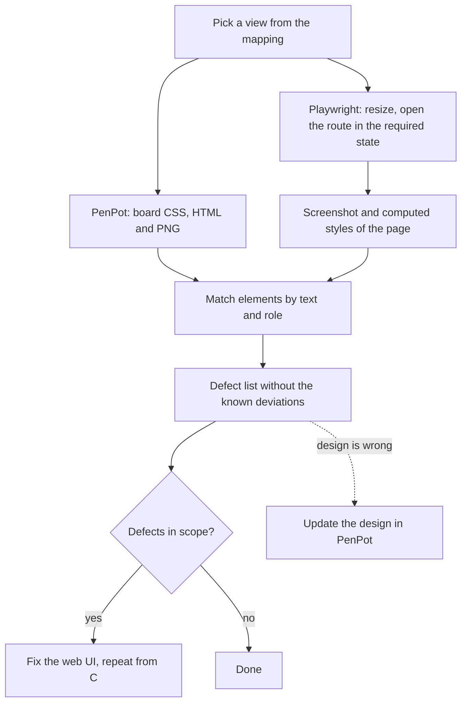

# Design workflow: PenPot and Playwright

Draft. PenPot is the master of the UI design. Agents compare the running web UI with the design through the PenPot MCP and the Playwright MCP, instead of a person comparing screens by hand.

## Setup

| Part | What it is | Notes |
|---|---|---|
| PenPot | Self-hosted, file "App Design" | Needs the PenPot tab open in a browser with the MCP plugin connected for the whole session. |
| PenPot MCP | `penpot` in the user scope | The URL carries a personal user token, so the server is not in `.mcp.json`. Add it with `claude mcp add --scope user --transport http penpot <URL with token>`. |
| Playwright MCP | `playwright-container` in `.mcp.json` (container from `compose.yml`) or `playwright` (local, pinned) | Real Chromium with viewport control (`browser_resize`). The container pins browser, libraries and MCP in one image. |
| App | `just serve-local` | `http://127.0.0.1:8080`, login `admin@example.com` / `password`, scripted traffic with `--demo-flows` ([development.md](development.md), section 6). |

### Check the setup

Run these before the first comparison of a session:

1. `/mcp` lists `penpot` and one of `playwright` (local) or `playwright-container` as connected. A server missing here is not configured in any scope.
2. PenPot: open the file in the browser, open the MCP plugin and connect it. Then run `penpot.currentFile.name` through `execute_code`; it must return `App Design` and `penpotUtils.getPages()` must list the pages of [The design file](#the-design-file). "Plugin tab appears to be suspended" means the tab is in the background: focus it and run `/mcp`.
3. Playwright: `browser_resize` to 1440 x 1000, open `http://127.0.0.1:8080/` and check with `browser_evaluate` that `innerWidth` is 1440. An error about a missing browser means step 2 or 3 of the Fedora setup below is open.
4. App: `curl -s -o /dev/null -w '%{http_code}' http://127.0.0.1:8080/` returns `303` while `just serve-local` runs.

### Playwright in a container

`compose.yml` has a `playwright` service (`mcr.microsoft.com/playwright/mcp`, tag = pinned `@playwright/mcp` version). It is behind the `design` profile, so `just db` does not start it.

```bash
podman compose --profile design up -d playwright
```

- The MCP listens on `http://localhost:8931/mcp`. It only accepts the host name `localhost`; `127.0.0.1` answers `403`.
- Host networking: the browser reaches the web UI and Dex on `127.0.0.1`, which the OIDC login and the cookie without `Secure` need.
- Files the browser writes (screenshots, console logs) land inside the container. Screenshots are also returned inline.
- Change the image tag and the `@playwright/mcp@<version>` pin of the local entry together.
- Sandboxes usually have no container socket and an agent must not start a daemon. There the browser has to come from the sandbox image or a sidecar of the same pod.

### Playwright on Fedora (local install)

1. Install the browser libraries (the Playwright check prints Debian package names):

   ```bash
   sudo dnf install libX11-xcb libXrandr libXcomposite libXcursor libXdamage libXi libXext \
       libXfixes libXrender gtk3 pango atk cairo cairo-gobject gdk-pixbuf2 alsa-lib dbus-libs
   ```

2. The MCP server defaults to the Google Chrome channel. Pass `--browser chromium` in the `args` of `.mcp.json`.
3. The MCP expects a specific Chromium revision, which can differ from the one of a plain `npx playwright install`. `npx @playwright/mcp@0.0.83 install-browser chrome-for-testing` downloads the matching one.
4. Reconnect with `/mcp` after every change of the MCP configuration.

## The design file

One page per section; PenPot only draws the open page, so a page of about 1,000 shapes stays fast.

| Page | Content |
|---|---|
| Components | Variant sets `Status badge`, `Rail`, `Bottom bar`, `Create button` (phone floating create action), `Button`, `Task row`, `Request card`, `Icon button` (properties Icon, Size, State; every icon-only control on the boards is an instance) |
| Chat | Chats, new chat with persona picker, chat artifacts, archive; desktop and phone |
| Tasks | Main task workspace and its variants (status menu, stop, cancel, reset, rename, blocked question, rate limited), profile menu, Requests · deny always |
| Tasks - Queue | Queued messages: many, editing one |
| Tasks - Status | Task status `in_review` |
| Tasks - Details Sidebar | Details sidebar: collapsed, many runs, runs collapsed |
| Tasks - Phone | Phone boards of tasks and requests, profile menu (main component `Profile menu`) |
| Tasks - Roadmap | Task boards for features that are not built yet (details tabs) |
| Flows (filter, new task) | Project filter, new task composer |
| Request Inbox | Request inbox |
| Config - Projects | Projects: table, edit modal and its tabs (push checks, context); phone |
| Config - Personas | Personas: cards, edit modal; phone edit sheet; settings area; variant set `Settings nav` (property Active; the settings sidebar on every settings board is an instance) |
| Config - Credentials | Credentials: table, new with validation error; error page (not found) |
| Config - Model providers | Model providers: table, new provider modal per credential scheme |
| Empty states | One board per empty state |
| Network | Egress rules: table, search, new and edit modals, empty state |
| Network - Graph | Traffic view: graph, table, allow and deny flows |
| Rejected | Boards that are not built and not planned |

Colours are tokens in the sets `light` and `dark` (theme `Mode`). Light boards bound to tokens preview in dark by switching the theme; there are no separate dark boards. Tokens are not shared with other files, so the components and tokens stay in this one file.

## Comparing a view



- `penpot.generateStyle` and `penpot.generateMarkup` return flex layout, paddings, gaps, sizes and hex colours of a board. `export_shape` returns a PNG.
- Compare by token name first (`color.status.running.bg` against `bg-status-running-bg`), then by value.
- A pixel diff of the two screenshots only finds places to look. The defect list comes from the structured comparison.
- The design is the master. If the app is right on purpose, change the design in PenPot and do not file a defect.

## Known issues

| Issue | Effect | Handling |
|---|---|---|
| The browser tab with PenPot freezes (heartbeat lost) | MCP calls time out, work in the plugin is lost | Keep the tab in the foreground. Reconnect with `/mcp`. Work in small calls. |
| One page with ~9,500 shapes | Exports time out, tab freezes | One page per section (done). Delete empty icon backgrounds (`base-background`). |
| Plugin storage and helper functions reset on reconnect | Scripts that rely on `storage` stop working | Keep each script self-contained. |
| Token bindings are lost when the page changes before PenPot applies them | Boards stay unbound | Wait on a page until the bindings are visible, then switch. |
| `setParentIndex` counts from the end of the child list | Inserted components land in the wrong place | Compute the target order, then assign `length - 1 - position`. |
| Library tokens cannot be applied in a consuming file | A separate library file does not share tokens | Keep components and tokens in one file. |
| `@playwright/mcp@latest` depends on an alpha Playwright and wants its own Chromium revision | Browser start fails with a missing revision | Pin the version, or use the container. |
| Obscura: fixed 1280 px viewport, no web fonts, no event stream, no graph lines | Comparisons were wrong | Replaced by Playwright. |

## Known deviations

The implementation deviates from the design on purpose; the OpenSpec changes record why. An agent does not report these as defects.

- Elements of the "Rejected" page are not built (request URL, query parameters, headers, response details; "Last matched" and "Matched N requests").
- The traffic page filters by persona and task, not by sandbox, and labels sandboxes with task key and run number.
- "Network · allow a blocked host" is superseded by "Network · allow from a row, with scope" (`iter2-egress-approvals`): the destination is read-only, the dialog has a scope, and only `not-allowlisted` rows (not IP literals) offer "Allow".
- The row action "+ Allow" is a text button like "Details" and "Rule", not the board's outlined button.
- The popover of a blocked graph node opens below the node inside the graph panel; the board places it to the right, outside the panel.
- The "Allow egress" dialog uses the shared form modal width (576 px) like the allowlist forms; the board is 480 px wide.
- After *Create rule* the traffic page shows the "Rule created" toast only; rows keep their verdict (no "Rule added" state): a row is an event that already happened.
- Approval cards show the summary line and the scope picker only for a registered approval type. `serve` registers none yet, so approvals render with the reason, the comment field and the buttons only.
- Tool rows show title, kind and status. The values on the right of the board's tool rows (duration "0.1s", `+1 −1` of an edit, "2 failed · 18s") are not built; the transcript carries no timings or diff statistics per tool call.
- The tab "Context" of the "Lifecycle events" boards is not built (`iter3-project-context`); the dialog has three tabs, and the phone board's four-tab row scrolls only where the tabs do not fit.
- The key panel of the "Lifecycle events" tab uses the white panel surface with a border; the boards fill it grey. The primary button of the subscription editor is the accent button of the dialog footer; the boards draw it dark.
- After a rejected subscription (422) submitted with Enter, the focused URL input keeps its previous value, not the submitted one. This is the htmx morph behavior of every form of the dialog (the project form behaves the same); the submit button keeps the value.
- To be filled in during the first comparisons: segmented control style, "Rows" selector, panel titles, subtitle and button icons on the traffic page.

## Mapping views to boards

One row per view. The agent reads it to know the PenPot page and board, the route, the data it needs and the viewport.

| Board (page / name) | Route | Data | Viewport |
|---|---|---|---|
| Network - Graph / Network · live traffic (interactive) | `/egress/log` | `--demo-flows` | 1440 |
| Network - Graph / Network · scrolled | `/egress/log` | `--demo-flows` | 1440 |
| Network - Graph / Network · narrow table, actions menu | `/egress/log` | `--demo-flows` | 1280 |
| Network - Graph / Network · allow from a row, with scope | `/egress/log` | `--demo-flows`; a `not-allowlisted` event of a run, "Allow" clicked | 1440 |
| Network - Graph / Network · narrow table, blocked row menu | `/egress/log` | `--demo-flows`; menu of a `not-allowlisted` row open | 1280 |
| Network - Graph / Network · allow from a graph node (hover) | `/egress/log` | `--demo-flows`; pointer on a blocked node | 1440 |
| Network - Graph / Network · allow from a graph node, across tasks | `/egress/log` | `--demo-flows`; blocked node with denied edges from two tasks of one project, "Allow" clicked | 1440 |
| Network / Egress rules · table with task entries | `/egress/allowlist` | manual seed (not built): instance, project and task `http-host` entries | 1440 |
| Network / Egress rules · deny rule listed | `/egress/allowlist` | manual seed (not built): `http-host` entries and deny rule `*.datadoghq.com` | 1440 |
| Network / Egress rules · new rule, allow | `/egress/allowlist` | "New egress rule" clicked | 1440 |
| Network / Egress rules · new rule, deny | `/egress/allowlist` | "New egress rule" clicked, Deny selected | 1440 |
| Network / Egress rules · search and pages | `/egress/allowlist?page=2` | manual seed (not built): 33 rules, the last of them deny rule `*.datadoghq.com` | 1440 |
| Network / Egress rules · search results | `/egress/allowlist?q=github` | as Egress rules · search and pages | 1440 |
| Network - Graph / Network · deny rule and deny always | `/egress/log` | `--demo-flows` and deny rule `*.datadoghq.com`; a denied event of a matching host | 1440 |
| Tasks / Desktop · light | `/tasks/<id>` | fixture task DF-12 (not built) | 1440 |
| Tasks - Status / Desktop · in review | `/tasks/<id>` | manual seed (not built): task `in_review`, Status menu open | 1440 |
| Tasks - Details Sidebar / Desktop · runs collapsed | `/tasks/<id>` | manual seed (not built): task with runs | 1440 |
| Tasks - Queue / Desktop · many queued messages | `/tasks/<id>` | manual seed (not built): 7 queued messages | 1440 |
| Tasks - Details Sidebar / Desktop · many runs | `/tasks/<id>` | manual seed (not built): task with 8 runs, description of 5 lines | 1440 |
| Tasks / Desktop · blocked question | `/tasks/<id>` | manual seed (not built): task `blocked` with a pending blocking question | 1440 |
| Tasks / Desktop · stop and cancel | `/tasks/<id>` | manual seed (not built): task `running` with an active run, 2 queued messages, PR; Status menu open | 1440 |
| Tasks / Desktop · cancel task confirmation | `/tasks/<id>` | as Desktop · stop and cancel; "Cancel task…" chosen | 1440 |
| Tasks / Desktop · reset workspace | `/tasks/<id>` | manual seed (not built): task `waiting` with ended runs; Status menu open | 1440 |
| Tasks / Desktop · reset workspace confirmation | `/tasks/<id>` | as Desktop · reset workspace; "Reset workspace…" chosen | 1440 |
| Tasks / Desktop · reset workspace while running | `/tasks/<id>` | as Desktop · stop and cancel; Status menu open | 1440 |
| Tasks / Desktop · profile menu | `/tasks/<id>` | as Desktop · light; avatar on the rail clicked (component `Profile menu`, main in Tasks - Phone / Phone · profile menu; entries name and role, Docs, Log out, version) | 1440 |
| Tasks - Phone / Phone · profile menu | `/tasks` | avatar clicked | 390 |
| Tasks / Desktop · rate limited, resumes | `/tasks/<id>` | manual seed (not built): task `rate_limited` with resume time 04:30, resume count 2 of `runs.maxAutoResumes` 3, run #2 `rate_limited` | 1440 |
| Request Inbox / Requests · inbox | `/requests` | manual seed (not built): pending `push-check-exception` request (DF-17, two findings), pending `network-access` approval, blocking question with suggested answers | 1440 |
| Tasks / Requests · deny always | `/requests` | manual seed (not built): pending `network-access` request of DF-7 for `http-intake.logs.us5.datadoghq.com:443` | 1440 |
| Tasks - Phone / Phone · task list | `/tasks` | fixture tasks (not built) | 390 |
| Tasks - Phone / Phone · stop and cancel | `/tasks/<id>` | as Desktop · stop and cancel; details sheet and Status menu open | 390 |
| Tasks - Phone / Phone · cancel task confirmation | `/tasks/<id>` | as Desktop · stop and cancel; "Cancel task…" chosen | 390 |
| Tasks - Phone / Phone · reset workspace | `/tasks/<id>` | as Desktop · reset workspace; details sheet and Status menu open | 390 |
| Tasks - Phone / Phone · reset workspace confirmation | `/tasks/<id>` | as Desktop · reset workspace; "Reset workspace…" chosen | 390 |
| Tasks - Phone / Phone · reset workspace while running | `/tasks/<id>` | as Desktop · stop and cancel; details sheet and Status menu open | 390 |
| Tasks - Phone / Phone · stop from composer | `/tasks/<id>` | task `running`, message box empty | 390 |
| Tasks - Phone / Phone · rate limited, resumes | `/tasks/<id>` | as Desktop · rate limited, resumes; details sheet open | 390 |
| Tasks - Phone / Phone · requests | `/requests` | as Requests · inbox | 390 |
| Tasks - Phone / Phone · requests, deny always | `/requests` | as Requests · deny always | 390 |
| Config - Projects / Projects · edit modal, push checks | `/projects/<key>/edit` | projects (not built); tab "Push checks" with the default policy | 1440 |
| Config - Projects / Projects · edit modal, push checks, invalid glob | `/projects/<key>/edit` | as above; `deploy/[` added as fifth glob and saved | 1440 |
| Config - Projects / Projects · edit modal, lifecycle events | `/projects/<key>/edit` | `just serve-local`, login as `admin@example.com`; tab "Lifecycle events"; two subscriptions (all event types, last delivery `HTTP 204`; three event types, last delivery `HTTP 503`; needs receivers that answer so); the board shows the planned tab "Context" before it (not built) | 1440 |
| Config - Projects / Projects · edit modal, lifecycle events, new subscription | `/projects/<key>/edit` | as above with one subscription; "New subscription" clicked, URL and event types filled | 1440 |
| Config - Projects / Projects · edit modal, lifecycle events, invalid URL | `/projects/<key>/edit` | as above; `https://10.0.4.12/hooks/df` submitted | 1440 |
| Config - Projects / Projects · edit modal, lifecycle events, delete subscription | `/projects/<key>/edit` | as the first board; trash icon of the second subscription clicked | 1440 |
| Config - Projects / Projects · edit modal, lifecycle events, empty | `/projects/<key>/edit` | as the first board without subscriptions | 1440 |
| Config - Projects / Projects · edit modal, lifecycle events, feature off | `/projects/<key>/edit` | control plane without `lifecycleEvents.signingKeyFile` (no key panel), with subscriptions | 1440 |
| Config - Projects / Projects · edit modal, lifecycle events, unrestricted URLs | `/projects/<key>/edit` | control plane started with `--unrestricted-project-subscriptions` (`dev-tools` build) | 1440 |
| Config - Projects / Phone · edit project sheet, lifecycle events | `/projects/<key>/edit` | as the first board; tab "Lifecycle events" chosen | 390 |
| Config - Projects / Phone · projects | `/projects` | projects (not built) | 390 |
| Config - Model providers / Model providers · table | `/model-providers` | manual seed (not built): providers Claude subscription (Linus, Grace, Ada), Anthropic API (Ken), OpenAI (unused) | 1440 |
| Config - Model providers / Model providers · new, Claude subscription preset | `/model-providers/new` | "New model provider" clicked, preset Claude subscription chosen; header, value and extra headers disabled | 1440 |
| Config - Model providers / Model providers · new, custom header | `/model-providers/new` | "New model provider" clicked, scheme Custom header, header `Authorization`, prefix `Token`, one extra header | 1440 |
| Config - Personas / Personas · cards | `/personas` | manual seed (not built): four personas with model providers | 1440 |
| Config - Personas / Settings · personas | `/personas` | as Personas · cards | 1440 |
| Config - Personas / Personas · edit modal | `/personas/<id>/edit` | as Personas · cards; edit of Linus clicked | 1440 |
| Config - Personas / Phone · edit persona sheet | `/personas/<id>/edit` | as Personas · edit modal | 390 |
| Tasks - Details Sidebar / Desktop · run usage, requests without usage | `/tasks/<id>` | manual seed (not built): run #8 with usage records and two records without usage | 1440 |
| Empty states / Empty · no tasks (phone) | `/tasks` | no active tasks | 390 |
| Empty states / Empty · no requests | `/requests` | no pending requests | 1440 |

The remaining boards follow the same pattern.

## Build order

1. This document, the mapping and the deviation list.
2. Fixtures for the task views (tasks DF-12, DF-14, WEB-3 and so on, queued messages, projects, personas) and a script that starts the app with them. Without them every comparison differs in content.
3. A skill or command `design-compare <view>` that runs the loop above.
4. Pilot on the traffic view, whose data already exists, and measure how noisy the structured comparison is. Then extend it view by view.

## Open points

- The archived OpenSpec changes still cite the old design files (for example `Main.dc.html:99-111`). They are history and stay as they are. The original canvas is still online.
- Whether queued messages (cap of 3 rows, scrolling) are covered by the first fixtures.
