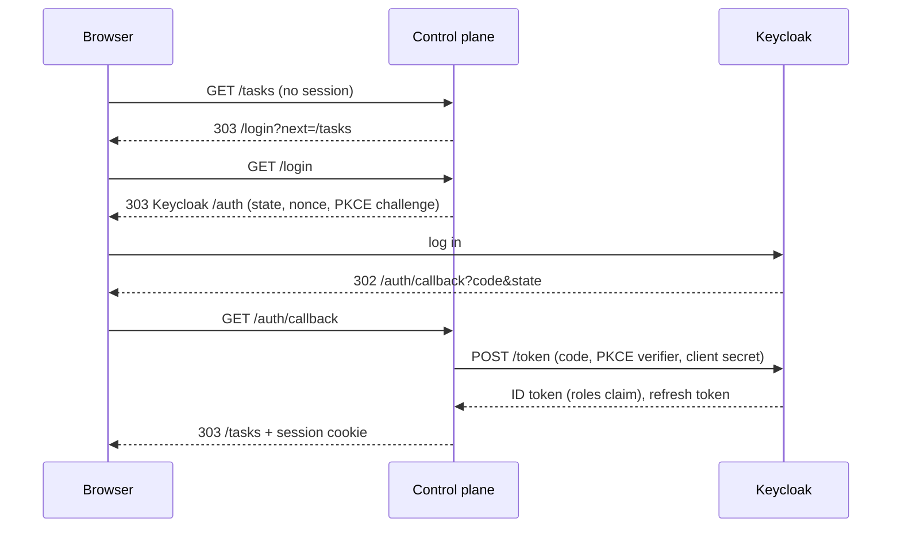

# Keycloak setup for the web UI

The control plane is a confidential OIDC client (authorization code flow with PKCE, performed
server-side). Browsers only get an HTTP-only session cookie; tokens stay on the server. Every UI page
requires the role `board-member`, read from a flat claim of the ID token.



## 1. Create the client

In the realm of your instance, **Clients > Create client**:

| Setting | Value |
| --- | --- |
| Client type | OpenID Connect |
| Client ID | `dark-factory` (`auth.clientId`) |
| Client authentication | On (confidential client) |
| Authentication flow | Standard flow only; turn off direct access grants and implicit flow |
| Valid redirect URIs | `https://<public host>/auth/callback` |
| Valid post logout redirect URIs | `https://<public host>/` |
| Web origins | empty |

Under **Advanced > Advanced settings** set *Proof Key for Code Exchange Code Challenge Method* to
`S256`.

Copy the secret from **Credentials** into a Kubernetes Secret in the instance namespace:

```bash
kubectl -n dark-factory create secret generic dark-factory-oidc \
  --from-literal=client-secret='<secret from Keycloak>'
```

## 2. Create the role and map it into the token

1. **Clients > dark-factory > Roles > Create role**: name `board-member`. Assign it to the users (or
   a group) who may operate the factory.
2. **Clients > dark-factory > Client scopes > dark-factory-dedicated > Configure a new mapper >
   User Client Role**:

   | Setting | Value |
   | --- | --- |
   | Name | `roles` |
   | Client ID | `dark-factory` |
   | Multivalued | On |
   | Token Claim Name | `roles` (`auth.rolesClaim`) |
   | Claim JSON Type | String |
   | Add to ID token | **On** |
   | Add to access token | optional |

   The default `resource_access.dark-factory.roles` claim is nested and is not read. The claim must be
   a top-level list, for example `"roles": ["board-member"]`.

Roles are read at every login and every token refresh; they are never stored as the source of truth.
A role removed in Keycloak takes effect when the access token expires (default 5 minutes) and is
refreshed. Live views (task list, task detail) reconnect at that point, so they stop as well.

*Revoke Refresh Token* (refresh token rotation) is supported: the control plane refreshes each
session once, even when several requests arrive with an expired token at the same time.

## 3. Configure the control plane

Helm values (`deploy/helm/dark-factory/README.md`):

```yaml
oidc:
  issuerUrl: https://id.example.org/realms/dark-factory
  clientId: dark-factory
  existingSecret: dark-factory-oidc
  clientSecretKey: client-secret
  publicUrl: https://factory.example.org
  rolesClaim: roles
```

The chart renders the `auth` section of `config.yaml`:

| Field | Required | Default | Effect |
| --- | --- | --- | --- |
| `auth.issuerUrl` | yes | | Issuer; `/.well-known/openid-configuration` is discovered below it on every login, callback and refresh. |
| `auth.clientId` | yes | | OIDC client ID. |
| `auth.clientSecretFile` | yes | | File with the client secret (the chart mounts it at `/run/secrets/oidc/client-secret`). |
| `auth.publicUrl` | yes | | Externally visible base URL; the redirect URI is `<publicUrl>/auth/callback`, the post-logout redirect `<publicUrl>/`. Must be `https://`; plain `http://` is accepted only on loopback (`localhost`, `127.0.0.0/8`, `::1`) for local development, and then the session cookie is sent without `Secure`. `serve` refuses any other `http://` URL. |
| `auth.rolesClaim` | no | `roles` | Top-level ID token claim with the role list. |
| `auth.extraScopes` | no | `[]` | Scopes requested in addition to `openid` and `profile`, e.g. `[groups]` for Dex (`docs/development.md`, section 6). Not set by the chart. |

Without an `auth` section `dark-factory serve` logs a warning, serves only `/healthz`, `/readyz` and
`/assets/*`, and the UI is unavailable.

## 4. Verify

1. Open `https://<public host>/`. You are redirected to Keycloak and, after login, to `/tasks`.
2. A user without `board-member` sees `403` with the message *Your account lacks the role
   `board-member`.*
3. **Log out** deletes the server-side session and ends the Keycloak session (RP-initiated logout).

## Troubleshooting

| Symptom | Cause |
| --- | --- |
| *Invalid parameter: redirect_uri* at Keycloak | The redirect URI does not match `auth.publicUrl` + `/auth/callback`. |
| 403 for a user who has the role | The mapper does not add the claim to the ID token, or `auth.rolesClaim` differs from *Token Claim Name*. |
| *Login unavailable* (502) | The control plane cannot reach `auth.issuerUrl`; check the NetworkPolicy and the issuer URL. |
| *Login failed* (400) | The login state does not match, e.g. the login page was opened in another browser or the cookie was blocked. |
| Logged out every few minutes | The refresh was refused: the Keycloak SSO session or refresh token expired, or the client lost *Standard flow*. |
