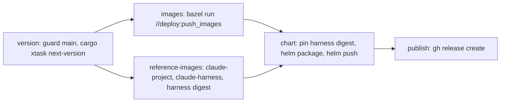

# Releasing

A release is one manually started GitHub Actions workflow. It computes the version, pushes all images and the Helm chart, and only then creates the Git tag and the GitHub Release.

## Cut a release

1. Make sure `main` contains what should be released and CI is green.
2. In GitHub: Actions, workflow **Release**, **Run workflow**, branch `main` (no inputs). With the GitHub CLI: `gh workflow run release.yaml --ref main`.
3. Follow the run (`gh run watch`). When it succeeds, release `v<version>` exists with generated notes.

A failed run leaves no tag and no GitHub Release; start it again and it computes the same version. Images and the chart pushed by the failed run stay in GHCR and are overwritten by the next run.

Pushing a tag does not start a release.

## Version

Format `YYYY.M.N`: year and month (UTC, no leading zero) of the release date, and `N`, the number of the release in that month starting at `0` (`2026.11.0`, `2026.11.1`, `2026.12.0`). The tag is `v<version>`; images and the chart use `<version>` without `v`. The version is valid SemVer without pre-release suffix.

`cargo xtask next-version` prints the next one. A version counts as used when a tag `v<version>` or a GitHub Release `v<version>` (draft or published) exists, so deleting only the tag does not free it. `N` is one more than the highest used `N` of the month (numeric comparison). Names that do not parse, and versions of other months, are ignored. Run it locally to preview the version: it needs `git` with the tags fetched and an authenticated `gh`.

## Workflow



| Job | What it does |
|---|---|
| `version` | Fails unless the run is on `main`. Outputs the version and the commit SHA that all later jobs check out. |
| `images` | Verifies the images and pushes control plane, runtime, both plugins and test project with `--//build:version=<version>`. |
| `reference-images` | Pushes `claude-project:<version>` and `claude-harness:<adapter version>`; outputs the digest of the harness image. |
| `chart` | Runs after both image jobs, so a published chart never references a missing image. Copies the chart, writes the harness digest into `image.harness.claudeCode.digest`, packages it with `--version` and `--app-version` set to the release version and pushes it to `oci://ghcr.io/prskr/dark-factory/charts/dark-factory`. |
| `publish` | Creates tag `v<version>` on the built commit and the GitHub Release with generated notes. Only job with `contents: write`. |

Two releases never run at the same time (`concurrency: release`).

The binaries report the version as `df_telemetry::VERSION`: Bazel passes `--//build:version`, plain `cargo` builds report `dev` unless `DF_VERSION` is set at build time. It is shown in the profile menu of the web UI and exported as OTel `service.version`.

## Install a release

```bash
helm install df oci://ghcr.io/prskr/dark-factory/charts/dark-factory --version 2026.11.0
helm template df oci://ghcr.io/prskr/dark-factory/charts/dark-factory --version 2026.11.0 | grep 'image:'
```

First-party images default to the chart `appVersion`; the harness image is pinned by the digest the release pushed.

## One-time setup

Before the first release is announced:

1. **DNS for `www.dark-factory.eu`** (docs site, change `docs-site`): `A`/`AAAA` records of the apex domain to GitHub Pages and a `www` `CNAME` to `prskr.github.io`.
2. **GitHub Pages**: Settings, Pages, source "Deploy from a branch" `gh-pages`, enable "Enforce HTTPS".
3. **Package visibility**: new GHCR packages are private. After the first release make the `charts/dark-factory` package and every new image package public (GitHub, Packages, package settings, Change visibility). Until then the release installs only with GHCR credentials.
4. **Stale tags**: delete the old `latest` tags of `claude-harness` and `claude-project` (package settings, Versions). Releases no longer move them.
