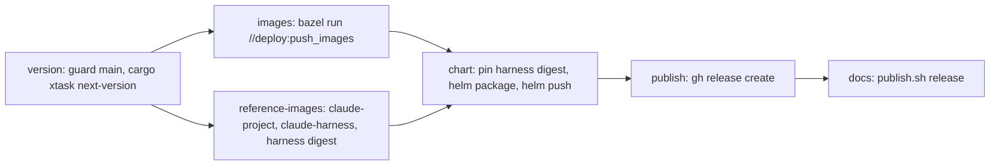

# Releasing

A release is one manually started GitHub Actions workflow. It computes the version, pushes all images and the Helm chart, and only then creates the Git tag and the GitHub Release.

## Cut a release

1. Make sure `main` contains what should be released and CI is green.
2. In GitHub: Actions, workflow **Release**, **Run workflow**, branch `main` (no inputs). With the GitHub CLI: `gh workflow run release.yaml --ref main`.
3. Follow the run (`gh run watch`). When it succeeds, release `v<version>` exists with generated notes.

A failed run leaves no tag and no GitHub Release; start it again and it computes the same version. Images and the chart pushed by the failed run stay in GHCR and are overwritten by the next run.

Pushing a tag does not start a release.

## Version

Format `YYYY.M.N`: year and month (UTC, no leading zero) of the release date, and `N`, the number of the release in that month starting at `0` (`2026.11.0`, `2026.11.1`, `2026.12.0`). The tag is `v<version>`; images and the chart use `<version>` without `v`. The version is valid SemVer without pre-release suffix.

`cargo xtask next-version` prints the next one. A version counts as used when a tag `v<version>` or a GitHub Release `v<version>` (draft or published) exists, so deleting only the tag does not free it. `N` is one more than the highest used `N` of the month (numeric comparison). Names that do not parse, and versions of other months, are ignored. Run it locally to preview the version: it needs `git` with the tags fetched and an authenticated `gh`.

## Workflow



| Job | What it does |
|---|---|
| `version` | Fails unless the run is on `main`. Outputs the version and the commit SHA that all later jobs check out. |
| `images` | Verifies the images and pushes control plane, runtime, both plugins and test project with `--//build:version=<version>`. |
| `reference-images` | Pushes `claude-project:<version>` and `claude-harness:<adapter version>`; outputs the digest of the harness image. |
| `chart` | Runs after both image jobs, so a published chart never references a missing image. Copies the chart, writes the harness digest into `image.harness.claudeCode.digest`, packages it with `--version` and `--app-version` set to the release version and pushes it to `oci://ghcr.io/prskr/dark-factory/charts/dark-factory`. |
| `publish` | Creates tag `v<version>` on the built commit and the GitHub Release with generated notes. Only job with `contents: write`. |
| `docs` | Runs after `publish`, so no docs exist for a version without a tag. Builds the docs from the released commit and publishes `/docs/<version>/`, `/docs/latest/` and `/versions.json` to `gh-pages` (see "Docs site"). Re-run this job alone when it fails. |

Two releases never run at the same time (`concurrency: release`).

The binaries report the version as `df_telemetry::VERSION`: Bazel passes `--//build:version`, plain `cargo` builds report `dev` unless `DF_VERSION` is set at build time. It is shown in the profile menu of the web UI and exported as OTel `service.version`.

## Docs site

The site `https://www.dark-factory.eu/` is built with Hugo (theme Hextra, vendored in `docs/_vendor`) from `docs/` and served by GitHub Pages from the `gh-pages` branch. `docs/push.sh` (fetch, `docs/publish.sh`, commit, push) updates that branch; the workflows `docs.yaml` (push to `main`) and `release.yaml` (job `docs`) call it. They run in separate concurrency groups with a push retry (below).

| Path | Owner | Written by |
|---|---|---|
| `/` (landing page), `/404.html`, `/CNAME`, `/.nojekyll`, `/docs/index.html` | `main` | `publish.sh <dir> main` |
| `/docs/dev/` | `main` | `publish.sh <dir> main` |
| `/docs/<version>/` | release | `publish.sh <dir> release <version>` |
| `/docs/latest/`, `/versions.json` | release | `publish.sh <dir> release <version>` |

`/docs/` forwards to `latest/`, or to `dev/` while no release exists. A release older than the newest one in `versions.json` is refused without changing anything, so re-running an old workflow cannot move `latest` back. The version switcher and the outdated banner read `/versions.json` in the browser, so old docs list newer releases.

`versions.json` lists `dev` first and then the releases, newest first; it is written by the first release, and the switcher falls back to `dev` before that. `docs.yaml` (push to `main`) and the release `docs` job run in separate concurrency groups (`gh-pages-main`, `gh-pages-release`): GitHub cancels a pending run when a newer one queues in the same group, so a shared group could drop the docs of a release. A superseded pending `main` publish is harmless. Because both can push at the same time, `docs/push.sh` retries a rejected push up to three times (`MAX_ATTEMPTS`): it fetches `gh-pages` again, resets to it and runs `publish.sh` again, so neither overwrites the other's paths. If all three attempts fail, re-run the failed job.

Local work (Hugo comes from `build/with_tools.sh`, no Go needed):

```bash
just docs-serve                   # live reload on http://localhost:1313
just docs-build                   # the site as publish.sh main writes it, into target/docs-site
docs/publish_test.sh              # tests of publish.sh (stub hugo, temporary directories)
docs/push_test.sh                 # tests of push.sh (local bare repository as remote)
docs/links_test.sh                # tests of the link check
just docs-theme-update v0.13.0    # new Hextra release (needs Go); check light and dark afterwards
```

Screenshots on the landing page (`docs/landing/images/`, Git LFS; the docs workflows check out with `lfs: true`) come from the running app, not from the design file. To retake one:

1. `just serve-local`, then `just seed`; log in as `admin@example.com` / `password`.
2. Playwright at 1440 x 900, light theme, open the view (for example `/egress/log`, whose traffic comes from `--demo-flows`).
3. Save the viewport as WebP (`browser_take_screenshot` with `type: webp`; with the Playwright container, copy it out with `podman cp`) under the same name in `docs/landing/images/`.

Links between published pages are relative (root-relative page links are checked too) and checked by the build: a broken link or an absolute `https://www.dark-factory.eu/...` link fails it. Link to unpublished repository files with a `https://github.com/prskr/dark-factory/blob/main/...` URL. The configuration references are mounted from the crates (`docs/config/_default/module.yaml`), not copied.

## Install a release

```bash
helm install df oci://ghcr.io/prskr/dark-factory/charts/dark-factory --version 2026.11.0
helm template df oci://ghcr.io/prskr/dark-factory/charts/dark-factory --version 2026.11.0 | grep 'image:'
```

First-party images default to the chart `appVersion`; the harness image is pinned by the digest the release pushed.

## One-time setup

Before the first release is announced:

1. **DNS for `www.dark-factory.eu`** (docs site, change `docs-site`): `A`/`AAAA` records of the apex domain to GitHub Pages and a `www` `CNAME` to `prskr.github.io`.
2. **GitHub Pages**: Settings, Pages, source "Deploy from a branch" `gh-pages`, enable "Enforce HTTPS".
3. **Package visibility**: new GHCR packages are private. After the first release make the `charts/dark-factory` package and every new image package public (GitHub, Packages, package settings, Change visibility). Until then the release installs only with GHCR credentials.
4. **Stale tags**: delete the old `latest` tags of `claude-harness` and `claude-project` (package settings, Versions). Releases no longer move them.
