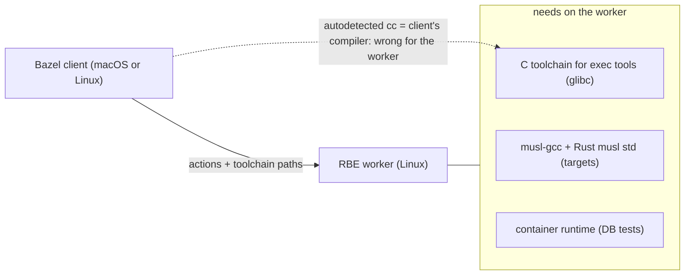
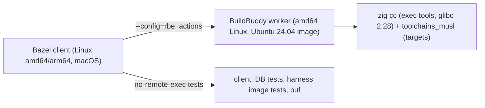

# Remote Build Execution (RBE)

Status: **in use for CI and releases, opt-in locally** (`--config=rbe`, see [development.md](development.md#bazel-platforms-cache-and-images) and [ADR-0058](adr/0058-hermetic-c-toolchain.md)). BuildBuddy cloud executors run build actions and every test that does not start containers; tests that depend on `df-test-postgres` still run on the client. Running them on workers is the remaining part of TD-27 in [tech_debt.md](tech_debt.md).

This document records why the earlier RBE setup was removed, what the current one consists of and what is still missing.

## 1. Background

| Period | Setup | Problem |
|--------|-------|---------|
| Iteration 1 | NativeLink scheduler (in-cluster) | Replaced by BuildBuddy |
| `5d6ce43` | BuildBuddy RBE (`--config=remote`, linux/amd64 workers, Firecracker + `dockerd` for tests) with a hermetic glibc LLVM toolchain (`toolchains_llvm`, Debian sysroots); release images built separately with `--config=release` (`toolchains_musl`) on the runner | Two incompatible builds of the whole workspace: glibc for tests on RBE, static musl for images outside RBE. A plain build of the images failed to link (see 2.1). |
| Until `hermetic-cc-toolchain` | No RBE. All Linux targets are static musl; tests and images share the build (CI: `--config=linux-amd64-musl`) | Container-backed tests cannot run in agent sandboxes (no container socket, see 4); exec tools used the host's C toolchain |
| Current | `--config=rbe` on BuildBuddy cloud (amd64 workers), static musl targets, exec tools with `zig cc` (see 2.2, 3) | Container-backed tests run on the client (see 4) |

The design documents still assume RBE runs the container-backed tests: [ADR-0023](adr/0023-kata-isolation-no-nested-containers.md), [agent-run.md](../design/agent-run.md) (§ sandbox, egress), [egress.md](../design/egress.md) and [product/context.md](../product/context.md).

## 2. Root causes

RBE and musl are not incompatible. The old setup had two independent problems.

### 2.1 Toolchain registration order (general, fixed)

rules_rust's default `*-unknown-linux-gnu` toolchains and the LLVM C toolchain constrain only cpu + os. They therefore also match the musl target platforms (`//build/platforms:linux_*_musl`), and Bazel takes the first registered match. Result: glibc `libstd` linked by `musl-gcc`:

```
undefined reference to `gnu_get_libc_version'   (libstd, sys/pal/unix/conf.rs)
```

On the RBE workers the same mismatch made static musl builds impossible ("the musl toolchain must win for the musl target platform").

**Fix (in place):** `MODULE.bazel` registers `@musl_toolchains_hub//:all`, `//build/platforms:musl_test_toolchain` and the `*-unknown-linux-musl` Rust toolchains before `@rust_toolchains//:all`. This holds for local and remote execution alike.

### 2.2 C toolchain for exec tools (inherent to RBE, solved with zig cc)

Build scripts, proc-macros and other exec tools are linked with the exec platform's C toolchain. Without configuration, Bazel autodetects that toolchain (`local_config_cc`) **on the client**. From a macOS client this is Xcode clang, which does not exist on a Linux worker. Every RBE setup with mixed client OSes needs a C toolchain that is defined independently of the client. This is not specific to musl or rules_rust; it is why `toolchains_llvm` and the sysroots were added the first time. Today `hermetic_cc_toolchain` (zig cc) is registered for the exec platforms (3.2).



## 3. The current setup



### 3.1 Worker image

BuildBuddy's public image `gcr.io/flame-public/rbe-ubuntu24-04`, pinned by the digest of its multi-arch index in `build/platforms/BUILD.bazel` (`linux_amd64_rbe`). It is enough: the C toolchain comes from the repository (zig), the image only supplies a shell, coreutils, `tar` and `file` for the test scripts, and the glibc that the Rust toolchain's `rustc` needs. No custom executor image is built. The same image runs on BuildBuddy's arm64 executors (`Arch=arm64`, verified with a one-action probe); arm64 tests on workers are not wired up.

### 3.2 Exec C toolchain

`hermetic_cc_toolchain` (zig cc, glibc 2.28 for the exec tools), registered after `@musl_toolchains_hub` in `MODULE.bazel` so that the musl platforms keep `toolchains_musl` (2.1). `@zig_sdk//toolchain/linux-amd64:linux_amd64_gnu.2.28` is registered before `@zig_sdk//toolchain:*` for every client, so that all clients use the same zig paths and share the exec action keys with the amd64 workers. Two patches (`build/patches/`) remove two arguments of `rustc` that zig rejects and declare that package on amd64 Linux hosts too (upstream skips the host's own exec platform). The zig cache directory must be fixed and visible to the sandbox, otherwise every action starts with an empty cache (`.bazelrc`, development.md). `toolchains_llvm` was tried first and rejected, see [ADR-0058](adr/0058-hermetic-c-toolchain.md).

### 3.3 Bazel configuration

```
build:rbe --config=cache
build:rbe --remote_executor=grpcs://remote.buildbuddy.io
build:rbe --extra_execution_platforms=//build/platforms:linux_amd64_rbe
build:rbe --host_platform=//build/platforms:linux_amd64_rbe
build:rbe --platforms=//build/platforms:linux_amd64_musl
build:rbe --jobs=50
# the same action keys on every client
build:rbe --features=-layering_check
build:rbe --host_features=-layering_check
build:rbe --cpu=k8
build:rbe --host_cpu=k8

# clients that cannot run amd64 binaries (arm64 Linux, macOS)
build:rbe-cross --config=rbe
build:rbe-cross --build_tag_filters=-no-remote-exec
build:rbe-cross --test_tag_filters=-no-remote-exec
```

- `linux_amd64_rbe`: `@platforms//os:linux`, `@platforms//cpu:x86_64`, `exec_properties` with `OSFamily`, `Arch` and the pinned `container-image`.
- Musl tests on a glibc worker: `musl_test_toolchain` lets the test run on an exec platform without the `:musl` constraint.
- `--platforms` equals an image platform (`linux_amd64_musl`), so tests and images share one configuration; the workers are amd64, whatever the client is.
- The client's cpu name and `layering_check` features are part of every action key; the four pins make arm64 Linux, macOS and amd64 clients compute the same keys.
- `.bazelrc.agents` keeps no remote configuration; agents may pass `--config=rbe` themselves where BuildBuddy is reachable.

### 3.4 Verification (what was run)

Numbers and run links are in [the results of the spike](adr/0058-hermetic-c-toolchain-results.md) and [ADR-0058](adr/0058-hermetic-c-toolchain.md). `bazel build` and `bazel test` with `--config=rbe` passed on the `ubuntu-latest` runner and in the release dry run, and with `--config=rbe-cross` from an arm64 Linux client and on the `ubuntu-24.04-arm` and `macos-latest` runners; a second client finds what the first built in the cache; `//deploy:images_structure_test` passes (static musl ELFs); the database tests run on the client.

## 4. Limitations

- Container-backed tests (`df-test-postgres`, harness image tests) do not run on workers: they need a container runtime. They run on the client, which must be amd64 Linux with `--config=rbe`, or any client without it (`just bazel-test-rbe`). Agent sandboxes have no container socket, so these tests only run in CI and on developer machines. Running them on workers (`dockerd` in the executor image) is the remaining part of TD-27.
- Agent sandboxes do not use remote execution (`.bazelrc.agents`).
- Without `--config=rbe`, cache hits are shared between Linux machines of the same arch; macOS hosts compile exec tools with Xcode's clang.
- On Linux hosts other than CI, the host arch is compiled twice (tests on `host_musl`, images on `linux_<arch>_musl`) unless `--config=linux-<arch>-musl` is set.
- A Linux host needs `file` and `readelf` for the two harness image structure tests.
