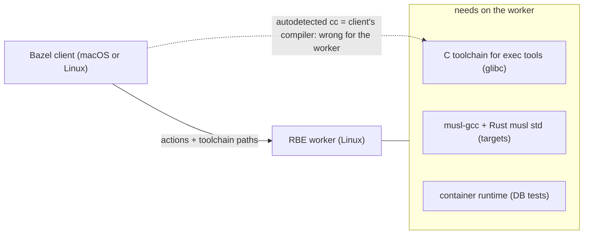

# Remote Build Execution (RBE)

Status: **not in use**. Bazel builds and tests run on the machine that runs Bazel; BuildBuddy is used as an optional remote cache only (`--config=cache`, see [development.md](development.md#bazel-platforms-cache-and-images)). Tracked as TD-27 in [tech_debt.md](tech_debt.md).

This document records why RBE was removed and what a custom worker setup needs to bring it back.

## 1. Background

| Period | Setup | Problem |
|--------|-------|---------|
| Iteration 1 | NativeLink scheduler (in-cluster) | Replaced by BuildBuddy |
| `5d6ce43` | BuildBuddy RBE (`--config=remote`, linux/amd64 workers, Firecracker + `dockerd` for tests) with a hermetic glibc LLVM toolchain (`toolchains_llvm`, Debian sysroots); release images built separately with `--config=release` (`toolchains_musl`) on the runner | Two incompatible builds of the whole workspace: glibc for tests on RBE, static musl for images outside RBE. A plain build of the images failed to link (see 2.1). |
| Current | No RBE. All Linux targets are static musl; tests and images share the build (CI: `--config=linux-amd64-musl`) | Container-backed tests cannot run in agent sandboxes (no container socket, see 4) |

The design documents still assume RBE runs the container-backed tests: [ADR-0023](../design/adr/0023-kata-isolation-no-nested-containers.md), [agent-run.md](../design/agent-run.md) (§ sandbox, egress), [egress.md](../design/egress.md) and [product/context.md](../product/context.md).

## 2. Root causes

RBE and musl are not incompatible. The old setup had two independent problems.

### 2.1 Toolchain registration order (general, fixed)

rules_rust's default `*-unknown-linux-gnu` toolchains and the LLVM C toolchain constrain only cpu + os. They therefore also match the musl target platforms (`//build/platforms:linux_*_musl`), and Bazel takes the first registered match. Result: glibc `libstd` linked by `musl-gcc`:

```
undefined reference to `gnu_get_libc_version'   (libstd, sys/pal/unix/conf.rs)
```

On the RBE workers the same mismatch made static musl builds impossible ("the musl toolchain must win for the musl target platform").

**Fix (in place):** `MODULE.bazel` registers `@musl_toolchains_hub//:all`, `//build/platforms:musl_test_toolchain` and the `*-unknown-linux-musl` Rust toolchains before `@rust_toolchains//:all`. This holds for local and remote execution alike.

### 2.2 C toolchain for exec tools (inherent to RBE, open)

Build scripts, proc-macros and other exec tools are linked with the exec platform's C toolchain. Without configuration, Bazel autodetects that toolchain (`local_config_cc`) **on the client**. From a macOS client this is Xcode clang, which does not exist on a Linux worker. Every RBE setup with mixed client OSes needs a C toolchain that is defined independently of the client. This is not specific to musl or rules_rust; it is why `toolchains_llvm` and the sysroots were added.



## 3. Bringing RBE back with a custom worker setup

Prerequisite: the workers are under our control (for example self-hosted BuildBuddy executors or NativeLink on the homelab nodes).

### 3.1 Worker image

| Requirement | Why |
|-------------|-----|
| Linux, glibc, `gcc` (or `clang`) and binutils | exec tools (build scripts, proc-macros) |
| `bash`, `coreutils`, `tar`, `file`, `git` | test scripts (`deploy/test_images.sh`), repository rules executed remotely |
| Container runtime reachable by tests (`DOCKER_HOST`) | `df-test-postgres` (testcontainers) |
| amd64 and arm64 pools (optional) | run tests for both architectures; otherwise arm64 is only cross-compiled |

### 3.2 Exec C toolchain: pick one

| Option | Effort | Notes |
|--------|--------|-------|
| **A. Checked-in toolchain for the worker image** | low | Define a `cc_toolchain` with the image's fixed paths (`/usr/bin/gcc`, include dirs), `exec_compatible_with` = worker platform. Image and config must change together; tag the image by digest. |
| **B. Hermetic LLVM** (`toolchains_llvm` + sysroots, as in `5d6ce43`) | medium | Independent of the worker image. Needs explicit `-L=` sysroot link flags for rust-lld. Large download (~1 GB) per worker cache. |
| **C. `hermetic_cc_toolchain` (zig cc)** | medium, untested here | One toolchain for glibc exec tools and musl targets on amd64/arm64, from macOS and Linux clients. Could replace both `toolchains_llvm` and `toolchains_musl`. |

Recommendation: **A** when the worker image is ours anyway; **C** when the same toolchain should also serve local builds.

### 3.3 Bazel configuration

```
# .bazelrc (sketch)
build:remote --config=cache
build:remote --remote_executor=grpcs://<scheduler>
build:remote --remote_timeout=10m
build:remote --jobs=50
build:remote --extra_execution_platforms=//build/platforms:linux_amd64_rbe
build:remote --platforms=//build/platforms:linux_amd64_musl
```

- `linux_amd64_rbe`: `@platforms//os:linux`, `@platforms//cpu:x86_64`, `exec_properties` with the worker image (`container-image`) and the container runtime settings of the scheduler. Listed first via `--extra_execution_platforms`, so test actions select it.
- Musl tests on a glibc worker: `musl_test_toolchain` (already registered) lets the test run on an exec platform without the `:musl` constraint.
- Keep `--platforms` equal to an image platform (`linux_amd64_musl`), so tests and images share one configuration.
- `.bazelrc.agents`: switch the default from `--config=cache` to `--config=remote` once it works; agents then get container-backed tests again (ADR-0023).

### 3.4 Verification

1. `bazel test --config=remote //...` from a Linux client and from macOS: all targets pass, no action runs locally (`--remote_local_fallback` off, check the BuildBuddy invocation).
2. `bazel cquery --config=remote 'deps(//deploy:runtime_image)'` shows `//crates/factory-agent:factory-agent` in the same configuration as the top-level target.
3. `//deploy:images_structure_test` passes (static musl ELFs).
4. Database tests pass on the workers (container runtime reachable).
5. A second run from another client (macOS vs. Linux) is fully cached: with all actions on the same worker platform, the exec tools are identical.

## 4. Current limitations without RBE

- Agent sandboxes have no container socket: `df-test-postgres` based tests fail there. CI runs them.
- Cache hits are shared only between machines with the same host OS and arch (exec tools are built for the host).
- On Linux hosts other than CI, the host arch is compiled twice (tests on `host_musl`, images on `linux_<arch>_musl`) unless `--config=linux-<arch>-musl` is set.
