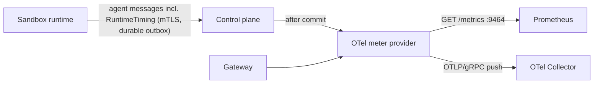

# Telemetry reference

The control plane (`dark-factory serve`) and the gateway (`dark-factory gateway`) export OpenTelemetry
metrics and, optionally, traces. `migrate` and the sandbox runtime export nothing: the runtime sends its
measurements to the control plane over the agent channel (`RuntimeTiming`), and the control plane derives
the run metrics from the messages it persists.



## Configuration

Standard `OTEL_*` variables; Helm renders them from `telemetry.*` (see `deploy/helm/dark-factory/README.md`).

| Variable | Required | Default | Effect |
|----------|----------|---------|--------|
| `OTEL_METRICS_EXPORTER` | no | `prometheus` | Comma-separated list of `prometheus`, `otlp`, `none`. `none` alone disables metrics. An unknown value stops the process at startup, the error names the variable. |
| `OTEL_EXPORTER_PROMETHEUS_HOST` | no | `0.0.0.0` | Address of the scrape endpoint. |
| `OTEL_EXPORTER_PROMETHEUS_PORT` | no | `9464` | Port of `GET /metrics`, separate from all other listeners. |
| `OTEL_TRACES_EXPORTER` | no | `none` | `otlp` exports spans; `none` installs no exporter and opens no connection. |
| `OTEL_TRACES_SAMPLER`, `OTEL_TRACES_SAMPLER_ARG` | no | `parentbased_always_on` | `always_on`, `always_off`, `traceidratio` (argument: ratio from 0 to 1, default 1), each also with the prefix `parentbased_`. Other values stop the process at startup. |
| `OTEL_EXPORTER_OTLP_ENDPOINT`, `_HEADERS`, `_INSECURE`, `_TIMEOUT` | with `otlp` | none | OTLP over gRPC. `OTEL_EXPORTER_OTLP_PROTOCOL` (also `_METRICS_PROTOCOL`, `_TRACES_PROTOCOL`) accepts only `grpc`; any other value stops the process at startup. An endpoint without scheme uses `https`; the native root store and a mounted private CA are honoured. |
| `OTEL_METRIC_EXPORT_INTERVAL` | no | `60000` (ms) | Push interval of the `otlp` metrics exporter. |
| `OTEL_SERVICE_NAME` | no | `dark-factory-control-plane` / `dark-factory-gateway` | `service.name`. |
| `OTEL_RESOURCE_ATTRIBUTES` | no | none | Extra resource attributes. |

Every metric and span carries the resource attributes `service.name`, `service.version` and
`service.instance.id` (pod name, else host name).

Export failures never affect the component; the SDK logs them at ERROR once per export interval. On shutdown
pending exports are flushed within the shutdown grace period (30 s) counted from the signal: what the
listeners did not use is left for the flush.

## Instruments

Recording is best-effort: the control plane records after the transaction that persists a message committed,
never for replayed messages, so a crash between commit and recording loses the sample. Run instruments carry
`project` (project key). Prometheus renders `df.agent.turns` as `df_agent_turns_total` and appends the unit
(`df_run_duration_seconds`).

### Control plane

| Instrument | Type | Unit | Attributes | Source |
|------------|------|------|------------|--------|
| `df.runs.ended` | counter | | `project`, `outcome` | `RunReport` |
| `df.run.duration` | histogram | s | `project`, `outcome` | run start to `RunReport` |
| `df.agent.turns` | counter | | `project`, `stop_reason` | `TurnEnded` |
| `df.agent.tokens` | counter | | `project`, `model`, `token_type` (`input`, `output`, `cache_read`, `cache_write`) | `TurnEnded.usage` |
| `df.agent.tool_calls` | counter | | `project`, `kind`, `origin`, `status` (`completed`, `failed`) | terminal status of a tool call |
| `df.agent.pushes` | counter | | `project`, `target`, `status` | `PushReport` |
| `df.agent.runtime.duration` | histogram | s | `project`, `operation`, `result` (`ok`, `error`) | `RuntimeTiming` |
| `df.agent.runtime.rejected` | counter | | `project`, `operation` | `RuntimeTiming` with a duration of zero or more than 7 days |
| `df.agent.connections` | up-down counter | | `project` | open agent channel streams |
| `df.agent.reconnects` | counter | | `project` | streams of runs that had one before |

`operation` is one of `workspace_prepare`, `harness_start`, `turn`, `push`, `finalize`. `outcome`,
`stop_reason`, `kind`, `origin`, `target` and `status` are the lower-case protobuf enum names without
prefix (`end_turn`, `task_branch`); unknown numbers are `unspecified`.

Attributes that originate from the sandbox are bounded: `model` is cut to 64 bytes and after 32 distinct
values per process further ones are `other`. Run ids, task keys, tool titles, repository URLs and hosts are
never attributes.

### Gateway

| Instrument | Type | Unit | Attributes | Meaning |
|------------|------|------|------------|---------|
| `df.gateway.connections` | counter | | `decision` (`allowed`, `denied`), `reason` (deny reason or `none`) | proxy requests by final decision, counted when they end |
| `df.gateway.active_connections` | up-down counter | | | requests connected to their destination |
| `df.gateway.bytes` | counter | By | `direction` (`upstream`: sandbox to destination, `downstream`) | relayed bytes |
| `df.gateway.policy_version` | gauge | | | version of the last applied allowlist snapshot |

## Spans

Only with `OTEL_TRACES_EXPORTER=otlp`. Attributes never contain credentials, prompts or tool input/output.

| Span | Attributes |
|------|------------|
| `http.request` | `http.request.method`, `http.route`, `http.response.status_code` (UI and gateway health listeners; the `/metrics` scrape endpoint gets no span) |
| `agent.session` | `run_id` |
| `agent.persist_batch` | `messages` (count) |
| `gateway.connect` | `method`, `decision`, `host` (allowed requests only) |

Spans of the runtime and trace context propagation over the agent channel are not part of this.

## How to enable tracing

1. Run an OTLP/gRPC collector that Jaeger, Tempo or similar reads from.
2. Set the endpoint and enable traces, in Helm:

   ```yaml
   telemetry:
     traces:
       enabled: true
       sampler: parentbased_traceidratio
       samplerArg: '0.1'
     otlp:
       endpoint: https://otel-collector.observability.svc:4317
   ```

   or as variables: `OTEL_TRACES_EXPORTER=otlp`, `OTEL_EXPORTER_OTLP_ENDPOINT=...`.
3. Look for `service.name` `dark-factory-control-plane` and `dark-factory-gateway`.

Spans pass the same `RUST_LOG` filter as log events: `RUST_LOG=info` exports the INFO spans listed above.
