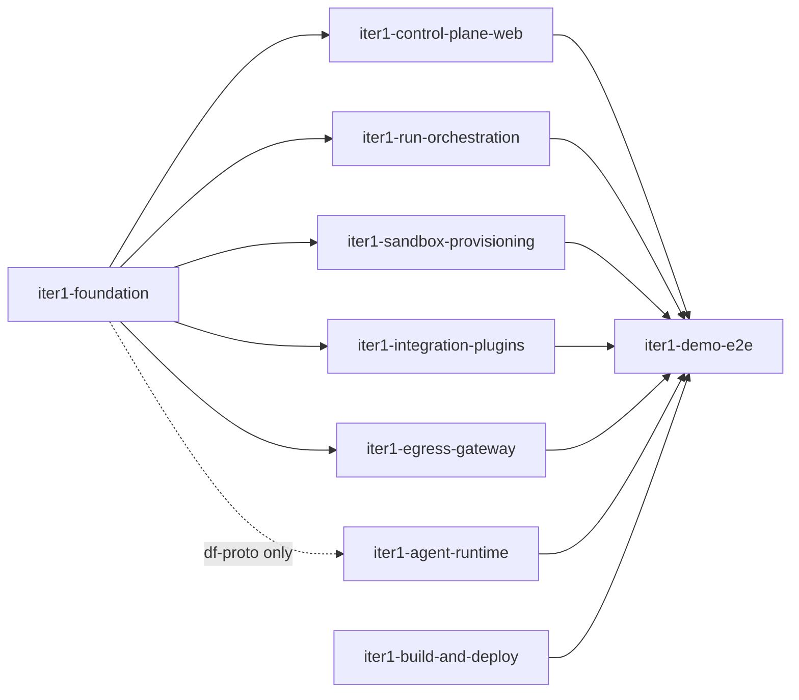

# OpenSpec

Specs (`specs/`) and in-flight changes (`changes/`) for Dark Factory. Applied changes are archived to `changes/archive/`.

## Iteration 1 — order of work

Scope: [`product/iterations/iteration-1.md`](../product/iterations/iteration-1.md). Crate, table, port and interface ownership per change: `iter1-foundation/design.md` ("Workstream map").

| Wave | Change | Contents | Can start when |
|---|---|---|---|
| 0 | `iter1-foundation` | Cargo workspace, `df-proto` (contract bindings), `df-core` (domain types, `SandboxProvider`/`ForgeClient`/`SecretStore` + fakes), `df-db` (shared schema, notifications, task management, audit), `dark-factory migrate` | immediately |
| 0 | `iter1-build-and-deploy` | Bazel cross builds, images, `//deploy:dev`, Helm chart | immediately |
| 1 | `iter1-agent-runtime` | `factory-agent`, `fake-acp-agent` | foundation task group 2 (`df-proto`) is done |
| 1 | `iter1-run-orchestration` | Agent port (mTLS), protocol v1 server, scheduler, transcript storage, factory tools, PR lifecycle, run credentials | foundation is applied |
| 1 | `iter1-sandbox-provisioning` | Sandbox, task PVC, image/csi volumes, per-run NetworkPolicy, `SecretStore` | foundation is applied |
| 1 | `iter1-integration-plugins` | Wasmtime plugin host, Forgejo plugin, `ForgeClient` | foundation is applied |
| 1 | `iter1-control-plane-web` | OIDC, configuration forms, task pages with live transcript | foundation is applied |
| 1 | `iter1-egress-gateway` | `gateway.v1` contract (first), proxy, `PolicyWatch`, `Tail` relay, allowlist and egress-log pages | foundation is applied; UI pages after `df-web`'s layout exists |
| 2 | `iter1-demo-e2e` | Automated demo with the fake agent, manual demo with Claude Code (incl. phone) | all other changes are applied and deployed |

Notes:
- Wave-1 changes develop against the fakes in `df_core::testing`, so they don't block each other.
- Each iteration-1 §7 spike is the first task group of the change that owns it.
- Apply one change per agent: `/opsx:apply <change>`.
