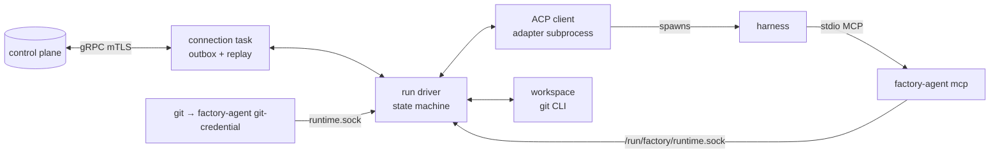

# Design

## Context

`design/agent-run.md` (§4.3, §5.2 layout, §6, §7, §9), `contract/proto/darkfactory/agent/v1/agent.proto`, `contract/proto/darkfactory/transcript/v1/transcript.proto`, ADR-0005. Pod wiring (env, volumes, cert paths) is produced by `iter1-sandbox-provisioning`; the env names below are the interface between both changes.

## Goals / Non-Goals

**Goals:**
- One static binary with subcommands `run`, `mcp`, `git-credential`.
- Every behaviour testable on a laptop: a scripted control plane (tonic server in the test), local Git repositories, and `fake-acp-agent` as the harness.

**Non-Goals:**
- Full-harness mode, skills bundle, gateway MCP endpoint, commit hooks and Git config entries from `Assign`, branch rewrite policy (never force the task branch), `AwaitingInput`, UID separation, lifecycle hooks.

## Decisions

### D1 — Process structure

One Unix socket `/run/factory/runtime.sock` (mode 0600) with length-delimited JSON frames serves both the MCP bridge and the credential helper. tokio tasks communicate via channels; the run driver owns all state.

### D2 — Environment interface (set by provisioning)
`DF_CONTROL_PLANE_ADDR` (`ip:9443`), `DF_CONTROL_PLANE_SERVER_NAME`, `DF_TLS_DIR` (`/run/factory/tls`: `tls.crt`, `tls.key`, `ca.crt`), `HTTPS_PROXY`/`HTTP_PROXY`/`NO_PROXY` (passed through to harness and Git). Paths `/data`, `/run/factory`, `/opt/factory` are fixed.

### D3 — Outbox
Append-only segment files under `/data/runtime/outbox/` (length-prefixed protobuf), plus `/data/runtime/run.json` (run id, next seq, last pushed SHA, harness session id). Acked segments are deleted. Bound 256 MiB; when exceeded, the driver stops reading ACP updates (back-pressure on the adapter's stdout) until acks free space.
*Alternative:* SQLite — an extra C dependency for an append-only log.

### D4 — Git command builder
`Git::new(repo).allow_protocols(&["https"])` adds every `-c` option and env var from `design/agent-run.md` §7.2. Tests construct it with `["https", "file"]` to use local bare repos; production code has no path to add `file`. The `.git/config` template is a static string per supported Git major version, plus rendered runtime keys; `/opt/factory/gitconfig` is a minimal global config (`safe.directory=/data/repo`, `init.defaultBranch=main`).

### D5 — ACP specifics (confirmed or replaced by spike 1.1)
- Adapter command and env from `Assign.harness.acp`; settings JSON written to `/data/home/.claude/settings.json`.
- Persona system prompt: adapter `_meta` system-prompt append if supported, else written to `/data/home/.claude/CLAUDE.md` each run.
- Rate limit: detected from the adapter's prompt error/stop signal; retry time parsed from the message when present.
- Usage: from the adapter if reported; else parsed per turn from `~/.claude/projects/<cwd-slug>/<session>.jsonl` (sum `message.usage` of assistant entries written during the turn).
- Factory tool correlation: harness tool calls titled `mcp__factory__<name>` get origin `FACTORY`; `factory_call_id` is matched to the next `ToolCallRequest` with the same tool name (best effort, contract open point 2).

### D6 — Fake agent script format
YAML: `sessions: { new: [turn…], loaded: [turn…] }`, turn = list of steps (`say`, `think`, `tool_call`, `shell`, `mcp`, `plan`, `usage`, `end`). The fake agent connects to MCP servers from `session/new` using `rmcp`'s stdio client. Scripts for tests live in `crates/fake-acp-agent/scripts/`.

## Risks / Trade-offs

- [Claude ACP adapter lacks `session/load` or usage] → summary fallback and session-log parsing are first-class paths, both covered by tests with the fake agent.
- [Adapter ignores `HTTPS_PROXY`] → spike 1.1 records it; without proxy support Claude can't run behind the gateway, which blocks the demo — escalate immediately.
- [Agent edits `.git/config` mid-run to redirect the runtime's push] → the runtime passes the remote URL explicitly on every push/fetch and rewrites the config before finalize.
