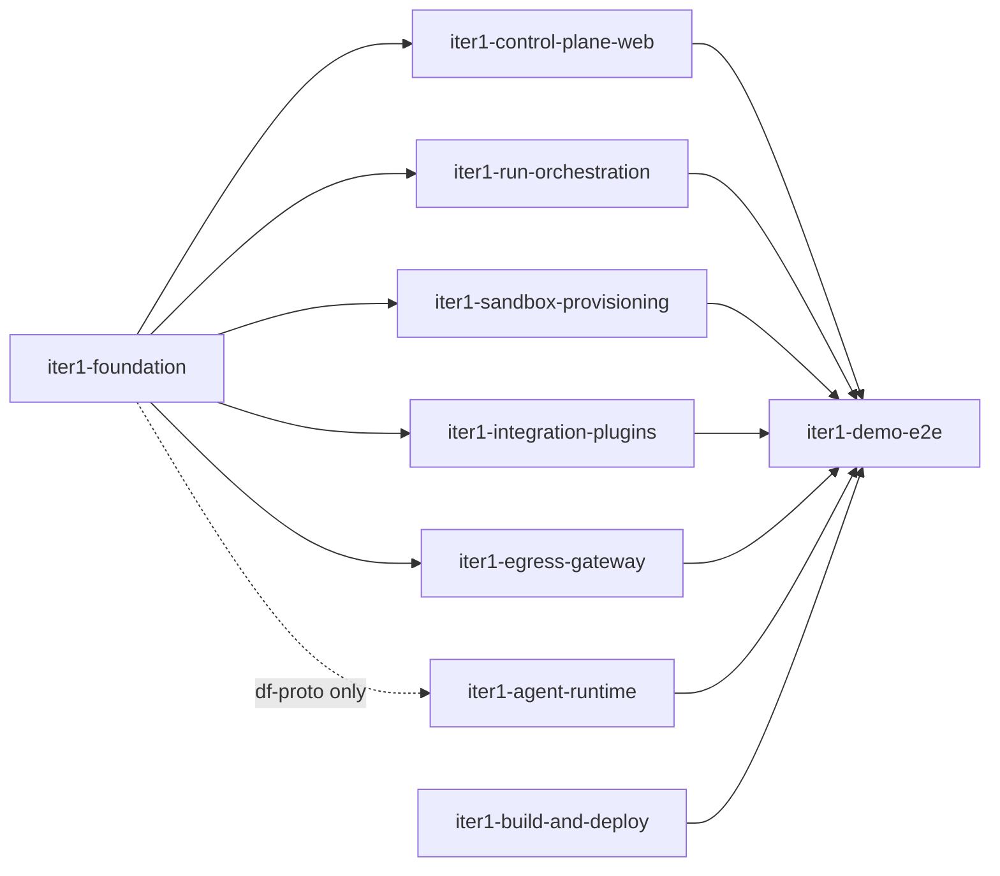

# Design

## Context

Nothing is implemented yet. Architecture, ADRs and contracts are settled (`product/context.md`, `design/`, `contract/`). Iteration 1 is split into nine OpenSpec changes so several agents can work in parallel; this change provides what they share. This document is also the **workstream map**: every other `iter1-*` change refers back to it for crate ownership, schema, ports and interfaces.

## Goals / Non-Goals

**Goals:**
- Every workstream can start coding against stable crates, tables and traits on day one, with fakes instead of the real implementations.
- Merge conflicts between workstreams are limited to `[workspace.dependencies]` and the `serve` wiring in `crates/dark-factory/src/main.rs`.

**Non-Goals:**
- Any behaviour beyond task management, migrations and audit writing. HTTP server, agent port, Kubernetes, plugins and gateway belong to their workstreams.
- Bazel and Helm (`iter1-build-and-deploy`).

## Workstream map



| Change | Owns | Consumes |
|---|---|---|
| `iter1-foundation` | `df-proto`, `df-core`, `df-db`, `dark-factory` (bin skeleton) | — |
| `iter1-build-and-deploy` | `MODULE.bazel`, `BUILD.bazel` files, `deploy/helm/dark-factory`, dev values | crate list |
| `iter1-control-plane-web` | `df-web` (OIDC, sessions, CSRF, layout, config forms, task pages, SSE) | `df-db`, notifier |
| `iter1-run-orchestration` | `df-agent-channel` (agent port, protocol v1 server, run scheduler, factory tools, PR lifecycle, transcript persistence) | `SandboxProvider`, `ForgeClient`, `SecretStore` |
| `iter1-sandbox-provisioning` | `df-k8s` (`SandboxProvider`, `SecretStore` impls, network policies, startup checks) | `df-db` allowlist tables |
| `iter1-agent-runtime` | `factory-agent`, `fake-acp-agent` | `df-proto` |
| `iter1-integration-plugins` | `df-plugins` (Wasmtime host, `ForgeClient` impl), `plugins/forgejo` | `SecretStore` |
| `iter1-egress-gateway` | `contract/proto/darkfactory/gateway/v1`, `df-gateway` (proxy, `PolicyWatch`, `Tail`, relay), egress pages in `df-web` | `df-db` runs + allowlist |
| `iter1-demo-e2e` | `e2e/` test crate, demo checklist | everything |

## Decisions

### D1 — Crate layout
`members = ["crates/*", "plugins/*"]`, so new crates need no edit to the root manifest. Binaries: `dark-factory` (`serve`, `migrate`, `gateway`), `factory-agent` (runtime), `fake-acp-agent`. Library crates are prefixed `df-`. Edition 2024, stable toolchain pinned in `rust-toolchain.toml` with targets `x86_64-unknown-linux-musl` and `wasm32-wasip2`.
*Alternative:* one big control-plane crate — rejected, parallel agents would collide in it.

### D2 — Contract bindings (`df-proto`)
`build.rs` with `tonic-build` (prost) over `contract/proto`, plus `pbjson-build` for serde in the canonical protobuf JSON mapping. Generated code is not checked in; protoc comes from `PROTOC` (Bazel provides it). Modules: `df_proto::agent::v1`, `df_proto::transcript::v1`; `iter1-egress-gateway` adds `gateway::v1`.
*Alternative:* hand-written serde for JSONB — rejected, the transcript contract says canonical JSON.

### D3 — Trait seams in `df-core`
Async traits (native `async fn` in traits, `Arc<dyn …>` via `async-trait` where object safety needs it). Fakes live in `df_core::testing` behind feature `test-util`.

```rust
pub trait SandboxProvider: Send + Sync {
    async fn ensure_task_volume(&self, task: &TaskVolumeSpec) -> Result<(), ProviderError>;
    async fn provision(&self, spec: &RunSandboxSpec) -> Result<(), ProviderError>;
    async fn teardown(&self, run_id: RunId) -> Result<(), ProviderError>;
    /// Peer = URI SAN from the client cert + peer IP. None = reject.
    async fn resolve_identity(&self, peer: &PeerIdentity) -> Option<RunId>;
    /// Started { run_id, pod_ip } / Gone { run_id, reason }.
    fn events(&self) -> BoxStream<'static, SandboxEvent>;
}

pub trait ForgeClient: Send + Sync {   // mirrors darkfactory:integrations@0.1.0
    async fn create_pull_request(&self, p: &ProjectId, req: NewPullRequest) -> Result<PullRequest, IntegrationError>;
    async fn find_open_pull_request(&self, p: &ProjectId, head: &str, base: &str) -> Result<Option<PullRequest>, IntegrationError>;
    async fn update_pull_request(&self, p: &ProjectId, number: u64, ch: PullRequestUpdate) -> Result<PullRequest, IntegrationError>;
    async fn get_issue(&self, p: &ProjectId, number: u64) -> Result<Issue, IntegrationError>;
    async fn add_issue_comment(&self, p: &ProjectId, number: u64, body: &str) -> Result<Comment, IntegrationError>;
}

pub trait SecretStore: Send + Sync {
    async fn get(&self, r: &CredentialRef) -> Result<SecretString, SecretError>;
}
```
`IntegrationError` mirrors the WIT `error` variant one to one. `RunSandboxSpec` carries run id, task key, project/persona ids, image, volume name and labels; the provider reads cluster targets from the database itself.
*Alternative:* let workstreams define their own interfaces — rejected, orchestration would block on three other teams.

### D4 — Schema ownership and migrations
Foundation creates all tables used by more than one workstream; component-private tables (e.g. the session store) are added by their owner. Migration files use sqlx timestamp names (`YYYYMMDDHHMMSS_<name>.sql`) so parallel additions don't collide. Schema `dark_factory`; all ids UUIDv7 unless noted.

| Table | Key columns |
|---|---|
| `users` | issuer+subject unique, display_name, first_seen, last_seen |
| `credential_refs` | name unique, secret_name, secret_key |
| `projects` | key unique (check regex), name, repo_url, issue_tracker_url null, image, base_branch, forge_credential_id, next_task_number |
| `personas` | name unique, system_prompt, harness (`claude-code`), adapter_command text[], model null, harness_credential_id |
| `tasks` | project_id+number unique, key, title, description, persona_id, issue_number null, status (check), status_line, pr_number/pr_url null, pr_title/pr_body null (stored `update_pull_request` values), diverged, harness_session_id, created_by |
| `task_messages` | id = prompt_id, task_id, author jsonb (Principal), content jsonb, queued_at, delivered_run_id null, delivered_at null |
| `runs` | task_id+number unique, state, outcome null, detail, retry_after null, pod_ip null, last_persisted_seq, task_branch_sha, wip_sha, harness_session_id, started_at, ended_at; partial unique index: one non-terminal run per task |
| `transcript_events` | id bigserial (global order, SSE event id), task_id, run_id+seq unique, schema_version, occurred_at, kind, payload jsonb `COMPRESSION lz4` |
| `tool_calls` | call_id pk, run_id, tool_name, arguments jsonb, result jsonb null, created_at, completed_at |
| `egress_allowlist` | scope (`instance`/`project`), project_id null, kind (`http-host`/`cluster-service`), host, port, namespace, service, ports int[], allow_dns |
| `blobs` | sha256 pk, mime_type, size, data bytea |
| `audit_log` | id bigserial, occurred_at, actor jsonb, roles text[], action, resource_type, resource_id, details jsonb |

Run states (`runs.state`): `pending, provisioning, connecting, preparing, running, finalizing, succeeded, failed, cancelled` (`blocked`/`awaiting_input` reserved). Outcomes mirror `RunOutcome` plus control-plane-side `provisioning_failed`, `connect_timeout`, `sandbox_lost`.

### D5 — Notifications
`df_db::notify` publishes after commit with `pg_notify(channel, json)`; one listener connection per process fans out to `tokio::sync::broadcast` subscribers. Channels: `task_changed {task_id}`, `run_changed {run_id, task_id}`, `transcript_event {task_id, id}`, `task_message_queued {task_id}`, `egress_policy {}`. Payloads carry ids only; receivers read the database.

### D6 — Instance configuration
One YAML file (`--config`, default `/etc/dark-factory/config.yaml`, rendered by Helm) deserialized into `df_core::config::InstanceConfig`; each workstream adds its own section struct. Secrets are file paths, never inline values. Database URL with the password from a file.

### D7 — Ports (fixed for chart, policies and tests)
| Component | Port | Purpose |
|---|---|---|
| Control plane | 8080 | UI + health (`/healthz`, `/readyz`) |
| Control plane | 9443 | Agent port (gRPC, mTLS, sandbox certs) |
| Control plane | 9444 | Internal gRPC for gateways (`PolicyWatch`, mTLS) |
| Gateway | 3128 | Egress proxy |
| Gateway | 9444 | Internal gRPC (`Tail`, mTLS) |
| Gateway | 8080 | Health |

### D8 — Testing approach
TDD per `CLAUDE.md`: tests first, >70 % line coverage per crate (`cargo llvm-cov`). Database tests use `#[sqlx::test]` against a Postgres from `DATABASE_URL` (local container or the dev instance's test database). sqlx offline data (`.sqlx/`) is checked in.

## Risks / Trade-offs

- [Schema guessed before the consumers exist] → owners add columns with new timestamped migrations; expand/contract rule applies from day one.
- [Shared `[workspace.dependencies]` conflicts] → trivial to resolve; foundation pins the common crates up front.
- [`pbjson` output must match the canonical JSON mapping exactly] → round-trip test against `protoc --encode`-produced fixtures.

## Open Questions

- Whether `audit_log` should get a separate INSERT-only role instead of a revoke on the application role — deferrable, behaviour is identical for iteration 1.
