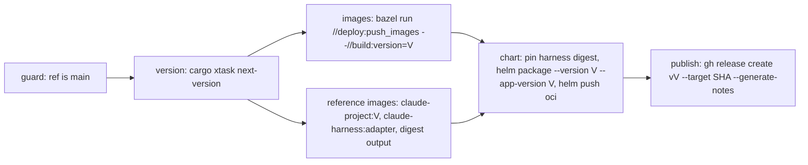

# Design: release versioning

## Context

See proposal.md for motivation; requirements are in `specs/`.

Current state:

- `.github/workflows/release.yaml` runs on `push: tags: v*` (and `workflow_dispatch`, which pushes `dev` tags). It pushes the Bazel images with `--//deploy:image_tag=<ref name>`, so images are tagged `v1.2.3` with the `v`. `claude-harness` and `claude-project` also get `latest`.
- `deploy/BUILD.bazel` has `string_flag(name = "image_tag", build_setting_default = "dev")`, used by five `image_push` targets (control plane, two plugins, runtime, test project) through `multi_deploy(name = "push_images")`.
- The chart is never packaged or pushed. `Chart.yaml` and `values.yaml` hardcode `0.1.0`; `_helpers.tpl` already falls back to `.Chart.AppVersion` when a tag is empty.
- `env!("CARGO_PKG_VERSION")` is read in `crates/df-telemetry/src/otel.rs` (twice) and `crates/factory-agent/src/connection.rs` (`runtime_version`, informational only). `df-telemetry` is a dependency of both binaries; `df-web` does not depend on it.
- `crates/df-web/src/components/shell.rs` renders the rail with a bare log-out button and, below 768 px, `profile_menu(display_name)` (avatar, name, role, log out).
- The repository has no tags yet.

## Goals / Non-Goals

**Goals:**

- One place computes the next version, with unit tests.
- One Bazel flag carries the version into binaries and image tags.
- The workflow is safe to re-run: nothing user-visible (tag, release) exists until every artifact is pushed.

**Non-Goals:**

- Reproducible-build guarantees or provenance attestations: backlog (with signing).
- Publishing crates to crates.io: rejected, the crates are not a public API.
- Releasing from branches other than `main` (hotfix branches): rejected pre-MVP; a fix is the next `N`.

## Decisions

### D1: Version computation in `cargo xtask next-version`

`cargo xtask next-version` collects the used versions from `git tag --list 'v*'` and from the tag names of all GitHub Releases including drafts (`gh release list --json tagName`), takes today's UTC date, and prints `YYYY.M.N` where `N` is one more than the highest `N` among used versions of the current month (numeric comparison, not lexical), or `0` if none. The pure function `next_version(used, year, month)` is unit-tested with the scenarios of `release-process`; names that don't parse are ignored.

GitHub keeps a release when its tag is deleted (it becomes a draft), so a published version stays used until someone deletes both tag and release. Deleting both on purpose is accepted as an intentional reset. A separate publication record (for example a file on a branch) was considered and rejected: it is a second source of truth for what the releases already record.

- Alternative: a shell snippet in the workflow (`git tag | sort -V | tail -1`). Rejected: not testable without a shell test harness, and `sort -V` edge cases (`v2026.11.10`) are exactly what the tests should pin down.
- Using the maximum, not a count, keeps the sequence correct when a lower tag is deleted.

### D2: One Bazel flag `//build:version`

A `string_flag` `//build:version` (default `dev`) replaces `//deploy:image_tag`. The `image_push` targets read it as `TAG`. A small rule writes `DF_VERSION=<flag value>` into an env file that `df-telemetry`'s `rust_library` consumes via `rustc_env_files`.

- Alternative: Bazel stamping (`--stamp` with a `--workspace_status_command`). Rejected: stamping touches every stamped action and the remote cache, needs a status script, and is a second mechanism next to the existing flag pattern.
- Only `df-telemetry` recompiles when the version changes; dependents relink.
- Plain `cargo` builds don't see the flag and report `dev`. `DF_VERSION=… cargo build` also works (rustc tracks `option_env!`), which is documented but not used by CI.

### D3: `df_telemetry::VERSION`

```rust
pub const VERSION: &str = match option_env!("DF_VERSION") {
    Some(v) if !v.is_empty() => v,
    _ => "dev",
};
```

It lives in `df-telemetry`, which already owns `service.version` and is a dependency of both binaries. `factory-agent` uses it for `runtime_version`. `df-web` does not get a new dependency: the `dark-factory` binary passes `df_telemetry::VERSION` into the web UI's state, so df-web tests can render any version string.

- Alternative: a new `df-version` crate. Rejected: a crate needs `BUILD.bazel`, `MODULE.bazel` and lint wiring for one constant.
- The Bazel default `dev` makes the env file always present, so Bazel and cargo builds agree on `dev` for unstamped builds.

### D4: Release workflow shape



- Trigger: `workflow_dispatch` only, no inputs. `concurrency: { group: release, cancel-in-progress: false }` serializes runs, so two runs cannot compute the same version.
- The `version` job checks out with full tag history and fails unless `github.ref == 'refs/heads/main'`. It outputs `version` and the commit SHA; every later job checks out that SHA.
- `publish` is the only job with `contents: write`. `gh release create` creates the tag on the given SHA and the release with GitHub's generated notes in one call.
- The `reference-images` job outputs the digest of the pushed `claude-harness` image. GHCR tags are mutable, and the adapter-version tag is pushed again by later releases, so the `chart` job writes that digest into `image.harness.claudeCode.digest` of the packaged `values.yaml` (`yq` from multitool) before `helm package`. The digest wins over the tag (`helm-deployment`, Harness image values). The repository's `values.yaml` keeps an empty digest.
- The chart uses the pinned `helm` from `multitool.lock.json` (`bazel run @multitool//tools/helm`), logged in to GHCR with `GITHUB_TOKEN`.
- `harness-images.yaml` keeps building on PRs; its release-time tagging of `claude-project` moves to the release workflow with the computed version.
- Manual `dev` image pushes from branches go away. Dev instances use `bazel run //deploy:dev`, which pushes digests.

### D5: Chart placeholder and defaults

`Chart.yaml` `version` and `appVersion` become `0.0.0`; only the release overrides them through `helm package`. `values.yaml` sets `tag: ''` for control plane, runtime and test project; `image.harness.claudeCode.tag` stays pinned to the adapter version. Helm unit tests assert the `appVersion` fallback with a fixed `chart.appVersion` in the test suite instead of relying on the placeholder.

### D6: Profile menu on the rail

`profile_menu` becomes one component for both form factors, taking the display name and the version. The rail's bottom renders its avatar trigger in place of the log-out button; the menu opens above the avatar, left-aligned with it (8 px gap), over the rail and the content. The phone placement stays as is. The footer line `Dark Factory <version>` uses `text-faint` (≥ 5.3:1 on `panel` in both themes). The Penpot rail board is updated first (`docs/design-workflow.md`); the code follows the board.

## Risks / Trade-offs

- [A new GHCR package (the chart) is private by default, so unauthenticated installs of the first release fail until the one-time step is done] → `docs/releasing.md` lists making the packages public right after the first release; the first release is not announced before that.
- [Generated release notes only list merged PRs; direct pushes to `main` are missing] → acceptable; changes land through PRs.
- [Stale `latest` tags of `claude-harness` and `claude-project` stay in GHCR and look current] → delete them once by hand; listed in `docs/releasing.md`.
- [`cargo xtask` in the release job needs the Rust toolchain on the runner] → the runner has `rustup`; `rust-toolchain.toml` pins the version. The xtask build adds about a minute.
- [The runtime reports `dev` from dev deploys, so mixed dev instances look identical] → acceptable; dev deploys pin images by digest.

## Migration Plan

1. Merge the change; no tag exists, so the first release becomes `<year>.<month>.0`.
2. Run the release workflow from `main`.
3. One-time steps from `docs/releasing.md`: make the `charts/dark-factory` package (and any new image package) public, delete stale `latest` tags. Between steps 2 and 3, the first release installs only with GHCR credentials.

Rollback: revert the workflow change. Published versions stay valid because they are self-contained.
