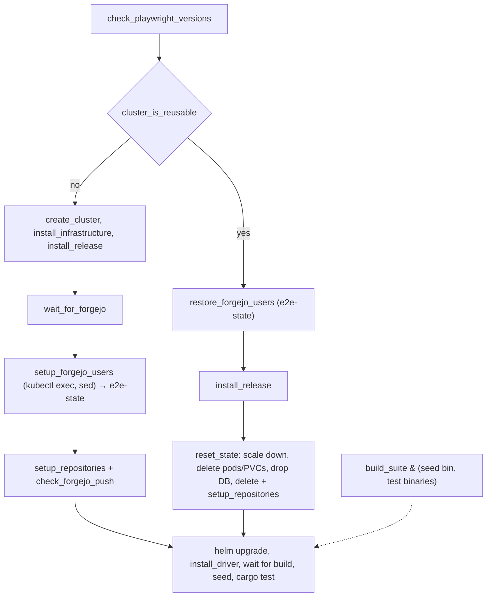

# Design

## Context

See proposal.md (Why). Current flow of `deploy/e2e/e2e-local.sh`:

Constraints that shape the approach:

- `df-e2e` is cargo-only. Any binary of the package compiles the whole library (`playwright-rs`, `df-db`, `df-proto`), so `setup` costs as much to build as `seed`.
- The Forgejo chart creates an admin from `gitea.admin` on install. Forgejo creates tokens only for the authenticated user (basic auth as that user), and an admin creates users through `POST /api/v1/admin/users`.
- The sandboxes' credential reference is the Secret `forgejo-token` in the release namespace; the control plane reads it each time it needs the credential, never at startup.

## Goals / Non-Goals

**Goals:**

- One code path for the Forgejo setup on a fresh and on a kept cluster.
- Every name the setup writes (users, repositories, webhook secret, issue, hidden file) comes from `data.rs`.
- The setup logic is covered by `cargo test -p df-e2e --lib` without a cluster.

**Non-Goals:**

- Faster setup. The build order changes (D5); the setup time printed by the script is compared before and after, a regression of more than a minute is fixed or reported, not accepted silently.
- Changes to what the tests see: same users, repositories, issue number, webhook events.
- Non-goals listed in proposal.md (Out of scope), all rejected.

## Decisions

### D1: One `forgejo` subcommand, run on every run

`setup forgejo` does, in order:

1. For `factory` and `reviewer`: create the user if `GET /users/{name}` is 404 (admin basic auth, `must_change_password: false`); delete its token named `e2e` (404 is fine) and create a new one (`scopes: ["all"]`, basic auth as the user).
2. For `demo` and `existing-branch`: delete the repository (404 is fine), create it (`auto_init`, `default_branch: main`), add the reviewer as collaborator (`write`), create the webhook. `demo` also gets the issue (number 1) and `secret/value.txt`.
3. Print `{"forgejo-token": "...", "reviewer-token": "..."}` on stdout.

Deleting and recreating the repositories on a fresh Forgejo costs two 404s, so the fresh and the kept path are the same and `reset_state` no longer touches Forgejo. The repository part uses the bot's basic auth; the token is only output.

Alternatives: two subcommands `forgejo users` and `forgejo repositories [--reset]` as the handoff sketched. Rejected: the script always runs both, back to back, and the flag only re-adds the branch this change removes.

### D2: Tokens are recreated instead of stored

Because D1 replaces the `e2e` token every run, the runner never needs an old token: `e2e-state` keeps only `manifest-hash` (still the reuse marker that `cluster_is_reusable` checks). `state_value` keeps one caller; `restore_forgejo_users` goes. An `e2e-state` written by the old script still has the token keys, which nothing reads, so old kept clusters are reused, not recreated.

Alternative: keep the stored tokens and add a `state` subcommand. Rejected (proposal, Out of scope).

### D3: Credentials have one home each

| Credential | Home | Reaches |
|---|---|---|
| Forgejo admin user and password | `e2e-local.sh` variables | Helm (`--set gitea.admin.username=…,gitea.admin.password=…`), the binary (`E2E_FORGEJO_ADMIN_USER`, `E2E_FORGEJO_ADMIN_PASSWORD`) |
| Bot and reviewer passwords | `data.rs` (`FORGE_OWNER_PASSWORD`, `FORGE_REVIEWER_PASSWORD`) | the binary only; the script no longer needs them |
| Webhook secret | `data.rs` `WEBHOOK_SECRET` | the binary; the script keeps its copy for the Secret `forge-webhooks` (Helm reads it there) |

The binary takes the admin credentials and `E2E_FORGEJO_URL` (the suite's existing variable) through clap `env`, required, no defaults. The webhook URL (`http://$release-control-plane.$namespace.svc:8080/webhooks/forgejo`) is an argument `--webhook-url`: release and namespace belong to the script.

The webhook secret stays in two places (script and `data.rs`). Reading it from the binary (`setup print webhook-secret`) for one value is more code than the duplicate; the e2e webhook test fails at once if they drift.

Alternative: read the admin from `forgejo-values.yaml`. Rejected: needs a YAML crate in `df-e2e` for two strings.

### D4: Forgejo client gets basic auth and the setup calls

`Forgejo` holds an `Auth` (`Token` or `Basic { user, password }`) instead of a token string; `Forgejo::new` keeps its signature (token), `Forgejo::with_password` builds the basic-auth client. The request helpers take an API path relative to `/api/v1/` for the setup calls; the existing repository-scoped helpers keep their `repos/{owner}/{repo}/` prefix. New calls: `user_exists`, `create_user`, `delete_token`, `create_token`, `create_repository`, `delete_repository`, `add_collaborator`, `create_webhook`, `delete_branch`. Deletes treat 404 as success; every other non-2xx fails with method, path and status (never the body, which may echo a token).

The setup steps live in `crates/df-e2e/src/setup/forgejo.rs` (sequence of D1) and `setup/versions.rs` (D6); `src/bin/setup.rs` is clap parsing and output only.

Tests run the client against `wiremock` (workspace dependency, new dev-dependency of `df-e2e`): request method, path, auth header and JSON body per call; user exists vs. missing; token missing vs. present; repository delete 404 vs. 204; a 500 that fails with the path in the error.

### D5: Build order

Today `build_suite &` builds `seed`, then the test binaries, while the cluster comes up; only `run_suite` waits for it. The Forgejo step now needs `setup` earlier:

1. At start: `cargo build -q -p df-e2e --bins &` (`bins_pid`).
2. Before the Forgejo step: `wait "$bins_pid"`, run `setup playwright-versions`, then start the test build in the background (`cargo test --no-run`, `--list`) and run `setup forgejo`.
3. `run_suite` waits for the test build as before.

The test build after the binaries is incremental (the library is built), and overlaps the Helm upgrade, the image wait and the driver install. Running both builds at once would only serialize on cargo's lock in an unknown order.

### D6: Playwright version check in the binary

`setup playwright-versions` reads:

- `playwright-core` from `deploy/images/playwright-server/package.json` (`serde_json`),
- the `tag` of `name = "playwright_base"` in `MODULE.bazel` (`regex`, `v(.+)-noble`),
- `PLAYWRIGHT_VERSION` from `build.rs` and `NODE_VERSION` from `src/build_support/driver_urls.rs` of the locked `playwright-rs`, found through `cargo metadata --format-version 1 --locked` (`Command`, JSON).

Paths are relative to the current directory (the script runs from the repository root). On a match it prints `{"playwright": "...", "node": "..."}`, which `install_driver` reads with `jq`; on a mismatch it fails with the three versions and their files; a missing value fails naming the file. Parsing is plain functions over strings, unit-tested with fixture text.

The check moves from the first step of the script to after the binaries are built (D5): a mismatch is found minutes later, but still before Forgejo setup and tests. It only fires when Renovate's group lags, which is rare.

### D7: What stays in shell

Cluster, images, Helm, `kubectl` and `git`: `cluster_is_reusable`, `manifest_hash`, `reset_state` (scale down, delete pods and PVCs, drop the database), `wait_for_forgejo`, the push check (`git push` with the token, then one `curl` DELETE of the branch), `install_driver` download, traps and log collection. The rule behind this split, for later additions to the runner (recorded in skill `e2e`, task 4.1):

- **Shell** (`e2e-local.sh`): calling a CLI in order (`kind`, `helm`, `kubectl`, container runtime, Bazel, `git`, `cargo`), waiting on one with a loop, traps, log collection, downloads.
- **Rust** (`df-e2e --bin setup`, logic in `src/setup/`): anything that builds or parses structured data (JSON bodies, API responses, versions from source files), talks to an HTTP API, uses a name or value the suite also uses (`data.rs`), or makes a decision a wrong result of which is hard to diagnose later. Such logic gets a unit test.
- A function in the script that needs `sed`/`jq` to extract a value, or string interpolation to build JSON, belongs in the binary.

`forgejo_api`, `create_forgejo_user`, `setup_forgejo_users`, `restore_forgejo_users`, `setup_repositories`, `setup_repository`, `playwright_rs_src`, `playwright_rs_version`, `check_playwright_versions` and the repository loop of `reset_state` are removed.

## Risks / Trade-offs

- [The tokens change every run on a kept cluster] → no component caches the old one: the control plane reads the Secret `forgejo-token` each time it needs the credential (`credential-resolution`, "Resolve references at use time"), so no restart is needed for the new token. `helm upgrade` would not restart it anyway (the pod template only checksums the configmap). Task 5.3 checks the second run on a kept cluster.
- [Cold builds: Forgejo setup waits for the `df-e2e` library] → on a fresh cluster the infrastructure install usually takes longer than the build; the setup time is compared before and after (task 5.3).
- [Forgejo API differences between chart versions (user creation fields, token scopes)] → the chart version is pinned in the script; the wiremock tests pin the request shape, the full run checks Forgejo accepts it.
- [The bot's basic auth for repository calls requires that the user has a known password] → the setup creates the user with the password from `data.rs`; a kept cluster created by the old script used the same password (`e2e-factory-password`), so the constants take those values.

## Migration Plan

No migration: a kept cluster from the old script is reused (D2). Rollback is reverting the change; a cluster kept by the new script lacks the token keys the old script reads, and the old script then fails with "run with E2E_FRESH=1".
