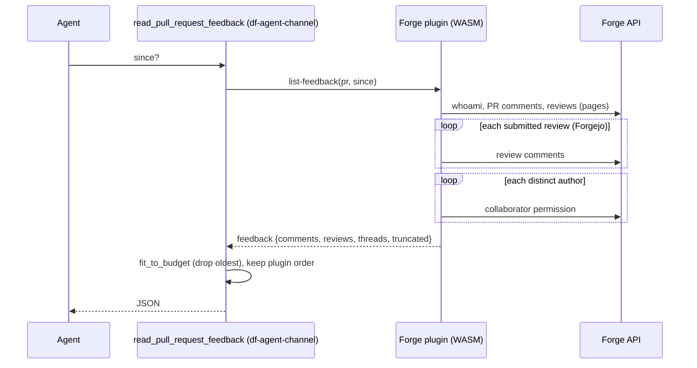

# Design

## Context

See proposal.md for the two bugs. Facts checked against the Forgejo source (`codeberg.org/forgejo/forgejo`, branch `forgejo`):

| Endpoint | Behavior |
|---|---|
| `GET /repos/{o}/{r}/issues/{n}/comments` (`ListIssueComments`) | Reads `since` and `before` only; no `ListOptions`, so `page` and `limit` are ignored and all comments are returned. |
| `GET .../pulls/{n}/reviews` (`ListPullReviews`) | Paginates (`page`, `limit`). |
| `GET .../pulls/{n}/reviews/{id}/comments` | No pagination; all comments of the review. |
| `GET .../collaborators/{login}/permission` | 403 unless site admin, repository admin, or `login` is the caller. Route middleware: token only. |
| `GET .../collaborators/{login}` | Reader access suffices, but answers 204/404 only, and 404 for the owner and members of the owning organisation. |
| `POST .../reviews/{id}/comments` | Creates a comment with `ReviewID`; does not write the review row, so the review's `updated_at` does not move. |

Current flow of a feedback read:

## Goals / Non-Goals

**Goals:**
- One request per Forgejo listing that does not paginate.
- A refused role lookup degrades the role and never fails a feedback read or a webhook.
- Agents read incrementally without keeping their own clock.

**Non-Goals:**
- A Forgejo role lookup without repository admin. Backlog item "Forgejo author role lookup without repository admin" in `product/iterations/roadmap.md`.
- Parallel review comment reads in the plugin: rejected. The host's WASI HTTP is blocking per call, and the cap from D5 bounds the call count.

## Decisions

### D1. PR comments: one request, server-side `since`

`list_feedback` calls `issues/{n}/comments[?since=…]` once with `call`, not `pages`. PR comments no longer contribute to `truncated`. The page-limit test moves to the reviews listing. The test fixture for issue comments returns the full list for any query, so a regression shows up as duplicates.

*Alternative:* the `/issues/{n}/timeline` endpoint paginates, but returns every event type and needs filtering. Rejected: it means more code for no gain at PR comment counts.

### D2. Refused role lookup → `outside` plus a warning (both plugins)

In `Roles::role`, `Err(Error::Unauthorized(_))` from the permission lookup is cached as `outside`, like `NotFound`. The plugin writes one warning per author and call to stderr, and the host forwards stderr to the control plane log. Forgejo text: `cannot read the repository permission of <login>: the bot account needs repository admin; treating <login> as outside`. GitHub uses the same shape without the admin hint (GitHub requires push access). The `Log` trait and `StderrLog` move to `forge-common` (D7) and the Forgejo client takes a `Log`, as the GitHub client already does.

`outside` is the fail-safe value. The agent treats the content as untrusted, and the webhook policy `members` does not wake the task.

*Alternative:* a fourth role `unknown`. It is more precise, but adds a WIT variant, a core enum value, a prompt rule and a webhook rule for one degraded setup. Rejected: the tool description (D4) and the docs explain that `outside` can mean the lookup was refused.

*Alternative:* `GET .../collaborators/{login}` as a fallback. Rejected: owners and members of the owning organisation would come out `outside`, the same result with an extra request.

### D3. Forge errors carry the failing request

Both plugins prefix the forge message of `unauthorized` errors with the method and path (`GET /api/v1/repos/o/r/...: <forge message>`), so `forge_error` can show it. `forge_error` in `df-agent-channel` drops the fixed "rejected the credentials" text:

> the forge refused the request (`<message>`); ask a human to check the bot account's access to the repository and the project's forge credential

Other variants keep their texts. The paths hold no secrets: credentials are headers injected by the host.

*Alternative:* a new `forbidden` variant for 403. Rejected for this change (proposal, out of scope).

### D4. Newest first and `next_since` in the tool

`fit_to_budget` already ranks items by activity. `assemble` sorts each list by activity, newest first (unparsable timestamps last; ties keep the plugin's order), instead of by plugin position.

`next_since` (RFC 3339, UTC) = `max(since, newest − CURSOR_OVERLAP)`, where `newest` is the latest parsable activity among the kept items and `CURSOR_OVERLAP` = 5 minutes. Without a parsable kept item it is the given `since`, or `null`.

- *Why forge timestamps:* both `newest` and the items the next read filters on are forge times, so the control plane clock plays no part.
- *Why the overlap:* the plugin lists PR comments, reviews and review comments in separate requests. An item created between two of them is missing from this result, but its timestamp is later than the start of the plugin call. `newest` is earlier than the end of the call. One call is bounded by `plugins.<name>.callTimeoutSeconds`, so subtracting at least that much keeps every missed item at or after `next_since`. `callTimeoutSeconds` gets a maximum of 300 (config validation and Helm schema) so a constant is enough.
- *Why `max(since, …)`:* the cursor never moves backwards.
- *Cost:* items of the last 5 minutes before the newest one come back on the next read. Every item has an id; the description tells the agent to skip ids it already handled.

Items the size budget dropped are older than `newest − CURSOR_OVERLAP` in all practical cases. A later read with `next_since` does not return them; `truncated: true` tells the agent, and the description says to look at the pull request on the forge if it needs older context. A backward cursor (`before`) is rejected: older feedback is usually superseded, and the budget keeps the newest.

*Alternative:* `next_since` = minimum over the listings of each listing's newest activity. Rejected: a listing without recent activity (for example no PR comment for a week) pins the cursor and every read returns the other listings' week of items again.

A review's activity is the later of `submitted_at` and `updated_at` (D6). A thread's activity is its newest review comment.

New description text (`contract/mcp/factory-tools.v2.json`), core sentences:

> Lists are newest first. The result has next_since: on your next read pass it as since to get only what changed since this read; items from the last few minutes before it can come back, so skip ids you already handled. truncated: true means older items were left out, and later reads with next_since will not return them; open the pull request URL if you need older context. Role outside also covers authors whose role the forge would not tell the bot account.

`render_message` in `df-core/src/webhooks.rs` adds: "Pass the next_since of your last read as since."

### D5. Forgejo: comments of at most 20 newest reviews (TD-96)

Filtering reviews by `updated_at` is unsafe (Context table, last row). `list_feedback` sorts submitted reviews by `submitted_at`, newest first, reads review comments for the first `MAX_REVIEWS_WITH_COMMENTS = 20`, and sets `truncated` if there are more. All reviews themselves are still returned (one paged listing). With 20 requests of a few hundred milliseconds each, a call stays well inside the default 30 s plugin timeout.

*Known limit:* while 20 newer reviews exist, a new reply in a thread of an older review is not returned. `truncated: true` signals it. The factory-tools requirement "Feedback since a point in time" states this exception.

*Listing limit:* the review listing itself stops at `MAX_PAGES` (20 pages of 50, 1,000 reviews) and sets `truncated`. Forgejo lists reviews oldest first, so beyond that limit the newest reviews are the ones missing. The spec states it; no pull request is expected to get near it. Acceptable: review threads that old are usually superseded, and the human can mention the bot.

### D6. Review `updated-at` (TD-95)

Add `updated-at: string` (RFC 3339) to WIT `record review`, `df_core::Review`, `df-plugins` `convert.rs`, and both plugin conversions. Both plugins already deserialize it. On GitHub it is `updatedAt` from the GraphQL query.

### D7. `plugins/forge-common` (TD-80)

A plain `rlib` crate shared by both plugins, with no WIT bindings of its own:

- `draft` (`DEFAULT_PREFIXES`, `parse_prefixes`, `split_title`, `apply_title`), taking the GitHub version (`split_at_checked`, no indexing);
- `timestamp` (`parse`, `touched_since`);
- `log` (`Log` trait, `StderrLog`);
- `http`: the blocking WASI HTTP transport (`send(method, scheme, authority, path, body) -> Result<RawResponse, TransportError>`, body chunking, `Retry-After` parsing) on the `wasip2` crate, which is already in the dependency graph at the WIT version the contract pins (`0.2.12`). Each plugin keeps a thin `Transport` impl that maps `TransportError` to its own WIT `Error`.

If the `wasip2` bindings and a plugin's `generate_all` bindings conflict when the component is linked, the plugin uses `wit_bindgen::generate!`'s `with` option to map the `wasi:*` interfaces to `wasip2`'s types. The transport stays in the shared crate either way.

*Alternative:* share only `draft` and `timestamp`. Rejected: the transport is the larger copy and the one most likely to need fixes.

### D8. Import allow-list test (TD-40)

`wit-parser` (already transitive via `wit-bindgen`/`wasmtime`) becomes a dev-dependency of `df-plugins`. A test resolves `contract/wit/integrations` with its `deps/`, takes world `plugin-base`, collects every imported interface (including those pulled in by `use`, such as `wasi:io/streams`) as `namespace:package/interface`, and asserts each one is in `ALLOWED_IMPORTS`. It does not test the reverse (an allowed name that is not in the world): the host has to accept interfaces that std links in.

For Bazel, the test target needs the WIT directory as `compile_data` or `data`, as the plugin targets already have it (`//contract:wit_integrations`).

## Risks / Trade-offs

- [All humans `outside` on Forgejo without repository admin; the agent treats the reviewer's requests as untrusted] → The docs say plainly that the review loop needs repository admin. The control plane log warns per author and call. The tool description explains the `outside` case.
- [Shared crate couples both plugin release cadences] → Both are built from the workspace at one version already.
- [`next_since` repeats items of the last 5 minutes] → Described in the tool; the agent skips known ids.
- [Items dropped by the size budget are never returned by incremental reads] → `truncated: true` and the description say so; older feedback is usually superseded.
- [WIT record change breaks plugins built against the old contract] → Pre-MVP; both in-tree plugins are rebuilt in the same change.

## Migration Plan

No data migration. Deploy control plane and both plugins together (WIT change). Operators of Forgejo projects who want correct roles make the bot account repository admin. Without that, the feedback loop now works, with every human `outside`.
