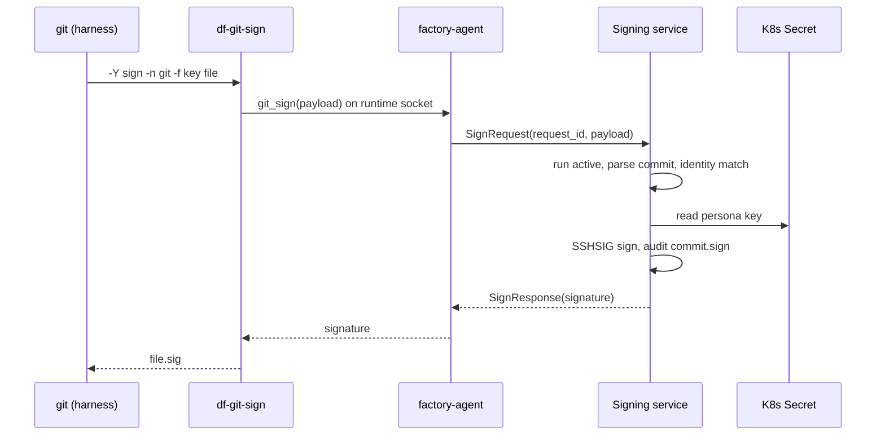

# Design: persona-commit-signing

## Context

- Builds on `persona-identity`: a run's commit identity is frozen on the run row, and `df:identity` checks against it.
- `design/agent-run.md` §12 already rejected signing in the proxy, because a signature changes the commit ID. It chose signing at commit time through `gpg.ssh.program`.
- factory-agent already serves a runtime socket (`runtime_socket.rs`, length-delimited JSON) for `factory-agent mcp`. The harness's Landlock domain may connect to it (`sandbox-filesystem-isolation`, "Factory tools still work").
- `SecretStore::get_or_create` (`df-core/src/seams.rs`, ADR-0056) creates generated instance secrets.
- The gateway parses pushed commits (`df-gateway/src/git/policy_checks.rs`), and gix is in the workspace.
- `gpg.*`, `user.*` and `commit.gpgSign` are already denied in user and project Git config (`git.rs`).

Motivation: see `proposal.md`. Requirements: see `specs/`.

## Goals / Non-Goals

**Goals:**
- The private key never leaves the control plane process and its Secret.
- One signing path for the harness's commits and the runtime's commits.
- Verification in the gateway with only public data.

**Non-Goals:**
- Automatic key and email registration on the forge → roadmap backlog.
- External signers (Vault Transit, KMS) → roadmap backlog. The `Signer` trait (D3) keeps the option open.
- Signing tags or WIP snapshots → rejected.
- Verifying signatures in the sandbox (`git log --show-signature`) → rejected. The shim answers `-Y verify`/`find-principals` with an error.

## Decisions

### D1: The shim is a factory-agent subcommand on the runtime socket

- `gpg.ssh.program` points to `/opt/factory/bin/df-git-sign`, a read-only two-line script that runs `exec /opt/factory/bin/factory-agent git-sign "$@"`. Git invokes the program without a shell, so it must be a single path.
- `git-sign` implements only `-Y sign -n git -f <keyfile> [-U] <datafile>`: it reads the payload file, sends `{"type":"git_sign","payload":…}` over `DF_RUNTIME_SOCK`, and writes `<datafile>.sig` (an armored SSHSIG). The payload path is the last positional argument. It ignores `-f` and `-U` (git adds `-U` for a literal `key::` signing key). Any other `-Y` mode, or a namespace other than `git`, exits non-zero with a message on stderr.
- The runtime relays the request as `SignRequest { request_id, payload }` on the agent stream and waits up to 10 s for the matching `SignResponse { request_id, oneof { signature, refused_reason } }`. A disconnect or timeout makes the shim fail, so the commit fails (spec "Control plane unreachable").
- `user.signingKey` is set to `key::<public key>` from `Assign.workspace.signing_public_key`. Git needs a value. A stale key after a rotation does no harm, because the shim ignores it.
- Alternative: a gateway `/sign` endpoint with pod-IP identity. Rejected: private keys would be copied into every gateway (ADR-0063).
- Alternative: a symlink with argv[0] dispatch. Rejected: clap multicall adds a second dispatch style for one subcommand.

### D2: Sign requests are not idempotent commands

A sign request has no side effect except an audit entry, so it is not replayed after a reconnect. The shim gets an error and git fails; the agent retries the commit. This avoids storing signatures for replay. A refused or timed-out request writes nothing but its audit entry.

### D3: Signing service in `df-agent-channel`, behind a `Signer` trait

`trait Signer { async fn sign(&self, persona: PersonaId, payload: &[u8]) -> Result<SshSig, SignError>; }` is declared where the service consumes it. The single implementation, `SecretSigner`, reads the persona's key through `SecretStore` on every request.

- The service checks, in order:
  1. the run is active;
  2. the payload is at most 1 MiB;
  3. the payload parses as a commit (gix-object);
  4. author and committer equal the run's frozen identity.
- Then it signs SHA-512 SSHSIG with namespace `git` and writes the audit entry `commit.sign` (persona, run, task, fingerprint, tree id).
- `ponytail:` one Kubernetes API read per signature. Add a cache with Secret watch only if signing latency shows up in commit times (agents commit a few times per turn).

### D4: Key storage and rotation

- Secret `df-persona-key-<persona id>` with key `id_ed25519` (OpenSSH private key format) and label `dark-factory.io/persona-key=true`. It is created with `get_or_create` when a persona is saved, and in the run creation path when it is missing (spec "Persona from before the upgrade").
- `personas.signing_public_key` and `signing_fingerprint` (both nullable until the key exists) hold the public half for the UI and the snapshot. The Secret is the source of truth: on every sign, the service checks that the public key derived from the Secret equals the DB value, and refuses with "key out of sync" otherwise.
- Rotate runs in one DB transaction that first locks the persona row (`SELECT … FOR UPDATE`), then generates a new key, replaces the Secret's data (`replace` with resourceVersion), updates the DB columns, writes the audit entry and publishes `egress_policy`. The row lock serializes concurrent rotations of one persona across both stores, so the Secret and the DB end on the same key.
- If the DB transaction fails after the Secret was replaced, the Secret holds the new key and the DB the old one. Recovery is automatic and treats the Secret as the source of truth: when the sign check finds the mismatch, the service locks the persona row, re-reads the Secret, writes its public key and fingerprint to the DB, writes the audit entry `persona.signing_key.reconcile` (old and new fingerprint), publishes `egress_policy`, and only then signs. Saving the persona runs the same reconcile. If the reconcile fails too, the signature is refused with "key out of sync", as before. The rotate UI shows the error.
- Why not write the Secret last: the transaction commit can still fail after the Secret write, so a reconcile is needed either way.
- Helm: the control plane role gets `create`, `update` on Secrets. `get_or_create` already needs `create`.

### D5: Library: `ssh-key`

`ssh-key` (RustCrypto, features `ed25519`, `alloc`) provides OpenSSH key encoding, fingerprints, and `SshSig` sign and verify on top of `ed25519-dalek`, which is already in the graph.
- Hand-rolling the SSHSIG envelope is about 100 lines, but it is security-relevant encoding code. Per the dependency rules, the crate wins.
- It is used by `df-core` (key types), `df-agent-channel` (signing) and `df-gateway` (verification).
- `docs/architecture.md` is updated, and `cargo deny check` must pass.

### D6: `df:signature` in the gateway

For each checked commit, the gateway:
1. extracts `gpgsig` from the raw commit object;
2. rebuilds the signed payload (the commit object without the `gpgsig` header);
3. verifies the SSHSIG against `GitRoute.signing_public_key` with namespace `git`.

- Results map to the details "missing signature", "signed by another key" (valid envelope, other public key) and "invalid signature".
- The check runs after `df:identity`, in the same pass. It shares that check's "always reject" path and the rejection feedback, which gets the re-sign hint.
- `GitRoute.signing_public_key` is read live from the persona, not frozen on the run, so a rotation takes effect with the next snapshot (spec "Signing key rotated"). Rotation publishes `egress_policy`, so the window is the snapshot propagation delay. In it a gateway still checks against the old key: a push signed with the new key is rejected with "signed by another key" and passes on retry once the snapshot arrives. Accepting old-key signatures in that window is acceptable, because both keys are the persona's and never leave the control plane.
- WIP snapshots are recognized by the target ref (`GitRoute.wip_branch` from the snapshot), never by commit content. Commits that are only on the WIP branch do not count as upstream, so a task-branch push checks their signatures.

### Sequence

## Risks / Trade-offs

- [An agent floods sign requests (audit growth, Kubernetes API load)] → Every request needs a parseable commit with the right identity. If this becomes a problem, add a per-run rate limit (for example 60 per minute). Not built now.
- [Disconnects make commits fail] → The error names the reason. The agent retries, and the runtime reconnects automatically.
- [Operators skip the forge registration, so commits show as unverified on the forge] → The persona page links the how-to. Dark Factory's own `df:signature` holds regardless.
- [Losing the key Secrets (namespace deleted without backup)] → Personas get new keys on rotate. Old commits stay signed but can no longer be verified on the forge once the old key is removed there. The backup docs list the Secrets.
- [`git rebase` without `--exec` re-signs only the commits it rewrites] → Covered: commits that are already pushed are not checked again, and the rewritten ones are signed through the shim.

## Migration Plan

1. Migration: add the nullable `personas.signing_public_key` and `signing_fingerprint` columns.
2. Deploy everything together (one release). Keys are created lazily on persona save or run creation.
3. Runs that are active during the upgrade have an old runtime without the shim. Their pushes would fail `df:signature`. The upgrade notes say to let runs finish or to restart them. Pre-MVP, so this is acceptable.
4. Rollback: restore the previous release. Signed commits remain valid Git objects.

## Open Questions

- None.
